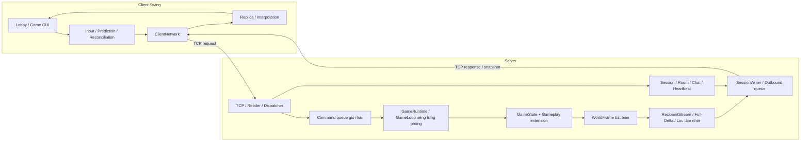

# Bomb It Multiplayer — Classic, Shadow Relay & Paradox

Bomb It Multiplayer là trò chơi đặt bom nhiều người chơi qua TCP, được phát triển bằng Java 25 và Swing. Server quản lý trạng thái chính thức của trận đấu; client gửi thao tác điều khiển, nhận dữ liệu đồng bộ và hiển thị trò chơi.

## Mục lục

1. [Project description — Giới thiệu](#1-project-description--giới-thiệu)
2. [Architecture — Kiến trúc](#2-architecture--kiến-trúc)
3. [Technology stack — Công nghệ](#3-technology-stack--công-nghệ)
4. [Requirements — Yêu cầu môi trường](#4-requirements--yêu-cầu-môi-trường)
5. [Installation — Cài đặt](#5-installation--cài-đặt)
6. [Configuration — Cấu hình](#6-configuration--cấu-hình)
7. [Database setup — Cơ sở dữ liệu](#7-database-setup--cơ-sở-dữ-liệu)
8. [Run server — Chạy máy chủ](#8-run-server--chạy-máy-chủ)
9. [Run client — Chạy game](#9-run-client--chạy-game)
10. [Test — Kiểm thử](#10-test--kiểm-thử)
11. [Experimental results — Kết quả thực nghiệm](#11-experimental-results--kết-quả-thực-nghiệm)
12. [Novelty — Cải tiến và đóng góp](#12-novelty--cải-tiến-và-đóng-góp)
13. [Limitations — Hạn chế](#13-limitations--hạn-chế)
14. [References — Tài liệu tham khảo](#14-references--tài-liệu-tham-khảo)

## 1. Project description — Giới thiệu

Dự án môn **Lập trình mạng** xây dựng trận đấu 2–4 người, có phòng chờ, chat, READY/START, đặt bom, phá vật cản, nhặt item, mất mạng và kết nối lại. Trọng tâm kỹ thuật gồm giao tiếp TCP, giao thức ứng dụng, xử lý đồng thời, đồng bộ thời gian thực và phục hồi trạng thái.

| Chế độ           | Kiểu thi đấu                   | Cách chơi                                                                               |
| ---------------- | ------------------------------ | --------------------------------------------------------------------------------------- |
| Classic          | Cá nhân 2–4 người hoặc đội 2–2 | Đặt bom, nhặt item, loại đối thủ; người hoặc đội sống sót cuối cùng thắng.              |
| Shadow Relay     | Cố định đội 2–2, đủ 4 người    | Chiếm ba trạm, tích điểm, dùng tầm nhìn chung theo đội và bom quét để quan sát đối thủ. |
| Paradox          | Cá nhân 2–4 người hoặc đội 2–2 | Luật chiến đấu nền như Classic, bổ sung quyền đảo toàn bộ gameplay về 40 tick trước.    |

Kiểu thi đấu cá nhân cho phép 2–4 người cạnh tranh độc lập áp dụng cho 2 chế độ Classic/Paradox.. Kiểu thi đấu đội gồm hai đội A và B, được phân theo thứ tự slot A/B/A/B. Đội được giữ cố định trong suốt trận, bao gồm khi rewind và khôi phục kết nối. Bom gây sát thương cho cả đối thủ, đồng đội và người đặt.

Luật mặc định:

- Classic/Paradox: 3 mạng/người, trận 180 giây; hết mạng bị loại. Hết giờ còn nhiều người hoặc cả hai đội còn người sống thì hòa. Hai bên cùng bị loại trong một batch kết thúc có thể hòa.
- Năm loại item: tăng số bom, tầm nổ, tốc độ, mạng sống và khiên. Không có item đầu trận; phá block có xác suất rơi item mặc định 75%.
- Shadow: giữ vùng trạm 40 tick để chiếm khi không bị tranh chấp; trạm đang sở hữu sinh điểm theo chu kỳ 20 tick. Mục tiêu 60 điểm; hết giờ xét điểm, bằng điểm thì hòa. Trận đấu cũng kết thúc khi một đội không còn người chơi sống.
- Shadow chia sẻ tầm nhìn trong đội; thông tin vị trí/chỉ số đối thủ và bom sát thương địch bị lọc theo tầm nhìn ở server. Bom đồng đội vẫn thấy; vụ nổ được công khai. Sương mù không che toàn bộ cấu trúc bản đồ hoặc mọi thông tin công khai của trận.
- Paradox: mỗi người một lượt rewind, cần đủ lịch sử; cooldown chung 3 giây. Rewind khôi phục gameplay, không hoàn lại lượt đã dùng, đội, danh tính hoặc đồng hồ trận. Kết quả đã chốt không bị đảo lại.
- Mất kết nối tạm thời: server giữ phiên tối đa 30 giây sau khi phát hiện ngắt; khóa thao tác nhân vật, trận tiếp tục và nhân vật vẫn chịu damage. Client còn mở sẽ tự thử kết nối lại. Hết grace, người mất mạng bị loại khỏi trận.

## 2. Architecture — Kiến trúc

Kiến trúc **client/server authoritative**: client không tự quyết định vị trí, damage, item hoặc kết quả. Cách tách input, mô phỏng và hiển thị dựa trên nguyên tắc game loop, client prediction và interpolation.



### Thành phần và concurrency

| Thành phần                                               | Trách nhiệm                                                                                                    |
| -------------------------------------------------------- | -------------------------------------------------------------------------------------------------------------- |
| `server/network`, `session`, `room`, `chat`, `heartbeat` | Kết nối, phiên, phòng, chat, heartbeat và recovery.                                                            |
| `server/game/core`, `movement`, `runtime`                | Queue, vòng lặp, world, movement/collision; một game thread ghi trạng thái mỗi runtime.                        |
| `server/game/bomb`, `item`, `event`                      | Fuse, chain explosion, damage theo batch, item và sự kiện gameplay.                                            |
| `server/game/mode`, `checkpoint`                         | Registry/factory cho mode, Shadow, lịch sử checkpoint và Paradox rewind.                                       |
| `server/game/replication`                                | Đọc frame bất biến, lọc góc nhìn, tạo full/delta và giữ baseline riêng cho từng người nhận.                    |
| `common/dto`, `common/protocol`                          | Contract dữ liệu, framing, encode/decode và validation.                                                        |
| `client/app`, `network`, `game/movement`, `ui`           | Kết nối, lifecycle, replica, prediction/reconciliation/interpolation và GUI.                                   |
| `metrics`, `tools`                                       | Đo RTT, lưu lượng ứng dụng và runner benchmark.                                                                |

Reader/handler chuyển thao tác thành command và đưa vào hàng đợi giới hạn 4096 phần tử của runtime. Thao tác enqueue không chặn vô hạn; command bị từ chối khi hàng đợi đầy và được ghi nhận qua bộ đếm. Game loop xử lý command theo thứ tự, cập nhật di chuyển và gameplay, sau đó công bố ảnh trạng thái bất biến. Các thread mạng tiếp nhận ảnh trạng thái qua hàng đợi riêng để gửi tới client. Giao diện Swing được cập nhật trên Event Dispatch Thread (EDT). Mô hình một luồng ghi trạng thái kết hợp hàng đợi thread-safe giúp kiểm soát truy cập đồng thời.

### Giao tiếp và đồng bộ

- Transport: TCP, nhiều message trên cùng kết nối.
- Framing: **[length:int32][type:int16][payload:UTF-8]**, big-endian. Length tính type và payload, không tính chính 4 byte length; tối đa 1.048.576 byte cho phần length chỉ định.
- Luồng chơi hiện tại: **protocol 3, snapshot 6**, metadata cấu hình/roster và envelope theo trận, người nhận, view/timeline.
- Full-state khởi tạo hoặc sửa replica; delta áp dụng theo baseline hợp lệ. Baseline chỉ commit sau khi enqueue thành công, chưa đồng nghĩa client đã nhận. Sai baseline phải resync; dữ liệu thuộc trận/view/timeline cũ bị kiểm tra trước khi áp dụng.
- Recovery/rewind khóa input và reset bộ đệm liên quan; chỉ mở lại sau full hợp lệ. TCP đảm bảo thứ tự byte trong một kết nối, không tự phục hồi trạng thái ứng dụng khi tạo kết nối mới.
- Giao thức của ứng dụng được định nghĩa trong (src/main/java/com/bombit/common/protocol/IntegrationContract.java), (src/main/java/com/bombit/common/protocol/MetadataV3Codec.java), (src/main/java/com/bombit/common/protocol/MatchEnvelopeV3Codec.java) và (src/main/java/com/bombit/common/protocol/SnapshotV6Codec.java). Endpoint chẩn đoán protocol v2 được duy trì riêng cho công cụ benchmark.

### Cấu trúc source

```text
BombItMultiplayer-Structure/
│
├── README.md
├── pom.xml
├── CHOI_GAME.cmd
├── MAY_CHU.cmd
│
├── src/
│   ├── main/
│   │   └── java/
│   │       └── com/
│   │           └── bombit/
│   │               ├── client/     # Giao diện, kết nối và replica client
│   │               ├── common/     # DTO, protocol và routing dùng chung
│   │               ├── server/     # Network, session, room và gameplay
│   │               ├── metrics/    # Đo latency và throughput
│   │               └── tools/      # Công cụ benchmark
│   │
│   └── test/
│       └── java/                   # JUnit, integration và kiểm tra CLI
│
├── scripts/                        # Build, run, test và đóng gói
└── report/                         # Báo cáo và tài liệu thực nghiệm
```

## 3. Technology stack — Công nghệ

| Hạng mục                     | Công nghệ                                                           |
| ---------------------------- | ------------------------------------------------------------------- |
| Ngôn ngữ / bytecode          | Java 25; cấu hình Maven release 25                                  |
| Giao diện                    | Swing/AWT, Java2D/ImageIO                                           |
| Mạng                         | Java TCP Socket/ServerSocket, giao thức ứng dụng tự thiết kế        |
| Dữ liệu truyền               | JSON UTF-8; snapshot được xử lý bởi codec riêng                     |
| Đồng thời                    | Java threads, bounded queues, executor và Swing EDT                 |
| Build                        | javac/jar qua script; Maven cho JUnit                               |
| Kiểm thử                     | JUnit Jupiter 5.11.4, Surefire 3.5.2; các check CLI không cần JUnit |
| Đóng gói                     | PowerShell, JAR, jlink tạo runtime tối giản, ZIP và SHA-256         |
| Database / game engine ngoài | Không sử dụng                                                       |

Ứng dụng sử dụng các thư viện chuẩn của JDK trong quá trình chạy. JUnit được sử dụng cho kiểm thử tự động. Phiên bản dependency và plugin build được khai báo trong (pom.xml).

## 4. Requirements — Yêu cầu môi trường

| Mục đích                  | Yêu cầu                                                                                                                         |
| ------------------------- | ------------------------------------------------------------------------------------------------------------------------------- |
| Chạy ZIP Windows mặc định | Giải nén đầy đủ, Windows tương thích kiến trúc runtime đi kèm; bản đã kiểm tra là Windows 11 amd64. Không cần cài Java/Maven.   |
| Build từ source           | Windows và PowerShell; **JDK 25 trở lên**, có javac và jar. Phiên bản đã kiểm thử: JDK 25.0.1.                                  |
| Chạy JUnit                | JDK 25+ và Maven; phiên bản đã kiểm thử là Maven 3.9.12. Cần kết nối Internet để tải các plugin/dependency chưa có trong cache. |
| Tạo ZIP kèm runtime       | JDK có jlink và jmods; runtime phụ thuộc OS/kiến trúc của JDK dùng đóng gói.                                                    |
| Chạy GUI                  | Môi trường desktop đồ họa, bàn phím và màn hình đủ hiển thị cửa sổ game.                                                        |
| Chơi nhiều máy            | Client truy cập được IPv4/cổng TCP server qua LAN hoặc Radmin VPN; firewall cho phép kết nối.                                   |

Các lệnh trong tài liệu được thực hiện bằng **PowerShell**, tại thư mục chứa pom.xml đối với source hoặc thư mục chứa hai launcher đối với bản ZIP. Phạm vi đánh giá cấu hình phần cứng được trình bày tại mục 11 và mục 13.

## 5. Installation — Cài đặt

### 5.1. Cài đặt bản phát hành

1. Mở (https://github.com/da-pic/BTL_LTM/releases), chọn release có **bomb-it-multiplayer.zip**.
2. Giải nén **toàn bộ** ZIP. Không chạy launcher trực tiếp trong trình xem ZIP; không tách JAR khỏi runtime/scripts.
3. Kiểm tra thư mục có cấu trúc:

   ```text
   bomb-it-multiplayer/
       CHOI_GAME.cmd
       MAY_CHU.cmd
       bomb-it-multiplayer.jar
       BUILD_INFO.txt
       runtime/
       scripts/
   ```

4. Chạy server/client theo mục 8–9. ZIP mặc định kèm runtime; ZIP tạo với tùy chọn NoRuntime yêu cầu máy nhận có Java 25+.

### 5.2. Biên dịch từ mã nguồn

Trước khi chạy các lệnh dưới đây, thực hiện **Bước 1 và Bước 2 tại mục 10** trong cùng cửa sổ PowerShell để tải và cấu hình JDK/Maven. Nếu đã clone dự án, mở terminal tại thư mục chứa `pom.xml` và chỉ chạy lệnh build, không clone lại. Lệnh clone yêu cầu máy đã cài Git.

```powershell
git clone https://github.com/da-pic/BTL_LTM.git
cd BTL_LTM
git branch --show-current
java -version
javac -version
cmd /c scripts\build-demo.cmd
```

Server và client sử dụng cùng phiên bản phát hành hoặc cùng branch/tag mã nguồn. Các biến môi trường ở mục 10 chỉ áp dụng trong cửa sổ PowerShell hiện tại; khi mở terminal mới, chạy lại Bước 2 trước khi build.

Quá trình biên dịch tạo **target/bomb-it-multiplayer.jar**, **target/demo-classes/** và **target/BUILD_INFO.txt**, không yêu cầu Maven. Source được biên dịch lại sau mỗi lần thay đổi. Script classpath ưu tiên demo-classes trong thư mục source và sử dụng JAR ở gốc đối với bản phát hành.

Tạo ZIP mới từ source:

```powershell
cmd /c scripts\package.cmd
```

Đầu ra gồm **target/release/bomb-it-multiplayer.zip** và **bomb-it-multiplayer.zip.sha256** trong cùng thư mục. Script biên dịch ứng dụng và tạo runtime đi kèm. ZIP chứa các thành phần chạy ứng dụng; bộ mã nguồn và kiểm thử được phân phối qua repository.

Kiểm tra SHA-256 với checksum đi kèm:

```powershell
Get-FileHash .\target\release\bomb-it-multiplayer.zip -Algorithm SHA256
Get-Content .\target\release\bomb-it-multiplayer.zip.sha256
```

## 6. Configuration — Cấu hình

### Kết nối và phòng

| Thiết lập            | Giá trị / cách chọn                                                                                    |
| -------------------- | ------------------------------------------------------------------------------------------------------ |
| Cổng server          | Mặc định 8888; đổi bằng đối số launcher.                                                               |
| Host client          | 127.0.0.1 khi cùng máy; IPv4 LAN/Radmin server khi khác máy.                                           |
| Tên người chơi       | Nhập trên màn hình kết nối hoặc đối số thứ ba của client.                                              |
| Mode và kiểu thi đấu | Host chọn khi tạo phòng hoặc khi phòng đang chờ; đổi cấu hình mode/kiểu thi đấu hủy READY.             |
| Số người             | Cá nhân 2–4; mọi trận đội cần đủ 4. Shadow cố định đội 2–2.                                            |
| Giao diện bản đồ     | Host chọn ngẫu nhiên/cổ điển/rừng/biển/băng/lửa. Đây là theme, không thay thế chọn mode hoặc luật đấu. |

### Thông số gameplay server

Mặc định Classic/Paradox được chụp vào cấu hình bất biến khi dựng registry. Client nhận metadata từ server, không tự quyết định luật. Shadow dùng preset riêng cố định; các override Classic dưới đây không phải cấu hình tùy ý cho Shadow.

| Java system property        | Mặc định | Ý nghĩa                         |
| --------------------------- | -------- | ------------------------------- |
| bombit.bomb.fuseMillis      | 3000     | Thời gian bom thường chờ nổ, ms |
| bombit.bomb.range           | 1        | Tầm nổ đầu, ô                   |
| bombit.bomb.quota           | 1        | Số bom đồng thời ban đầu        |
| bombit.match.durationMillis | 180000   | Thời lượng trận, ms             |
| bombit.match.initialLives   | 3        | Mạng ban đầu                    |
| bombit.item.dropChance      | 0.75     | Xác suất rơi item khi phá block |
| bombit.item.maxBombs        | 5        | Trần quota bom                  |
| bombit.item.maxRange        | 8        | Trần tầm nổ                     |
| bombit.item.maxLives        | 99       | Trần mạng sống                  |
| bombit.player.hitboxSize    | 24       | Hitbox vuông, pixel             |
| bombit.player.initialSpeed  | 80       | Tốc độ đầu, pixel/giây          |
| bombit.item.speedIncrement  | 8        | Tăng tốc mỗi item               |
| bombit.item.maxSpeed        | 144      | Trần tốc độ, pixel/giây         |

Bản đồ mặc định có kích thước 17×15 ô, mỗi ô 32 pixel. Chu kỳ tick mục tiêu là 50 ms (20 Hz); chu kỳ thực tế phụ thuộc tải xử lý và bộ lập lịch hệ điều hành. Heartbeat mặc định 2 giây, timeout 10 giây. Server giữ phiên 30 giây sau khi phát hiện ngắt kết nối; client có ngân sách thử phục hồi 29 giây tính từ thời điểm phát hiện lỗi ở client.

Ví dụ cấu hình thời lượng trận 120 giây khi chạy từ source. Java system property được đặt trước tên class:

```powershell
& "$env:JAVA_HOME\bin\java.exe" '-Dbombit.match.durationMillis=120000' -cp target/demo-classes com.bombit.server.app.ServerApplication 8888
```

Với ZIP có runtime, dùng runtime/bin/java.exe và classpath bomb-it-multiplayer.jar. Các giá trị phải thỏa validation, ví dụ chỉ số đầu không vượt trần; cấu hình sai có thể bị từ chối khi khởi tạo.

## 7. Database setup — Cơ sở dữ liệu

Dự án **không dùng database**, không cần MySQL/PostgreSQL, schema, JDBC, tài khoản DB hoặc migration. Session, room, world, kết quả phục vụ lifecycle và checkpoint Paradox nằm trong bộ nhớ tiến trình server.

Dừng/crash server làm mất các trạng thái này. Session Recovery chỉ phục hồi kết nối tới server đang còn giữ phiên, không khôi phục sau khi tiến trình mất trạng thái.
## 8. Run server — Chạy máy chủ

Tại thư mục source đã biên dịch hoặc thư mục bản phát hành đã giải nén, thực hiện:

```powershell
.\MAY_CHU.cmd
```

Đổi cổng khi cần:

```powershell
.\MAY_CHU.cmd 8889
```

Lệnh tương đương:

```powershell
cmd /c scripts\run-server.cmd 8888
```

Server hiển thị cổng lắng nghe và các địa chỉ IPv4 của máy chủ. Terminal server được duy trì trong suốt trận đấu; **Ctrl+C** dừng server. Các client kết nối đến cùng một máy chủ qua địa chỉ LAN/Radmin phù hợp.

Kiểm tra runtime mà không mở listener:

```powershell
.\MAY_CHU.cmd --check-runtime
```

## 9. Run client — Chạy game

### Cùng máy

Mở terminal thứ hai:

```powershell
.\CHOI_GAME.cmd 127.0.0.1 8888 Player1
```

Mở thêm client:

```powershell
.\CHOI_GAME.cmd 127.0.0.1 8888 Player2
.\CHOI_GAME.cmd 127.0.0.1 8888 Player3
.\CHOI_GAME.cmd 127.0.0.1 8888 Player4
```

Launcher không đối số mở màn hình nhập host, cổng và tên người chơi. Launcher sử dụng javaw; script sau chạy client với console để hiển thị thông báo lỗi:

```powershell
cmd /c scripts\run-client.cmd 127.0.0.1 8888 Player1
```

### Khác máy qua LAN/Radmin

1. Máy chủ chạy server, xem IPv4 bằng ipconfig hoặc giao diện Radmin.
2. Các máy dùng cùng LAN hoặc tham gia cùng mạng Radmin; dùng cùng phiên bản game.
3. Mỗi máy kiểm tra kết nối, thay địa chỉ ví dụ bằng IPv4 server thực tế:

   ```powershell
   Test-NetConnection -ComputerName 26.10.20.30 -Port 8888
   .\CHOI_GAME.cmd 26.10.20.30 8888 Player2
   ```

4. Nếu TcpTestSucceeded=False, kiểm tra listener, đúng IP/cổng và firewall TCP inbound trên server. Cho phép ứng dụng/cổng trên profile mạng đang dùng; không cần tắt toàn bộ firewall.

### Tạo trận và điều khiển

1. Mỗi người bấm kết nối trên GUI.
2. Host tạo phòng và chọn mode/kiểu thi đấu; người khác chọn phòng và tham gia.
3. Khách bấm READY; host START khi đủ người và khách sẵn sàng. Host không cần bật READY như khách.
4. Sau kết quả, dùng nút chơi lại/quay về phòng rồi READY/START lượt mới. Host đổi mode/kiểu đấu tại phòng chờ; mỗi lượt tạo định danh trận mới.

| Phím    | Tác dụng                                            |
| ------- | --------------------------------------------------- |
| Mũi tên | Di chuyển                                           |
| Space   | Đặt bom sát thương                                  |
| F       | Đặt bom quét trong Shadow, phụ thuộc quota/cooldown |
| R       | Yêu cầu rewind trong Paradox                        |
| F1      | Xem luật và hướng dẫn mode/kiểu đấu hiện tại        |

Item được nhặt tự động khi nhân vật đi vào vùng hợp lệ. Sau recovery hoặc rewind, người chơi nhả và nhấn lại phím để tiếp tục điều khiển. Kịch bản kiểm tra mất mạng được thực hiện bằng cách giữ ứng dụng client và server hoạt động, ngắt đường truyền của client rồi khôi phục trong thời gian grace. Thao tác chủ động rời phòng được xử lý theo lifecycle riêng.

### Lỗi thường gặp

| Hiện tượng                          | Cách xử lý                                                                       |
| ----------------------------------- | -------------------------------------------------------------------------------- |
| Báo chưa build/không tìm thấy class | Source: chạy build-demo.cmd. ZIP: giải nén đủ thư mục.                           |
| UnsupportedClassVersionError        | Dùng Java 25+ hoặc runtime đúng trong ZIP.                                       |
| mvn.cmd is not recognized           | Cài Maven/thêm Maven bin vào PATH hoặc đặt BOMBIT_MVN như mục 10.                |
| Không mở được cổng                  | Dừng server cũ hoặc đổi cổng ở cả server/client.                                 |
| Không START được                    | Kiểm tra đủ người, READY của khách, quyền host và cấu hình. Đấu đội cần 4 người. |
| Kết nối bị từ chối/timeout          | Kiểm tra IP/cổng, listener, LAN/Radmin và firewall.                              |
| Bản mới vẫn chạy như cũ             | Build lại, đóng tiến trình cũ rồi mở lại server/client; không trộn các bản ZIP.  |
| Phím không điều khiển               | Bấm vào cửa sổ game; chờ full sync/recovery và nhấn lại phím.                    |

## 10. Test — Kiểm thử

### Bộ kiểm thử đầy đủ từ source

Hướng dẫn cài tự động dưới đây dành cho **Windows 10/11 64-bit Intel/AMD (x64), PowerShell 5.1 trở lên**, cần Internet. Các script `.cmd` không chạy trực tiếp trên Linux/macOS. Máy Windows ARM cần JDK phù hợp với kiến trúc máy; không dùng khối tải x64 dưới đây.

Sao chép **toàn bộ từng khối lệnh**, gồm cả `$env:...`, dấu ngoặc và dấu nháy. Không sao chép ký hiệu đầu dòng terminal như `PS D:\...>`. Chỉ nhập một đường dẫn trong dấu nháy sẽ in đường dẫn ra màn hình, không cấu hình môi trường.

#### Bước 1: Tải JDK và Maven (chỉ cần làm một lần)

Mở PowerShell thông thường, dán toàn bộ khối sau rồi nhấn Enter. Lệnh tải Temurin JDK 25 và Maven 3.9.12 vào thư mục `bombit-tools` trong `%LOCALAPPDATA%` của người dùng hiện tại, không yêu cầu tự sửa đường dẫn và không thay đổi cấu hình Java của hệ thống. Nếu máy đã cài Java/Maven ở nơi khác, hướng dẫn này vẫn dùng bản riêng cho dự án.

```powershell
& {
    $ErrorActionPreference = 'Stop'
    [Net.ServicePointManager]::SecurityProtocol = [Net.SecurityProtocolType]::Tls12
    $toolsDir = Join-Path $env:LOCALAPPDATA 'bombit-tools'
    $jdkDir = Join-Path $toolsDir 'jdk-25'
    $mavenDir = Join-Path $toolsDir 'apache-maven-3.9.12'
    New-Item -ItemType Directory -Path $toolsDir -Force | Out-Null

    $jdk = Get-ChildItem -LiteralPath $jdkDir -Directory -ErrorAction SilentlyContinue |
        Where-Object { Test-Path (Join-Path $_.FullName 'bin\javac.exe') } |
        Select-Object -First 1
    if (-not $jdk) {
        Write-Host 'Dang tai JDK 25, vui long cho...'
        $jdkZip = Join-Path $toolsDir 'jdk-25.zip'
        Invoke-WebRequest -UseBasicParsing -Uri 'https://api.adoptium.net/v3/binary/latest/25/ga/windows/x64/jdk/hotspot/normal/eclipse' -OutFile $jdkZip
        Expand-Archive -LiteralPath $jdkZip -DestinationPath $jdkDir -Force
    }

    if (-not (Test-Path (Join-Path $mavenDir 'bin\mvn.cmd'))) {
        Write-Host 'Dang tai Maven 3.9.12, vui long cho...'
        $mavenZip = Join-Path $toolsDir 'apache-maven-3.9.12-bin.zip'
        Invoke-WebRequest -UseBasicParsing -Uri 'https://archive.apache.org/dist/maven/maven-3/3.9.12/binaries/apache-maven-3.9.12-bin.zip' -OutFile $mavenZip
        Expand-Archive -LiteralPath $mavenZip -DestinationPath $toolsDir -Force
    }
    Write-Host 'Da tai va giai nen. Tiep tuc Buoc 2.'
}
```

Nếu có lỗi màu đỏ hoặc tải bị ngắt, kiểm tra kết nối Internet rồi chạy lại cả khối Bước 1. Các công cụ đã giải nén đầy đủ sẽ được bỏ qua. Nguồn tải: [Eclipse Adoptium](https://api.adoptium.net/q/swagger-ui/) và [Apache Maven](https://archive.apache.org/dist/maven/maven-3/3.9.12/binaries/).

#### Bước 2: Cấu hình terminal và kiểm tra phiên bản

Chạy toàn bộ khối dưới đây sau Bước 1. **Mỗi lần mở PowerShell/terminal IDE mới, chạy lại khối Bước 2**; không cần tải lại Bước 1. Khối này tự tìm đường dẫn vừa cài và thay giá trị `BOMBIT_MVN` cũ trong terminal hiện tại.

```powershell
& {
    $ErrorActionPreference = 'Stop'
    $toolsDir = Join-Path $env:LOCALAPPDATA 'bombit-tools'
    $jdkDir = Join-Path $toolsDir 'jdk-25'
    if (-not (Test-Path -LiteralPath $jdkDir -PathType Container)) {
        throw 'Chua tai JDK. Hay chay toan bo khoi lenh Buoc 1, cho hoan tat roi chay lai Buoc 2.'
    }
    $jdk = Get-ChildItem -LiteralPath $jdkDir -Directory |
        Where-Object { Test-Path (Join-Path $_.FullName 'bin\javac.exe') } |
        Select-Object -First 1
    $env:BOMBIT_MVN = Join-Path $toolsDir 'apache-maven-3.9.12\bin\mvn.cmd'
    if (-not $jdk -or -not (Test-Path $env:BOMBIT_MVN)) {
        throw 'Chua co du JDK/Maven. Hay chay lai Buoc 1.'
    }
    $env:JAVA_HOME = $jdk.FullName
    $mavenBin = Split-Path -Parent $env:BOMBIT_MVN
    $env:Path = "$env:JAVA_HOME\bin;$mavenBin;$env:Path"
    java -version
    javac -version
    & $env:BOMBIT_MVN -version
}
```

Java và javac phải hiển thị phiên bản **25 trở lên**. Thông tin Java trong kết quả `mvn -version` cũng phải đáp ứng yêu cầu này. Nếu xuất hiện thông báo “not recognized”, kiểm tra lại việc cài đặt và cấu hình `PATH` của công cụ tương ứng.

#### Bước 3: Chạy toàn bộ kiểm thử

Mở PowerShell tại thư mục dự án chứa `pom.xml`, sau đó chạy:

```powershell
cmd /c scripts\test.cmd
```

Trong VS Code, mở thư mục dự án rồi chọn **Terminal → New Terminal**, chọn PowerShell và chạy Bước 2 trong chính terminal đó trước khi chạy lệnh test. Nếu báo không tìm thấy `scripts\test.cmd`, terminal đang ở sai thư mục; chuyển về thư mục chứa `pom.xml` của bản clone.

Script chạy tuần tự **Maven/JUnit → check-tv2.cmd → NetworkTest**. Các bài kiểm tra hết hạn phiên sử dụng grace thực 30 giây, vì vậy thời gian chạy toàn bộ suite có thể kéo dài vài phút.

Ngay sau khi script kết thúc, kiểm tra mã thoát:

```powershell
$LASTEXITCODE
```

Giá trị `0` nghĩa là toàn bộ các bước thành công. Nếu khác `0`, xem thông báo lỗi phía trên.

#### Chạy khi không có Internet

Lần chạy đầu cần kết nối Internet để Maven tải plugin và thư viện chưa có trong cache. Chỉ sử dụng chế độ offline khi cache đã chứa đầy đủ các thành phần cần thiết:

```powershell
cmd /c scripts\test.cmd -o
```

### Kiểm tra theo phạm vi

Chạy Bước 2 trong terminal hiện tại rồi chạy các lệnh dưới đây tại thư mục chứa `pom.xml`. `check-tv2.cmd` yêu cầu JDK 25 trở lên và không cần Maven; Bước 2 đã thêm Maven vào `PATH` để chạy các lệnh `mvn`.

```powershell
# Queue, FIFO, multithreading, snapshot, prediction/collision và đối chứng delta; không cần Maven.
cmd /c scripts\check-tv2.cmd

# Kiểm thử các chế độ/kiểu thi đấu, Paradox recovery và damage/timeout theo đội.
mvn '-Dtest=AllMatchFormatsIntegrationTest,ParadoxRecoveryIntegrationTest,TeamMatchGameplayTest' test

# Replica Shadow, checkpoint và rewind authoritative.
mvn '-Dtest=ShadowSynchronizationTest,ParadoxGameplayCheckpointTest,ParadoxAuthoritativeTest' test
```

| Phạm vi GUI/tích hợp | Nội dung kiểm tra                                                                                  |
| -------------------- | -------------------------------------------------------------------------------------------------- |
| Classic cá nhân/đội  | Movement/collision, đặt bom, damage cùng tick, thắng/thua/hòa, timeout.                            |
| Paradox cá nhân/đội  | Rewind đủ/thiếu lịch sử, lượt/cooldown, đội không đổi, full timeline mới, input cũ không tác động. |
| Shadow đội           | Chiếm/tranh trạm, điểm, scan, hiện/ẩn đối thủ và bom địch theo tầm nhìn.                           |
| Recovery             | Sai token, hết grace, frozen chịu damage, full rồi delta, kết quả khi offline.                     |
| Lifecycle            | Chơi lại, chuyển mode/kiểu đấu, hủy READY, không giữ replica/kết quả lượt trước.                   |
| Bản đóng gói         | Giải nén ở đường dẫn có khoảng trắng, runtime đi kèm, mở server và nhiều GUI.                      |

### Benchmark mạng chẩn đoán

Mở PowerShell tại thư mục dự án chứa `pom.xml` và chạy Bước 2 ở trên để cấu hình JDK trong terminal hiện tại.

**1. Build game trước khi chạy benchmark:**

```powershell
cmd /c scripts\build-demo.cmd
```

Chờ build hoàn tất thành công rồi mới chạy lệnh tiếp theo. Nếu build báo lỗi, xử lý lỗi trước khi tiếp tục. Cần build lại sau khi thay đổi mã nguồn.

**2. Chạy benchmark:**

```powershell
cmd /c scripts\run-benchmark.cmd --local --mode suite --seconds 5 --warmup 1 --label local-v2-diagnostic --csv target\network-results.csv
```

Kết quả được lưu tại `target/network-results.csv`. Nếu xuất hiện thông báo “Build first with scripts\build-demo.cmd”, quay lại bước build ở trên.

Suite gồm workload transport với 1/2/4 client và idle/movement/bombs với 2/4 client. Tham số --mode xác định workload benchmark. Runner local sử dụng endpoint legacyDiagnostic theo **protocol v2**, tách biệt với lobby public v3/snapshot v6. Kết quả benchmark được đánh giá trong phạm vi endpoint này.

RTT đo PING/PONG; MOVE ACK đo từ gửi input đến xử lý snapshot xác nhận sequence. TX/RX là byte frame ứng dụng, chưa tính TCP/IP header/retransmission.

### Kiểm thử chức năng

Trong VS Code, mở **Terminal → New Terminal**, chọn PowerShell và chạy lệnh `mvn test` biên dịch source và chạy các bài kiểm thử JUnit trong dự án.

```powershell
mvn test
```

### Gameplay Stress Test

Kịch bản tăng dần số client theo các mốc 112, 120, 122 và 124. Mỗi client vào trận, gửi lệnh di chuyển và đặt bom. Mức tải đạt khi RTT P95 không vượt 150 ms, MOVE ACK loss không quá 1%, MOVE ACK P95 không quá 200 ms và tick rate nằm trong khoảng 18–22 Hz.

```powershell
java -Xss512k -cp "target\classes;target\test-classes" com.bombit.tools.NetworkBenchmark --local --mode stresstest --stress-levels 120,122,124,126,128 --move-rate 20 --warmup 5 --seconds 180 --max-rtt-p95-ms 150 --max-cpu-percent 95 --csv target\network-stresstest-full-120-128-180s.csv
```

Mỗi dòng trong `target\network-stresstest-gameplay-expanded.csv` là một mốc tải. `PASS` nghĩa là đạt các ngưỡng trên; khi gặp `FAIL`, mức client cao nhất trước đó có trạng thái `PASS` là mức tối đa đạt trong lượt đo. Server và các client mô phỏng cùng chạy trong một JVM trên loopback.

### Kiểm thử tốc độ lệnh ở nhiều phòng 

Chạy một dòng lệnh trong PowerShell để kiểm tra lần lượt 10, 50 và 100 client. Benchmark phân bố client thành khoảng 3, 13 và 25 phòng; mỗi lượt tăng tốc độ MOVE từ 20 lệnh/giây/người. Mỗi mức client được ghi vào một CSV riêng trong `target`.

```powershell
foreach($n in 10,50,100){$csv="target\network-command-rate-$n.csv";java -Xss512k -cp target\classes com.bombit.tools.NetworkBenchmark --local --mode commandrate --clients $n --command-rates 20,30,40,50,60,80,100 --warmup 2 --seconds 10 --max-rtt-p95-ms 150 --max-ack-p95-ms 200 --max-ack-loss-percent 1 --min-tick-hz 18 --csv $csv}
```

Mỗi lượt dừng ở mức đầu tiên có `ANOMALY`; các mức client tiếp theo trong vòng lặp vẫn tiếp tục chạy. `ANOMALY` là kết quả đo theo ngưỡng, không phải lỗi biên dịch. Benchmark chạy server và client mô phỏng cùng JVM trên loopback.

## 11. Experimental results — Kết quả thực nghiệm

Kết quả được trình bày theo môi trường, phiên bản giao thức và kịch bản thực nghiệm. Phép đo dung lượng snapshot, phép đo mạng và kiểm tra chức năng được đánh giá riêng.

### 11.1. Đối chứng full–delta

#### Cách chạy thực nghiệm

1. Mở PowerShell tại thư mục dự án chứa `pom.xml`. Nếu đang dùng terminal mới, chạy lại **Bước 2 ở mục 10** để cấu hình JDK. Thực nghiệm yêu cầu JDK 25 trở lên, không cần Maven và không cần mở server/client.
2. Chạy lệnh sau. Script tự biên dịch source, chạy các kiểm tra và thực nghiệm full–delta:

   ```powershell
   cmd /c scripts\check-tv2.cmd
   ```

3. Ngay sau khi lệnh kết thúc, kiểm tra mã thoát:

   ```powershell
   $LASTEXITCODE
   ```

   Chỉ sử dụng kết quả khi mã thoát là `0` và có dòng `PASS` của thực nghiệm. Nếu script báo lỗi, xử lý lỗi trước; không dùng file kết quả có thể còn lại từ lần chạy trước.

4. Mở file `target/delta-compression-results.csv` trong VS Code hoặc xem các dòng cuối bằng lệnh:

   ```powershell
   Get-Content target\delta-compression-results.csv -Tail 5
   ```

File chứa số byte từng tick với các cột `tick,full_frame_bytes,delta_frame_bytes`. Dòng cuối tổng hợp kết quả có dạng sau (dấu `...` đại diện cho số liệu thực tế, không phải lệnh để chạy):

```text
PASS: full=... bytes, delta=... bytes, saved=...%, packets=.../200
```

Điền các ô trống dưới đây bằng số liệu của lần chạy thành công:

| Chỉ số                     | Gửi full mỗi tick    | Delta kèm full định kỳ       |
| -------------------------- | -------------------- | ---------------------------- |
| Tick mô phỏng              | 200                  | 200                          |
| Tổng byte frame ứng dụng   | 110076               | 16411                        |
| Số packet snapshot         | 200                  | 83                           |
| Giảm tổng byte so với full | -                    | 85.09%                       |

Nguồn thực thi: (src/test/java/com/bombit/server/game/movement/DeltaCompressionCheck.java). Cùng world 17×15, một player di chuyển 80 tick đầu, có thêm/xóa entity; full tại tick 1/100/200. Đo sau SnapshotPacketCodec và PacketEncoder, gồm framing/JSON/Base64, chưa tính TCP/IP. Replica được đối chiếu với ảnh full trong kịch bản.

### 11.2. Thực nghiệm TCP loopback

#### Cách chạy thực nghiệm

1. Mở PowerShell tại thư mục chứa `pom.xml` và chạy **Bước 2 ở mục 10** để cấu hình JDK trong terminal hiện tại.
2. Build game và chờ hoàn tất thành công trước khi tiếp tục:

   ```powershell
   cmd /c scripts\build-demo.cmd
   ```

3. Chạy suite benchmark. Lệnh tự mở server và các client thử nghiệm trên cùng máy qua `127.0.0.1`, không cần mở GUI hoặc server riêng:

   ```powershell
   cmd /c scripts\run-benchmark.cmd --local --mode suite --seconds 5 --warmup 1 --label local-v2-diagnostic --csv target\network-results.csv
   ```

   Suite chạy nhiều kịch bản liên tiếp; mỗi kịch bản có 1 giây warmup và khoảng 5 giây đo, nên tổng thời gian dài hơn 6 giây. Ngay sau khi lệnh kết thúc, chạy `$LASTEXITCODE`; chỉ dùng kết quả khi mã thoát là `0`.

4. Đọc kết quả trong `target/network-results.csv`. Mỗi dòng là số liệu của **một client trong một kịch bản**. File được ghi nối tiếp qua các lần chạy, vì vậy chỉ chọn các dòng có cùng `run_id` của lần thực nghiệm cần báo cáo. Có thể lấy lần chạy cuối bằng khối lệnh:

   ```powershell
   $rows = @(Import-Csv target\network-results.csv)
   $lastRunId = $rows[-1].run_id
   $currentRun = @($rows | Where-Object { $_.run_id -eq $lastRunId })
   $currentRun | Select-Object scenario, client_index, status, cleanup_ok, error | Format-Table -AutoSize
   ```

   Kiểm tra các dòng của lần chạy có `status=PASS`, `cleanup_ok=true` và không có lỗi trong cột `error`. Nếu lần chạy cuối thất bại hoặc thiếu kịch bản, xử lý lỗi và chạy lại trước khi điền bảng.


| Workload         | Client | Tổng TX ứng dụng (B/s) | Tổng RX ứng dụng (B/s) | RTT p95 lớn nhất/client (ms) | MOVE ACK p95 lớn nhất/client (ms) |
| ---------------- | ------ | ---------------------- | ---------------------- | ---------------------------- | --------------------------------- |
| Transport        | 4      | 377.264                | 377.264                | 2.691                        | N/A                               |
| Idle gameplay    | 4      | 379.996                | 2335.180               | 2.333                        | N/A                               |
| Movement         | 2      | 4232.162               | 15766.134              | 2.530                        | 47.385                            |
| Movement         | 4      | 8449.698               | 47688.324              | 2.532                        | 46.744                            |
| Bombs + movement | 4      | 7209.507               | 43374.344              | 16.069                       | 77.691                            |

Bộ số liệu chỉ phản ánh phiên bản mã nguồn và môi trường loopback của lần chạy được ghi nhận, dùng endpoint chẩn đoán protocol v2 như mô tả ở mục 10. Hiệu năng của pipeline đa mode, mạng LAN/WAN, tải tối đa và độ ổn định dài hạn chưa được đánh giá bằng bộ phép đo tương đương.

Ngưỡng ổn định tối đa: Hệ thống duy trì sự ổn định tuyệt vời lên đến 122 client đồng thời (chia thành 31 phòng chơi) trong thời gian dài (180 giây) với tần số 20Hz hoàn hảo, tỷ lệ mất gói tin ACK bằng 0% và độ trễ đồng bộ nằm trong giới hạn cho phép .Điểm tới hạn: Khi đẩy lên mức 124 client ($\ge 32$ phòng), hệ thống bắt đầu phát sinh lỗi ngoại lệ (Benchmark player died/was removed), xác định rõ giới hạn chịu tải tối đa của kiến trúc hiện tại là 122 client.

### 11.3. Kiểm tra chức năng đa mode

Kiểm tra GUI được thực hiện cục bộ bằng runtime đi kèm bản ZIP đã giải nén. Ma trận bao gồm Classic cá nhân/đội, Paradox cá nhân/đội và Shadow đội; các kịch bản gồm hủy READY khi thay đổi cấu hình, kết quả đội, rewind, scan, recovery, chơi lại và chuyển mode.

Các kịch bản tự động được cài đặt trong (src/test/java/com/bombit/integration/AllMatchFormatsIntegrationTest.java), (src/test/java/com/bombit/server/game/runtime/TeamMatchGameplayTest.java), (src/test/java/com/bombit/integration/ParadoxRecoveryIntegrationTest.java) và (src/test/java/com/bombit/server/game/mode/shadow/ShadowSynchronizationTest.java). 


### 11.4. Kiểm thử Chức năng

| Nguồn test (Test Class) | Kịch bản chính | Điều kiện đạt theo assertion | Kết quả lượt test |
| --- | --- | --- | --- |
| SessionRecoveryClientTest | Phục hồi phiên kết nối phía Client. | Giao diện và dữ liệu local khôi phục đúng trạng thái; không crash app. | 10/10 đạt |
| RecoveryInputTest | Thao tác nhập liệu trong quá trình đứt mạng. | Tín hiệu phím đưa vào bộ đệm và gửi thành công sau khi reconnect. | 2/2 đạt |
| RespawnPredictionTest | Thuật toán dự đoán vị trí hồi sinh (Prediction). | Tọa độ nhân vật hiển thị ở client khớp với kết quả từ server. | 2/2 đạt |
| ClientStabilityTest | Kiểm tra độ ổn định kết nối phía client. | Không văng lỗi (Exception) khi nhận luồng dữ liệu liên tục. | 7/7 đạt |
| ConnectCancellationTest | Hủy tiến trình kết nối mạng chủ động. | Socket đóng an toàn, tài nguyên bộ nhớ được giải phóng sạch. | 1/1 đạt |
| BombPresentationStateTest | Trạng thái hiển thị hoạt ảnh của bom. | Animation chuyển đổi đúng theo vòng đời nổ/hủy của bom. | 1/1 đạt |
| BombSceneTest | Hiển thị màn hình Scene chứa bom. | Chuyển cảnh và render lưới bom thành công không bị treo UI. | 2/2 đạt |
| Java2DRendererTest | Bộ vẽ đồ họa Java2D cơ bản. | Các object đồ họa xuất ra đúng ma trận tọa độ pixel. | 2/2 đạt |
| ItemClientStateTest | Trạng thái hiển thị vật phẩm (Item) ở client. | Item biến mất trên UI ngay khi có tín hiệu nhặt thành công. | 1/1 đạt |
| TileGridRendererTest | Render lưới bản đồ tĩnh (Tile Grid). | Vẽ chuẩn kích thước grid gốc, không vỡ khung hình. | 1/1 đạt |
| ModeSelectionPanelTest | Màn hình giao diện chọn chế độ chơi. | Giao diện nạp đủ danh sách mode và phản hồi đúng sự kiện click. | 2/2 đạt |
| MatchResultsPanelTest | Màn hình tổng kết quả trận đấu. | Hiển thị đúng dữ liệu thứ hạng, số kill và điểm số. | 1/1 đạt |
| TeamGuiPresentationTest | Giao diện HUD của các đội chơi (Team). | Tên, màu sắc và thanh máu của team render chính xác trên HUD. | 3/3 đạt |
| EffectiveRulesTest | Thiết lập các ràng buộc luật chơi hiệu lực. | Thời gian > 0, số mạng >= 1; các ruleset bắt buộc phải hợp lệ. | 13/13 đạt |
| MatchFormatContractTest | Hợp đồng định dạng dữ liệu ván đấu. | DTO payload tuân thủ nghiêm ngặt chuẩn contract khai báo. | 4/4 đạt |
| BombProtocolTest | Giao thức đóng gói/mở gói tin bom. | Object byte serialize/deserialize bảo toàn 100% dữ liệu gốc. | 4/4 đạt |
| GameplayProtocolTest | Giao thức thao tác điều khiển gameplay. | Gói tin phím bấm/di chuyển được mã hóa đúng chuẩn giao thức. | 3/3 đạt |
| IntegrationContractTest | Hợp đồng liên lạc tích hợp client-server. | Các API giao tiếp qua lại thỏa mãn định dạng ràng buộc. | 8/8 đạt |
| LobbyContractTest | Ràng buộc giao thức của Sảnh (Lobby). | Gói tin tạo/thoát sảnh parse đúng thành object quản lý. | 4/4 đạt |
| ParadoxProtocolTest | Giao thức riêng của chế độ nghịch lý Paradox. | Dữ liệu nhảy vọt thời gian (timeline) encode đúng payload. | 5/5 đạt |
| ProtocolV3Test | Core mã hóa giao thức nhị phân V3. | Chuỗi byte sinh ra chuẩn format V3, tương thích ngược an toàn. | 5/5 đạt |
| SnapshotV6Test | Đóng gói map Snapshot chuẩn V6. | Cấu trúc map lớn được serialize đầy đủ mà không mất object. | 4/4 đạt |
| TeamMatchResultProtocolTest | Giao thức gửi kết quả chế độ Team. | Điểm số và thông tin xếp hạng team mã hóa không sai lệch. | 2/2 đạt |
| AllMatchFormatsIntegrationTest | Tích hợp chạy thử tất cả format trận. | Server khởi chạy được mọi format game mà không ném lỗi. | 1/1 đạt |
| BombClientIntegrationTest | Tích hợp giao tiếp bom hai chiều. | Client gửi đặt bom -> Server xác nhận -> Bom nổ đồng bộ tốt. | 3/3 đạt |
| ConfiguredLobbyIntegrationTest | Tích hợp sảnh có nạp file cấu hình. | Sảnh load chính xác file custom ruleset từ bộ nhớ. | 1/1 đạt |
| CurrentLobbyProtocolTest | Luồng giao thức sảnh hiện tại. | Client và server bắt tay (handshake) vào sảnh thành công. | 4/4 đạt |
| LobbyLifecycleTest | Vòng đời hoạt động của Sảnh. | State machine chạy chuẩn: tạo, join, play, hủy và xóa memory. | 15/15 đạt |
| MatchFormatLobbyIntegrationTest | Tích hợp format luật chơi vào Sảnh. | Sảnh áp dụng chính xác luật (ví dụ: giới hạn time) vào game. | 4/4 đạt |
| MatchLifecycleIntegrationTest | Vòng đời thực tế của một trận đấu. | Start, vòng lặp, end game xử lý đúng theo luồng sự kiện. | 5/5 đạt |
| MovementDemoProcessTest | Trình giả lập quá trình di chuyển. | Process mô phỏng di chuyển mượt mà qua các frame. | 1/1 đạt |
| MovementDemoTest | Pass các case di chuyển cơ bản (Demo). | Không bị kẹt tường, đi đúng tốc độ tính toán. | 8/8 đạt |
| ParadoxRecoveryIntegrationTest | Phục hồi mạng giữa chừng khi chơi Paradox. | Tái tạo lại state lịch sử chính xác; không sinh rác bộ nhớ. | 9/9 đạt |
| ParadoxTimelineIntegrationTest | Tích hợp trục thời gian Paradox. | Checkpoint lưu trữ đúng vị trí để rollback không sai lệch. | 1/1 đạt |
| RecoveryGameplayIntegrationTest | Các case phục hồi gameplay phức tạp. | Replay kết quả đúng; reject handshake nếu sai token; xử lý orphan client. | 8/8 đạt |
| ShadowLobbyIntegrationTest | Tích hợp Sảnh có chế độ Shadow. | Sảnh khởi tạo và nhận cờ cấu hình khuất bóng thành công. | 4/4 đạt |
| StabilityLifecycleTest | Stress test vòng đời hệ thống. | Chạy liên tục nhiều luồng không xảy ra hiện tượng memory leak. | 3/3 đạt |
| ChatFaultTest | Chịu lỗi hệ thống kênh Chat. | Spam tin rác hoặc gửi format dị thường không làm sập phòng. | 1/1 đạt |
| BombGameplayTest | Core kịch bản đặt và nổ bom. | Kích nổ bom đúng block/giới hạn; pass 10 nhánh luật fixture. | 10/10 đạt |
| BombSchedulerTest | Bộ đếm ngược thời gian bom nổ. | Lập lịch nổ kích hoạt chuẩn xác từng mili-giây. | 1/1 đạt |
| BombSystemTest | Cơ chế nâng cao: Trùng ô, chain reaction. | Bom nổ dây chuyền đúng mạch; block dừng tia lửa điện chuẩn. | 4/4 đạt |
| ItemSystemTest | Cơ chế sinh vật phẩm (Spawn/Pickup). | Item rơi ra ngẫu nhiên và kích hoạt tác dụng chuẩn xác. | 2/2 đạt |
| ArenaGeneratorTest | Thuật toán sinh bản đồ tự động. | Phân bổ hòm/tường không tạo ra dead-end không thể vượt qua. | 3/3 đạt |
| ClassicModeFactoryTest | Khởi tạo map cho chế độ Cổ điển. | Factory sinh ra đúng số liệu cấu trúc chuẩn của mode Cổ điển. | 3/3 đạt |
| ModeRegistryTest | Đăng ký các bộ luật chơi với hệ thống. | Toàn bộ các class chế độ chơi được Load vào memory hợp lệ. | 9/9 đạt |
| ParadoxAuthoritativeTest | Cấp phép thẩm quyền trong mode Paradox. | Server làm nguồn gốc duy nhất, chống client tự ý dịch thời gian. | 6/6 đạt |
| ParadoxFoundationTest | Nền tảng cấu trúc mode Paradox. | Engine theo dõi trục thời gian (timeline) khởi tạo an toàn. | 6/6 đạt |
| ParadoxGameplayCheckpointTest | Thuật toán sao lưu state Paradox. | Trạng thái lưu/rollback không làm mất entity hay sai vật lý. | 8/8 đạt |
| ShadowFoundationTest | Nền tảng chế độ khuất tầm nhìn (Shadow). | Engine che giấu thông tin (Fog of war) được build thành công. | 4/4 đạt |
| ShadowGameplayTest | Logic gameplay ảnh hưởng bởi bóng tối. | Entity nấp sau tường không thể bị nhận diện bởi đối thủ. | 9/9 đạt |
| ShadowScanTest | Thuật toán quét/Raycast Shadow. | Quét radar phát hiện đúng vật cản để xác định góc tối. | 5/5 đạt |
| ShadowSynchronizationTest | Đồng bộ trạng thái Shadow xuống Client. | Chỉ gửi các entity thuộc vùng sáng khả kiến tới từng client. | 7/7 đạt |
| ShadowUiTest | Xử lý hiển thị UI vùng tối trên màn hình. | Vùng đen che giấu bản đồ render trơn tru không gãy ảnh. | 5/5 đạt |
| ShadowVisibilityTest | Quản lý vòng đời thực thể khi vào vùng tối. | Cắt luồng update dữ liệu của object lập tức khi nó rời khỏi FOV. | 5/5 đạt |
| DeltaCompressionTest | Nén dung lượng dữ liệu bằng Delta. | Size gói tin nén giảm ~85.09% so với nguyên bản; packet đi đủ. | 1/1 đạt |
| MovementFeatureTest | Tổ hợp tính năng lưới di chuyển (Move). | Prediction, nội suy, xử lý va chạm và luồng TCP chạy mượt mà. | 1/1 đạt |
| BombRuntimeIntegrationTest | Chạy thực tế luồng bom trên server tick. | Thread xử lý bom không xung đột với thread game cập nhật map. | 4/4 đạt |
| ConfiguredRuntimeTest | Cấu hình vòng lặp Tick-rate server. | Máy chủ duy trì đúng TPS (Ticks per second) theo setting truyền vào. | 8/8 đạt |
| ExtendedItemsTest | Xử lý các hiệu ứng Item nâng cao. | Khiên (Shield) không cộng dồn sai; item hồi sinh chặn đánh lừa. | 6/6 đạt |
| MatchGameplayTest | Luồng xử lý thi đấu chung. | Tranh chấp nhặt item một người thắng; xác định đúng Winner. | 5/5 đạt |
| MovementBalanceTest | Cơ chế giới hạn lạm dụng di chuyển. | Tốc độ kịch trần (Max speed) ngăn ngừa hack speed bên client. | 4/4 đạt |
| ParadoxRuntimeTest | Vòng lặp runtime riêng cho Paradox. | Event timeline được tiêm (inject) vào đúng tick của server. | 2/2 đạt |
| RuntimeContractTest | Đảm bảo hợp đồng an toàn đa luồng. | Chuẩn FIFO, queue limit; dọn dẹp bộ nhớ (cleanup) thread an toàn. | 1/1 đạt |
| TeamMatchGameplayTest | Trận đấu chế độ chia Đội chơi (Team). | Điểm số cộng/trừ chia đúng phe phái; loại đội thua chính xác. | 10/10 đạt |
| RecoveryWriterTest | Cơ chế ghi file/buffer bản vá phục hồi. | Ghi đệm IO packet phục hồi không bị ném lỗi bộ nhớ tràn. | 1/1 đạt |
| ServerTransportTest | Tầng giao vận (Transport) kết nối. | Gửi/nhận packet Inbound/Outbound đa luồng trơn tru. | 10/10 đạt |
| SessionWriterTest | Dữ liệu stream từ Session gửi đi. | Đảm bảo luồng byte ghi xuống socket theo đúng thứ tự (order). | 3/3 đạt |
| TransportStabilityTest | Ổn định giao vận mức cao. | Chịu tải liên tục không rớt socket hay ngắt mạng nội bộ. | 6/6 đạt |
| MatchFormatRoomTest | Logic format thiết lập vào Phòng. | Phòng chặn các cấu hình lậu sai định dạng format quy định. | 2/2 đạt |
| RoomConfigurationV3Test | Engine nạp cấu hình phòng V3. | Parse file cấu hình phức tạp V3 thành object không mất dữ liệu. | 2/2 đạt |
| RoomManagerTest | Bộ quản lý tập trung các Phòng chờ. | Cấp phát Room ID ngẫu nhiên không trùng lắp (Collision). | 1/1 đạt |
| ShadowRoomTest | Sảnh chuyên dụng biệt lập cho Shadow mode. | Sảnh phân nhánh mạng riêng, cắt luồng nhìn thấy toàn map. | 2/2 đạt |
| SessionFaultTest | Chịu lỗi khi kết nối đứt đột ngột. | Cô lập người chơi rớt mạng; máy chủ game không bị sập lây. | 1/1 đạt |
| SessionManagerTest | Trình quản lý toàn bộ Phiên đăng nhập. | Đăng ký token và thu hồi token đúng logic, không giữ session ma. | 4/4 đạt |
| SessionRecoveryTest | Logic ân hạn (Grace Period) đứt kết nối. | Cấp quyền (admitted=true) nếu đúng hạn; từ chối (false) nếu trễ. | 13/13 đạt |
| NetworkBenchmarkTest | Công cụ Benchmark sức chịu tải. | Cân bằng đủ 4 clients bom đồng thời, băng thông phản hồi cao. | 4/4 đạt |

### 11.4. Kiểm thử tốc độ lệnh ở nhiều phòng (Multi-room Command Rate Stress Test)

| Client | Phòng | Tốc độ thực tế (lệnh/người/giây) | Lệnh gửi | Đã ACK | Chưa ACK khi kết thúc | MOVE ACK P95 (ms) | RTT P95 (ms) | Tick TB (Hz) | Kết quả |
| ---: | ---: | ---: | ---: | ---: | ---: | ---: | ---: | ---: | :--- |
| 10 | 3 | 19.986 | 2,000 | 2,000 | 0 | 32.405 | 6.519 | 19.986 | PASS |
| 10 | 3 | 29.987 | 3,000 | 2,200 | 800 | 3,511.083 | 6.276 | 20.091 | ANOMALY |
| 50 | 13 | 19.993 | 10,000 | 10,000 | 0 | 71.152 | 5.934 | 20.025 | PASS |
| 50 | 13 | 29.996 | 15,000 | 10,992 | 4,008 | 3,500.687 | 6.203 | 20.057 | ANOMALY |
| 100 | 25 | 19.991 | 20,000 | 20,000 | 0 | 70.709 | 6.122 | 20.114 | PASS |
| 100 | 25 | 29.990 | 30,000 | 21,992 | 8,008 | 3,504.116 | 6.149 | 20.090 | ANOMALY |
| 122 | 31 | 19.989 | 24,400 | 24,400 | 0 | 72.905 | 5.908 | 20.143 | PASS |
| 122 | 31 | 29.993 | 36,600 | 26,832 | 9,768 | 3,505.975 | 5.920 | 20.089 | ANOMALY |multiplayer.csv) |

Ở các lượt đo này, 20 lệnh/người/giây đạt ngưỡng với 10, 50, 100 và 122 client. Mức 30 lệnh/người/giây vượt ngưỡng MOVE ACK P95 200 ms; số “chưa ACK” là lệnh chưa được xác nhận sau cửa sổ đo và một giây chờ, không khẳng định chúng mất vĩnh viễn. CPU/RAM không được đo riêng cho server vì server và load generator cùng JVM.

## 12. Novelty — Cải tiến và đóng góp

Dự án mở rộng mô hình game mạng gửi toàn bộ trạng thái công khai thành hệ thống có đồng bộ chênh lệch, phục hồi phiên, góc nhìn theo người nhận và chuyển timeline authoritative. Đóng góp của dự án tập trung vào thiết kế, triển khai và tích hợp các cơ chế này trong cùng một hệ thống nhiều chế độ chơi.

| Cải tiến                  | Cơ chế kỹ thuật                                                                                                                                             | Bằng chứng / phạm vi |
| ------------------------- | ----------------------------------------------------------------------------------------------------------------------------------------------------------- | ------------------- |
| State Delta Compression   | Gửi phần thay đổi so với baseline; commit khi enqueue thành công; client kiểm tra baseline và yêu cầu resync. Pipeline đa mode có baseline theo người nhận. | Đối chứng full–delta tại mục 11.1 và kiểm thử tính đúng đắn của replica/snapshot. |
| Seamless Session Recovery | Giữ phiên 30 giây, khóa input, xác minh phiên/token và đồng bộ full trước khi tiếp tục; hết grace loại người offline.                                       | Kiểm thử khôi phục kết nối, token không hợp lệ, hết hạn phiên và gameplay khi offline. |
| Shadow Relay              | Server lọc dữ liệu theo tầm nhìn của đội/người nhận trước khi gửi; full–delta xử lý đối tượng xuất hiện hoặc rời vùng quan sát.                             | ShadowViewProjector, ShadowRecipientStream, ShadowReplica và kiểm thử visibility/synchronization. |
| Paradox                   | Checkpoint gameplay/RNG, rewind authoritative và tim	eline epoch; loại command cũ, reset baseline/prediction/interpolation/effect và chờ full hợp lệ.  | Kiểm thử capture–restore, quyết định rewind phía server, chuyển timeline và recovery. |
| Nền tảng đa mode/kiểu đấu | Registry/factory, cấu hình/roster bất biến và luật đội chung Classic/Paradox; tách trạng thái giữa các lượt chơi.                                           | Kiểm thử nhiều lượt liên tiếp, chuyển mode/format, hủy READY và kết quả đội. |

Các đóng góp kỹ thuật thể hiện việc quản lý trạng thái authoritative, thiết kế giao thức ứng dụng, xử lý đồng thời, phân phối dữ liệu theo người nhận và khôi phục tính nhất quán giữa server với nhiều client.

## 13. Limitations — Hạn chế

- Các phép đo hiện mới thực hiện trên môi trường loopback với thời gian ngắn, chưa phản ánh đầy đủ độ trễ biến động, sự cố mạng hoặc trải nghiệm thực tế trên giao diện Swing. Hệ thống cũng chưa được đánh giá toàn diện về CPU, RAM, khả năng vận hành dài hạn và hiệu quả khôi phục phiên chơi.

- Nhìn chung, kết quả cho thấy tính khả thi của việc xây dựng trò chơi multiplayer bằng Java và TCP, đồng thời tạo cơ sở để tiếp tục kiểm thử và hoàn thiện hệ thống trong tương lai.

## 14. References — Tài liệu tham khảo

Danh mục tài liệu tham khảo về giao thức TCP, xử lý đồng thời và đồng bộ game mạng.

1. akien-mga. (n.d.). DynaDungeons [Mã nguồn]. GitHub. https://github.com/akien-mga/dynadungeons
2. arnobpl. (n.d.). Bomberman Battle [Mã nguồn]. GitHub. https://github.com/arnobpl/Bomberman-Battle
3. Eddy, W. (Ed.). (2022). Transmission Control Protocol (TCP) (RFC 9293). Internet Engineering Task Force. https://doi.org/10.17487/RFC9293
4. Fiedler, G. (2004, September 4). Networked physics (2004). Gaffer On Games. https://gafferongames.com/post/networked_physics_2004/
5. Fiedler, G. (2014, November 30). Snapshot interpolation. Gaffer On Games. https://gafferongames.com/post/snapshot_interpolation/
6. Fiedler, G. (2015, January 4). Snapshot compression. Gaffer On Games. https://gafferongames.com/post/snapshot_compression/
7. Gambetta, G. (n.d.-a). Client-server game architecture. Fast-Paced Multiplayer. https://www.gabrielgambetta.com/client-server-game-architecture.html
8. Gambetta, G. (n.d.-b). Client-side prediction and server reconciliation. Fast-Paced Multiplayer. https://www.gabrielgambetta.com/client-side-prediction-server-reconciliation.html
9. Gambetta, G. (n.d.-c). Entity interpolation. Fast-Paced Multiplayer. https://www.gabrielgambetta.com/entity-interpolation.html
10. shuoros. (n.d.). Bomberman [Mã nguồn]. GitHub. https://github.com/shuoros/Bomberman
