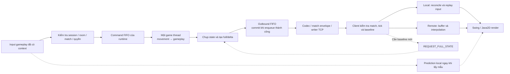
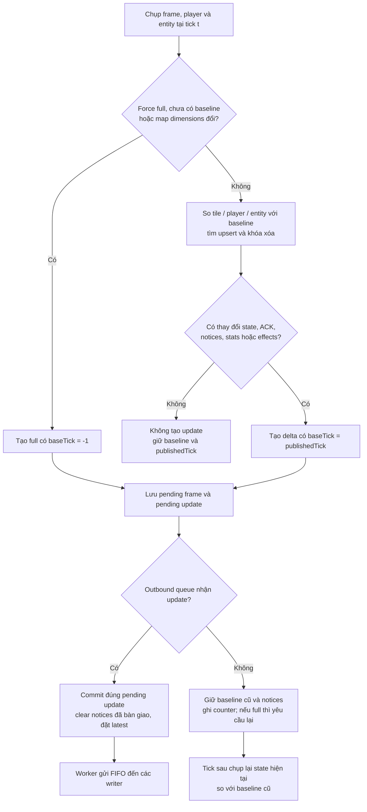

# 7. Giải pháp đề xuất

Nhóm đề xuất giải pháp phối hợp bốn phần: server quyết định gameplay bằng runtime theo phòng;
client cải thiện phản hồi điều khiển bằng prediction/reconciliation và nội suy nhân vật từ xa;
dữ liệu trạng thái được truyền dưới dạng full/delta với cơ chế phục hồi baseline;
Session Recovery giữ phiên trận trong khoảng mất kết nối tạm thời và tái đồng bộ trước khi mở lại input.
Mục tiêu là duy trì một kết quả gameplay thống nhất, hạn chế gửi lại dữ liệu không đổi
và tổ chức xử lý lỗi mà không để I/O socket trực tiếp chi phối bước mô phỏng.

Chương tập trung vào cách giải quyết và các quyết định thiết kế. Thành phần cụ thể và format message
được trình bày ở [mục 8](08_KIEN_TRUC_HE_THONG.md) và [mục 9](09_THIET_KE_GIAO_TIEP_MANG.md).
Các mã giả dưới đây do nhóm diễn giải từ code hiện hành, không phải code mới cần thêm vào project;
chúng lược bớt chi tiết lifecycle/exception khi đã được nêu riêng.

> **Phân công: TV2 chủ trì ý tưởng tổng thể; TV1/TV3/TV4 xác nhận các bước thuộc module mình.**

## 7.1. Ý tưởng server authoritative và luồng input → state → client

### 7.1.1. Phân quyền giữa server và client

Nhóm kế thừa nguyên tắc server authoritative: client gửi ý định, server tính trạng thái hợp lệ rồi công bố kết quả.
Đây là cách tổ chức đã được Gambetta mô tả, không phải thuật toán do nhóm phát minh.
[[2]](https://www.gabrielgambetta.com/client-server-game-architecture.html)

Trong Bomb It, MOVE mang hướng, cờ đi/dừng và sequence; PLANT_BOMB mang requestId.
Server lấy player từ session/context rồi kiểm tra collision, quota, damage, pickup và kết quả.
Client không tự khai vị trí authoritative, sức mạnh bom hoặc người thắng.
Prediction chỉ thay biểu diễn local, không được dùng để áp lại sát thương hoặc vật phẩm vào world server.

**Hình 7.1. Luồng phối hợp của giải pháp. Nhóm tự vẽ từ thiết kế và code project.**



Sơ đồ tập trung luồng gameplay; các thao tác lobby như tạo/join/ready được tầng phòng xử lý trước khi có runtime,
không phải mọi thao tác phòng đều trở thành GameCommand. Đường resync là yêu cầu qua handler để đặt cờ full,
không phải client gọi trực tiếp builder. Bản nguồn: [07_01_giai_phap_tong_the.mmd](../figures/approach/07_01_giai_phap_tong_the.mmd).

### 7.1.2. Các mục tiêu và cơ chế tương ứng

**Bảng 7.1. Vấn đề cần giải quyết và cơ chế được chọn.**

| Vấn đề | Cơ chế | Phạm vi tác động |
|---|---|---|
| Client có thể gửi yêu cầu sai hoặc cũ | Xác thực session/room/match, validation và luật server | Quyền áp dụng thao tác |
| Nhiều nguồn input cùng sửa world | Command FIFO và một game thread/state theo runtime | Thứ tự cập nhật |
| Chờ state server làm điều khiển local chậm phản hồi | Prediction, ACK và replay | Biểu diễn local, vẫn có hiệu chỉnh |
| Dữ liệu remote nhận theo đợt | Buffer và nội suy tuyến tính | Độ liên tục hiển thị, có độ trễ |
| Lặp lại dữ liệu map/entity không đổi | Delta theo baseline và full phục hồi | Dung lượng đồng bộ, phát sinh chi phí so sánh |
| Mất transport tạm thời trong active match | Giữ session/runtime có thời hạn, kiểm tra token/ownership, full mới rồi tiếp tục delta | Quyền quay lại cùng trận; input bị khoá khi đồng bộ, không replay mọi thao tác |
| Client chậm hoặc queue đầy | Giới hạn pending, từ chối/đóng theo lớp lỗi | Kiểm soát backlog và vòng đời |

Giải pháp kết hợp các cơ chế vì chúng giải quyết các khâu khác nhau. Giảm byte snapshot không tự chứng minh
giảm latency; prediction không chứng minh world luôn đúng; queue hữu hạn không thay thế phép đo tải.
Mỗi mục tiêu được đối chiếu riêng với FR/NFR và bằng chứng trong các chương thực nghiệm.

> **Phân công: TV1 phụ trách connection/session/room; TV4 phối hợp identity, routing và vòng đời match.**

## 7.2. Quản lý connection, session và room

Nhóm tách connection socket, session người chơi, room chờ và match gameplay.
Một session tham gia tối đa một room; một lượt có roster cố định và một matchId riêng.
Session không trực tiếp chứa state nhân vật đang mô phỏng và room không tự tính luật bom/movement.

Khi host Start hợp lệ, tầng điều phối chụp roster, cấp mapping session→playerId, tạo spawn/runtime rồi
đưa GAME_STARTED vào writer trước snapshot gửi tới client. Client cài listener thường trực trước CONNECT,
tạo context/controller khi nhận metadata và chỉ bật input sau full có local player.
Giữ cùng TCP qua các lượt giúp không phải tạo lại toàn bộ kết nối mỗi lần chơi lại;
matchId và world/controller mới vẫn tách dữ liệu lượt cũ khỏi lượt sau.

Server dùng các kiểm tra membership, host, room state và match scope trước khi submit gameplay.
Đây là gate tiếp nhận; sau đó game thread còn kiểm tra luật nghiệp vụ.
Kết quả bình thường hoặc hủy lượt đều đi qua lifecycle dừng runtime và đưa phòng về WAITING.
Khi recovery được bật và active match còn hợp lệ, unexpected disconnect giữ session/ghế/runtime trong grace;
chỉ dừng điều khiển của người mất mạng, không lập tức huỷ lượt. Kết nối mới có token hợp lệ tiếp quản
identity cũ, nhận metadata cùng match và full state mới. GUI lobby mặc định bật auto reconnect;
constructor tổng quát và demo M1 không mặc nhiên có cùng cấu hình/hành vi.

Leave, đóng chủ động hoặc hard drop vẫn đi theo cleanup; hết grace có thể hủy cả lượt bằng ABORTED.
Match đã kết thúc trong thời gian offline không được tạo lại khi reconnect.
Session UUID, playerId số trong match và matchId được giữ đúng vai trò, không dùng thay nhau.
Luồng ownership, deadline và điều kiện hoàn tất recovery được trình bày ở mục 7.8;
đây là luồng đã được tích hợp và kiểm thử, thay cho mô tả chỉ có API/token dự phòng ở phiên bản cũ.
Nguồn hiện thực: [LobbyGameServer](../../src/main/java/com/bombit/server/app/LobbyGameServer.java)
và [DemoClientConnection](../../src/main/java/com/bombit/client/app/DemoClientConnection.java).

> **Phân công: TV2 phụ trách core/runtime/queue; TV3 xác nhận extension, TV4 xác nhận handoff tới network.**

## 7.3. Single-writer state, command queue và runtime theo phòng

### 7.3.1. Quyền sở hữu state và bước mô phỏng

Nhóm chọn mỗi runtime có map/state/extension riêng và một game thread cập nhật world.
Network đưa command vào queue thay vì sửa Player hoặc GameMap trên luồng đọc socket.
Đầu ra là snapshot bất biến qua outbound FIFO; worker gửi không cần đọc GameState mutable.

Lựa chọn bước mô phỏng cố định tham khảo các phân tích timestep của Fiedler.
[[9]](https://gafferongames.com/post/fix_your_timestep/)
Trong code của nhóm, bước mặc định là 50 ms và có giới hạn công việc lấy từ command queue.
Loop không chạy bù toàn bộ tick đã trễ; nó điều chỉnh mốc lịch khi quá hạn.
Vì vậy, đây là nhịp mục tiêu và bước mô phỏng đã chọn, không phải cam kết mọi server luôn theo kịp thời gian thực.

### 7.3.2. Mã giả xử lý tick

**Thuật toán 7.1. Vòng cập nhật theo room.**

```text
Gọi extension.onStart() trên game thread
Trong khi runtime còn chạy:
    Cho từng player: beginTick()
    sampled := tập rỗng
    Lặp tối đa 256 lần:
        c := commandQueue.peek()
        Nếu không có c: dừng đọc queue
        Nếu c là movement có sequence > 0 và playerId đã ở sampled:
            dừng đọc queue, không chuyển c xuống cuối hàng
        commandQueue.poll()
        Nếu c là command lifecycle:
            áp dụng chính sách frozen/remove hoặc mở lại của core
        Ngược lại nếu c là movement và player không frozen:
            thử áp dụng c bằng MovementSystem
            Nếu thành công và sequence > 0: thêm playerId vào sampled
        extension.processCommand(c)
    Buộc player frozen dừng movement
    movement.update(state, 0,05 giây)
    extension.update(thời gian hiện tại)
    tick := tick + 1
    PUBLISH(state, tick) theo Thuật toán 7.3
    Chờ tới lịch tick tiếp; nếu trễ thì điều chỉnh mốc lịch
Khi kết thúc hoặc có lỗi:
    gọi extension.onStop() trên game thread và dọn command queue
```

Nhánh lifecycle được nối với callback disconnect/reconnect của lobby khi recovery bật:
PlayerDisconnectedCommand giữ player nhưng đưa vào tập frozen; PlayerReconnectedCommand gỡ frozen và yêu cầu full.
Network không trực tiếp sửa world. Nếu queue từ chối lifecycle command, tầng điều phối xử lý kết thúc lượt;
không giả định command đã áp chỉ vì có lời gọi submit. RECONNECT được nhận ở ClientHandler trước router,
không đòi hỏi một route gameplay mới trong loop.
Đọc mẫu thứ hai của cùng player bằng peek rồi dừng bảo toàn FIFO toàn cục,
nhưng có thể làm command của player khác phía sau cũng chờ. Đây là đánh đổi của chính sách hiện hành;
rate limit phía network hỗ trợ hạn chế spam, chưa chứng minh công bằng tuyệt đối hoặc không có backlog.

Command queue mặc định 4096 và outbound queue 1024. Submit dùng offer, không chờ queue có chỗ;
loop dừng thì không nhận command mới. Các tham số cần được đo dưới workload thực tế trước khi kết luận năng lực tải.
Nguồn: [GameLoop](../../src/main/java/com/bombit/server/game/core/GameLoop.java),
[GameRuntime](../../src/main/java/com/bombit/server/game/runtime/GameRuntime.java)
và [GameRuntimeManager](../../src/main/java/com/bombit/server/game/runtime/GameRuntimeManager.java).

> **Phân công: TV2 phụ trách movement/collision và prediction/reconciliation/interpolation.**

## 7.4. Movement/collision và đồng bộ chuyển động phía client

### 7.4.1. Tính vị trí và va chạm phía server

MOVE cập nhật hướng/đi-dừng; bước movement tính quãng đường `d = speed × Δt`.
Nhân vật phải còn sống và input có sequence phải được áp dụng ở tick đó mới tiến thêm bước tương ứng.
Mẫu sequence không lớn hơn ACK được bỏ; không tăng tốc chỉ vì gửi lại input cũ.

Collision dùng hitbox hình chữ nhật, kiểm tra map/boundary và entity bom.
Quãng đường mỗi trục được chia thành bước tối đa 1 pixel rồi kiểm tra vị trí chiếm chỗ;
trục X xử lý trước Y. Cạnh phải/dưới của hitbox không được tính như phần bên trong,
tránh nhận nhầm tile kề khi đứng sát mép. Người đang chồng bom được đi ra nhưng không đi trở vào sau khi đã ra hết.
Đây là phương pháp đang dùng cho quy mô map và tốc độ hiện tại, chưa phải broad-phase/spatial index cho nhiều thực thể.
Nguồn: [MovementSystem](../../src/main/java/com/bombit/server/game/movement/MovementSystem.java)
và [CollisionSystem](../../src/main/java/com/bombit/server/game/movement/CollisionSystem.java).

### 7.4.2. Prediction, ACK và reconciliation

Nhóm kế thừa cách prediction/reconciliation của Gambetta: dự đoán input local,
nhận state server kèm input ACK, bỏ input đã xử lý và phát lại phần chưa được xác nhận.
[[4]](https://www.gabrielgambetta.com/client-side-prediction-server-reconciliation.html)

Client dùng movement/collision chung trên state local riêng, giữ pending theo sequence tăng dần.
Sau khi snapshot áp dụng hợp lệ, controller cập nhật map/entity dùng dự đoán trước khi restore player và replay.
Nếu respawn counter đổi, pending trước hồi sinh được xóa nhưng sequence không quay lại số đã dùng.
Nếu player bị loại, prediction không tiếp tục replay hành động cho player đó.

ACK nằm trong PlayerData sau movement, không phải ACK TCP hay xác nhận mới enqueue command.
Do client chỉ có world đã nhận gần nhất, bom/block mới đổi có thể gây khác biệt prediction;
reconciliation là bước cần thiết. Giới hạn 256 pending ngăn lịch sử tăng mãi, khi đầy báo lỗi cho caller;
không có bảo đảm tự retry/resync mọi tình huống.

### 7.4.3. Nội suy nhân vật từ xa

Nhân vật remote được hiển thị giữa các mẫu đã biết, thay vì giả định đã biết input tương lai của họ.
Cách tiếp cận tham khảo phần entity interpolation của Gambetta.
[[5]](https://www.gabrielgambetta.com/entity-interpolation.html)

Project giữ tối đa 32 frame vị trí; render timeline lùi 2 tick và giới hạn mức tiến của timeline khi thiếu update.
Giữa hai tick khác nhau, dùng `p(r) = p_a + (p_b − p_a) × α`, với `α` được chặn trong [0,1].
Ngoài vùng mẫu thì giữ vị trí biên, không ngoại suy vô hạn; respawn làm xóa buffer để không vẽ đường dịch chuyển qua map.
Render không sửa replica hoặc quyết định damage. Độ mượt, correction và độ trễ hiển thị còn cần nghiệm thu/đo riêng.
Nguồn: [PredictionController](../../src/main/java/com/bombit/client/game/movement/PredictionController.java),
[MovementClientController](../../src/main/java/com/bombit/client/game/movement/MovementClientController.java)
và [InterpolationController](../../src/main/java/com/bombit/client/game/movement/InterpolationController.java).

### 7.4.4. Input và lịch sử chuyển động khi phục hồi phiên

Ngay khi bắt đầu recovery, controller khoá input, tăng input generation và bỏ tác vụ gửi đang chờ;
tác vụ đã được lấy ra khỏi queue còn phải kiểm tra generation/trạng thái trước khi gửi.
InputController xoá phím giữ khi chuyển generation, kể cả recovery hoàn tất giữa hai lần lấy mẫu.
Các biện pháp này hạn chế input từ kết nối cũ lọt sang kết nối mới; chúng không thu hồi được lệnh
đã tới server trước khi mất transport hoặc đảo ngược tác động gameplay đã được server xử lý.

Client giữ controller/context để không reset sequence MOVE và counter request đặt bom.
Khi chuẩn bị phục hồi, replica được đánh dấu cần full, pending prediction cũ và interpolation được xoá;
world cũ có thể tiếp tục được hiển thị dưới trạng thái đang phục hồi nhưng không được dùng để mở điều khiển.
Sau khi full hợp lệ được áp, prediction lấy lại state authoritative và sequence không lùi;
người chơi lấy mẫu input mới thay vì phát lại mọi phím trong thời gian mất mạng.
ACK phiên riêng lẻ chưa thực hiện bước này. Vì thế, cơ chế khác với reconciliation thông thường
vốn replay các input pending chưa ACK khi transport vẫn liên tục.

> **Phân công: TV2 chủ trì State Delta Compression và replica; TV4 phối hợp codec, resync và phép đo.**

## 7.5. State Delta Compression và phục hồi baseline

### 7.5.1. Phần kế thừa và phần áp dụng của nhóm

Delta compression biểu diễn thay đổi so với baseline; phía nhận phải có baseline phù hợp để giải mã.
Nguyên tắc này đã được Fiedler trình bày.
[[3]](https://gafferongames.com/post/snapshot_compression/)
Nhóm áp dụng vào trạng thái Bomb It, với map/player/entity, ACK, frame gameplay và danh sách xóa.
Không giới hạn giải pháp ở việc so hai mảng tile, và không nhận đây là phát minh delta compression nói chung.

Gọi `C_t` là ảnh state cần đồng bộ chụp tại tick `t`, `B_b` là ảnh baseline đã commit tại tick `b`.
Update tăng dần có dạng `U_(b→t) = Diff(B_b, C_t)` và mang `baseTick=b`.
Mục tiêu khôi phục là: nếu replica đang đúng ảnh ở `b`, áp dụng update hợp lệ sẽ tạo đúng phần state được contract đồng bộ tại `t`.
Ký hiệu không bao gồm các đối tượng nội bộ như socket, queue hay toàn bộ lịch sử domain event.

### 7.5.2. Những dữ liệu được so sánh

**Bảng 7.2. Quy tắc phát hiện và biểu diễn thay đổi.**

| Thành phần | Cách xác định thay đổi | Dữ liệu gửi/giữ |
|---|---|---|
| Map nền | So từng tile ở cùng `(x,y)` | Record `x,y,newType`; full thì gửi toàn map theo hàng |
| Player | So toàn bộ trường PlayerData, kể cả ACK và double chính xác | Upsert cả PlayerData, chưa chỉ gửi field đổi |
| Player bị xóa | ID baseline không còn trong ảnh hiện tại | Danh sách removedPlayerIds |
| Bom/item | So EntityData theo key kind + ID và record equality | Upsert record mới/đổi; removedEntityKeys cho entity biến mất |
| Match state | So WAITING/RUNNING/FINISHED | State và cờ changed theo contract |
| MatchFrame | So timer, Stats và result | Khi phát snapshot có frame thì gửi trọn MatchFrame |
| BombFrame | So danh sách explosion; không chỉ vì serverTimeMillis tiến lên | Khi phát snapshot có frame thì gửi trọn effect list hiện tại |
| Notices | Có event chưa bàn giao | Gắn với update nội bộ để worker encode thành message riêng |

Vì PlayerData có `lastProcessedInput`, nhân vật đứng yên nhưng nhận mẫu input mới vẫn có thể tạo player upsert.
Match timer đổi giây, Stats, effect hoặc notice cũng có thể làm phát update dù không tile nào đổi.
Do đó, không dự đoán dung lượng từ số tile thay đổi đơn thuần.

Builder giữ bản sao tile/PlayerData và EntityData bất biến làm baseline;
nó không giữ Player mutable để rồi baseline vô tình đổi theo world.
Không lượng tử hóa tọa độ trước so sánh và chưa chọn full/delta theo kích thước encode nhỏ hơn.
Nguồn: [StateDeltaBuilder](../../src/main/java/com/bombit/server/game/movement/StateDeltaBuilder.java)
và [SnapshotPacketCodec](../../src/main/java/com/bombit/server/game/movement/SnapshotPacketCodec.java).

### 7.5.3. Mã giả tạo full/delta

**Thuật toán 7.2. Tạo update dựa trên baseline đã công bố.**

```text
BUILD_UPDATE(state, t, forceFull):
    C := chụp map, PlayerData và entity hiện tại trên game thread
    B := baseline đã commit, có tick b và các frame gameplay đã công bố
    Nếu forceFull hoặc B chưa tồn tại hoặc dimensions/tileSize đổi:
        U := FULL(t, baseTick=-1, toàn bộ map/player/entity)
    Ngược lại:
        tileChanges := các ô mà C.tile khác B.tile
        playerUpserts := player mới hoặc khác bất kỳ trường PlayerData nào
        removedPlayers := ID trong B nhưng không còn trong C
        entityUpserts := entity mới hoặc record khác theo key
        removedEntities := key trong B nhưng không còn trong C
        stateChanged := C.matchState khác B.matchState
        frameChanged := MatchFrame đổi hoặc danh sách explosion đổi
        Nếu mọi danh sách đổi/xóa rỗng,
           stateChanged=false, frameChanged=false và không có notices chờ:
            trả NONE, không tiến baseline
        U := DELTA(t, baseTick=b, các upsert/xóa và metadata)
    Gắn BombFrame/MatchFrame hiện tại và bản sao notices vào U
    Lưu pending frame/entity và đúng đối tượng pendingUpdate=U
    Trả U; bước này chưa commit baseline
```

Ở đây `B` gộp các trường published của implementation để viết gọn; code thực lưu frame, entity,
BombFrame và MatchFrame ở các trường riêng. So effect chỉ xét danh sách explosion khi quyết định bỏ tick rỗng,
nhưng snapshot đã phát vẫn mang serverTimeMillis mới để client biểu diễn effect theo thời lượng.
Danh sách notices là handoff nội bộ, không được encode thành một phần lịch sử event trong Base64 snapshot.

**Hình 7.2. Tạo delta, pending và commit. Nhóm tự vẽ từ StateDeltaBuilder/GameLoop.**



Mũi tên đến worker chỉ đường handoff, không có nghĩa commit chờ socket gửi xong.
Bản nguồn: [07_02_delta_va_commit.mmd](../figures/approach/07_02_delta_va_commit.mmd).

### 7.5.4. Commit sau enqueue và chính sách full

**Thuật toán 7.3. Công bố update mà không làm baseline tiến trước queue.**

```text
PUBLISH(state, t):
    requested := đọc và xóa cờ fullRequested một cách nguyên tử
    wantFull := requested hoặc t=1 hoặc t chia hết 100 hoặc state=FINISHED
    U := BUILD_UPDATE(state, t, wantFull)
    Nếu U là NONE: kết thúc bước publish
    Nếu outboundQueue.offer(U) thành công:
        builder.commit(U)              // chỉ chấp nhận đúng pendingUpdate
        state.clearGameNotices()
        latest := U
    Ngược lại:
        tăng outboundFull counter
        giữ baseline đã commit và notices chưa bàn giao
        Nếu wantFull: đặt lại cờ fullRequested
```

Nhóm dùng một consumer đọc outbound FIFO theo runtime để không bỏ delta trung gian.
`latest/createUpdate()` chỉ là ảnh công bố gần nhất, không thay chuỗi queue và không bảo đảm là full.
Nếu offer thất bại, lần build sau chụp state hiện tại rồi so với baseline cũ; không chỉ retry mù update cũ.
Phần state trung gian có thể được gộp về ảnh cuối, còn notices chưa bàn giao được giữ trong giới hạn backlog.

**Bảng 7.3. Ví dụ logic về baseline, không phải log thực nghiệm.**

| Tick | Điều kiện giả định | Kết quả publish | Baseline sau bước |
|---:|---|---|---:|
| 100 | Force full, queue nhận | Full có baseTick=-1 | 100 |
| 101 | Không trường đồng bộ/ACK/frame/notice nào đổi | Không update | 100 |
| 102 | Có thay đổi, queue nhận | Delta baseTick=100 | 102 |
| 103 | Có thay đổi, queue đầy | Có pending nhưng chưa công bố | 102 |
| 104 | Chụp state mới, queue nhận | Delta baseTick=102, gồm chênh lệch còn tồn tại | 104 |

Ví dụ cho thấy baseTick không phải mặc định `t−1`. Điều kiện tick 101 là giả định minh họa:
trong trận thật ACK/timer/notice vẫn có thể đổi dù nhân vật đứng yên.
Commit chỉ xác nhận queue nhận update, chưa phải từng client xác nhận receipt hoặc apply.
Nếu writer một client thất bại, transport/lobby xử lý disconnect theo chính sách;
không âm thầm bỏ delta rồi tiếp tục với giả định baseline client đã tiến.

### 7.5.5. Ghép replica và phục hồi baseline

**Thuật toán 7.4. Tiếp nhận update và đồng bộ movement phía client.**

```text
RECEIVE_UPDATE(packet):
    Kiểm tra match envelope; packet sai match thì bỏ
    Decode và kiểm tra cấu trúc U; lỗi decode đi theo đường fail controller
    Nếu U.tick <= replica.tick: bỏ stale, không lùi replica
    Kiểm tra dimensions, tọa độ và dữ liệu theo contract
    Nếu U là delta và (replica cần full hoặc U.baseTick != replica.tick
                      hoặc dimensions/tileSize không khớp):
        đánh dấu cần full, giữ world cũ
        yêu cầu full qua owner có giới hạn tần suất; kết thúc
    Nếu các kiểm tra apply khác thất bại:
        đánh dấu cần full theo ClientWorldState, yêu cầu full qua owner; kết thúc
    Nếu full: thay map/player/entity
    Nếu delta: áp tile changes, upsert và các danh sách xóa
    Thay các frame gameplay bằng frame đi kèm; đặt replica.tick=U.tick
    Đồng bộ scene và lấy player local
    Nếu full khi đang phục hồi phiên: xóa pending cũ và interpolation, giữ sequence/counter
    Ngược lại nếu respawn counter đổi: xóa pending trước hồi sinh
    Cập nhật world dùng prediction, restore player server và replay input > ACK
    Ghi frame vị trí cho interpolation
```

Đây là chuỗi logic tổng hợp từ controller/replica, không khẳng định tất cả validation nằm trong một hàm.
Khi replica từ chối update ở một kiểm tra khác, controller cũng gửi yêu cầu full như khi sai baseline.
Payload không decode được có thể làm controller fail; không coi mọi dữ liệu hỏng đều tự sửa được bằng resync.
Khi đang phục hồi phiên, owner áp thêm gate trước thuật toán: đúng connection epoch, đã nhận ACK/metadata
cùng context và update phải là full. Delta chưa được dùng để mở input; sau apply còn kiểm tra replica
không còn needsFullState và lastAppliedFullTick trùng full vừa nhận trước khi resume theo mục 7.8.

Resync dùng handler hiện có để lưu barrier tick và đặt cờ full cho runtime.
Worker duy nhất chờ full mới sau barrier rồi phát FULL_STATE_SYNC cho cả roster,
vì baseline đang dùng chung room. Client owner gộp request đang chờ và hạn chế tần suất;
tick client báo không được dùng để rewind world server.
Trong Session Recovery, callback resume chủ động yêu cầu full và đặt barrier cho player trở lại;
không cần client liên tục gửi REQUEST_FULL_STATE trong khoảng chờ recovery.
Update cũ trong queue và delta chưa có nền bị chặn đối với player đó cho tới full vượt barrier.

Lập luận khôi phục theo contract như sau: full thiết lập ảnh nền; với delta có đúng baseline,
những phần không được nêu giữ nguyên, phần upsert được thay và khóa xóa được loại bỏ.
Nếu các danh sách Diff đầy đủ và thứ tự update được giữ, replica thu được ảnh cần đồng bộ của tick đích.
Đây là lập luận thiết kế dưới điều kiện dữ liệu hợp lệ, không thay cho test correctness hoặc chứng minh hình thức toàn bộ hệ thống.
Nguồn: [ClientWorldState](../../src/main/java/com/bombit/client/game/movement/ClientWorldState.java),
[MovementClientController](../../src/main/java/com/bombit/client/game/movement/MovementClientController.java)
và `LobbyGameServer`.

### 7.5.6. Chi phí và trường hợp delta kém lợi

Với `N=W×H`, `P` là tổng số player cần xét ở ảnh cũ/mới, `E` là tổng entity cũ/mới,
`F` đại diện kích thước effect/frame/notice cần sao chép hoặc so sánh,
chi phí builder thông thường có cỡ `O(N+P+E+F)` khi lookup hash có chi phí kỳ vọng hằng số.
Builder vẫn quét/chụp toàn map mỗi lần, chưa dùng dirty-tile tracking để chỉ đọc ô thay đổi.
Giảm số byte truyền không đồng nghĩa chi phí CPU tạo delta chỉ phụ thuộc số ô đổi.

Baseline và pending cần bộ nhớ cùng cỡ dữ liệu được giữ; queue update còn tốn bộ nhớ riêng tùy số phần tử và kích thước update.
Ước lượng trên chỉ nói builder, không bao gồm encode/serialize, sắp xếp cell effect, khóa, I/O hoặc render.
Đây là phân tích từ các vòng lặp code, chưa phải phép đo thời gian hay RAM.

**Bảng 7.4. Minh họa byte phần giá trị tile theo layout hiện tại, không phải byte toàn packet.**

| Trường hợp map 17×15 | Full: 1 byte/tile | Delta: 4 byte x + 4 byte y + 1 byte type/ô đổi |
|---|---:|---:|
| 1 tile đổi | 255 byte | 9 byte |
| 29 tile đổi | 255 byte | 261 byte |

Bảng chỉ tính vùng dữ liệu tile, bỏ các count/header, player/entity và frame khác.
Nó minh họa vì sao nhiều ô đổi có thể làm phần tile của delta lớn hơn full,
không đặt một ngưỡng chuyển loại tự động cho implementation. Code hiện chọn full theo policy, không encode cả hai rồi chọn nhỏ hơn.
Mỗi PlayerData được gửi cả record; ACK đổi thường xuyên và toàn bộ Stats/effect gửi kèm còn làm giảm phần tiết kiệm tiềm năng.

Binary snapshot tiếp tục được bọc Base64 trong JSON.
Theo quy tắc Base64, dạng có padding có độ dài `4×ceil(n/3)` với `n` byte binary.
[[13]](https://www.rfc-editor.org/rfc/rfc4648.html)
Phép đo cần tính sau cùng một lớp biểu diễn ở hai chế độ, kể cả match envelope/frame và các full định kỳ/resync nếu có.
Không dùng “1000 byte so với 50–100 byte” như kết quả mặc định khi chưa đo đúng workload.

### 7.5.7. Cách đánh giá cải tiến

Nhóm chọn đối chứng gửi full mỗi tick và chế độ delta kết hợp full theo chính sách đang dùng,
trên cùng trạng thái đầu, chuỗi input, luật, thời lượng và điều kiện sinh item.
Đánh giá cần tối thiểu hai mặt: replica khôi phục đúng và lượng dữ liệu/chi phí xử lý.
Workload cần có idle với ACK thực, movement, bom/phá block/item và số người chơi đại diện,
không chỉ fixture ít thay đổi ở map.

Tỷ lệ tiết kiệm được tính bằng `100×(1−B_delta/B_full)` với tổng byte cùng scope và `B_full>0`.
Tính cả full đầu/định kỳ/phục hồi của chế độ delta; nếu đo toàn luồng, phải tính các notice/control theo cùng quy tắc ở cả hai chế độ.
Giá trị âm vẫn là kết quả cần báo cáo, không loại bỏ kịch bản delta kém lợi.
Chương giải pháp chưa chốt mức tiết kiệm hoặc lợi ích latency; các kết luận đó thuộc thực nghiệm/kết quả.

> **Phân công: TV3 phụ trách gameplay; TV2 phối hợp world adapter, runtime và respawn phía client.**

## 7.6. Bom/item/event, damage batch, respawn và kết quả

Gameplay được đưa vào loop qua GameplayExtension để giữ cùng thứ tự cập nhật state.
PLANT_BOMB đi qua gate/queue rồi mới kiểm tra placement; bom đến hạn được xét bằng thời lượng phía server trong update,
không tạo thread riêng sửa world cho từng bom.

Một batch nổ gom bom gốc và nổ dây chuyền, theo dõi bom đã xử lý, các block bị phá và player trúng.
Sau khi tính vùng ảnh hưởng, mỗi player nhận tối đa một hit trong batch.
Quy tắc giữ block đã phá làm barrier cho các tia còn lại trong cùng batch giúp định nghĩa nhất quán trường hợp nổ đồng thời.
Khiên chặn hit; còn mạng thì respawn và giữ nâng cấp, hết mạng mới bị loại.

Sau batch, extension xóa item cũ trong vùng nổ, xét drop mới từ block, thực hiện pickup theo thứ tự playerId,
rồi xác định người còn sống/timer/kết quả. Điều này tránh kết luận thắng khi batch chưa xử lý hết
hoặc gây damage lặp lên player vừa respawn trong cùng đợt.
Kết quả được chốt trong gameplay state; tầng lobby công bố rồi dừng runtime và chuyển lượt.
Freeze khi mất mạng không dừng extension.update: bom đã đặt, damage, respawn, item và timer vẫn tiến.
Extension đánh dấu player disconnected để chặn ý định đặt bom mới; phục hồi phiên không xoá bom đã đặt,
không cấp miễn damage và không áp lại effect item khi nhận full. Kết quả kết thúc khi player vắng mặt
vẫn là quyết định authoritative; resume sau đó không được đảo ngược kết quả hoặc dựng lại runtime.

Domain event được chuyển thành notices sau snapshot nhưng không làm client áp lại damage/pickup.
Stats và respawn counter trong snapshot mới quyết định state client; renderer chỉ biểu diễn.
Đặt bom được submit chưa có ACK nghiệp vụ riêng cho từng requestId ở callback lobby mặc định;
không bịa phản hồi lỗi gameplay mà code chưa gửi.
Nguồn: [BombSystem](../../src/main/java/com/bombit/server/game/bomb/BombSystem.java),
[MatchGameplayExtension](../../src/main/java/com/bombit/server/game/runtime/MatchGameplayExtension.java)
và [Player](../../src/main/java/com/bombit/server/game/core/Player.java).

> **Phân công: TV4 chủ trì protocol/routing/backpressure; TV1 transport/lifecycle, TV2 và TV3 xác nhận tác động tới gameplay.**

## 7.7. Protocol, match scope, routing và backpressure

### 7.7.1. Các quyết định thiết kế và đánh đổi

**Bảng 7.5. Lựa chọn hiện hành và hệ quả cần đánh giá.**

| Lựa chọn | Lý do áp dụng trong đề tài | Chi phí/giới hạn |
|---|---|---|
| TCP có length/type và JSON envelope | Dùng chung kênh điều khiển/gameplay, decoder biết biên message | Giao dữ liệu có thứ tự không bảo đảm hạn tick; cần kiểm soát backlog |
| Một game thread/state mỗi runtime | Tập trung thứ tự movement/gameplay/snapshot | Room vẫn chia sẻ CPU/pool và khóa điều phối; không chứng minh scale tuyến tính |
| Bước 50 ms và giới hạn command/tick | Ràng buộc bước mô phỏng và lượng công việc | FIFO có thể làm chờ input phía sau; tick có thể trễ |
| Delta theo record/tile + tombstone | Tránh lặp dữ liệu, biểu diễn được xóa | Quét map, giữ baseline, record ACK và metadata vẫn tốn byte |
| Full đầu/định kỳ/yêu cầu/FINISHED | Tạo và phục hồi nền đồng bộ theo policy | Chi phí full, chưa có tự chọn loại theo size |
| Baseline commit khi enqueue | Không tham chiếu update chưa vào luồng công bố | Không phải receipt ACK của từng client; queue/writer phải giữ chuỗi |
| Prediction local + nội suy remote | Kết hợp phản hồi local với biểu diễn remote | Có correction, buffer delay và lịch sử cần reset khi respawn |
| Match envelope và context mới mỗi lượt | Loại message cũ khi replay | Không thay kiểm tra session/socket; canonical codec hạn chế dạng JSON được nhận |
| Grace session, token và chuyển ownership socket | Cho phép trở lại cùng runtime sau mất nối tạm thời | Giữ state/timer trong RAM; token chưa có TLS/rotation; hết grace có thể hủy cả lượt |
| ACK → metadata → full được áp rồi mới mở input | Không điều khiển trên replica thiếu nền sau reconnect | Có khoảng chờ và dữ liệu full; không đảm bảo replay input/event lịch sử |
| Queue/budget hữu hạn và đóng client lỗi | Giới hạn một số dạng backlog, không tiếp tục sai baseline | Soft disconnect có thể recovery; hard drop/expiry/queue lifecycle lỗi có thể hủy lượt |

Các hướng kế thừa từ tài liệu đã nêu ở mục 5; thông số/policy và cách tích hợp trong bảng là lựa chọn của project.
Không tuyên bố một lựa chọn tối ưu cho mọi game hoặc mọi điều kiện mạng.

### 7.7.2. Gate tiếp nhận và ranh giới gửi

Chuỗi kiểm tra gồm frame/UTF-8 → schema → session/room/match/quyền → queue → luật gameplay.
Mã match giúp bỏ dữ liệu cũ, sequence xử lý input lặp trong match, requestId hạn chế đặt bom lặp,
còn eventId phục vụ notice. Các số này không thay thế nhau và không phải bằng chứng exactly-once toàn hệ thống.

Server có một writer theo socket; producer encode/enqueue rồi writer mới ghi/flush.
Client lấy mẫu trên UI nhưng gửi qua sender/control worker; callback mạng chuyển về owner UI tuần tự.
Quá tải được xử lý theo lớp: command bị từ chối, outbound không commit baseline, writer đầy/timeout đóng kết nối,
replica sai baseline xin full, payload hỏng có thể fail controller. Không coi mọi lỗi là một lần resync thành công.
Lỗi socket trong active match và đúng cấu hình có thể chuyển sang recovery thay vì đóng hẳn controller;
ERROR từ chối hoặc hết budget vẫn kết thúc chờ. Phân loại này không cho phép phục hồi session
đã chủ động rời, đã hard drop hoặc match không còn tồn tại.

Khóa và queue bảo vệ quyền sở hữu dữ liệu nhưng không tự bảo đảm UX hay tải tối đa.
Thiết kế đầy đủ của message, giới hạn và sequence đã được mô tả ở mục 9;
phần triển khai sẽ nêu các class/API và phần thực nghiệm kiểm chứng các trường hợp tương ứng.

### 7.7.3. Phạm vi đóng góp và bằng chứng cần có

**Bảng 7.6. Phần kế thừa, phần nhóm hiện thực và cách kiểm chứng.**

| Nội dung | Phần kế thừa/ý tưởng nền | Phần hiện thực và bằng chứng cần dùng |
|---|---|---|
| Server authoritative | Mô hình client gửi intent, server quyết định [2] | Gate identity, movement/gameplay và test quyền/luật |
| Prediction/reconciliation/interpolation | Các phương pháp trong [4], [5] | Controllers, ACK/replay/respawn, test và nghiệm thu chuyển động |
| State Delta Compression | Delta theo baseline [3] | Builder/codec/replica, commit/FIFO/full-resync, correctness và so sánh byte |
| Seamless Session Recovery | Ý tưởng phục hồi phiên tầng ứng dụng và đồng bộ state sau mất nối, không phải phát minh recovery nói chung | Token/ownership/grace; freeze qua queue; client epoch/timeout/input gate; full→delta; test token sai, expiry, reconnect lặp và gameplay offline |
| Runtime và giao tiếp | Kiến thức concurrency, loop và protocol thông dụng | Tích hợp theo room, queue/owner/lifecycle, test isolation/cleanup/fault và phép đo |

Đóng góp dự kiến là áp dụng và tích hợp các cơ chế trong một game hoạt động theo contract đã xác định,
đặc biệt phần full/delta và phục hồi cùng phiên trận trong bối cảnh Bomb It.
Mức độ novelty và hiệu quả cuối cùng chỉ được chốt từ implementation cùng bằng chứng phù hợp;
không chuyển số đo fixture cũ hoặc ví dụ lý thuyết thành kết quả mọi trận.
Lượt hồi quy mới ngoài sandbox đạt 171/171 JUnit cùng TV2/TCP checks; log giữ cả các attempt sandbox
có lỗi smoke ba tiến trình. Đây là kết quả kiểm thử cục bộ theo phiên bản working tree, không là benchmark
latency recovery hay thay thế nghiệm thu GUI/LAN/soak.
Nguồn: [kết quả kiểm thử mới](../session-recovery/03_KET_QUA_KIEM_THU_THUC_TE.md).

> **Phân công: TV1 chủ trì session/ownership và grace; TV2 runtime/snapshot/input, TV3 gameplay offline, TV4 protocol/GUI phối hợp.**

## 7.8. Seamless Session Recovery và tái đồng bộ trước khi tiếp tục

### 7.8.1. Mục tiêu và điều kiện tiếp nhận

Cải tiến giữ quyền trở lại **cùng phiên, cùng trận còn chạy** sau mất transport tạm thời.
Nó hoạt động khi tiến trình server còn giữ session/world và deadline cho phép, không phải cơ chế failover
hoặc khôi phục dữ liệu từ disk. “Liền mạch” ở đây là giữ identity/controller/cửa sổ và tiếp tục sau đồng bộ;
vẫn có khoảng khoá input và có thể thất bại khi hết grace hoặc trận kết thúc.

Khi server xử lý unexpected disconnect trong active match có recovery bật, nó giữ session ở DISCONNECTED,
ghi ticket thời gian và gọi lobby để submit PlayerDisconnectedCommand. Mỗi lần disconnect có ticket riêng;
callback timer cũ không được xoá session đã phục hồi hoặc grace của lần ngắt sau.
Grace 15 giây là tham số project chọn; RFC TCP không quy định con số đó.

Kết nối mới gửi RECONNECT với session UUID và token. ClientHandler kiểm tra sơ bộ để còn trả lỗi qua writer tạm,
sau đó SessionManager kiểm tra lại dưới khoá session và giữ một quyền handoff.
Nó có thể tiếp quản TCP half-open với token hợp lệ, nhưng từ chối handoff chồng nhau hoặc token/deadline sai.
Callback/cleanup của reader, writer hoặc heartbeat cũ phải đối chiếu socket mà nó sở hữu trước khi đóng phiên.
Việc giữ token chỉ cấp quyền resume theo contract; không chứng minh danh tính tài khoản hoặc bảo mật đường truyền.

### 7.8.2. Chuyển ownership và tạo full mới

Sau khi claim hợp lệ, manager huỷ ticket expiry và gắn socket mới trong khi vẫn giữ DISCONNECTED
để pump/heartbeat chưa sử dụng một writer chưa sẵn sàng. Handler bỏ session/writer tạm nhưng giữ socket,
tạo writer cho identity cũ và enqueue CONNECT_ACK. Manager phục hồi trạng thái rồi gọi callback lobby;
callback chạy ngoài khoá session để tránh giữ khoá session khi chờ khoá điều phối lobby.

Lobby xác minh match còn active, submit PlayerReconnectedCommand, gửi GAME_STARTED cùng context,
đặt recovery barrier theo tick công bố gần nhất và yêu cầu full. Snapshot pump bỏ update cũ hoặc delta
cho player đang chờ nền; chỉ đưa người đó vào tập initialized khi enqueue full mới sau barrier thành công.
Nếu queue lifecycle không nhận hoặc bước thiết lập lỗi, rollback/cleanup hoặc ABORT theo nhánh lỗi;
không mở tiếp luồng trên giả định state đã được cập nhật.

Do baseline chung theo match, full có thể đi tới cả roster; không khẳng định chỉ unicast riêng người reconnect.
Full được tạo trên game thread qua cơ chế snapshot hiện có, không phải network thread đọc world mutable.
Một full đã enqueue thành công **chưa phải client đã nhận hoặc áp xong**, nên client vẫn phải kiểm tra riêng.
Nếu callback thấy match đã kết thúc, server từ chối theo SessionRecoveryRejectedException và dọn phiên;
ACK identity có thể đã enqueue trước đó nhưng không đủ làm client resume.

### 7.8.3. State machine client và deadline

Client phân biệt CONNECTING/CONNECTED với RECONNECTING, WAITING_ACK, WAITING_FULL và CLOSED.
Mỗi attempt có connection epoch; packet/UI action của attempt cũ bị loại thay vì áp vào world mới.
Recovery dùng control worker cho connect/retry và watchdog riêng kiểm tra deadline, giữ I/O khỏi EDT.

**Bảng 7.7. Budget phục hồi mặc định của client, không phải SLA đã đo.**

| Tham số | Giá trị | Phạm vi |
|---|---:|---|
| Budget tổng | 14.000 ms | Từ khi client bắt đầu recovery; không reset khi retry |
| Chờ ACK | 2.500 ms/attempt | Bao gồm bước connect của attempt |
| Chờ full | 4.000 ms/attempt | Sau ACK, gồm metadata và full được xử lý trên UI |
| Connect timeout | Tối đa 1.500 ms | Giới hạn bởi budget tổng còn lại; không tự bao trọn DNS trước Socket.connect |
| Retry delay | 200 ms × số attempt, tối đa 500 ms | Backoff hữu hạn; không phải exponential backoff hoặc jitter |
| Watchdog period | 50 ms | Chu kỳ kiểm tra; scheduler có thể thực thi trễ |

Budget phía client và grace phía server bắt đầu ở các sự kiện khác nhau, không trừ hai con số thành
một biên an toàn thời gian thực. Các deadline dùng clock đo thời gian trôi trong tiến trình;
không lấy nanoTime của hai JVM để tính latency một chiều.
Chưa có benchmark độ trễ phục hồi hoặc kiểm thử mọi trường hợp DNS/timer wrap-around.

**Thuật toán 7.5. Phục hồi client với gate full state.**

```text
Khi mất transport và có context/token cùng cấu hình auto recovery:
    tạo recovery với deadline tổng; khoá input và bỏ pending cũ
    giữ controller/context/counter; đánh dấu replica cần full
    lên lịch attempt, không chặn EDT
Mỗi attempt:
    dừng reader/socket cũ; tăng connection epoch
    đặt WAITING_ACK và deadline pha; connect trong budget còn lại
    gửi RECONNECT(session UUID, token)
Khi nhận ACK ở đúng epoch/pha:
    kiểm tra identity; chuyển WAITING_FULL và đặt deadline pha
    vẫn khoá input
Khi nhận GAME_STARTED ở đúng epoch/pha:
    kiểm tra context trùng trận đang phục hồi; đánh dấu metadata sẵn sàng
Khi nhận snapshot ở đúng epoch, WAITING_FULL và đã có metadata:
    kiểm tra match envelope và decode; không dùng delta để hoàn tất recovery
    thử áp full hợp lệ vào controller/replica
    chỉ khi replica không cần full và lastAppliedFullTick đúng update vừa áp:
        reset prediction/interpolation phù hợp, giữ sequence/request counter
        resume input, xoá recovery và chuyển CONNECTED
Khi transport ngắt lại hoặc timeout pha:
    retry với epoch mới, không reset deadline tổng
Khi hết budget, lỗi không thể tiếp tục hoặc người dùng đóng:
    chuyển CLOSED, dọn transport/worker/timer/controller theo nhánh kết thúc
```

Mã giả lược bớt chi tiết lỗi và dispatch. Client bỏ packet sai match/epoch hoặc full stale;
payload full không decode được có thể fail, không retry mọi dữ liệu hỏng.
RATE_LIMITED/NOT_READY trong khi recovery không làm mở input và vẫn nằm trong deadline;
lỗi từ chối khác kết thúc recovery. Full hợp lệ được nhận dưới GAME_SNAPSHOT hay FULL_STATE_SYNC
đều phải thoả điều kiện apply; không chỉ căn cứ tên message để mở điều khiển.

### 7.8.4. Gameplay, hết hạn và mức bảo đảm

Trong grace, extension gameplay vẫn cập nhật: bom nổ, block/item đổi, timer giảm và player offline có thể
mất mạng sống, respawn hoặc bị loại. Full phản ánh world hiện tại nên không cần replay damage/pickup
từ lịch sử event; client cũng không tự cộng lại effect. Nếu GAME_OVER đã chốt, reconnect không tái tạo
runtime hoặc phát lại kết quả cũ cho người vắng mặt. Khi hết grace, hard drop/leave có thể ABORT cả trận,
gỡ ghế, chuyển host và đưa phòng về WAITING; không quảng cáo rằng mọi người còn lại luôn chơi tiếp.

Các ca đã chạy xác nhận nhiều input và bốn bom trước ngắt, ba vòng reconnect, full bằng peer ở cùng tick
rồi delta, request bom mới còn hiệu lực và request cũ không đặt lại; đồng thời có token sai, cả hai player
offline, grace 15 giây thực và GAME_OVER trong grace. Bộ test còn kiểm tra queue đầy, socket/timer cũ,
timeout ACK/full và UI action cũ. Đây là bằng chứng về các assertion xác định, không phải bảo đảm
exactly-once cho mọi thao tác hoặc chứng minh không còn mọi race/lỗi mạng.

Recovery và delta có mục tiêu khác nhau: recovery giữ quyền tham gia và thiết lập lại ảnh nền;
delta giảm dữ liệu giữa các ảnh khi đã có nền. Full bổ sung khi reconnect có chi phí và có thể ảnh hưởng
cả roster, nên tỷ lệ byte tiết kiệm của benchmark cũ không tự áp dụng cho workload có recovery.
Chưa có TLS/token rotation, persistence/failover, nghiệm thu GUI thủ công/LAN/Wi-Fi thực hoặc đo SLA.

Nguồn hiện thực: [SessionManager](../../src/main/java/com/bombit/server/session/SessionManager.java),
[ClientHandler](../../src/main/java/com/bombit/server/network/ClientHandler.java),
[LobbyGameServer](../../src/main/java/com/bombit/server/app/LobbyGameServer.java),
[DemoClientConnection](../../src/main/java/com/bombit/client/app/DemoClientConnection.java)
và [MovementClientController](../../src/main/java/com/bombit/client/game/movement/MovementClientController.java).
Truy vết thiết kế và bằng chứng: [nhiệm vụ 2](../session-recovery/02_XAC_MINH_THIET_KE_VA_NGUON.md),
[ma trận và lượt kiểm thử nhiệm vụ 3](../session-recovery/03_KET_QUA_KIEM_THU_THUC_TE.md).
