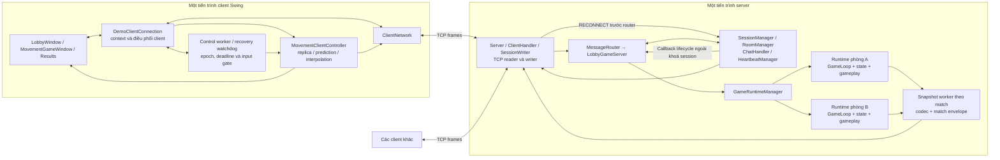
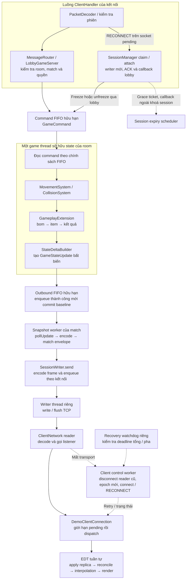
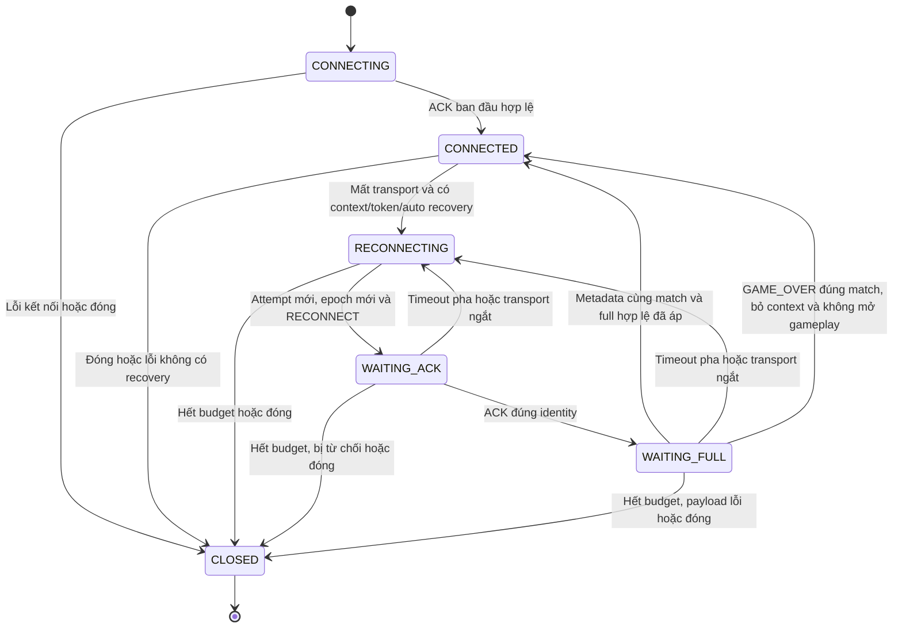

# 8. Kiến trúc hệ thống

Bomb It Multiplayer được tổ chức thành một tiến trình server và nhiều tiến trình client desktop.
Server quản lý kết nối, phòng và trạng thái gameplay authoritative; client tiếp nhận điều khiển,
duy trì dữ liệu bản sao và biểu diễn game bằng Swing/Java2D.
Trong server, mỗi phòng đang chơi có runtime riêng; các runtime dùng chung hạ tầng kết nối và điều phối lobby.
Đây là kiến trúc các thành phần trong cùng ứng dụng Java, không phải một tập microservice triển khai độc lập.

Chương mô tả đường chạy lobby/gameplay mặc định, nối các yêu cầu FR/NFR ở
[mục 6](06_DINH_NGHIA_BAI_TOAN.md) với thành phần thực tế trong code.
Thuật toán đồng bộ đã được giới thiệu ở mục 5; schema message và định dạng byte sẽ được trình bày ở mục 9.
Luồng Session Recovery nối session/transport với runtime và client owner theo giải pháp mục 7.8;
phạm vi là cùng tiến trình server còn hoạt động, cùng active match và deadline hợp lệ.

> **Phân công: TV4 ghép sơ đồ tổng thể; TV1/TV2/TV3 xác nhận các thành phần thuộc module mình.**

## 8.1. Sơ đồ tổng thể Client–Server

**Hình 8.1. Các thành phần chính và ranh giới tiến trình. Nhóm tự vẽ từ code project.**



Mũi tên biểu diễn trao đổi dữ liệu hoặc gọi thành phần; chỉ đường nối TCP là giao tiếp giữa tiến trình.
Hai runtime A/B minh họa sự phân tách theo phòng, không phải hai server.
Ô snapshot worker đại diện cho các worker tương ứng từng match, không phải một worker duy nhất xử lý mọi trận.
Bản nguồn sơ đồ được lưu tại [08_01_tong_the.mmd](../figures/architecture/08_01_tong_the.mmd).

Điểm khởi tạo mặc định là
[ServerApplication](../../src/main/java/com/bombit/server/app/ServerApplication.java) tạo `LobbyGameServer`,
và [ClientApplication](../../src/main/java/com/bombit/client/app/ClientApplication.java) mở `LobbyWindow`.
Các nhánh demo/headless là đường chạy phục vụ mục đích riêng; không được dùng để thay mô tả toàn bộ luồng sản phẩm.
ServerApplication bật seamless recovery cho lobby; LobbyWindow bật auto reconnect.
Constructor tổng quát còn có cấu hình mặc định khác, vì vậy không suy ra demo M1 cũng có resume trận.

Dữ liệu trận, phòng và session chủ yếu nằm trong RAM của tiến trình server.
Kiến trúc hiện hành chưa tích hợp database cho tài khoản, lịch sử hoặc khôi phục trận sau khi server dừng.
Các file cấu hình, log hoặc CSV phục vụ phát triển/thực nghiệm không được coi là tầng persistence gameplay.

> **Phân công: TV1 phụ trách transport/session/room; TV4 xác nhận router, codec và tích hợp.**

## 8.2. Tầng transport, session và room

### 8.2.1. Phân tách trách nhiệm

**Bảng 8.1. Các thành phần hạ tầng server.**

| Thành phần | Trách nhiệm | Ranh giới với gameplay |
|---|---|---|
| `Server`, `ClientHandler`, `ConnectionManager` | Accept socket, tổ chức reader/writer, decode frame; chặn RECONNECT trước router, chuyển writer/socket về phiên cũ và cleanup theo captured socket | Không trực tiếp tính movement, damage hoặc item |
| `SessionManager`, `Session` | Danh tính/token, trạng thái phiên, heartbeat, grace ticket, claim recovery và cleanup | Quản lý quyền giữ phiên; không thay thế player state của match |
| `RoomManager`, `Room` | Thành viên, host, ready, trạng thái chờ/đang chơi và cập nhật phòng | Room không tự chứa thuật toán game loop |
| `MessageRouter`, `SessionHandlers` | Tra handler theo message type; xử lý các message phiên | Router gọi handler trên luồng gọi, không phải một worker queue riêng |
| `LobbyGameServer` | Ghép room/runtime, kiểm tra quyền/scope, ánh xạ roster, suspend/recovery barrier, snapshot/kết quả | Chuyển callback phiên thành command lifecycle; không sửa world mutable từ reader |
| `ChatHandler`, `HeartbeatManager` | Worker chat theo phòng và sweep phát hiện timeout | Không tạo thread riêng cho từng thao tác gameplay |

Căn cứ: [Server](../../src/main/java/com/bombit/server/network/Server.java),
[ClientHandler](../../src/main/java/com/bombit/server/network/ClientHandler.java),
[MessageRouter](../../src/main/java/com/bombit/server/dispatch/MessageRouter.java) và
[LobbyGameServer](../../src/main/java/com/bombit/server/app/LobbyGameServer.java).

### 8.2.2. Luồng tiếp nhận và phân quyền

Sau khi accept, `Server` đăng ký session và tạo writer cho socket; `ClientHandler` được đưa vào reader pool.
Handler đọc đủ frame, kiểm tra giới hạn, trạng thái handshake rồi gọi router bằng danh tính phiên server đang quản lý.
Các trường định danh mà client gửi không tự cấp quyền điều khiển một player khác.
Một socket mới đang ở trạng thái pending có thể gửi CONNECT để tạo luồng phiên mới, hoặc RECONNECT để xin tiếp quản phiên cũ.
Nhánh RECONNECT được ClientHandler nhận trước router: kiểm tra schema/token sơ bộ, gọi manager xác minh lại và claim,
rồi mới bỏ session/writer tạm nhưng giữ socket để gắn writer của identity cũ.
UUID người chơi trong request phải đi kèm token và kiểm tra manager; nó không tự cấp quyền bằng tên hoặc ID công khai.

`LobbyGameServer` kiểm tra thành viên phòng, quyền host, trạng thái trận và match envelope trước khi xử lý gameplay.
MOVE được đổi thành command qua `MovementHandler`; PLANT_BOMB cũng được đưa vào queue của runtime.
Thao tác hợp lệ ở tầng mạng mới chỉ được tiếp nhận: kết quả nghiệp vụ còn phụ thuộc game thread và luật gameplay.

Khi Start hợp lệ, tầng điều phối chụp roster, tạo spawn và ánh xạ session UUID sang playerId số trong match,
gọi `GameRuntimeManager.startGame`, tạo `MatchContext` và gửi `GAME_STARTED` trước khi worker phát snapshot.
Một session có thể chơi nhiều lượt qua cùng kết nối; mỗi lượt có match identity riêng.

### 8.2.3. Gửi dữ liệu và lỗi kết nối

Các producer sử dụng `SessionWriter.send` để encode frame và enqueue; writer thread tương ứng socket mới thực hiện
`write/flush`. Cách tổ chức này tách thao tác ghi socket khỏi bước mô phỏng và giữ các frame cùng kết nối không xen byte.
Queue/byte budget và watchdog giới hạn dữ liệu tồn đọng, phát hiện ghi kéo dài và đưa lỗi về cơ chế cleanup.
Chi tiết ở [SessionWriter](../../src/main/java/com/bombit/server/network/SessionWriter.java) và
[ConnectionManager](../../src/main/java/com/bombit/server/network/ConnectionManager.java).

Reader pool, writer, heartbeat và session expiry phối hợp qua SessionManager và callback lifecycle.
Trong active match có recovery bật, unexpected disconnect giữ session/ghế/runtime, đưa PlayerDisconnectedCommand
vào queue để dừng điều khiển, đồng thời chặn phát snapshot cho player suspended. Bom/item/timer vẫn chạy trên game thread.
Grace hết hạn hoặc leave/hard drop đi theo nhánh dọn phiên, có thể ABORT cả lượt.

SessionManager kiểm tra deadline và ownership dưới khoá session, nhưng gọi sink/lobby ngoài khoá đó.
Mỗi lần ngắt có DisconnectWindow riêng; timer cũ và cleanup của socket cũ phải đối chiếu ticket/socket trước khi tác động.
ConnectionManager tạo writer thay thế theo socket mới; late release không được xoá writer hiện tại chỉ dựa vào playerId.
Chi tiết các owner và trạng thái phục hồi được tổng hợp ở mục 8.7.

> **Phân công: TV2 phụ trách model/core/runtime/movement; TV1/TV4 xác nhận API tích hợp theo room.**

## 8.3. Model, state, runtime và movement

### 8.3.1. Mô hình dữ liệu và quyền sở hữu

**Bảng 8.2. Phân biệt dữ liệu model, state và dữ liệu bàn giao.**

| Nhóm | Thành phần tiêu biểu | Vai trò và cách sử dụng |
|---|---|---|
| Model giá trị | `Direction`, `TilePosition`, `TileType` | Enum/giá trị bất biến để thống nhất hướng, ô và loại nền |
| State đang mô phỏng | `GameState`, `GameMap`, `Player`, entity trong world | Mutable; sau khởi tạo được cập nhật bởi game thread của runtime |
| Input nghiệp vụ | `GameCommand`, movement/plant và `PlayerDisconnectedCommand`/`PlayerReconnectedCommand` | Handoff ý định và lifecycle sang game thread; không mang tham chiếu UI/socket |
| Snapshot/handoff | `GameStateUpdate`, `EntityData`, `BombFrame`, `MatchFrame`, `GameNotice` | Bản dữ liệu công bố để truyền trạng thái/diễn biến; không dùng state mutable làm payload chia sẻ |

`GameRuntimeManager` tạo map và state mới cho mỗi trận, kiểm tra spawn/định danh, tạo extension rồi khởi động runtime.
Map factory và extension factory phải cung cấp instance riêng; manager kiểm tra việc tái sử dụng map instance.
`GameRuntime` giữ roomId, matchId, mapping player và loop, cung cấp submit, poll update, request full và close.
API này không trả trực tiếp `GameState` cho network thread.

Đường chạy lobby inject `DefaultArenaMap` và `MatchGameplayExtension` đầy đủ.
Constructor manager không tham số còn có cấu hình tối giản phục vụ sử dụng/test khác;
không lấy cấu hình tối giản đó để kết luận gameplay mặc định chưa có bom/item.
Căn cứ:
[GameRuntimeManager](../../src/main/java/com/bombit/server/game/runtime/GameRuntimeManager.java) và
[GameRuntime](../../src/main/java/com/bombit/server/game/runtime/GameRuntime.java).

### 8.3.2. Trình tự của game loop

Sau `onStart` của extension, mỗi tick thực hiện:

1. Chuẩn bị cờ xử lý input của player, lấy command theo FIFO và chính sách giới hạn mỗi tick.
2. Áp dụng command movement; chuyển các command cần gameplay sang extension.
3. Cập nhật vị trí qua `MovementSystem` và `CollisionSystem` với bước mô phỏng cấu hình.
4. Gọi `GameplayExtension.update` để xử lý bom, item và kết quả.
5. Tạo full/delta update, đưa vào outbound FIFO và điều chỉnh lịch tick tiếp theo.

`MoveCommand` thay đổi ý định điều khiển; vị trí thực tế được tính trong bước movement.
Trạng thái ACK phản ánh input được áp dụng vào mô phỏng, không chỉ việc packet đã đến socket.
Các command cùng tick vẫn được xử lý theo chính sách FIFO; một mẫu movement mới thứ hai của cùng player
có thể làm phần command còn lại đợi tick sau.
Core xử lý tập frozen từ command disconnect/reconnect, buộc player frozen dừng movement trước bước cập nhật vị trí.
Extension vẫn nhận command lifecycle và tiếp tục update gameplay. Khi lobby không submit được freeze/unfreeze,
nó kết thúc lượt theo policy thay vì giả định game thread đã áp thay đổi.

Mặc định loop có bước 50 ms, command queue 4096, outbound queue 1024 và giới hạn đọc 256 command/tick.
Các giá trị là cấu hình hiện tại, không phải kết quả chứng minh tải tối đa hoặc luôn đạt 20 Hz.
Tick trễ điều chỉnh mốc chạy tiếp; code không chạy bù toàn bộ bằng accumulator.
Nguồn: [GameLoop](../../src/main/java/com/bombit/server/game/core/GameLoop.java).

### 8.3.3. Snapshot và baseline

`StateDeltaBuilder` chụp dữ liệu để so sánh với baseline đã commit.
Update được tạo trên game thread và bàn giao qua FIFO; chỉ enqueue thành công mới commit baseline,
xóa notices đã bàn giao và công bố ảnh `latest`.
Nếu outbound đầy thì baseline cũ được giữ để lần tạo tiếp vẫn tham chiếu phần đã công bố.

`createUpdate()` trả ảnh công bố gần nhất, có thể là delta; hàm không tạo snapshot mới từ network thread
và không thay thế việc đọc outbound FIFO. Nếu tầng gửi chỉ lấy ảnh mới nhất rồi bỏ các delta trung gian,
client có thể mất chuỗi baseline cần thiết.
Nhận vào queue cũng chưa phải ACK rằng từng client đã áp dụng dữ liệu.
Sau reconnect, snapshot worker dùng suspended/recoveryFullAfter để bỏ delta/full cũ cho người đang khôi phục.
Một full mới vượt barrier được enqueue thành công mới gỡ gate initialized phía server;
client vẫn chờ full được áp thành công trước khi mở input. Baseline chung theo match nên full có thể đi tới cả roster.
Các ranh giới này được xác định trong
[StateDeltaBuilder](../../src/main/java/com/bombit/server/game/movement/StateDeltaBuilder.java)
và `GameLoop`.

> **Phân công: TV3 phụ trách bomb/item/event; TV2 phối hợp extension contract và các world adapter.**

## 8.4. Gameplay extension và world adapters

### 8.4.1. Điểm mở rộng trong runtime

`GameplayExtension` định nghĩa `onStart`, `processCommand`, `update` và `onStop`.
Loop gọi chúng trên cùng game thread. Nhờ contract này, loop quản lý lịch và movement,
còn nghiệp vụ bom/item nằm trong implementation gameplay.
Factory được gọi khi khởi tạo để gắn extension với state của đúng trận.
Nguồn: [GameplayExtension](../../src/main/java/com/bombit/server/game/runtime/GameplayExtension.java).

Trong đường chạy mặc định, `MatchGameplayExtension` phối hợp `BombGameplayExtension` và `ItemSystem`.
Sau movement, extension xử lý bom đến hạn/nổ dây chuyền/damage, xóa item cũ trong vùng nổ,
xét drop từ block vừa phá, pickup theo thứ tự playerId rồi quyết định thời gian/kết quả.
Do các bước cùng dùng một owner thread, snapshot cuối tick phản ánh trạng thái sau chuỗi cập nhật đó.

### 8.4.2. Vai trò của world adapter

**Bảng 8.3. Các lớp liên kết gameplay với state và đầu ra.**

| Thành phần | Trách nhiệm |
|---|---|
| `BombSystem` qua `BombWorldAdapter` | Kiểm tra đặt bom, truy vấn ô/player, quản lý entity bom và thời lượng đã trôi qua; áp dụng tác động vào state |
| `ItemSystem` qua `ItemWorldAdapter` | Tạo/xóa entity item, tìm người nhặt và áp dụng effect theo bộ luật |
| `ItemEffectRegistry`, `ItemSpawnPolicy` | Catalog hiệu ứng và chính sách lựa chọn drop, tách khỏi luồng pickup/runtime |
| `MatchGameplayExtension` | Kết hợp các bước gameplay, mạng sống/respawn, timer, stats và kết quả trận |

Adapter dịch giữa định danh session của API gameplay với playerId/state của runtime,
đồng thời kiểm tra quyền truy cập theo game thread. Chúng không mở socket và không tự broadcast.
Bom đang chạy dùng kiểm tra thời lượng trong loop; `BombScheduler` còn trong repository không phải scheduler
của đường gameplay mặc định. Nguồn:
[MatchGameplayExtension](../../src/main/java/com/bombit/server/game/runtime/MatchGameplayExtension.java),
[BombWorldAdapter](../../src/main/java/com/bombit/server/game/runtime/BombWorldAdapter.java),
[ItemWorldAdapter](../../src/main/java/com/bombit/server/game/runtime/ItemWorldAdapter.java).

### 8.4.3. Domain event và thông điệp mạng

Game event không được đồng nhất với frame TCP. Một số event được ghi thành `GameNotice` để đi cùng
`GameStateUpdate` nội bộ; state và các frame hiệu ứng/stats được chụp trong update tương ứng.
Snapshot worker mới chuyển notices thành message chính thức và gửi sau snapshot qua writer queue của từng session.
Như vậy, domain system phát sinh diễn biến nhưng tầng tích hợp quyết định cách biểu diễn trên mạng.

Repository có hai interface cùng tên `GameEventSink` ở hai package:
`server.game.event` nhận domain event qua `publish`, còn `server.integration` nhận callback vòng đời session
như disconnect/hard drop. Chúng không phải một event bus chung và không chứng minh kiến trúc event sourcing.
Lúc cấu hình lobby, callback domain ngoài có thể là no-op; đường ghi state/notices nội bộ vẫn hoạt động.

> **Phân công: TV1 phụ trách lobby/results UI; TV2 movement/đồng bộ/render map-player; TV3 render bom/item/hiệu ứng; TV4 hạ tầng client dùng chung.**

## 8.5. Client lobby, movement, renderer và results

### 8.5.1. Điều phối kết nối và màn hình

**Bảng 8.4. Trách nhiệm các thành phần client.**

| Thành phần | Trách nhiệm |
|---|---|
| `LobbyWindow`, `MatchResultsPanel` | Giao diện kết nối/phòng/ready/chat và kết quả; giữ luồng chuyển giữa lobby và gameplay |
| `DemoClientConnection` | Owner transport/context/token; heartbeat/control sender, recovery state/epoch/deadline, watchdog riêng và listener xuyên các lượt |
| `ClientNetwork` | Kết nối TCP, encode/send có khóa, reader decode, phát listener và theo dõi byte; không tự cập nhật world/UI |
| `MovementClientController` | Nhận packet đúng match, ghép replica, điều phối prediction/reconciliation/interpolation, resync và worker gửi input |
| `InputController`, `PredictionController`, `ReconciliationController`, `InterpolationController` | Lấy mẫu thao tác và các bước xử lý movement tại client |
| `MovementGameWindow`, `TileGridRenderer`, `BombScene`, các renderer item/bom/lửa | Vẽ map, entity, nhân vật, hiệu ứng và HUD từ dữ liệu phía client |

Tên `DemoClientConnection` còn mang dấu mốc phát triển, nhưng `LobbyWindow` đang dùng lớp này làm owner
kết nối thật. Không có một lớp `LobbyController` riêng trong đường chạy đã khảo sát.
Nguồn: [LobbyWindow](../../src/main/java/com/bombit/client/lobby/LobbyWindow.java),
[DemoClientConnection](../../src/main/java/com/bombit/client/app/DemoClientConnection.java)
và [ClientNetwork](../../src/main/java/com/bombit/client/network/ClientNetwork.java).

Listener ứng dụng được cài trước CONNECT. Nó chuyển packet sang UI executor tuần tự,
xử lý `GAME_STARTED` của lượt mới để tạo controller/context, sau đó chuyển snapshot/notices cho controller hiện hành.
Controller được tạo với `subscribe=false` trong luồng này, tránh đăng ký thêm listener làm áp dụng packet hai lần.
API controller vẫn hỗ trợ tự đăng ký typed listener cho kiểu tích hợp khác.
Trong recovery, GAME_STARTED phải trùng context đang giữ; client giữ controller và cửa sổ hiện tại,
không đi theo nhánh tạo lượt mới làm reset sequence/counter đặt bom.

### 8.5.2. Phân biệt replica, prediction và dữ liệu render

`ClientWorldState` là replica của dữ liệu server đã áp dụng thành công.
`PredictionController` giữ state local riêng và lịch sử input chưa ACK, còn interpolation giữ các mẫu vị trí remote.
Ba loại dữ liệu có mục đích khác nhau; không dùng vị trí đã nội suy để sửa world authoritative hoặc tính damage.

Khi áp dụng snapshot, controller kiểm tra kết quả ghép replica. Nếu hợp lệ, nó đồng bộ scene bom,
reset lịch sử khi respawn, cập nhật world cho prediction, reconcile rồi ghi mẫu nội suy.
Nếu thiếu/sai baseline, controller yêu cầu full và tạm không sinh input mới theo điều kiện input-ready.
Khi phục hồi phiên, owner chủ động suspend input, tăng generation, bỏ sender task/pending prediction cũ,
xoá interpolation và đánh dấu replica cần full. World cũ được giữ để vẽ trạng thái chờ;
ACK phiên không đủ mở input. Full phải đúng match/epoch và áp thành công sau metadata hợp lệ.
Nguồn: [MovementClientController](../../src/main/java/com/bombit/client/game/movement/MovementClientController.java).

Client tái sử dụng `GameMap`, `Player` và movement/collision từ các package mang tên `server.game` để mô phỏng local.
Đây là tái sử dụng mã trong cùng repository, không phải client truy cập instance `GameState` đang chạy trên server.
Snapshot codec cũng nằm ở `server.game.movement`; vì vậy, ranh giới trách nhiệm logic chưa hoàn toàn trùng
với cách đặt package. Không mô tả project như đã tách mọi DTO/codec/game simulation thành thư viện common độc lập.

### 8.5.3. Render và kết quả

`MovementGameWindow` vẽ nhân vật local theo prediction, nhân vật khác theo interpolation,
map/item từ replica và bom/lửa từ `BombScene`. HUD lấy mạng sống, khiên, quota, range và timer từ dữ liệu server.
Client chỉ gửi ý định đặt bom; không tự tạo bom hoặc tự trừ damage như một kết quả authoritative.

Sau `GAME_OVER` đúng match, connection owner ghi kết quả, đóng movement controller và bỏ context trận;
lobby đóng cửa sổ gameplay, hiển thị `MatchResultsPanel` và giữ kết nối để ready/start lượt khác.
Render timer và input timer có vòng đời gắn với cửa sổ gameplay, không được để tiếp tục dùng controller của trận cũ.
Nguồn: [MovementGameWindow](../../src/main/java/com/bombit/client/game/movement/MovementGameWindow.java).

> **Phân công: TV4 ghép mục 8.6; TV1 xác nhận transport/session, TV2 loop và client state, TV3 gameplay cleanup.**

## 8.6. Router, worker, queue, quyền sở hữu thread và cleanup

### 8.6.1. Các ranh giới bàn giao dữ liệu

**Hình 8.2. Luồng command và snapshot qua các thread/queue. Nhóm tự vẽ từ code project.**



Sơ đồ tập trung đường gameplay mặc định. Queue writer chứa frame đã encode;
không đặt toàn bộ encode vào writer thread. Việc render chạy theo timer của UI sau các lần cập nhật state,
không phải một bước bắt buộc được gọi ngay sau mỗi packet.
Bản nguồn: [08_02_thread_va_queue.mmd](../figures/architecture/08_02_thread_va_queue.mmd).

**Bảng 8.5. Thread, dữ liệu sở hữu và cơ chế giới hạn.**

| Miền thực thi | Công việc/dữ liệu | Bàn giao và giới hạn chính |
|---|---|---|
| Accept và reader pool của server | Socket, đọc frame và route | Pool/queue hữu hạn; `MessageRouter` gọi đồng bộ handler |
| Điều phối lobby/session/room | Thành viên, match context, suspended/recovery barrier và grace ticket | Claim dưới khoá session; callback ngoài khoá; lobby/pump có synchronization riêng |
| GameLoop của từng runtime | State mutable, movement, extension và builder | Nhận command FIFO; xuất snapshot bất biến qua outbound FIFO |
| Snapshot worker của từng match | Poll update, codec, envelope, snapshot/notices/result | Không đọc state mutable; enqueue writer của từng session |
| Session writer của từng socket | Ghi/flush frame đã encode | Queue 256 frame chờ, budget 4 MiB tính cả frame đang ghi; watchdog ghi kéo dài |
| Worker/scheduler phụ trợ server | Chat, heartbeat, session expiry, watchdog và connection cleanup | Tách vòng đời hạ tầng khỏi bước update gameplay |
| Reader/control/sender của client | Decode; control/heartbeat/resync/input; connect/retry recovery | Epoch và input generation chặn task cũ; connect/close không giữ monitor xuyên I/O |
| Recovery watchdog client | Kiểm tra deadline tổng/từng pha trên scheduler riêng | Không đợi control worker đang connect; timeout dẫn retry hoặc close theo budget |
| Swing EDT | Replica, prediction/replay, buffer nội suy và UI | Dispatch tuần tự; input/render timer; giới hạn pending dispatch trước EDT |

Giới hạn pending dispatch của owner client không biến hàng đợi EDT toàn cục của Swing thành một queue hữu hạn.
Đường listener mặc định tắt pull queue của `ClientNetwork` để không giữ thêm bản packet không có consumer.
Nếu API `receive()` được dùng ở tích hợp khác, pull queue có giới hạn riêng.

State theo phòng được cách ly, nhưng toàn hệ thống vẫn dùng chung CPU, reader pool, manager và khóa điều phối.
Không suy ra mỗi room có tài nguyên độc lập hoàn toàn hoặc throughput tăng tuyến tính theo số room.

### 8.6.2. Luồng dữ liệu movement và snapshot

**Hình 8.3. Một lượt input đi qua runtime và trở về client. Nhóm tự vẽ từ code project.**

```mermaid
sequenceDiagram
    participant UI as Client EDT
    participant SEND as Movement-Sender
    participant IN as Server reader/router/lobby
    participant LOOP as GameRuntime / GameLoop
    participant PUMP as Snapshot worker
    participant WRITE as SessionWriter
    participant NET as ClientNetwork reader
    Note over UI,NET: Luồng sau khi đã nhận GAME_STARTED và full hợp lệ
    UI->>UI: Lấy mẫu input và prediction local
    UI->>SEND: Enqueue MOVE có sequence
    SEND->>IN: ClientNetwork.send → TCP frame
    IN->>LOOP: Kiểm tra scope, submit GameCommand
    Note over IN,LOOP: Submit thành công chưa phải ACK đã mô phỏng
    LOOP->>LOOP: Tick: command → movement → gameplay
    LOOP-->>PUMP: GameStateUpdate qua outbound FIFO
    PUMP->>WRITE: Snapshot rồi notices qua queue của từng session
    WRITE-->>NET: Ghi TCP frames
    NET->>UI: Listener ứng dụng dispatch tuần tự
    UI->>UI: Ghép replica, dùng ACK để reconcile, ghi mẫu nội suy
    UI->>UI: Render local prediction và remote interpolation
```

Sơ đồ mô tả các bước logic; một snapshot có thể phản ánh nhiều biến đổi và được phát cho cả roster,
không phải mỗi input luôn có ngay một packet phản hồi riêng. Gameplay notice chỉ được phát nếu có;
mỗi client khác nhận qua writer riêng. Bản nguồn: [08_03_luong_movement.mmd](../figures/architecture/08_03_luong_movement.mmd).

Với bom, nhánh đầu vào là PLANT_BOMB → kiểm tra scope/rate/requestId → command queue.
Game thread áp dụng placement và xử lý bom đến hạn qua extension; entity/map/player mới xuất hiện
trong snapshot, còn diễn biến tương ứng có thể đi qua notice/effect.
Với resync, client gửi REQUEST_FULL_STATE; tầng lobby đặt yêu cầu full cho runtime và snapshot worker
nhận diện full mới sau mốc yêu cầu để công bố FULL_STATE_SYNC.
Cả hai luồng giữ nguyên ranh giới state và I/O của hình 8.2.

### 8.6.3. Chính sách quá tải và lỗi

Command queue đầy làm submit thất bại, được tầng tích hợp trả lỗi thay vì chờ đến khi queue có chỗ.
Với callback lifecycle recovery, không có request gameplay để trả INPUT_QUEUE_FULL theo cách thông thường:
freeze/unfreeze không enqueue được thì lobby ABORT lượt; nhánh resume còn rollback/cleanup session.
Outbound runtime đầy giữ baseline chưa commit để lần tạo sau còn tham chiếu đúng dữ liệu đã enqueue.
Writer queue/budget đầy hoặc write deadline bị vượt có thể đóng kết nối và kích hoạt cleanup;
không tùy ý bỏ một delta rồi tiếp tục như thể client đã nhận đủ.

Ở client, hết budget dispatch hoặc queue gửi được xử lý bằng dừng controller/phiên và báo lỗi theo owner.
Lỗi gửi transport có thể kích hoạt recovery nếu active context/token/cấu hình còn cho phép;
lỗi decode/world không mặc nhiên được chuyển thành retry vô hạn.
Đối với sai baseline hợp lệ ở cấp đồng bộ, client yêu cầu full thay vì tự suy đoán phần thiếu.
Các cơ chế này giới hạn một số dạng backlog; hiệu quả dưới tải và các đường lỗi vẫn cần kiểm chứng trong Results.

### 8.6.4. Cleanup và chuyển lượt

Kết thúc gameplay bình thường đi qua kết quả trong snapshot; snapshot worker đưa kết quả về tầng lobby để đóng match.
Kết thúc hành chính, hard drop hoặc grace hết hạn có thể dùng ABORTED nếu lượt chưa có kết quả chốt.
Unexpected disconnect trong grace hợp lệ giữ runtime; không dọn match như một leave ngay lập tức.
Tầng điều phối đánh dấu match không còn active, dừng runtime, chuyển room về WAITING và công bố GAME_OVER/room state.

`GameLoop.stop` yêu cầu dừng, interrupt và chờ thread có thời hạn; `onStop` chạy trong phần cleanup của game thread
để extension dọn bom/item/effect. Snapshot worker thoát theo cờ/lifecycle runtime và tự rời danh sách worker.
Khi đóng cả server, `LobbyGameServer.close` còn đóng transport/manager và interrupt/join worker còn lại.

Transport đóng socket để đánh thức thao tác đọc/ghi đang chặn, dừng heartbeat/expiry/watchdog và reader pool/chat worker.
`ConnectionManager` chuyển callback lỗi writer sang cleanup executor để tránh gọi trực tiếp logic lobby trong lúc producer
còn giữ khóa. Phía client dừng timer, đóng movement sender, bỏ context trận cũ; khi đóng phiên mới đóng cả reader/control/network.
Việc dọn tài nguyên là trách nhiệm theo từng owner, không chỉ gọi `dispose()` cho cửa sổ.
Riêng recovery giữ controller và timer UI để biểu diễn trạng thái chờ, nhưng khoá input qua generation/readiness.
Khi recovery thất bại/đóng phiên, owner còn dừng recovery watchdog và control worker;
ở server, ticket expiry phải được huỷ hoặc xác minh thế hệ trước khi dọn session.

Một số frame đã vào writer có thể còn tới sau khi trận kết thúc. Match identity và context client giúp bỏ dữ liệu cũ;
lượt chơi lại tạo runtime/world/controller mới, đồng thời giữ TCP nếu phiên vẫn hợp lệ.
Match identity lọc dữ liệu lượt cũ; connection epoch và input generation bổ sung để lọc tác vụ của lần nối cũ
ngay trong cùng match. Resume chỉ thành công khi đầy đủ điều kiện session/lifecycle/full gate, không nhờ matchId riêng lẻ.

### 8.6.5. Liên hệ yêu cầu và giới hạn kiến trúc

**Bảng 8.6. Kiến trúc đáp ứng các nhóm yêu cầu ở mục 6.**

| Nhóm yêu cầu | Thành phần chịu trách nhiệm chính | Nội dung cần kiểm chứng tiếp |
|---|---|---|
| FR01–FR03 | Transport, session, room, router và lobby UI | Phân quyền, trạng thái phòng, chat đúng scope |
| FR04–FR09 | Runtime riêng room, movement và gameplay extension/adapters | Isolation, collision, bom/item/damage và thứ tự cập nhật |
| FR10–FR11 | Builder/codec, snapshot pump, replica và client controllers | Baseline/resync, ACK/replay, respawn và biểu diễn |
| FR12–FR14 | Lobby lifecycle, session writer, cleanup và context theo match | Kết thúc/chơi lại, dữ liệu cũ, queue đầy và lỗi kết nối |
| FR15 | SessionManager/ClientHandler/ConnectionManager; callback lobby/runtime; client recovery owner | Token/deadline/ownership, giữ runtime/controller, khoá input tới full, expiry và gameplay offline |
| NFR01–NFR08 | Các ranh giới owner/queue và công cụ đo/test | Tính đúng, nhịp/tải/byte, giải phóng tài nguyên và tái lập |

Mô tả kiến trúc giải thích cách các thành phần phối hợp, chưa xác nhận mọi thuộc tính chất lượng đã đạt.
Lượt mới ngoài sandbox đạt 171/171 JUnit và TV2/TCP checks; các lượt sandbox có lỗi smoke ba tiến trình
được giữ để chỉ rõ điều kiện chạy. Chưa nghiệm thu GUI thủ công/LAN/Wi-Fi/soak;
không dùng sơ đồ làm bằng chứng thay cho kiểm thử hoặc số liệu thực nghiệm.
Nguồn: [kết quả kiểm thử mới](../session-recovery/03_KET_QUA_KIEM_THU_THUC_TE.md).

## 8.7. Quyền sở hữu và trạng thái trong Session Recovery

### 8.7.1. Phân tách owner khi chuyển transport

**Bảng 8.7. Dữ liệu recovery và thành phần được phép thay đổi.**

| Dữ liệu | Owner/cơ chế | Ranh giới cần giữ |
|---|---|---|
| Session UUID/token, socket hiện tại, state trước disconnect | SessionManager/Session, khoá session | Session tồn tại qua nhiều socket; kiểm tra token không thay kiểm tra deadline/match |
| DisconnectWindow và ScheduledFuture | SessionManager, ticket riêng mỗi lần ngắt | Deadline kiểm tra lại khi claim; timer huỷ/đến muộn không xoá thế hệ sau |
| Writer và captured socket | ConnectionManager/SessionWriter | Bỏ writer tạm nhưng giữ socket để handoff; late cleanup không đóng writer mới |
| Match context, suspended, initialized, recoveryFullAfter | LobbyGameServer và snapshot pump dưới điều phối lobby | Không phát delta/notice cho người còn suspended/chưa có full nền mới |
| Player frozen, bom/item/damage/timer | GameLoop và gameplay extension | Chỉ game thread sửa world; lifecycle được queue nhận chưa có nghĩa đã áp ngay |
| RecoveryState, connection epoch, deadline | DemoClientConnection; control worker/watchdog và UI dispatch | Watchdog độc lập kiểm tra timeout; callback UI phải thuộc epoch hiện hành |
| Replica/prediction/interpolation và input generation | MovementClientController/InputController | Giữ world để vẽ; bỏ pending cũ; không mở input chỉ nhờ ACK |

Trong handoff, session vẫn DISCONNECTED khi attach socket và dựng writer; sau khi enqueue ACK mới phục hồi
state và gọi lobby. Nhánh lobby có thể từ chối do trận đã kết thúc, nên ACK không phải cam kết tiếp tục trận.
SessionRecoveryRejectedException đánh dấu từ chối nghiệp vụ; lỗi writer/setup thực vẫn đi vào diagnostics.
Không có enum ORPHAN_SESSION hoặc một service persistence/failover mới trong kiến trúc này.

### 8.7.2. Trạng thái client và gate gameplay

**Hình 8.4. State machine kết nối và recovery của client owner. Nhóm tự vẽ từ code đã xác minh.**



CONNECTED là enum kết nối, không đồng nghĩa luôn có gameplay sẵn sàng: sau ACK ban đầu còn chờ trận/full,
và sau GAME_OVER context đã bị bỏ. Khi GAME_OVER đúng match còn được nhận trong recovery, owner kết thúc
recovery và đóng controller; nhánh này áp dụng cả khi còn RECONNECTING/WAITING_ACK, hình chỉ vẽ đại diện từ WAITING_FULL.
Nếu không nhận được kết quả trong lúc offline, server không có replay lịch sử GAME_OVER để bảo đảm bổ sung.
Sơ đồ lược bớt callback trạng thái không đổi; UI readiness còn phụ thuộc controller/replica.

Bản nguồn: [08_04_trang_thai_recovery.mmd](../figures/architecture/08_04_trang_thai_recovery.mmd).
Các sequence có frame trên dây, nhánh sai token và hết hạn được trình bày tại mục 9.6.5–9.6.6;
tham số budget ở mục 7.8.3, phần 9 bổ sung cách diễn giải timeout theo giao thức.
