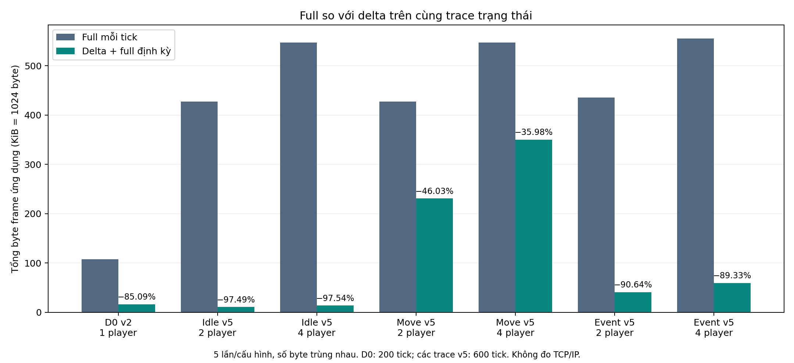
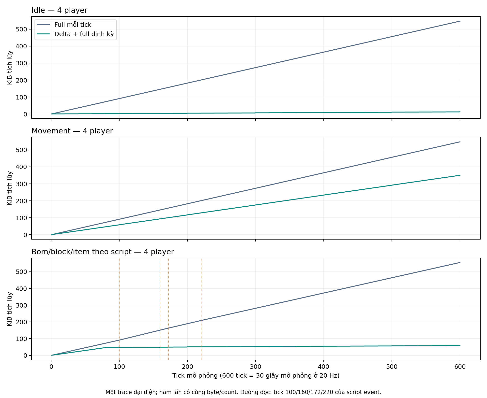
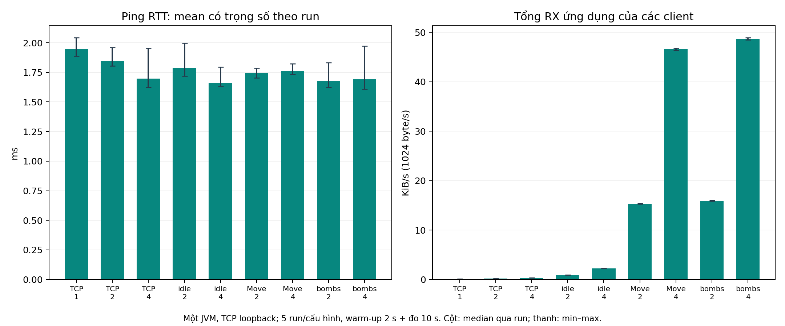

# 12. Kết quả — Results

> **Phân công tổng hợp: TV4; TV1 xác nhận phòng/kết nối, TV2 xác nhận movement/runtime/đồng bộ, TV3 xác nhận gameplay. Mỗi thành viên chịu trách nhiệm giải thích assertion và log của phần mình.**
>
Chương phân biệt **baseline cũ ở mục 12.1–12.6** với **Session Recovery ở mục 12.8**.
Baseline dùng revision `e333050`; recovery dùng HEAD `492c031` cộng working tree đã sửa và inventory riêng.
Mục 12.7 tổng hợp phần còn thiếu theo cả hai mốc. Không thay các tổng 133 test, 35 lượt delta,
45 scenario-run mạng hoặc 84 execution reliability cũ thành kết quả của phiên bản recovery.

Ngày 26/10/2026, nhóm chạy lại bộ test từ source tại revision
`e333050997c5dbf78ec4b9b42a9bc9a73ce6a0d5`, không thay production code, test, luật game hoặc timeout.
Maven dùng JDK 25 tại máy khảo sát và dependency cache offline.
Log và XML mới được sao lưu ngoài target tại [hồ sơ nhiệm vụ 12](../evidence/task12-2026-10-26/README.md).
Lượt suite đầy đủ này là một lần thực thi tự động; các lần lặp mạng/reliability bổ sung được trình bày ở 12.4/12.6.
Nghiệm thu GUI/LAN của thiết kế mục 11 chưa được thực hiện.

**Bảng 12.1. Kết quả thực chạy và phạm vi đếm.**

| Lượt | Kết quả thực tế | Cách đọc |
|---|---|---|
| Gọi wrapper test trong sandbox | Dừng trước khi chạy test do không tạo được local Maven repository | Lỗi môi trường thực thi; không tính là test case fail |
| Maven offline, gọi trực tiếp sau khi được phép truy cập môi trường | 38 class, 133 test; 133 pass, 0 failure/error/skipped; BUILD SUCCESS; Maven báo 39,743 s | Tổng suite, có cả test công cụ/protocol, không phải 133 kịch bản GUI |
| Check TV2 độc lập | Exit 0; bốn nhóm check API, movement, runtime và delta đều PASS | Không cộng bốn dòng PASS vào số 133 JUnit |
| NetworkTest main độc lập | Exit 0; codec/framing/validation/router/metrics/TCP loopback PASS | Main độc lập, không cộng vào số JUnit |
| Khảo sát nhiệm vụ 1, cùng revision | 133 test, 132 pass, 1 failure; smoke đa tiến trình thất bại cả lần chạy riêng | Dữ liệu lịch sử được giữ; một lần PASS mới không chứng minh đã sửa nguyên nhân |

Nguồn tổng hợp: [junit-summary.json](../evidence/task12-2026-10-26/junit-summary.json),
[Maven log](../evidence/task12-2026-10-26/maven-tests.log),
[TV2 log](../evidence/task12-2026-10-26/tv2-checks.log),
[NetworkTest log](../evidence/task12-2026-10-26/network-main.log) và
[khảo sát trước](../evidence/task01-2026-10-26/junit-first-run-summary.json).
Số giây Maven là thời gian công cụ báo cho build/test, không phải latency gameplay hay throughput.

Trong các bảng dưới đây, “đạt” nghĩa assertion của lớp test được chạy ở lượt mới đều đạt.
Một dòng có thể gom nhiều assertion; số test của một lớp không phải số tính năng độc lập.
Các lớp tích hợp có thể xuất hiện ở nhiều bảng vì kiểm tra nhiều phần của cùng luồng;
không cộng lại số của các bảng để tính tổng suite.
“Lượt mới” trong mục 12.1–12.6 là lượt của đợt baseline 26/10/2026, không phải lượt recovery 27/10/2026.
Link source trong các mục lịch sử giúp tìm module; số execution/assertion của mốc cũ phải đối chiếu XML/hash
được lưu theo revision, vì các lớp như LobbyLifecycleTest/BombClientIntegrationTest đã được bổ sung về sau.

> **Phân công: TV1; TV4 phối hợp contract và đối chiếu log TCP.**

## 12.1. Chức năng phòng/kết nối

**Bảng 12.2. Kết quả phòng, session và lobby.**

| Nguồn test | Đầu vào/kịch bản thực thi | Điều kiện đã kiểm tra | Kết quả lượt mới |
|---|---|---|---|
| RoomManagerTest | Tạo phòng, thêm guest, lấy snapshot roster | Đủ hai thành viên; snapshot không cho sửa cấu trúc | 1/1 đạt |
| SessionManagerTest | Các fixture quản lý phiên trong lớp | Quản lý session theo assertion đã khai báo | 3/3 đạt; không suy tính năng resume trận |
| LobbyContractTest | Payload/request lobby hợp lệ và không hợp lệ | Encode/decode và kiểm tra contract | 4/4 đạt |
| LobbyLifecycleTest | Phòng bốn người, người thứ năm; quyền/ready/start; hai phòng; chat/resync; concurrent start; leave/disconnect; chơi lượt mới cùng TCP | Roster/quyền authoritative, room tách biệt, match epoch mới, quay lại phòng và cleanup | 7/7 đạt qua TCP loopback |
| ChatFaultTest | Fixture lỗi luồng chat | Hành vi từ chối/cleanup theo assertion | 1/1 đạt |

Nguồn: [RoomManagerTest](../../src/test/java/com/bombit/server/room/RoomManagerTest.java),
[SessionManagerTest](../../src/test/java/com/bombit/server/session/SessionManagerTest.java),
[LobbyContractTest](../../src/test/java/com/bombit/common/protocol/LobbyContractTest.java),
[LobbyLifecycleTest](../../src/test/java/com/bombit/integration/LobbyLifecycleTest.java) và
[ChatFaultTest](../../src/test/java/com/bombit/server/chat/ChatFaultTest.java).
Trạng thái thực chạy từng lớp nằm trong summary/XML của lượt mới.

Đáng chú ý, `fourPlayerRoomRejectsFifthAndCanonicalRequestsWork` kiểm tra capacity qua đường request thật;
`independentRoomsChatMovementResyncAndCleanup` kiểm tra nhiều chức năng cùng ranh giới phòng;
`realClientControllersReturnToRoomAndReplayOnSameTcpConnections` dùng controller ứng dụng để kiểm tra vòng đời.
Những kết quả này hỗ trợ kết luận lobby/room đã tích hợp qua TCP trong các fixture đã chạy.
Riêng các fixture baseline này chưa chứng minh bốn người ở bốn máy thao tác GUI hoặc reconnect khôi phục trận.
Bằng chứng recovery trên phiên bản tích hợp được trình bày riêng ở mục 12.8; nghiệm thu GUI/LAN nhiều máy vẫn chưa có.

> **Phân công: TV2; TV4 phối hợp packet và các kiểm tra tích hợp.**

## 12.2. Movement/runtime/client synchronization

### 12.2.1. Movement, collision và ranh giới runtime

**Bảng 12.3. Kết quả movement và runtime.**

| Nguồn test/check | Tình huống kiểm tra | Kết quả assertion tiêu biểu | Kết quả lượt mới |
|---|---|---|---|
| RuntimeContractTest → RuntimeContractCheck | Queue nhỏ bị đầy, hai producer, hai runtime, STOP, wall/block/biên, player chết, extension lỗi | Reject được đếm; giữ thứ tự từng producer; đủ 200 command identity; A dừng không làm B dừng; snapshot cũ giữ nguyên; thread được join | 1/1 JUnit đạt; check riêng cũng PASS |
| MovementFeatureTest → MovementFeatureCheck | Hai bước prediction, ACK/replay, interpolation, collision bom và runtime/TCP | Replay chỉ input chưa ACK; giữ endpoint ngoài buffer; đi ra ô bom được nhưng không đi vào lại; không chạy tiếp vô hạn khi thiếu mẫu input | 1/1 JUnit đạt; check riêng cũng PASS |
| MovementBalanceTest | Fixture cân bằng hitbox/tốc độ và movement | Các assertion cấu hình/chuyển động của lớp đạt | 4/4 đạt |
| MovementDemoTest | Hai client MOVE/STOP/biên; hard/soft wall qua TCP; resync/rate gate; roster và cleanup | Client nhận state authoritative; controller nhận full và tự yêu cầu resync theo fixture | 8/8 đạt |
| RespawnPredictionTest | Respawn local và remote | Xóa input pending cũ nhưng không dùng lại sequence; remote teleport thay vì nội suy xuyên map | 2/2 đạt |

Nguồn: [RuntimeContractCheck](../../src/test/java/com/bombit/server/game/runtime/RuntimeContractCheck.java),
[MovementFeatureCheck](../../src/test/java/com/bombit/server/game/movement/MovementFeatureCheck.java),
[MovementBalanceTest](../../src/test/java/com/bombit/server/game/runtime/MovementBalanceTest.java),
[MovementDemoTest](../../src/test/java/com/bombit/integration/MovementDemoTest.java) và
[RespawnPredictionTest](../../src/test/java/com/bombit/client/game/movement/RespawnPredictionTest.java).
RuntimeContractTest và MovementFeatureTest là wrapper JUnit cho check tương ứng,
vì vậy việc chạy lại check độc lập không tạo thêm coverage độc lập tương đương một nhóm tính năng mới.

FIFO được kiểm tra theo enqueue/thứ tự producer, không phải tuyên bố thứ tự thời gian tuyệt đối giữa hai thread.
Các mốc vị trí được assert trong fixture với map/tốc độ cụ thể; không suy mọi tốc độ/map đều không có lỗi va chạm.
Prediction/interpolation được kiểm tra bằng giá trị state, chưa có phép đo độ mượt, correction nhìn thấy hoặc FPS GUI.

### 12.2.2. Snapshot và khôi phục replica

**Bảng 12.4. Kết quả kiểm tra đồng bộ.**

| Nguồn | Tình huống | Kết quả lượt mới và phạm vi |
|---|---|---|
| IntegrationContractTest | Contract packet/match scope và dữ liệu snapshot theo fixture | 8/8 đạt |
| DeltaCompressionTest → DeltaCompressionCheck | Full đầu, delta tile/entity, xóa entity/player, build chưa commit, bỏ update, full phục hồi và full cũ | 1/1 JUnit đạt; check riêng PASS |
| MovementDemoTest | First full và tự resync của client controller, xử lý request theo match/rate gate | Đạt trong 8 test của lớp; không đếm lại thành 8 test mới |
| MatchLifecycleIntegrationTest | Stats/pickup/result, respawn/shield, full resync và lượt mới qua hai client TCP | 5/5 đạt; dữ liệu client/server khớp assertion |

Nguồn: [IntegrationContractTest](../../src/test/java/com/bombit/common/protocol/IntegrationContractTest.java),
[DeltaCompressionCheck](../../src/test/java/com/bombit/server/game/movement/DeltaCompressionCheck.java) và
[MatchLifecycleIntegrationTest](../../src/test/java/com/bombit/integration/MatchLifecycleIntegrationTest.java).

Fixture delta kiểm tra build không commit giữ baseline cũ, client phát hiện base tick thiếu và giữ state cũ khi từ chối,
sau đó full state phục hồi được replica. Vòng trace còn đối chiếu map, số entity và vị trí x của player với nhánh full
trên từng tick của fixture. Không mô tả assertion chọn lọc này là kiểm tra equality mọi field của mọi snapshot v5.
Thao tác bỏ update diễn ra có chủ ý trong test replica, không phải đo packet loss trên TCP.
Phần byte được in cùng check sẽ được phân tích riêng ở 12.5, tránh trộn kiểm chứng tính đúng với kết luận hiệu năng.

> **Phân công: TV3; TV2 phối hợp world adapter và runtime, TV4 phối hợp wire contract.**

## 12.3. Gameplay bomb/item/lives/result

**Bảng 12.5. Kết quả gameplay và tích hợp presentation.**

| Nguồn test | Kịch bản chính | Điều kiện đạt theo assertion | Kết quả lượt mới |
|---|---|---|---|
| BombSystemTest | Trùng ô bom, block dừng tia, chain và death event | Mỗi bom nổ một lần; block bị phá đúng; death event theo fixture | 4/4 đạt |
| BombGameplayTest | Các fixture luật placement/explosion | Các nhánh luật được lớp test kiểm tra đạt | 10/10 đạt |
| BombRuntimeIntegrationTest | Loop thật đặt/nổ/xóa entity, room tách kho bom, lỗi callback, hai client TCP | Entity/map/alive được xuất bản; lỗi vẫn cleanup trên game thread; resync thấy trạng thái bom | 4/4 đạt |
| ItemSystemTest | Spawn và pickup qua ItemWorld fixture | Sinh/nhặt và effect/event theo assertion | 2/2 đạt |
| MatchGameplayTest | Drop/pickup cùng ô, upgrade quota, chết cùng tick, last alive, timeout, cap và foreign thread | Một người thắng pickup; không xuất winner trung gian khi cùng chết; rank/reason đúng; adapter từ chối thread khác | 5/5 đạt |
| ExtendedItemsTest | Năm loại item, shield, blast chồng, respawn, LIFE_UP tranh chấp, range và seeded drop | Shield không cộng dồn; một damage/batch; upgrade giữ khi respawn; không hồi sinh người đã bị loại | 6/6 đạt |
| BombClientIntegrationTest | Hai client trên đường giao tiếp bom | Các assertion tích hợp trong hai fixture đạt | 2/2 đạt |
| MatchLifecycleIntegrationTest | Kết quả cuối, replay/disconnect và trạng thái mở rộng | Final snapshot, GAME_OVER và state client theo assertion | 5/5 đạt; trùng lớp đã dẫn ở 12.2 |
| BombSceneTest | Snapshot/notice và presentation qua controller | Hình ảnh scene theo state authoritative trong fixture | 2/2 đạt |
| Java2DRendererTest | Vẽ BufferedImage và năm icon item | Có pixel hiển thị; năm icon có chữ ký pixel khác nhau | 2/2 đạt; chưa phải ảnh nghiệm thu GUI |
| TileGridRendererTest / MatchResultsPanelTest | Grid và bảng kết quả theo fixture | Assertion renderer/UI component đạt | Mỗi lớp 1/1 đạt |

Nguồn chi tiết: [BombSystemTest](../../src/test/java/com/bombit/server/game/bomb/BombSystemTest.java),
[BombGameplayTest](../../src/test/java/com/bombit/server/game/bomb/BombGameplayTest.java),
[BombRuntimeIntegrationTest](../../src/test/java/com/bombit/server/game/runtime/BombRuntimeIntegrationTest.java),
[ItemSystemTest](../../src/test/java/com/bombit/server/game/item/ItemSystemTest.java),
[MatchGameplayTest](../../src/test/java/com/bombit/server/game/runtime/MatchGameplayTest.java),
[ExtendedItemsTest](../../src/test/java/com/bombit/server/game/runtime/ExtendedItemsTest.java),
[BombClientIntegrationTest](../../src/test/java/com/bombit/integration/BombClientIntegrationTest.java),
[BombSceneTest](../../src/test/java/com/bombit/client/game/bomb/BombSceneTest.java),
[Java2DRendererTest](../../src/test/java/com/bombit/client/game/bomb/Java2DRendererTest.java),
[TileGridRendererTest](../../src/test/java/com/bombit/client/game/movement/TileGridRendererTest.java) và
[MatchResultsPanelTest](../../src/test/java/com/bombit/client/lobby/MatchResultsPanelTest.java).

Các test gameplay dùng world/policy/clock được điều khiển để kiểm tra quy tắc cụ thể;
các test TCP bổ sung bằng chứng các lớp đó được ghép vào runtime và client.
Sự kết hợp này hỗ trợ kết luận logic bom/item/lives/result đã có kiểm chứng ở cả fixture và một số luồng tích hợp.
Nó chưa chứng minh mọi thứ tự nhận input hoặc mọi vị trí respawn đều đã được kiểm tra.
Test renderer dùng ảnh trong bộ nhớ, không lưu PNG và không đánh giá bố cục cửa sổ, trải nghiệm điều khiển hoặc khả năng đọc HUD.
Không lấy một ảnh dựng lại sau test làm screenshot của một trận mạng đã chạy.

> **Phân công: TV4 tổng hợp; TV1/TV2/TV3 xác nhận cleanup tài nguyên do module mình sở hữu.**

## 12.4. Concurrency, fault handling và cleanup

### 12.4.1. Kết quả lifecycle chức năng đã có

**Bảng 12.6. Kết quả lifecycle và process smoke.**

| Nguồn | Nội dung đã chạy | Kết quả lượt mới | Giới hạn kết luận |
|---|---|---|---|
| RuntimeContractTest | Queue, producer, stop từng room và extension failure | 1/1 đạt | Không phải stress vô hạn |
| StabilityLifecycleTest | 20 vòng lượt chơi; injected runtime fault; 10 chu kỳ start/stop server | 3/3 đạt | Vòng lặp nằm trong fixture, không phải 20 lần thực nghiệm độc lập hoặc soak dài hạn |
| LobbyLifecycleTest | Concurrent start, replay match epoch, disconnect/host transfer và start failure | 7/7 đạt | Luồng TCP loopback đã kiểm tra, chưa phải LAN |
| MovementDemoProcessTest | Một server và hai headless client ở ba Java process | 1/1 đạt; hai client READY players=2, FINAL ack=78 | Profile demo/headless; không thay GUI/lobby nhiều máy |

Nguồn: [StabilityLifecycleTest](../../src/test/java/com/bombit/integration/StabilityLifecycleTest.java),
[MovementDemoProcessTest](../../src/test/java/com/bombit/integration/MovementDemoProcessTest.java),
[client A log](../evidence/task12-2026-10-26/m1-client-a-process.log),
[client B log](../evidence/task12-2026-10-26/m1-client-b-process.log) và
[server log](../evidence/task12-2026-10-26/m1-server-process.log).
Hai client cùng ghi match ID `f69d2c20-5415-4906-b5be-733d95b8669e`; đây là định danh của lần chạy, không hard-code vào test.
ACK=78 là output quan sát được, không dùng làm ngưỡng hiệu năng hoặc mong đợi cố định cho các lần chạy sau.

Process smoke trước đây thất bại với `No full snapshot before smoke deadline`, kể cả lần retry ở nhiệm vụ 1.
Lần mới pass với source không đổi và assertion/timeout không đổi.
Do điều kiện môi trường/chạy process khác nhau có thể ảnh hưởng, kết luận hiện tại là
**chưa tái hiện lỗi trong lần chạy mới**, chưa xác định nguyên nhân và chưa có bằng chứng một bản sửa đã giải quyết lỗi.
Các lần lặp bổ sung được trình bày ở 12.4.2, giữ riêng với lượt suite đầy đủ và log lịch sử.

### 12.4.2. Ba lượt concurrency/fault/lifecycle độc lập

Sau nhóm benchmark mạng, bảy lớp test được chạy lại bằng ba Maven invocation độc lập,
giữ nguyên assertion, timeout và source. Mỗi lượt có 28 test; XML mới và log ba process smoke
được lưu riêng trước lần tiếp theo. Các lượt này không chạy đồng thời với cửa sổ đo latency.

**Bảng 12.7. Test concurrency/reliability theo lớp và số lần lặp.**

| Class | Test/lượt | Số lượt | PASS / tổng lần thực thi test | Điều kiện đã kiểm tra |
|---|---:|---:|---:|---|
| RuntimeContractTest | 1 | 3 | 3/3 | FIFO/2 producer, queue đầy, room isolation, snapshot và stop/failure |
| SessionWriterTest | 3 | 3 | 9/9 | Budget byte, queue đầy, validation trước enqueue |
| TransportStabilityTest | 6 | 3 | 18/18 | Heartbeat, absolute frame deadline, blocked writer, lỗi handler và rate limit |
| ClientStabilityTest | 7 | 3 | 21/21 | Pull/UI queue đầy, byte budget, listener lỗi, write deadline và cleanup |
| StabilityLifecycleTest | 3 | 3 | 9/9 | 20 lượt trận, lỗi runtime được inject và 10 chu kỳ server start/stop trong fixture |
| MovementDemoProcessTest | 1 | 3 | 3/3 | Server và hai headless client ở ba process riêng |
| LobbyLifecycleTest | 7 | 3 | 21/21 | Capacity/quyền, concurrent start, replay, disconnect và lỗi start |
| Tổng | 28 | 3 | 84/84 | Không cộng các lần lặp này vào 133 test của suite nhiệm vụ 12 |

Nguồn: [reliability-summary.json](../evidence/task14-2026-10-26/reliability-summary.json),
[RuntimeContractCheck](../../src/test/java/com/bombit/server/game/runtime/RuntimeContractCheck.java),
[SessionWriterTest](../../src/test/java/com/bombit/server/network/SessionWriterTest.java),
[TransportStabilityTest](../../src/test/java/com/bombit/server/network/TransportStabilityTest.java),
[ClientStabilityTest](../../src/test/java/com/bombit/client/network/ClientStabilityTest.java) và
[StabilityLifecycleTest](../../src/test/java/com/bombit/integration/StabilityLifecycleTest.java).
Các lớp còn lại đã dẫn ở 12.1/12.4.1. Raw log/XML của từng attempt nằm trong
[hồ sơ nhiệm vụ 14](../evidence/task14-2026-10-26/README.md).

Ở RuntimeContractCheck, hai producer gửi tổng 200 command; assertion kiểm tra đủ identity và thứ tự từng producer.
Fixture queue nhỏ kiểm tra submit không vượt capacity và counter reject tăng.
SessionWriter/ClientStability chủ động làm chậm consumer, đầy queue hoặc vượt byte budget,
rồi kiểm tra kết nối đóng/báo lỗi và tài nguyên được giải phóng thay vì âm thầm bỏ snapshot.
TransportStability kiểm tra peer gửi frame dở không kéo dài absolute deadline, writer bị chặn vẫn timeout
dù peer tiếp tục PING và client khỏe khác vẫn dùng được.

Các exception như `injected runtime fault` hoặc `injected handler failure` là đầu vào chủ động,
không phải lỗi ngoài dự kiến của lượt test. Test PASS nghĩa hệ thống đã phản ứng theo assertion của fixture.
Một số deadline của fixture được rút ngắn để kiểm tra nhánh timeout; không dùng chúng làm thông số timeout production.
20 lượt trận hoặc 10 chu kỳ server bên trong một test không phải 20/10 run hiệu năng độc lập,
và không thay soak dài hạn hoặc profiler chứng minh không còn mọi memory leak.

### 12.4.3. Lịch sử lỗi và lỗi môi trường thực thi

Smoke ba process đạt cả ba lần lặp mới, ngoài một lần đạt ở nhiệm vụ 12.
Tuy nhiên lỗi `No full snapshot before smoke deadline` của nhiệm vụ 1 vẫn chưa có nguyên nhân được xác minh;
không có bản sửa source/assertion/timeout để gán kết quả PASS mới cho một fix cụ thể.
Kết luận tại đợt baseline 26/10/2026 là lỗi không tái hiện trong bốn lần đạt đã lưu, không phải xác suất lỗi bằng không.
Ở đợt recovery sau đó, lỗi smoke lại xuất hiện trong sandbox và đạt ngoài sandbox với cùng source;
các attempt mới được trình bày ở 12.8, không sửa ngược kết quả baseline này.

Lần đầu gọi script reliability bị policy chặn trước khi script chạy.
Lần gọi PowerShell tiếp theo truyền sai JAVA_HOME nên ba invocation Maven đều dừng ở bước môi trường,
chưa chạy test và chưa sinh XML mới. Sau khi sửa cách truyền biến môi trường của process,
ba lượt thực thi test ở bảng trên hoàn tất. Những log lỗi chuẩn bị vẫn được giữ riêng,
không tính chúng là test case fail hoặc xóa để tạo bộ bằng chứng chỉ có PASS.

> **Phân công: TV2 thiết kế trace, baseline và kiểm tra replica; TV4 chạy lặp, lưu dữ liệu, tính tổng và vẽ biểu đồ. TV3 đối chiếu ý nghĩa dữ liệu bom/item/frame.**

## 12.5. Full so với delta

### 12.5.1. Phép đo thực hiện và đối chứng

Ngày 26/10/2026, thực nghiệm chạy năm process Java mới cho fixture D0 và năm process cho harness D1;
mỗi process D1 chạy sáu cấu hình tuần tự, tổng cộng 35 scenario-run.
Không sửa source production hoặc bật nén ở transport.
[DeltaExperiment.java](../experiments/DeltaExperiment.java) và
[analyze_delta.py](../experiments/analyze_delta.py) là công cụ thực nghiệm nằm trong thư mục báo cáo.
Raw data, log, trace và bảng tổng hợp được giữ tại [hồ sơ nhiệm vụ 13](../evidence/task13-2026-10-26/README.md).

D0 chạy lại DeltaCompressionCheck với 200 tick, map trống 17 × 15 và một player, dùng snapshot v2 không match envelope.
D1 dùng arena 17 × 15, 2/4 player, 600 tick, BombFrame/MatchFrame để encoder phát v5,
cùng match UUID cố định cho hai nhánh và framing PacketEncoder.
Mỗi tick lấy cùng một GameState làm đầu vào: B0 tạo full, B1 tạo full/delta hoặc bỏ tick rỗng.
Full bắt buộc ở tick 1 và các bội 100; D0 có ba full, D1 có bảy full.
Không có full do mất baseline, queue đầy hoặc disconnect trong phép đo này.

Byte được đo là frame ứng dụng hoàn chỉnh, gồm length/type, JSON/Base64 và envelope nếu có;
không gồm TCP/IP, retransmission hoặc traffic notice riêng.
Không so trực tiếp tổng D0 với D1 như hai cách encode cùng thời lượng: chúng khác phiên bản, số player và số tick.
Mỗi tỷ lệ giảm chỉ so B0 và B1 trong cùng một hàng cấu hình.

### 12.5.2. Trace D1 và kiểm tra tính đúng

Ba trace D1 được dựng xác định, không dùng RNG:

- **Idle:** không phát movement input, MatchFrame giảm remainingSeconds mỗi 20 tick.
- **Movement:** tất cả player nhận input sequence tăng mỗi tick, đi ngang theo hướng đổi sau 40 tick,
  dùng MovementSystem với dt=0,05 giây; ACK vì vậy thay đổi liên tục.
- **Bom/block/item theo script:** movement ở tick 1–80, STOP ở tick 81; thêm bom tại (3,2) ở tick 100;
  tick 160 xóa bom, phá block (3,3), thêm item và frame lửa; tick 172 bỏ frame lửa;
  tick 220 xóa item và tăng bombLimit player 1. Những tick còn lại chủ yếu chỉ thay timer trận.

Trace thứ ba trực tiếp dựng thay đổi state để đo kích thước serialization, không chạy BombSystem/ItemSystem
và không kiểm tra player có thật sự đứng ở ô pickup. Không diễn giải nó thành log của một trận gameplay tự nhiên.
Luật placement/damage/pickup thực tế có bằng chứng kiểm thử riêng ở 12.3.
Mỗi trace lưu full frame dạng Base64 theo từng tick cùng nhãn sự kiện, đủ để đối chiếu lại dữ liệu đầu vào.

Harness D1 decode cả full và delta qua PacketDecoder, match envelope, snapshot codec rồi áp vào hai ClientWorldState.
Sau mỗi tick, kể cả tick B1 không gửi, harness so sánh map/dimensions, match state,
mọi field PlayerData được codec truyền, entity, MatchFrame và danh sách explosion.
So sánh chuẩn hóa thứ tự player/entity, bỏ metadata tick và serverTimeMillis của BombFrame:
replica không nhận packet có thể giữ tick/clock cũ dù state gameplay vẫn đúng.
Timestamp bắt đầu/kết thúc và cells của explosion vẫn được giữ trong phép so sánh.
Không so notice vì nó không nằm trong payload snapshot.

Cả 30 scenario-run D1 hoàn tất, **18.000/18.000 lần so sánh state chuẩn hóa đạt**.
D0 cũng hoàn tất đủ năm lần với assertion gốc, nhưng kiểm tra equality của D0 chỉ bao phủ các field fixture đã assert,
không được gộp thành kiểm tra mọi field v5. Đây là kiểm tra harness, không làm tăng số 133 JUnit ở 12.1.

### 12.5.3. Tổng byte và tỷ lệ giảm

**Bảng 12.8. Full so với delta trên cùng trace; số byte của một lần chạy đại diện.**

| Cấu hình | Tick | Tổng full B0 (byte) | Tổng delta B1 (byte) | Byte tiết kiệm | Tỷ lệ giảm |
|---|---:|---:|---:|---:|---:|
| D0 v2, 1 player | 200 | 110076 | 16411 | 93665 | 85,09% |
| D1 idle, 2 player | 600 | 438000 | 11014 | 426986 | 97,49% |
| D1 idle, 4 player | 600 | 560400 | 13786 | 546614 | 97,54% |
| D1 movement, 2 player | 600 | 438000 | 236380 | 201620 | 46,03% |
| D1 movement, 4 player | 600 | 560400 | 358780 | 201620 | 35,98% |
| D1 bom/block/item, 2 player | 600 | 445968 | 41724 | 404244 | 90,64% |
| D1 bom/block/item, 4 player | 600 | 568368 | 60648 | 507720 | 89,33% |

Nguồn: [summary.csv](../evidence/task13-2026-10-26/summary.csv) và
[all-runs.csv](../evidence/task13-2026-10-26/all-runs.csv).
Tính theo `100 × (1 − tổng byte B1 / tổng byte B0)`, không lấy trung bình phần trăm giảm từng packet.
Với mỗi cấu hình, cả năm lần có cùng tổng byte và số packet; median, min và max tổng byte bằng giá trị trong bảng.
Đây là độ lặp của phép đo size trên fixture xác định, không phải bằng chứng sai số thống kê của latency/bandwidth mạng.

*Hình 12.1. Tổng frame ứng dụng theo cấu hình; phần trăm ghi trên cột delta là tỷ lệ giảm so với full của cùng hàng.
Đơn vị trục là KiB = 1024 byte; D0 có 200 tick, D1 có 600 tick. Nguồn hình: script phân tích dữ liệu thực chạy.*

*Hình 12.2. Byte tích lũy của các trace D1 bốn player. Đường dọc ở trace sự kiện chỉ tick 100/160/172/220;
đường delta vẫn có chi phí full định kỳ và update timer. Trục tick là thời gian mô phỏng, không phải thời gian đo mạng.*

Bản vector để ghép DOCX/in: [hình 12.1 SVG](../figures/delta/12_5_full_vs_delta.svg),
[PDF](../figures/delta/12_5_full_vs_delta.pdf), [hình 12.2 SVG](../figures/delta/12_5_cumulative_bytes.svg),
[PDF](../figures/delta/12_5_cumulative_bytes.pdf).

### 12.5.4. Số packet và lý do mức giảm khác nhau

**Bảng 12.9. Chi phí phát packet và phân biệt byte/tick với byte/packet.**

| Cấu hình | Full của B1 | Delta của B1 | Tick không gửi | Byte/tick B1 | Byte/packet B1 đã gửi |
|---|---:|---:|---:|---:|---:|
| D0 v2 | 3 | 80 | 117 | 82,06 | 197,72 |
| D1 idle, 2 player | 7 | 24 | 569 | 18,36 | 355,29 |
| D1 idle, 4 player | 7 | 24 | 569 | 22,98 | 444,71 |
| D1 movement, 2 player | 7 | 593 | 0 | 393,97 | 393,97 |
| D1 movement, 4 player | 7 | 593 | 0 | 597,97 | 597,97 |
| D1 bom/block/item, 2 player | 7 | 101 | 492 | 69,54 | 386,33 |
| D1 bom/block/item, 4 player | 7 | 101 | 492 | 101,08 | 561,56 |

Byte/tick lấy tổng byte chia toàn bộ tick, gồm cả tick không gửi.
Byte/packet lấy tổng byte chia số packet B1 thật sự phát, gồm full và delta; không phải size trung bình chỉ của DELTA.
Do đó không thể dùng 18–23 byte/tick ở idle hoặc 70–101 byte/tick ở trace sự kiện
để tuyên bố mỗi gói v5 chỉ có 50–100 byte.

Idle tiết kiệm nhiều vì chỉ phát 31 packet trong 600 tick, gồm cả update timer và full định kỳ.
Trace movement phát đủ 600 packet: mỗi player đổi vị trí/ACK liên tục nên builder gửi lại PlayerData,
trong khi MatchFrame và metadata vẫn chiếm byte. Khi tăng từ hai lên bốn player,
phần PlayerData phải phát lớn hơn; tỷ lệ giảm còn 35,98% dù tổng byte vẫn thấp hơn full.
Trace bom/block/item có 492 tick không phát nên mức giảm cao hơn movement;
kết quả này chịu ảnh hưởng mạnh của đoạn ít thay đổi sau sự kiện cuối.

### 12.5.5. Giới hạn và kết luận trong phạm vi đo

Các kết quả chứng minh implementation giảm tổng byte snapshot so với full mỗi tick trên **bảy fixture đã đo**,
đồng thời giữ state replica theo các assertion của từng harness.
Mức giảm 35,98–97,54% của các trace D1 không phải khoảng đảm bảo cho mọi trận.
Không lấy một tỷ lệ trung bình chung cho các workload khác nhau để quảng bá mức tiết kiệm cố định.

Phép đo đồng thời hưởng lợi từ diff và bỏ tick rỗng; chưa có ablation tách riêng đóng góp hai cơ chế.
Không đo CPU/GC, thời gian scan map, latency encode/decode hoặc bộ nhớ baseline.
Chưa có trace map thay đổi dày đặc, nhiều entity hoặc resync lặp để xác định trường hợp delta có thể lớn hơn full.
Builder hiện không tự chọn packet nhỏ nhất sau encode, nên không kết luận delta luôn tối ưu.

D1 là codec harness một process, không chạy queue/loop/network, không có backpressure,
không phát notice packet và không nhân traffic cho nhiều connection nhận broadcast.
Đối với cùng một danh sách notice ở hai nhánh, thêm cùng số byte notice sẽ làm tỷ lệ giảm của **toàn luồng** thấp hơn
tỷ lệ snapshot trong bảng. Muốn kết luận bandwidth/latency hệ thống phải đo TCP riêng ở 12.6.
Số 600 tick là 30 giây mô phỏng theo 20 Hz, không phải mỗi process chạy đủ 30 giây thực.
Năm lần lặp cho size xác định không thay cho nhóm loopback/LAN nhiều lần của mục 11.

> **Phân công: TV4 thu thập và tổng hợp; TV1 xác nhận transport, TV2 xác nhận input/ACK/snapshot, TV3 xác nhận workload bom.**

## 12.6. Latency/ACK/throughput/message rate theo workload

### 12.6.1. Môi trường, số run và quy tắc tổng hợp

Thực nghiệm ngày 26/10/2026 chạy NetworkBenchmark với classpath `target/classes` đã kiểm tra hash,
JDK 25.0.1, Windows 11/amd64, 16 logical processors theo metadata runner.
Server và client trong cùng JVM nhưng giao tiếp TCP thật qua 127.0.0.1; mỗi scenario tạo server/client mới.
Năm suite process độc lập, mỗi suite chín scenario, tạo **45 scenario-run và 125 hàng peer**.
Mỗi scenario warm-up 2 giây, đo 10 giây yêu cầu; tỷ suất dùng window_seconds thực đo.
Không chạy test Maven hoặc plotting đồng thời với benchmark.
CPU model/RAM chưa được xác minh; vì vậy không dùng kết quả này làm mốc hiệu năng phần cứng chuẩn.

Nguồn: [started-manifest.json](../evidence/task14-2026-10-26/started-manifest.json),
[all-peer-rows.csv](../evidence/task14-2026-10-26/all-peer-rows.csv),
[per-run-metrics.csv](../evidence/task14-2026-10-26/per-run-metrics.csv) và
[network-summary.csv](../evidence/task14-2026-10-26/network-summary.csv).
Không trộn CSV lịch sử ngày 22/10 hoặc dữ liệu codec D0/D1 vào các bảng mạng này.

Trong từng run, mean RTT/ACK được tính từ mean từng peer với trọng số số mẫu;
RX/TX byte/s và message/s được cộng theo các client trong cùng cửa sổ.
P95 theo run lấy giá trị p95 cao nhất của các peer, gọi là **worst-peer p95**;
không gọi nó là pooled p95 của mọi ping/input.
Mỗi ô bên dưới trình bày **median (min–max) qua năm run**, không phải confidence interval.
Stat đầu vào đã được runner làm tròn ba chữ số thập phân, nên số tổng hợp cũng chịu sai số làm tròn.

### 12.6.2. Ping RTT và input ACK delay

**Bảng 12.10. Latency theo cấu hình, đơn vị ms.**

| Cấu hình | Run PASS/attempt | RTT mean theo run, ms | Worst-peer RTT p95, ms | ACK mean theo run, ms | Worst-peer ACK p95, ms |
|---|---:|---|---|---|---|
| transport-1 | 5/5 | 1,94 (1,89–2,04) | 2,31 (2,12–2,80) | — | — |
| transport-2 | 5/5 | 1,85 (1,80–1,96) | 2,42 (2,33–2,52) | — | — |
| transport-4 | 5/5 | 1,70 (1,62–1,95) | 2,27 (2,05–3,02) | — | — |
| idle-2 | 5/5 | 1,79 (1,72–2,00) | 2,23 (2,09–2,53) | — | — |
| idle-4 | 5/5 | 1,66 (1,63–1,79) | 2,26 (2,13–2,52) | — | — |
| movement-2 | 5/5 | 1,74 (1,70–1,78) | 2,27 (2,05–2,49) | 26,11 (25,68–27,63) | 48,34 (47,00–49,32) |
| movement-4 | 5/5 | 1,76 (1,73–1,82) | 2,40 (2,32–2,68) | 27,07 (26,04–30,11) | 49,02 (47,99–50,13) |
| bombs-2 | 5/5 | 1,68 (1,62–1,83) | 2,23 (2,09–2,93) | 27,22 (26,19–27,95) | 49,56 (47,36–50,52) |
| bombs-4 | 5/5 | 1,69 (1,61–1,97) | 2,17 (2,11–2,52) | 26,22 (25,70–28,62) | 49,19 (47,56–49,97) |

Mean RTT có median theo cấu hình khoảng 1,66–1,94 ms trong môi trường loopback này;
không có xu hướng đơn điệu tăng theo số client và không đủ căn cứ nói thêm client làm latency thấp hơn.
RTT nhỏ phản ánh đường TCP cục bộ và polling của runner, chưa đại diện LAN/Wi-Fi hoặc render latency.

Các mode có MOVE đạt median mean ACK khoảng 26,11–27,22 ms và median worst-peer ACK p95 khoảng 48,34–49,56 ms.
Khoảng này phù hợp với việc server lấy mẫu theo tick mục tiêu 50 ms, nhưng phép đo không tách riêng
thời gian queue, chờ tick, socket và poll nên không gán toàn bộ độ trễ cho GameLoop.
Không chia RTT đôi để suy one-way latency, không dùng ACK cuối process smoke thay ACK duration.
Ô không có MOVE được ghi “—”, không thay bằng 0 ms.

Mode bombs chỉ có một placement/client/run. Median qua run của median peer plant observation
là 53,01 ms ở hai client (min–max 49,20–54,19) và 46,28 ms ở bốn client (45,43–47,30).
Đó là thời gian đến khi replica thấy bom authoritative, không có packet ACK placement riêng.
Số mẫu ít và khác pha tick, nên không kết luận bốn client đặt bom nhanh hơn hai client.

### 12.6.3. Throughput và message rate ứng dụng

**Bảng 12.11. Tổng lưu lượng phía client; median (min–max) theo run.**

| Cấu hình | Tổng TX KiB/s | Tổng RX KiB/s | TX message/s | RX message/s | Mẫu RTT / mẫu ACK, cả 5 run |
|---|---|---|---|---|---:|
| transport-1 | 0,09 (0,09–0,09) | 0,09 (0,09–0,09) | 5,00 (5,00–5,00) | 5,00 (5,00–5,00) | 250 / 0 |
| transport-2 | 0,19 (0,19–0,19) | 0,19 (0,19–0,19) | 10,00 (10,00–10,00) | 10,00 (10,00–10,00) | 500 / 0 |
| transport-4 | 0,37 (0,37–0,37) | 0,37 (0,37–0,37) | 20,00 (20,00–20,00) | 20,00 (20,00–20,00) | 1000 / 0 |
| idle-2 | 0,19 (0,19–0,19) | 0,95 (0,95–0,95) | 10,00 (10,00–10,00) | 12,40 (12,40–12,40) | 500 / 0 |
| idle-4 | 0,37 (0,37–0,37) | 2,28 (2,28–2,28) | 20,00 (20,00–20,00) | 24,80 (24,80–24,80) | 1000 / 0 |
| movement-2 | 4,15 (4,13–4,15) | 15,32 (15,32–15,40) | 49,59 (49,40–49,60) | 49,40 (49,39–49,60) | 500 / 1974 |
| movement-4 | 8,29 (8,25–8,30) | 46,57 (46,34–46,81) | 99,19 (98,80–99,20) | 99,20 (98,80–99,59) | 1000 / 3952 |
| bombs-2 | 4,25 (4,23–4,25) | 15,88 (15,87–16,00) | 49,80 (49,60–49,80) | 50,19 (50,19–50,60) | 500 / 1974 |
| bombs-4 | 8,49 (8,45–8,49) | 48,68 (48,46–48,91) | 99,59 (99,19–99,60) | 102,39 (101,99–102,79) | 1000 / 3948 |

KiB/s là 1024 byte/giây, đo frame ứng dụng sau framing/envelope, không phải tổng byte TCP/IP.
Tổng RX là tổng frame mà các client nhận/poll; nếu một snapshot được broadcast cho bốn client,
bốn bản nhận được tính bốn lần. Không cộng TX vào RX rồi gọi đó là lượng message duy nhất.
Số mẫu cuối bảng là tổng sample count qua năm run, không phải năm lần lặp mới của cùng một peer.

Transport chủ yếu là PING/PONG nên tổng rate tăng gần với số client và nhịp mục tiêu 5 PING/giây/client.
Idle vẫn có snapshot do timer trận/full định kỳ, nên RX cao hơn transport dù không gửi MOVE.
Movement bốn client có tổng RX median 46,57 KiB/s, so với 15,32 KiB/s ở hai client;
đây là lưu lượng do workload tạo ra, không phải khả năng xử lý tối đa của server.
Snapshot chứa nhiều PlayerData hơn và được gửi cho nhiều receiver hơn khi roster tăng,
nên không kỳ vọng tổng RX luôn tăng tuyến tính theo số player.
Mode bombs cao hơn movement ở cùng số client vì có entity/effect/notice, nhưng không đại diện spam bom liên tục.

*Hình 12.3. Mean RTT có trọng số và tổng RX client; cột là median qua năm run, thanh là min–max.
Nhãn TCP tương ứng mode transport, Move tương ứng movement. Đo một JVM/loopback; không suy thành tải tối đa hoặc LAN.*

Bản xuất để ghép DOCX/in: [SVG](../figures/network-results/12_6_loopback.svg),
[PDF](../figures/network-results/12_6_loopback.pdf).

### 12.6.4. Lỗi, cleanup và request cuối cửa sổ

**Bảng 12.12. Trạng thái và số đếm qua năm run/cấu hình.**

| Cấu hình | FAIL / attempt | Cleanup lỗi | Pending PING cuối cửa sổ, tổng | Pending MOVE cuối cửa sổ, tổng | Stale / resync, tổng |
|---|---:|---:|---:|---:|---:|
| transport-1 | 0/5 | 0 | 0 | 0 | 0 / 0 |
| transport-2 | 0/5 | 0 | 0 | 0 | 0 / 0 |
| transport-4 | 0/5 | 0 | 0 | 0 | 0 / 0 |
| idle-2 | 0/5 | 0 | 0 | 0 | 0 / 0 |
| idle-4 | 0/5 | 0 | 0 | 0 | 0 / 0 |
| movement-2 | 0/5 | 0 | 0 | 2 | 0 / 0 |
| movement-4 | 0/5 | 0 | 0 | 4 | 0 / 0 |
| bombs-2 | 0/5 | 0 | 0 | 4 | 0 / 0 |
| bombs-4 | 0/5 | 0 | 0 | 4 | 0 / 0 |

45/45 scenario-run PASS, 0/45 FAIL và không có cleanup lỗi theo kiểm tra local runner;
cả năm suite process trả exit code 0. Các giá trị status/cleanup ở hàng peer cùng scenario
chia sẻ trạng thái run, không phải 125 lần kiểm chứng độc lập.
Không có stale snapshot hoặc resync request trong nhóm workload bình thường này;
khả năng phục hồi baseline được kiểm tra bằng fixture riêng, không phải do benchmark đã gây mất delta.

Tổng 14 MOVE vẫn pending tại mốc kết thúc của các cửa sổ, còn PING pending bằng 0.
Những input chưa ACK không được đưa vào mean/p95 ACK; bảng giữ số pending để lộ giới hạn quan sát này.
Runner ngừng đo rồi cleanup, không theo dõi completion của mọi input sau cửa sổ.
Do đó không gọi 14 request này là message loss, không tuyên bố loss rate bằng 0 từ số FAIL bằng 0,
và không coi các mean ACK chỉ của mẫu hoàn tất là độ trễ của toàn bộ input đã gửi.

Ở bombs-2, tổng năm run quan sát 20 notice đặt bom và 20 notice nổ;
ở bombs-4 là 80 và 80, do mỗi peer quan sát bom của mọi player.
Đó là số quan sát phía client, không phải 20/80 quả bom duy nhất; mỗi run thực tế chỉ đặt 2/4 bom.
Runner cũng kiểm tra local player còn sống và baseline hợp lệ ở cuối cửa sổ.

### 12.6.5. Kết luận trong phạm vi chạy được

Trong cấu hình loopback đã đo, hệ thống hoàn tất workload transport 1/2/4 client và gameplay 2/4 player
với latency/throughput và trạng thái như các bảng trên; các fixture lỗi lặp lại cũng đạt assertion.
Đây là bằng chứng cho những mức tải và điều kiện cụ thể, không phải chứng nhận reliability tổng quát.
Không đo trên nhiều máy, mạng có jitter/loss chủ động, tải vượt bốn client, trận dài hạn,
CPU/GC hoặc tài nguyên phần cứng đầy đủ. Warm-up hiện tại chủ yếu poll/PING, chưa làm nóng mọi đường movement/bom.
Suite có thứ tự mode cố định, không randomize và không ước lượng confidence interval từ năm run.
Các giới hạn này được giữ khi diễn giải novelty và đề xuất mở rộng ở các chương sau.

> **Phân công: cả nhóm xác nhận; TV4 theo dõi bằng chứng còn thiếu.**

## 12.7. Test chưa đạt và phần chưa có bằng chứng

**Bảng 12.13. Bằng chứng cần bổ sung trước khi nộp.**

| Nội dung | Hiện trạng | Log/ảnh/biên bản cần thêm | Phụ trách |
|---|---|---|---|
| Lỗi smoke lịch sử/môi trường | Baseline có lượt đạt; đợt recovery smoke lỗi trong sandbox, đạt ngoài sandbox cùng source | Đã giữ cả attempt lỗi/đạt ở 12.8; chưa kết luận chính xác policy môi trường gây khác biệt | TV2/TV4 |
| GUI phòng hai/bốn người | Test controller/TCP đạt; chưa có biên bản người thao tác | Ảnh roster/ready/start/chat; ghi run/match, tên máy, người kiểm tra và kết quả từng bước | TV1/TV4 |
| Movement và mất focus | Logic/state test đạt; chưa nghiệm thu điều khiển GUI | Video/phân đoạn log nhấn/thả/mất focus, chạm tường/block/biên và STOP; không suy từ ảnh tĩnh | TV2 |
| Bom, item, shield/respawn và HUD | Fixture/integration đạt; chưa có ảnh trận mạng nghiệm thu | Ảnh trước/sau placement, block/item, lives/shield/respawn và HUD cùng match; log server/client tương ứng | TV3/TV2 |
| Kết quả và lượt chơi lại | Test authoritative result/replay đạt | Ảnh kết quả hai client, trở lại phòng và match mới; đối chiếu result DTO/log | TV1/TV3/TV4 |
| LAN nhiều máy | Chưa thực hiện trong lượt này | Topology/hardware/IP/port, lệnh, CSV từng process, log và ảnh hai đầu | Cả nhóm |
| Lặp timing/concurrency/fault | Đã hoàn thành ba lượt, 84/84 lần thực thi test đạt | Đã lưu XML/log từng attempt; bổ sung soak hoặc tải khác nếu mở rộng kết luận | TV4 và owner module |
| Hiệu năng full/delta và mạng | Đã đo codec D0/D1 và 45 scenario-run TCP loopback; chưa đo LAN hoặc tải dày đặc | Đã lưu CSV/sample/pending/cleanup; cần LAN/trace thực tế nếu mở rộng | TV2/TV4 |
| Recovery correctness | Đã kiểm tra token/expiry/full→delta, reconnect lặp, input/GUI state, gameplay offline và cleanup trong fixture cục bộ | Evidence 171/171 ngoài sandbox ở 12.8; bổ sung nghiệm thu thao tác GUI/mạng thật nếu mở rộng kết luận | TV1/TV2/TV3/TV4 |
| Recovery latency/overhead | Chưa có benchmark latency P50/P95/P99 hoặc tổng byte full khi reconnect | Cần workload/metric/mốc đo riêng; 15001 ms chờ expiry và thời gian suite không thay được | TV1/TV2/TV4 |

Không có failure ở suite nhiệm vụ 12 hoặc các lượt test nhiệm vụ 14; điều đó không xóa lịch sử fail hoặc các nhóm chưa nghiệm thu.
Mốc recovery cũng có cả full attempt lỗi trong sandbox và full cuối đạt; không bỏ failure khỏi hồ sơ.
Lỗi Maven repository, execution policy và JAVA_HOME ở bước chuẩn bị được lưu như lỗi môi trường/cách gọi lệnh,
không trộn vào thống kê test case.
Không sửa test/source để đổi kết quả và không tạo ảnh giả cho kịch bản chưa chạy.
Các ảnh/video sẽ gắn caption gồm thời điểm, topology, run/match ID và điều kiện quan sát;
ảnh thiếu log đối chiếu chỉ minh họa giao diện, chưa chứng minh đồng bộ hay cleanup.

> **Phân công: TV1 giải thích session/token/expiry và ownership; TV2 runtime/snapshot/input; TV3 gameplay offline; TV4 tổng hợp log, môi trường và giới hạn kết luận.**

## 12.8. Kết quả Session Recovery trên phiên bản tích hợp

### 12.8.1. Phiên bản và các attempt thực tế

Đợt ngày **27/10/2026** chạy trên nhánh integration/session-recovery, HEAD
`492c03127f15a25f4fc685fd004eafe424d53f9f` cộng các sửa server/client trong working tree.
219 source Java được snapshot/hash; không gọi riêng HEAD là phiên bản đã có toàn bộ bản sửa và 171 test đạt.
Thiết lập đầy đủ tại 11.7; đây là kiểm thử tính đúng qua fixture/TCP loopback, không đo recovery latency.

**Bảng 12.14. Các attempt của đợt recovery và kết quả hồi quy.**

| Lượt | Điều kiện/phạm vi | Kết quả đã lưu | Diễn giải |
|---|---|---|---|
| A1 | Full suite trong sandbox | 171 execution, 170 pass, 1 failure, 0 error/skipped | MovementDemoProcessTest: No full snapshot before smoke deadline |
| A2 | Chạy riêng smoke ba process trong sandbox | 1 execution, 1 failure | Cùng hiện tượng, không phải một full suite khác |
| A3 | Full suite trong sandbox sau javac production tường minh | 171 execution, 170 pass, 1 failure, 0 error/skipped | Cùng smoke vẫn lỗi, javac exit 0; không thay source/timeout |
| A4 | Smoke riêng ngoài sandbox | 1/1 pass | Cùng source/assertion/timeout; không ghép XML này vào tổng A5 |
| A5 | Full suite ngoài sandbox | **171/171 pass, 44 class, 0 failure/error/skipped** | BUILD SUCCESS; kết thúc 19:58:23+07:00, Maven total 01:10 min |
| Kiểm tra riêng | Check TV2 và NetworkTest main ngoài sandbox | Cả hai exit 0/PASS | Không cộng vào số JUnit hoặc số case recovery |

Nguồn: [A1](../evidence/recovery-report-task03-attempt01-2026-10-27/),
[A2](../evidence/recovery-report-task03-smoke-recheck-2026-10-27/),
[A3](../evidence/recovery-report-task03-attempt02-2026-10-27/),
[A4](../evidence/recovery-report-task03-smoke-unrestricted-2026-10-27/)
và [A5](../evidence/recovery-report-task03-20261027-200413/README.md).
Tổng suite A5 đối chiếu từ [junit-summary.json](../evidence/recovery-report-task03-20261027-200413/junit-summary.json)
và [log Maven full](../evidence/recovery-report-task03-20261027-200413/report-recovery-task03-full.log).

Failure A1/A2/A3 là smoke **demo M1 ba tiến trình Java**, không phải testcase handshake recovery của lobby.
Hai full attempt lỗi vẫn có các nhóm recovery đạt. A4/A5 đạt ngoài sandbox cho thấy sự phụ thuộc điều kiện chạy,
nhưng chưa chỉ ra chính xác thành phần sandbox gây khác biệt; không nhận đã sửa một lỗi production hoặc firewall cụ thể.
Không cộng các attempt khác phạm vi thành một tỷ lệ thành công recovery và không coi 01:10 min là latency phục hồi.

### 12.8.2. Các lớp kiểm thử recovery và phạm vi đếm

**Bảng 12.15. Execution của các lớp liên quan trong lượt A5.**

| Test class | Pass/tổng | Assertion chính |
|---|---:|---|
| SessionRecoveryClientTest | 9/9 | ACK/full gate, timeout từng pha/tổng, retry, identity, EDT, UI packet cũ, close |
| RecoveryInputTest | 2/2 | Clear input khi paused và đổi generation giữa hai mẫu |
| ConnectCancellationTest | 1/1 | Đóng candidate socket khi connect đang chờ |
| RecoveryGameplayIntegrationTest | 8/8 | Full→delta, nhiều input/bom, token sai, gameplay offline, hai player offline, expiry/GAME_OVER, auto client |
| RecoveryWriterTest | 1/1 | Thay writer và bỏ late release của socket cũ |
| SessionRecoveryTest | 10/10 | Ba biên grace, timer/heartbeat/socket cũ, claim chồng, writer fault và shutdown |
| BombClientIntegrationTest | 3/3 | Lớp tích hợp chung có thêm recovery giữ controller/counter |
| LobbyLifecycleTest | 13/13 | Lớp lifecycle chung gồm recovery, queue đầy và readiness barrier |

Sáu lớp đầu có 31 execution; hai lớp dùng chung có 16 execution, không gọi mọi ca của chúng là recovery riêng.
Tổng tám lớp là 47 trong 171, không cộng thêm vào 171. Mỗi hàng có 0 failure/error/skipped.
Marker stdout 11 dòng cũng không thay tổng testcase JUnit.

Nguồn chi tiết: [class-results.csv](../evidence/recovery-report-task03-20261027-200413/class-results.csv),
[test-executions.csv](../evidence/recovery-report-task03-20261027-200413/test-executions.csv)
và [44 XML Surefire](../evidence/recovery-report-task03-20261027-200413/surefire/).
Source assertion tương ứng nằm trong snapshot cùng evidence, ví dụ
[RecoveryGameplayIntegrationTest](../evidence/recovery-report-task03-20261027-200413/source/src/test/java/com/bombit/integration/RecoveryGameplayIntegrationTest.java).
Lớp hiện tại đã có thêm ca so với baseline 133; không sửa các bảng 12.2–12.7 thành số của A5.

### 12.8.3. Kết quả nghiệp vụ, full→delta và gameplay offline

**Bảng 12.16. Kết quả kiểm chứng theo nhóm kịch bản recovery.**

| Mã | Kết quả quan sát/assertion | Kết luận trong phạm vi fixture |
|---|---|---|
| R01 | 4 bom trước ngắt; 3 recovery; 3 full bằng peer cùng tick và 3 lần ghép delta sau full | Identity/match/runtime và baseline được giữ/phục hồi đúng trong ba vòng |
| R02 | Request bom cũ không tạo thêm command; request mới đưa tổng bom lên 5, sequence tiếp tục | Không reset counter/đặt lặp theo ID cũ; không suy exactly-once cho mọi lệnh |
| R03 | Player offline còn trong world, moving=false và vị trí ổn định qua snapshot quan sát | Freeze dừng movement; peer online vẫn nhận update |
| R04 | Lives 3→2, respawns=1; block (2,1) bị phá, item sinh; timer 30→29 s | Bom/damage/respawn/item/timer tiếp tục khi offline |
| R05 | Full cùng tick bằng peer về dimensions, tileSize, match state, tiles, PlayerData/ACK, entities, MatchFrame và BombFrame | Full khôi phục ảnh world hiện tại, không chỉ vị trí nhân vật |
| R06 | SPEED_UP nhặt một lần, speed 80→88; full tiếp theo không cộng lại; lives vẫn 2 | State authoritative không bị lặp effect vì resync |
| R07 | Ba request sai bị từ chối; valid_owner_resumed=true | Token sai, identity lạ, thiếu field không phá phiên chủ hợp lệ |
| R08 | recovered_players=2, same_runtime=true; không timer thừa | Cả hai có thể offline rồi về cùng runtime trong fixture |
| R09 | TIMEOUT, resurrected=false; runtime/worker dừng | Resume không tạo lại match đã kết thúc |
| R10 | LAST_ALIVE, player offline hết mạng; resurrected=false | Kết quả gameplay không bị reconnect đảo ngược |
| R11 | Grace configured=15 s; token muộn bị từ chối; ABORTED, gỡ ghế/chuyển host, WAITING, runtime/timer dọn | Hết grace theo hard drop/leave, không hứa peer luôn chơi tiếp |
| R12 | Trước biên nhận, tại/sau biên từ chối theo Bảng 12.17 | Admission kiểm tra deadline kể cả timer chưa chạy |
| R13 | Auto client 3 vòng, same_controller=true, bomb_request_counter_continued=true | Giữ controller/context/listener và bộ đếm qua tự nối lại |
| R14 | Mỗi fixture kiểm tra accept/runtime/snapshot/transport/executor đã dừng và map/session/timer được dọn theo phạm vi | Cleanup đạt assertion trong các ca, không thay cho soak hoặc chứng minh mọi memory leak |

R01/R02/R03 dùng chung một testcase; R04/R05/R06 dùng chung một testcase; các hàng R không được cộng thành số execution.
Các giá trị in từ lượt A5 nằm trong [case-results.csv](../evidence/recovery-report-task03-20261027-200413/case-results.csv)
và [case-results.json](../evidence/recovery-report-task03-20261027-200413/case-results.json).
CSV có 8 record integration (TIMEOUT/LAST_ALIVE riêng) và 3 record boundary;
những assertion chi tiết không in thành marker vẫn cần đối chiếu source/XML, không tự suy ra chỉ từ tên scenario.

Các test client/server khác còn xác nhận ACK/delta/full cũ chưa mở input, thiếu ACK/full không chờ vô hạn,
packet chờ UI của attempt cũ không ghi đè world mới, giữ phím không phát lại sau recovery,
old socket/timer/heartbeat không đóng nhầm lần nối mới và freeze/unfreeze queue đầy không bị coi thành công.
Writer setup fault thực vẫn được ghi trong failure; từ chối do trận đã kết thúc được phân loại nghiệp vụ và cleanup,
không gắn thành server crash chỉ vì không còn match để phục hồi.

### 12.8.4. Biên grace và ý nghĩa số đo chờ hết hạn

**Bảng 12.17. Admission quanh biên 15 giây với clock điều khiển.**

| elapsed_nanos | So với grace 15 s | admitted | Kết quả assertion |
|---:|---|---|---|
| 14.999.999.999 | Trước 1 ns | true | PASS |
| 15.000.000.000 | Đúng biên | false | PASS |
| 15.000.000.001 | Sau 1 ns | false | PASS |

Đây là unit test clock/scheduler được tiêm, không phải ba phép đo khả năng lập lịch OS ở độ phân giải nanosecond.
Case TCP expiry riêng dùng **15 giây thực**, ghi `observed_wait_ms=15001` trong A5.
Thời gian này tính sau khi test đã quan sát state DISCONNECTED tới khi nhận GAME_OVER;
không trùng thời điểm tạo ticket server và không đo từ lúc Wi-Fi/cáp vật lý mất.
Không kết luận recovery mất 15001 ms, không lấy nó làm độ trễ P95 hoặc chứng minh timer chính xác ±1 ms.

### 12.8.5. Kết luận và giới hạn phép kiểm chứng

Kết quả hỗ trợ nhận định Session Recovery đã được tích hợp và đạt các assertion cục bộ đã thiết kế,
gồm giữ phiên/runtime/controller, khoá input tới full được áp, tiếp tục delta, xử lý token/grace/lifecycle
và phản ánh gameplay xảy ra trong thời gian offline. Nó bổ sung bằng chứng cho FR15/NFR07,
không thay đổi ý nghĩa các benchmark baseline cũ.

Chưa đo tỷ lệ thành công ngoài thực tế, recovery latency P50/P95/P99, throughput/byte overhead của recovery,
GUI thủ công/LAN/Wi-Fi vật lý, tải tối đa, soak hoặc khôi phục sau server restart.
Không có phép đo A/B recovery bật/tắt mới; số tiết kiệm byte ở 12.5 và RTT ở 12.6 không được dùng
để tuyên bố recovery cải thiện tương ứng. Tên “liền mạch” không có nghĩa không gián đoạn input hoặc không mất lệnh.
Các failure sandbox và khác biệt môi trường phải được giữ khi diễn giải reliability.

Toàn bộ evidence dùng cho phần mới được kiểm tra checksum và inventory source;
biên tập chương này không chạy test mới, không đổi source/assertion/timeout hoặc tạo ảnh GUI cho kịch bản chưa thực hiện.
