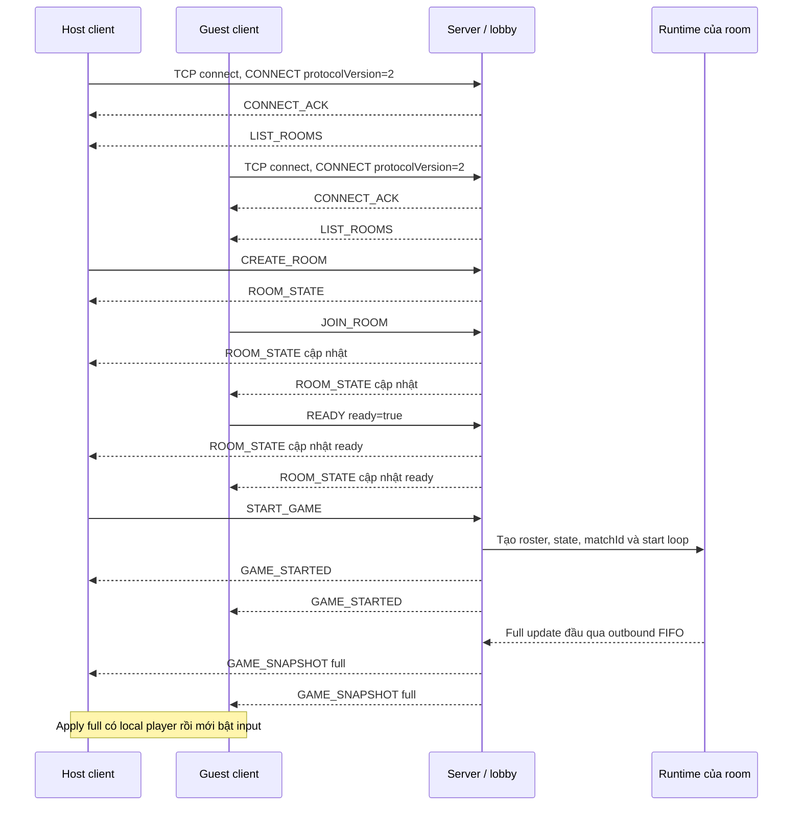
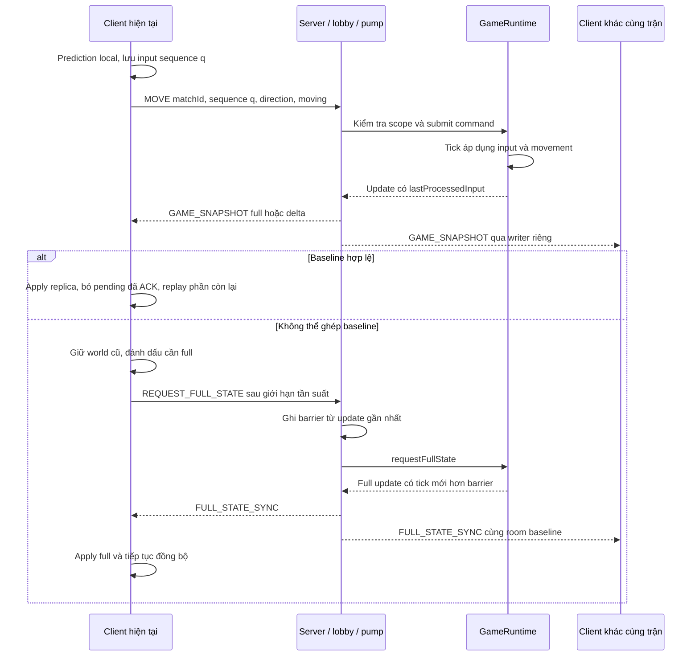

# 9. Thiết kế giao tiếp mạng

Protocol của Bomb It Multiplayer là giao thức ứng dụng trên TCP, phục vụ kết nối, lobby/phòng và gameplay
trong cùng một phiên client. Chương này trình bày đường chạy lobby mặc định theo codec và handler hiện hành;
không coi mọi message có tên trong đặc tả lịch sử là chức năng đã được bật.
Kiến trúc thread/queue được giải thích ở [mục 8](08_KIEN_TRUC_HE_THONG.md);
ở đây tập trung vào dữ liệu trên đường truyền, điều kiện xử lý và thứ tự trao đổi.

Quy ước: `C→S` là client gửi server; `S→C` là server gửi một client; `S→Room` là phát tới các client thuộc phòng/trận.
`S`, `R`, `M` trong schema lần lượt biểu thị UUID session, room và match, không phải chuỗi literal gửi trên mạng.
Ký hiệu kiểu và trường có thể bỏ trong bảng dùng để mô tả schema; các ví dụ JSON riêng là dạng canonical khi có yêu cầu.

> **Phân công: TV4 phụ trách framing/codec/version; TV1 xác nhận transport và handshake.**

## 9.1. TCP framing, UTF-8, size limit và handshake protocol 2

### 9.1.1. Cấu trúc frame

**Bảng 9.1. Frame ứng dụng trên TCP.**

| Trường | Kích thước | Quy tắc |
|---|---|---|
| `length` | int32, 4 byte | Số byte của type + payload, không tính chính prefix này |
| `type` | int16, 2 byte | Mã message theo `PacketType` |
| `payload` | `length − 2` byte | JSON mã hóa UTF-8 |

Các số nhiều byte của frame dùng big-endian. Giới hạn `length` là 2..1.048.576 byte,
do đó payload tối đa 1.048.574 byte và tổng frame tối đa 1.048.580 byte.
Giới hạn tính sau khi đã thêm match envelope, JSON và Base64; không chỉ tính binary snapshot.
Không có newline phân cách frame. TCP có thể chia hoặc gộp dữ liệu giữa các lần đọc;
decoder đọc đủ 4 byte length rồi `readFully` phần body và kiểm tra UTF-8 trước khi chuyển cho handler.

Ví dụ với message PING `0x0040`, body canonical `{"pingId":1}` có 12 byte UTF-8,
`length=14` và tổng frame 18 byte:

```text
00 00 00 0E 00 40 7B 22 70 69 6E 67 49 64 22 3A 31 7D
```

Đây là ví dụ tính frame, chưa phải số đo packet TCP/IP.
Nguồn: [PacketEncoder](../../src/main/java/com/bombit/common/protocol/PacketEncoder.java),
[PacketDecoder](../../src/main/java/com/bombit/common/protocol/PacketDecoder.java) và
[PacketType](../../src/main/java/com/bombit/common/protocol/PacketType.java).

### 9.1.2. Phân lớp kiểm tra dữ liệu

Framing kiểm tra kích thước/UTF-8; codec kiểm tra schema; handler kiểm tra trạng thái, scope và quyền;
game thread quyết định kết quả luật chơi. Frame đọc được không đồng nghĩa request đã hợp lệ hoặc đã được mô phỏng.

`SessionPacketCodec` xử lý object control nhỏ; `LobbyPacketCodec`/`LobbyJson` xử lý object lobby và một số message gameplay.
MOVE, resync, metadata bắt đầu trận và snapshot còn dùng định dạng canonical riêng.
Một JSON tương đương nhưng đổi thứ tự trường hoặc thêm khoảng trắng có thể không được các codec canonical chấp nhận.
Client phải dùng encoder hiện có thay vì tự tạo JSON tùy ý cho các loại đó.

Request qua `LobbyPacketCodec.request` tối đa 4096 ký tự; parser `LobbyJson` có giới hạn tổng 65.536 ký tự,
độ sâu 8 và tối đa 256 phần tử trong array. Control object tối đa 1024 ký tự;
MOVE và resync inner body tối đa 128 ký tự. Đây là các giới hạn ở những lớp khác nhau,
không thay thế giới hạn byte của frame.

### 9.1.3. Thương lượng phiên bản

Client mở TCP rồi gửi:

```json
{"playerName":"PlayerA","protocolVersion":2}
```

Server chỉ chấp nhận handshake protocol 2 trong đường chạy tích hợp.
Tên được strip, dài 1–32 code point và không chứa control character.
CONNECT sai version được trả `UNSUPPORTED_VERSION`, sau đó kết nối bị dọn theo chính sách transport.
`protocolVersion` không phải `snapshotVersion`: trường thứ nhất quy định contract tích hợp,
trường thứ hai mô tả layout binary của snapshot.

Thông tin ACK gồm `playerId` UUID phiên, token, `serverVersion`, protocol version và các giá trị heartbeat/grace.
`serverVersion` hiện là chuỗi `0.1.0`; đó không phải mã revision kiểm thử và không chứng minh tương thích với mọi binary snapshot.
Nguồn: [SessionPacketCodec](../../src/main/java/com/bombit/common/protocol/SessionPacketCodec.java)
và [SessionHandlers](../../src/main/java/com/bombit/server/dispatch/SessionHandlers.java).

> **Phân công: TV1 phụ trách danh tính và vòng đời phiên/phòng; TV4 kiểm tra envelope/context, TV2 xác nhận mapping runtime.**

## 9.2. Session, room, match identity và vòng đời kết nối

### 9.2.1. Hệ thống định danh

**Bảng 9.2. Định danh và phạm vi ý nghĩa.**

| Trường | Kiểu/phạm vi | Cách sử dụng |
|---|---|---|
| Session ID | UUID string server cấp | Field `playerId` trong CONNECT_ACK và roster phòng; danh tính kết nối đã handshake |
| Room ID | UUID string | Membership và quyền thao tác phòng |
| Match ID | UUID mới cho mỗi runtime/lượt | Lọc lệnh và state thuộc lượt cũ, kể cả chơi lại cùng phòng |
| Gameplay player ID | int32 dương, trong match | Ánh xạ từ session qua MatchContext/runtime; không nhận từ MOVE |
| Bomb/item ID | int32 dương trong namespace kind + match | Entity bom và item có thể có cùng số nhưng khác key `BOMB:id`/`ITEM:id` |
| Sequence, tick, baseTick, requestId, eventId | int64 Java; JSON integer khi ở JSON | Đánh số input, baseline, yêu cầu và event; không dùng float thay ID |

Client lấy session UUID từ CONNECT_ACK rồi đối chiếu roster GAME_STARTED để biết local playerId số.
`EntityData.ownerId` của bom vẫn là UUID chủ sở hữu, trong khi `ownerPlayerId` của event wire là int gameplay.
Không chuyển hai dạng này bằng cách parse UUID thành số nguyên.

### 9.2.2. Match envelope

Message gameplay được bọc bằng field `matchId` ở đầu object. Ví dụ MOVE trên dây:

```json
{"matchId":"11111111-1111-4111-8111-111111111111","sequence":7,"direction":"RIGHT","moving":false}
```

`MatchEnvelopeCodec` kiểm tra type, prefix UUID kỳ vọng, header lặp và kích thước frame.
Sau unwrap, codec chuyên biệt tiếp tục kiểm tra body; envelope không phải parser đầy đủ cho JSON bên trong.
Server lấy danh tính từ session/socket đang xử lý và đối chiếu runtime; client kiểm tra matchId trước áp dụng state.

Envelope áp dụng cho MOVE, PLANT_BOMB, snapshot/full-sync/resync, END_GAME, GAME_OVER và các notice gameplay.
GAME_STARTED đã tự chứa matchId; message session, heartbeat và lobby không bọc envelope.
Các API legacy không envelope vẫn có thể phục vụ fixture, nhưng không được suy ra thành contract production protocol 2.
Nguồn: [MatchEnvelopeCodec](../../src/main/java/com/bombit/common/protocol/MatchEnvelopeCodec.java).

### 9.2.3. Heartbeat và kết thúc kết nối

**Bảng 9.3. Các message phiên/control đang được sử dụng.**

| Mã | Message/hướng | Body chính và ngữ nghĩa |
|---|---|---|
| `0x0001` | CONNECT, C→S | `playerName`, `protocolVersion:2`; phải hoàn tất trước yêu cầu lobby/gameplay |
| `0x0002` | CONNECT_ACK, S→C | `playerId:S`, `reconnectToken`, `serverVersion`, `protocolVersion:2`, `heartbeatIntervalMs:2000`, `heartbeatTimeoutMs:10000`, `reconnectGraceMs:15000` |
| `0x0040` | PING, C→S | `pingId:int32`; client mặc định gửi theo chu kỳ 2 giây |
| `0x0041` | PONG, S→C | Echo đúng JSON body PING đã qua kiểm tra |
| `0x0042` | DISCONNECT, C→S | `reason:"USER_QUIT"`; handler hỗ trợ đóng phiên chủ động |
| `0x00FF` | ERROR, S→C | `errorCode`, `message`, `requestId` có thể null; cách xử lý tùy lớp lỗi |

Server sweep heartbeat mặc định mỗi 2 giây và timeout 10 giây; việc phát hiện không phải deadline chính xác tại giây thứ 10.
Frame được route thành công có thể cập nhật liveness; dữ liệu chưa decode hoặc request bị từ chối không mặc nhiên giữ phiên sống.
Client owner ghi thời điểm nhận packet đã decode và kiểm tra timeout qua control worker;
không yêu cầu chỉ PONG mới được tính là hoạt động từ server.

Đường đóng client hiện tại có thể đóng socket trực tiếp, được server nhận qua EOF; không khẳng định mỗi lần người dùng
đóng cửa sổ đều phát DISCONNECT. Mất kết nối trong lượt chơi hiện kết thúc/hủy lượt và bỏ ghế;
metadata phiên có thể còn chờ dọn tối đa theo grace, không còn world để resume.

### 9.2.4. Message có khai báo nhưng chưa thành luồng sản phẩm

`RECONNECT=0x0043` và `NETWORK_LOST=0x0044` có trong PacketType/tài liệu, nhưng router sản phẩm chưa đăng ký handler.
Enum reason `RECONNECT` trong request resync cũng không chứng minh đã có reconnect end-to-end.
`PLAYER_DISCONNECTED=0x0032` còn dùng trong các API/nhánh hạ tầng; đường lobby hiện tại chủ yếu cập nhật bằng GAME_OVER
và ROOM_STATE, không có luồng thông báo player-disconnected trong trận giữ ghế để tiếp tục chơi.

Không đưa các schema reconnect dự kiến thành sequence đã triển khai. Sau handshake, type chưa có handler có thể trả
UNKNOWN_MESSAGE; trước handshake còn chịu cổng kiểm tra CONNECT.
Căn cứ: [LobbyGameServer](../../src/main/java/com/bombit/server/app/LobbyGameServer.java),
[ClientHandler](../../src/main/java/com/bombit/server/network/ClientHandler.java),
[DemoClientConnection](../../src/main/java/com/bombit/client/app/DemoClientConnection.java)
và [đánh giá reconnect](../../docs/RECONNECT_ASSESSMENT.md).

> **Phân công: TV1 phụ trách nội dung lobby/phòng; TV4 chuẩn hóa schema và hướng truyền.**

## 9.3. Message lobby và room

**Bảng 9.4. Các message phòng đang nối vào server/client mặc định.**

| Mã | Message/hướng | Body và điều kiện chính |
|---|---|---|
| `0x0010` | CREATE_ROOM, C→S | `roomName` 1–64 code point, `maxPlayers` 2–4; `mode` có thể bỏ hoặc là `STANDARD` |
| `0x0011` | JOIN_ROOM, C→S | `roomId:R`; phòng đang WAITING, còn chỗ, client chưa ở phòng khác |
| `0x0012` | ROOM_STATE, S→Room | `roomId,roomName,hostId,state,maxPlayers,players:[{playerId:S,username,state}]` |
| `0x0013` | READY, C→S | `roomId:R,ready:boolean`; đặt trạng thái ready, không phải yêu cầu toggle |
| `0x0014` | START_GAME, C→S | `roomId:R`; host, ít nhất hai người và mọi khách ready |
| `0x0015` | GAME_STARTED, S→Room | `roomId:R,matchId:M,tickMillis:50,inputStepMillis:50,mapId:"demo",players:[{sessionId:S,playerId:int,username}]` |
| `0x0016` | LEAVE_ROOM, C→S/S→C | Request `roomId:R`; ACK cùng type `{roomId:R,left:true}`; người còn lại nhận cập nhật phòng |
| `0x0017` | CHAT, C→S/S→Room | Request `roomId:R,message` 1–256 code point; response thêm `playerId:S,username` từ session |
| `0x0018` | LIST_ROOMS, C→S/S→C | Request `{}`; response `{rooms:[ROOM_STATE body...]}`; cũng được server chủ động phát khi danh sách đổi |
| `0x0035` | END_GAME, C→S | Envelope chỉ chứa `matchId:M`, inner `{}`; host của lượt hiện tại |

Với READY, START_GAME, CHAT và LEAVE_ROOM, handler còn chấp nhận dạng rút gọn thiếu roomId bằng membership hiện tại;
nếu có roomId thì phải khớp. JOIN_ROOM vẫn cần roomId. Sau CREATE/JOIN, trạng thái phòng và danh sách được cập nhật,
không có một mã CREATE_ACK hoặc JOIN_ACK riêng.

Chat chỉ phát trong phòng, cả lúc WAITING và PLAYING. Tên tác giả lấy từ session, không tin tác giả tự khai trong request.
Phòng đang chơi không cho join trực tiếp. Khi host rời, quyền host chuyển cho thành viên còn lại theo thứ tự phòng.

GAME_STARTED hiện được `DemoPacketCodec` encode với `mapId:"demo"` ngay cả ở lobby mặc định dùng DefaultArenaMap.
Client không dùng chuỗi này để tự suy ra layout: map đầy đủ lấy từ full snapshot.
Đây là giá trị metadata hiện tại, không phải tuyên bố ứng dụng chỉ chạy profile movement demo.
Nguồn: [LobbyPacketCodec](../../src/main/java/com/bombit/common/protocol/LobbyPacketCodec.java),
[DemoPacketCodec](../../src/main/java/com/bombit/common/protocol/DemoPacketCodec.java)
và `LobbyGameServer`.

> **Phân công: TV2 phụ trách input/snapshot/baseline; TV4 phối hợp codec, match envelope và resync.**

## 9.4. MOVE, input sequence/ACK, snapshot v2–v5 và full/delta/resync

### 9.4.1. Message movement và phục hồi

**Bảng 9.5. Message đồng bộ trạng thái, đều có match envelope ở protocol 2.**

| Mã | Message/hướng | Inner body và ý nghĩa |
|---|---|---|
| `0x0020` | MOVE, C→S | `sequence:int64>0,direction:UP/DOWN/LEFT/RIGHT,moving:boolean` |
| `0x0030` | GAME_SNAPSHOT, S→Room | `snapshotVersion,data:Base64`; có thể full hoặc delta theo binary kind |
| `0x0033` | FULL_STATE_SYNC, S→Room | Cùng schema snapshot, nhưng binary kind bắt buộc full |
| `0x0034` | REQUEST_FULL_STATE, C→S | `lastAppliedTick>=-1,reason:COLD_START/BASELINE_MISMATCH/RECONNECT` |

Client phát mẫu input mỗi 50 ms, kể cả mẫu đứng yên. Sequence bắt đầu 1 trong lượt mới; server bỏ mẫu
không lớn hơn `lastProcessedInput` và có thể chấp nhận khoảng trống sequence. Một tick áp dụng tối đa
một mẫu movement mới mỗi player theo FIFO toàn cục. Với input có sequence, khi không có mẫu mới được áp dụng
thì movement không tự tiếp tục thêm một bước cho player đó.

ACK nằm trong PlayerData của snapshot sau bước movement, không có MOVE_ACK riêng và không dùng ACK TCP thay nó.
Client bỏ input pending có sequence ≤ ACK, khôi phục state server rồi replay phần còn lại.
Khi đã có 256 input chưa ACK, prediction từ chối tạo mẫu tiếp và báo lỗi cho caller,
không tự xóa mẫu hoặc bảo đảm tự khởi động resync.
Đây là khả năng của controller; không tuyên bố đã có tự động gửi lại mọi input bị từ chối bởi server.
Nguồn: [MovePacketCodec](../../src/main/java/com/bombit/server/game/movement/MovePacketCodec.java),
[MovementSystem](../../src/main/java/com/bombit/server/game/movement/MovementSystem.java)
và [PredictionController](../../src/main/java/com/bombit/client/game/movement/PredictionController.java).

### 9.4.2. Lớp binary snapshot và version

Dữ liệu trên dây có các lớp: frame → JSON match envelope → `snapshotVersion,data` → Base64 → binary snapshot.
Base64 chỉ biểu diễn byte, phần tránh gửi lại dữ liệu đến từ builder full/delta.
Binary dùng big-endian; int32/int64 lần lượt 4/8 byte, double 8 byte, ordinal 1 byte;
encoder ghi boolean bằng một byte 0/1. Chuỗi `writeUTF` dùng modified UTF-8 có prefix độ dài uint16,
khác UTF-8 của JSON bên ngoài.

**Bảng 9.6. Thứ tự các khối binary cơ sở v2.**

| Thứ tự | Trường/khối | Kiểu và nội dung |
|---|---|---|
| 1 | kind, tick, baseTick | uint8 full=0/delta=1; int64; int64 |
| 2 | mapWidth, mapHeight, tileSize | Ba int32 |
| 3 | matchState, matchStateChanged | uint8 WAITING/RUNNING/FINISHED; boolean |
| 4 | Full map | count:int32, rồi tile:uint8 theo thứ tự `y*width+x` |
| 5 | Tile changes | count:int32, mỗi record `x:int32,y:int32,type:uint8` |
| 6 | Players | count:int32, các PlayerData đầy đủ hoặc upsert theo loại update |
| 7 | Removed players | count:int32, rồi các playerId:int32 |
| 8 | Entities | count:int32, các EntityData đầy đủ hoặc upsert |
| 9 | Removed entities | count:int32, rồi key:`writeUTF` |

Một PlayerData gồm `id:int32`, năm double `x,y,width,height,speed`, `direction:uint8`,
`moving:boolean`, `alive:boolean`, `lastProcessedInput:int64`.
Một EntityData gồm `kind:uint8`, ba int32 `id,tileX,tileY`, `ownerId:writeUTF`, `variant:int32`, `expiresAtMillis:int64`.
Với bom, variant là range và ownerId là UUID; với item, variant là wireId cố định và ownerId rỗng.
Các key xóa dạng `BOMB:<id>`/`ITEM:<id>` là phần bắt buộc để biết entity đã biến mất.

Direction wire cố định `UP=0,DOWN=1,LEFT=2,RIGHT=3`; tile `EMPTY=0,HARD_WALL=1,BREAKABLE_BLOCK=2`;
match state `WAITING=0,RUNNING=1,FINISHED=2`; entity `BOMB=0,ITEM=1`.
OUT_OF_BOUNDS không phải tile được lưu/truyền. Item dùng mã riêng
`BOMB_UP=0,FIRE_UP=1,SPEED_UP=2,LIFE_UP=3,SHIELD=4`.
Thay layout, ordinal hoặc ý nghĩa trường cần migration/version tương ứng.

**Bảng 9.7. Các version snapshot được decoder hiện tại hỗ trợ.**

| Version | Phần dữ liệu thêm so với nền v2 | Tình trạng trong encoder hiện tại |
|---|---|---|
| 2 | Map/player/entity và ACK | Phát khi update không có BombFrame/MatchFrame |
| 3 | Sau v2: serverTimeMillis và danh sách toàn bộ explosion còn hiển thị | Phát khi có BombFrame nhưng không MatchFrame |
| 4 | Sau v3: remainingSeconds, Stats cũ, hasResult và result JSON qua writeUTF | Decode để tương thích; encoder hiện tại không chọn phát v4 |
| 5 | Sau v3: MatchFrame như v4, nhưng Stats thêm lives/shield/respawns | Lobby gameplay hiện phát v5 |

Phần v3 gồm `serverTimeMillis:int64`, `explosionCount:int32`; mỗi explosion có
`bombId:int32,startedAtMillis:int64,visibleUntilMillis:int64,cellCount:int32`, rồi các cặp `x,y:int32`.
Danh sách này là toàn bộ effect còn hiệu lực trong cả full và delta, không phải danh sách effect chênh lệch.
Giới hạn DTO là 256 explosion, mỗi explosion tối đa 1024 ô; duration hiển thị hiện 600 ms.
State/effect từ snapshot mới quyết định cảnh bom/lửa, không tự xóa bom vì đồng hồ client vừa đếm về 0.

MatchFrame v5 gồm `remainingSeconds:int32,statsCount:int32`, mỗi Stats gồm
`playerId:int32,bombLimit:int32,range:int32,lives:int32,shield:boolean,respawns:int32`,
sau đó `hasResult:boolean`; nếu true thì `result:writeUTF` chứa inner JSON GAME_OVER.
Cả full và delta mang toàn bộ Stats, không chỉ player có tọa độ đổi. V4 thiếu ba trường mới được đọc với
lives=1, shield=false, respawns=0. Result trong snapshot phải thuộc state FINISHED và không có tick lớn hơn snapshot.

Decoder từ chối dữ liệu dư, count không phù hợp, số/enum không hợp lệ và body không nhất quán full/delta;
replica tiếp tục kiểm tra tọa độ và tập ID Stats trước khi apply.
Các bộ encode/decode hiện tại phải được phân phối tương thích giữa client/server; handshake version 2
không tự bảo đảm một client cũ đọc được v5.
Nguồn: [SnapshotPacketCodec](../../src/main/java/com/bombit/server/game/movement/SnapshotPacketCodec.java),
[BombFrame](../../src/main/java/com/bombit/common/dto/BombFrame.java) và
[MatchFrame](../../src/main/java/com/bombit/common/dto/MatchFrame.java).

### 9.4.3. Full, delta và điều kiện áp dụng

Full có `baseTick=-1`, đủ `width*height` tile và toàn bộ player/entity; không kèm tile changes hoặc danh sách xóa.
Delta có `0<=baseTick<tick`, không chứa full map, dùng record upsert và danh sách xóa rõ ràng.
Không có record trong delta không có nghĩa đối tượng bị xóa. Khi một player đổi, codec gửi cả PlayerData,
chưa nén riêng từng field.

Replica bỏ update có `tick<=tick` đang giữ. Delta chỉ áp dụng khi baseTick khớp tick replica,
kích thước map/ô không đổi và các kiểm tra dữ liệu thành công.
Nếu cần full, replica giữ dữ liệu cũ để hiển thị và báo NEED_FULL_STATE; không ghép một phần delta sai.
Full hợp lệ thay dữ liệu cũ và tạo baseline mới.

Server tạo full đầu, full mỗi 100 tick, full khi được yêu cầu và full FINISHED.
100 tick tương ứng khoảng 5 giây nếu loop theo kịp nhịp 50 ms; không phải bảo đảm thời gian thực dưới mọi tải.
Update không đổi có thể không được phát, nên baseline không nhất thiết là tick ngay trước.
Builder chỉ commit khi enqueue vào outbound FIFO thành công, chưa phải khi client ACK đã áp dụng.
Nguồn: [StateDeltaBuilder](../../src/main/java/com/bombit/server/game/movement/StateDeltaBuilder.java),
[GameLoop](../../src/main/java/com/bombit/server/game/core/GameLoop.java)
và [ClientWorldState](../../src/main/java/com/bombit/client/game/movement/ClientWorldState.java).

### 9.4.4. Request full và phục hồi baseline

Ví dụ request canonical trên dây:

```json
{"matchId":"11111111-1111-4111-8111-111111111111","lastAppliedTick":40,"reason":"BASELINE_MISMATCH"}
```

`lastAppliedTick=-1` nghĩa chưa có baseline. Handler kiểm tra request nhưng không dùng tick client để rewind world.
Nó lưu barrier từ update gần nhất, đặt cờ request full; consumer snapshot hiện có chờ full với tick mới hơn barrier
để phát FULL_STATE_SYNC. Không thêm consumer cạnh tranh outbound FIFO và không coi `createUpdate()` là full.

Baseline chung theo runtime/room nên full phục hồi được phát cho cả roster, dù một client yêu cầu.
Server giới hạn tối thiểu 1 giây giữa các request; client owner hiện lập lịch cách tối thiểu 1100 ms
và gộp request đang chờ. FULL_STATE_SYNC dùng cùng body version tương ứng update, bắt buộc full.
Không diễn giải resync như giao thức reconnect hoặc bảo đảm sửa được mọi payload hỏng.
Nguồn: [ResyncPacketCodec](../../src/main/java/com/bombit/common/protocol/ResyncPacketCodec.java),
[LobbyGameServer](../../src/main/java/com/bombit/server/app/LobbyGameServer.java)
và [DemoClientConnection](../../src/main/java/com/bombit/client/app/DemoClientConnection.java).

> **Phân công: TV3 phụ trách nội dung bom/item/damage/kết quả; TV4 codec và envelope, TV2 state/notice handoff.**

## 9.5. PLANT_BOMB, event, dedupe và GAME_OVER

### 9.5.1. Tiếp nhận lệnh đặt bom

PLANT_BOMB `0x0021` có inner body `{"requestId":1}`, requestId int64 dương và tăng theo player/match.
Không truyền tọa độ, range hoặc owner do client tự khai. Server lấy player từ session/context và vị trí từ world authoritative.

Handler bỏ requestId cũ/trùng trước khi tính giới hạn riêng của đặt bom, nhưng frame đó vẫn được tính vào tổng rate limit kết nối.
Chỉ ghi nhận requestId sau khi submit command thành công; queue đầy có thể thử lại cùng ID theo contract.
Không suy ra client hiện đã tự động retry mọi yêu cầu bị từ chối.

Submit thành công cũng chưa bảo đảm bom được tạo: game thread còn kiểm tra player sống, quota và ô đặt.
Trong cấu hình lobby hiện tại, callback `BombCommandResult` bên ngoài là no-op, chưa có message ACK riêng
báo thành công/thất bại nghiệp vụ cho từng requestId. Bom đặt thành công được phản ánh qua snapshot và BOMB_PLANTED;
các lỗi như quota đầy ở bước gameplay không mặc nhiên được gửi thành ERROR có requestId tương ứng.

### 9.5.2. Notice và kết quả trên dây

Mỗi notice trong bảng có thêm bộ trường chung `eventId:int64>0,tick:int64>0,occurredAtMillis:int64`,
trừ GAME_OVER dùng schema riêng. Các message dưới đây là `S→Room` và có match envelope.

**Bảng 9.8. Body inner của các thông báo gameplay và kết quả.**

| Mã | Message | Các trường ngoài bộ notice chung |
|---|---|---|
| `0x0022` | BOMB_PLANTED | `bombId:int,ownerPlayerId:int,x:int,y:int,fuseMs:long,explodeAtMillis:long,range:int` |
| `0x0023` | BOMB_EXPLODE | `bombId:int,x:int,y:int,affectedCells:[{x:int,y:int}]` |
| `0x0024` | ITEM_SPAWN | `itemId:int,itemType:string,x:int,y:int` |
| `0x0025` | ITEM_PICKED_UP | `itemId:int,playerId:int,itemType:string` |
| `0x0026` | PLAYER_DIE | `playerId:int,killerPlayerId:int hoặc null,cause:"EXPLOSION"` |
| `0x0031` | GAME_OVER | Schema riêng: `tick:long,winnerPlayerId:int hoặc null,reason,rankings:[{playerId:int,rank:int}]` |

`itemType` là một trong BOMB_UP/FIRE_UP/SPEED_UP/LIFE_UP/SHIELD.
PLAYER_DIE chỉ mô tả bị loại; khiên chặn hoặc mất một mạng rồi respawn được thể hiện qua snapshot Stats,
không phát PLAYER_DIE cho mọi lần nhận damage.
Không có packet BLOCK_DESTROYED riêng: thay đổi nền đi qua snapshot, còn event block nội bộ phục vụ gameplay/drop.

EventId được cấp trên game thread theo match; snapshot worker encode notice đã bàn giao sau snapshot tương ứng,
qua cùng writer FIFO của từng session. Client không dùng notice để áp lại damage, pickup hoặc thay đổi map.
Scene bom ghi nhận notice cùng tick replica và dedupe trong cache 256 ID; notice item/death được validate nhưng
không cộng lại chỉ số. Không khái quát cơ chế cache này thành bảo đảm exactly-once đầu cuối cho mọi message.

Full/resync mang state và effect hiện tại, không phát lại toàn bộ lịch sử notices.
Nguồn: [BombPacketCodec](../../src/main/java/com/bombit/common/protocol/BombPacketCodec.java),
[GameplayPacketCodec](../../src/main/java/com/bombit/common/protocol/GameplayPacketCodec.java),
[BombScene](../../src/main/java/com/bombit/client/game/bomb/BombScene.java)
và [MovementClientController](../../src/main/java/com/bombit/client/game/movement/MovementClientController.java).

### 9.5.3. GAME_OVER và chính sách kết thúc

Reason là LAST_ALIVE, ALL_DEAD, TIMEOUT hoặc ABORTED. Chỉ LAST_ALIVE có winnerPlayerId;
ABORTED không có người thắng và rankings rỗng. Lượt kết thúc bình thường có full FINISHED/result,
sau đó notices nếu có và GAME_OVER. Client owner áp dụng snapshot trên cùng UI executor trước khi xử lý GAME_OVER.

Hủy hành chính không giả tạo snapshot FINISHED; server dừng runtime và gửi GAME_OVER theo chính sách hủy
nếu chưa có kết quả chốt. Client bỏ context/controller cũ, hiển thị kết quả và giữ TCP để chơi lượt sau nếu kết nối còn hợp lệ.
GAME_OVER cũ/trùng không mở lại world đã đóng; match mới luôn có identity mới.

> **Phân công: TV4 ghép sơ đồ; TV1 xác nhận kết nối/phòng, TV2 movement/resync, TV3 gameplay/kết quả.**

## 9.6. Sơ đồ tuần tự các luồng chính

Các mũi tên server→client dưới đây là frame ứng dụng được enqueue/ghi theo writer tương ứng;
không phải mỗi mũi tên tương đương đúng một TCP segment. Các sơ đồ bỏ bớt heartbeat và cập nhật LIST_ROOMS lặp
để tập trung luồng chính; không bỏ các kiểm tra của handler trong hiện thực.

### 9.6.1. Kết nối, vào phòng và bắt đầu

**Hình 9.1. Kết nối và bắt đầu một trận hai người. Nhóm tự vẽ từ code project.**



Runtime có thể đã tạo update trước khi worker bắt đầu đọc queue; bảo đảm cần thể hiện là GAME_STARTED vào writer
trước full gửi cho client, không phải game thread chỉ bắt đầu mô phỏng sau khi metadata đã tới client.
Server dùng dấu initialized sau enqueue full; client chỉ bật input sau khi thực sự apply full.
Không có message ACK-full riêng. Bản gốc: [09_01_ket_noi_va_start.mmd](../figures/network/09_01_ket_noi_va_start.mmd).

### 9.6.2. Di chuyển, ACK và resync

**Hình 9.2. Input sequence và nhánh phục hồi baseline. Nhóm tự vẽ từ code project.**



Nhánh sai baseline là lỗi/thiếu chuỗi ở lớp ứng dụng, không giả định TCP giao segment sai thứ tự như UDP.
Bản gốc: [09_02_move_va_resync.mmd](../figures/network/09_02_move_va_resync.mmd).

### 9.6.3. Đặt bom và thông báo diễn biến

**Hình 9.3. Nhánh đặt bom thành công và vụ nổ sau đó. Nhóm tự vẽ từ code project.**

```mermaid
sequenceDiagram
    participant C as Client
    participant S as Server / lobby / pump
    participant R as GameLoop và gameplay
    Note over C,R: Minh họa nhánh đặt bom thành công
    C->>S: PLANT_BOMB matchId, requestId
    S->>S: Kiểm tra scope, ID trùng/cũ và rate limit
    S->>R: Submit PlantBombCommand
    R->>R: Kiểm tra sống, ô đặt, quota; tạo bom
    R-->>S: Snapshot và notice placement qua FIFO
    S-->>C: GAME_SNAPSHOT có entity bom
    S-->>C: BOMB_PLANTED
    Note over C,R: Khi bom đến hạn hoặc được kích nổ dây chuyền
    R->>R: Nổ, damage batch, block/item và cập nhật state
    R-->>S: Snapshot và notices mới
    S-->>C: GAME_SNAPSHOT state/effects mới
    S-->>C: BOMB_EXPLODE và notices khác nếu có
    C->>C: Render từ snapshot; notice không áp damage/pickup lần hai
```

Thông báo được phát cho cả roster, không chỉ người đặt. Request trùng không tạo thêm command;
request hợp lệ ở transport nhưng không đạt luật đặt bom không đi qua nhánh tạo entity trong hình.
Bản gốc: [09_03_bom_va_event.mmd](../figures/network/09_03_bom_va_event.mmd).

### 9.6.4. Kết thúc và chơi lại

**Hình 9.4. Kết thúc gameplay bình thường và mở lượt mới. Nhóm tự vẽ từ code project.**

```mermaid
sequenceDiagram
    participant H as Host client
    participant C as Guest client
    participant S as Server / lobby / pump
    participant R as Runtime
    R-->>S: Full FINISHED có MatchResult
    S-->>H: GAME_SNAPSHOT full FINISHED
    S-->>C: GAME_SNAPSHOT full FINISHED
    opt Có gameplay notices của tick cuối
        S-->>H: Notices sau snapshot
        S-->>C: Notices sau snapshot
    end
    S->>R: Stop runtime
    S-->>H: GAME_OVER
    S-->>C: GAME_OVER
    S-->>H: ROOM_STATE WAITING
    S-->>C: ROOM_STATE WAITING
    Note over H,C: Đóng controller cũ, hiển thị kết quả; giữ TCP nếu còn hợp lệ
    C->>S: READY ready=true
    H->>S: START_GAME
    S->>R: Tạo runtime/world mới với matchId mới
    S-->>H: GAME_STARTED của lượt mới
    S-->>C: GAME_STARTED của lượt mới
    S-->>H: Full snapshot lượt mới
    S-->>C: Full snapshot lượt mới
```

Nhánh host End/leave/disconnect bỏ phần full FINISHED nếu chưa có kết quả gameplay;
nó dừng runtime và gửi ABORTED. Socket đã mất không được bảo đảm nhận thông báo cuối;
các thành viên còn kết nối được cập nhật theo khả năng gửi.
Bản gốc: [09_04_ket_thuc_va_choi_lai.mmd](../figures/network/09_04_ket_thuc_va_choi_lai.mmd).

> **Phân công: TV1/TV4 phụ trách transport, timeout và validation; TV2 queue/baseline, TV3 kiểm tra tác động gameplay.**

## 9.7. Packet lỗi, timeout, client chậm, queue đầy và stale match

### 9.7.1. Giới hạn vận hành của giao thức

**Bảng 9.9. Các giới hạn mặc định liên quan đến giao tiếp.**

| Lớp/loại | Giới hạn hiện tại | Khi vượt/không đáp ứng |
|---|---|---|
| Tổng frame đã decode | 100 frame/giây/kết nối, kể cả unknown/rejected | RATE_LIMITED và đóng sau drain có thời hạn |
| CHAT và LIST_ROOMS | Mỗi loại 5 request/giây/kết nối | RATE_LIMITED; chưa đóng chỉ vì vượt loại nếu chưa vượt tổng |
| MOVE | 40 request/giây trong cửa sổ một giây | RATE_LIMITED; chưa enqueue request vượt |
| PLANT_BOMB | 5 request mới/giây/session/match | Bỏ ID cũ/trùng trước giới hạn riêng; request mới vượt trả RATE_LIMITED |
| Request full | Khoảng cách tối thiểu 1000 ms ở server | RATE_LIMITED; client owner hiện dùng 1100 ms |
| Đọc frame server | Deadline toàn frame mặc định 10 giây | Đóng captured connection; không gia hạn vô hạn theo từng byte |
| Ghi socket | Watchdog mặc định 5 giây ở server/client | Đóng socket để thoát I/O chặn, báo/dọn theo owner |
| Writer server | Queue 256 frame chờ; byte budget 4 MiB tính cả frame đang ghi | Đóng kết nối khi đầy; không bỏ một delta rồi tiếp tục |
| Runtime | Command 4096, outbound 1024 | Submit thất bại hoặc giữ baseline chưa commit như mục 9.4 |
| Pending phía client | Pull queue tùy chọn 1024 packet; UI dispatch count hữu hạn, budget 4 MiB | Overflow gây lỗi/dừng; owner mặc định tắt pull queue không dùng |

Các rate limit là cửa sổ/điều kiện trong handler, không phải bảo đảm throughput thực đạt.
MOVE/PLANT/resync còn chịu giới hạn tổng kết nối. Control và input sender của client có giới hạn pending riêng;
UI owner hiện cho tối đa 256 dispatch đang chờ, không có nghĩa toàn bộ EDT được biến thành queue hữu hạn.
Watchdog/scheduler có chu kỳ kiểm tra nên các thời gian trên là cấu hình phát hiện, không phải SLA ngắt chính xác.
Nguồn: [InboundRateLimiter](../../src/main/java/com/bombit/server/network/InboundRateLimiter.java),
[ClientHandler](../../src/main/java/com/bombit/server/network/ClientHandler.java),
[SessionWriter](../../src/main/java/com/bombit/server/network/SessionWriter.java)
và [ClientNetwork](../../src/main/java/com/bombit/client/network/ClientNetwork.java).

### 9.7.2. Phân loại lỗi và hành động

**Bảng 9.10. Cách xử lý theo lớp lỗi thực tế.**

| Tình huống | Phản hồi/hành động server hoặc client | Lưu ý |
|---|---|---|
| Length/UTF-8 không hợp lệ | Server đóng kết nối có kiểm soát | Không cố tìm biên frame tiếp theo, không bảo đảm gửi ERROR |
| EOF, frame thiếu byte hoặc timeout I/O | Dọn captured connection; phiên đã handshake đi qua chính sách disconnect | Nếu đang chơi, lobby có thể hủy lượt |
| Request trước handshake hoặc version không hỗ trợ | NOT_CONNECTED/UNSUPPORTED_VERSION rồi đóng theo transport | CONNECT lặp sau handshake là INVALID_PACKET |
| JSON/field sai sau handshake | INVALID_PACKET; thông thường tiếp tục phiên | Codec, handler và trạng thái quyết định đường lỗi cụ thể |
| Sai phòng/quyền/trạng thái | NOT_IN_ROOM, NOT_HOST, NOT_READY, NOT_PLAYING hoặc lỗi lobby tương ứng | Không được sửa world để chấp nhận yêu cầu |
| Sai/mất match envelope | Handler gameplay trả STALE_MATCH; client bỏ packet sai match | UUID đúng chưa thay cho kiểm tra session/socket/membership |
| Command queue không nhận | INPUT_QUEUE_FULL | Chưa bảo đảm command đã được xử lý; không có replay tự động mọi request |
| Writer đầy/ghi quá hạn | Đóng client đó và cleanup | Theo chính sách lobby, một disconnect có thể làm hủy cả lượt của phòng |
| Replica không ghép được baseline | Giữ world cũ, xin full, tạm chặn input mới theo input-ready | Payload decode hỏng có thể gây fail controller thay vì đi qua resync |
| RuntimeException ngoài validation trong handler | SERVER_ERROR, ghi diagnostics rồi đóng kết nối | Lỗi runtime/pump được xử lý qua failure và endMatch; không hứa luôn phát MATCH_FAILED |

Các lỗi lobby còn gồm ROOM_NOT_FOUND, ROOM_FULL, ROOM_PLAYING, ALREADY_IN_ROOM,
INVALID_ROOM_STATE, ROOM_LIMIT, MODE_NOT_SUPPORTED, CHAT_QUEUE_FULL và MATCH_START_FAILED theo handler tương ứng.
Type không có handler sau handshake trả UNKNOWN_MESSAGE; một type có tên trong PacketType không tự cho phép gửi ở mọi hướng.

Ví dụ ERROR do transport/handler hiện tạo:

```json
{"errorCode":"INPUT_QUEUE_FULL","message":"INPUT_QUEUE_FULL","requestId":null}
```

Schema cho phép trường requestId, nhưng helper hiện đặt null; không mô tả ERROR như cơ chế correlation hoàn chỉnh
cho từng MOVE/PLANT_BOMB. Nếu writer/socket đã hỏng thì phản hồi cuối có thể không gửi được.
Ở lobby client, ERROR nghiệp vụ được chuyển lên UI để người dùng xử lý, không mặc định ngắt phiên;
codec/listener hoặc I/O failure có thể đóng owner để tránh tiếp tục với state không an toàn.

### 9.7.3. Thứ tự, dữ liệu cũ và giới hạn kết luận

Mỗi kết nối server có writer riêng; snapshot, notice và kết quả được enqueue theo thứ tự của luồng công bố.
Client dùng listener ứng dụng thường trực và UI executor tuần tự để xử lý metadata/state/kết quả.
Match identity ngăn dữ liệu lượt trước ảnh hưởng lượt mới; tick và baseline kiểm tra thứ tự state trong cùng match.
Không thay các tầng kiểm tra này bằng giả định “TCP tin cậy nên ứng dụng luôn đồng bộ”.

Protocol hiện không có receipt ACK riêng cho snapshot, không có ACK nghiệp vụ riêng cho mọi lệnh và chưa có reconnect resume.
Mức đúng/ổn định dưới phân mảnh, quá tải, lỗi, nhiều client hoặc nhiều process cần minh chứng test/đo tương ứng.
Thiết kế trên không được dùng để kết luận đã đạt GUI/LAN/soak hoặc để bỏ qua process smoke failure đã ghi ở
[hồ sơ khảo sát](../01_HO_SO_KHAO_SAT.md).
