# 1. Tên đề tài — Title

> **Phân công: TV1 tổng hợp bìa; cả nhóm xác nhận thông tin định danh trước khi xuất bản nộp.**

**BOMB IT MULTIPLAYER**

**Thiết kế và đánh giá đồng bộ trạng thái theo delta và phục hồi phiên chơi trên kiến trúc server authoritative**

Báo cáo project ứng dụng mạng — nội dung cập nhật ngày 27/10/2026.

| Thông tin bìa | Nội dung |
|---|---|
| Trường/khoa | Chưa được cung cấp thông tin chính thức |
| Học phần/mã học phần/lớp | Chưa được cung cấp thông tin chính thức |
| Giảng viên hướng dẫn | Chưa được cung cấp thông tin chính thức |
| Nhóm/số nhóm | Chưa xác nhận |
| Học kỳ/năm học | Chưa xác nhận; không suy từ ngày chạy thực nghiệm |
| Repository khảo sát | BombItMultiplayer-Structure |

**Danh sách theo tên gọi trong phân công nội bộ; chưa thay cho họ tên/MSSV trên bìa chính thức:**

| Vai trò | Tên gọi đã có trong tài liệu | Họ tên chính thức | MSSV |
|---|---|---|---|
| Thành viên 1 | Mai | Chưa xác nhận | Chưa xác nhận |
| Thành viên 2 | Chinh | Chưa xác nhận | Chưa xác nhận |
| Thành viên 3 | Duy | Chưa xác nhận | Chưa xác nhận |
| Thành viên 4 | Giang | Chưa xác nhận | Chưa xác nhận |

Nguồn tên gọi: [nhiemvu.md](../../phancong/nhiemvu.md).
Nhóm cần thay các ô chưa xác nhận bằng thông tin thật trước khi nộp; không dùng tên gọi ngắn làm xác nhận tác giả đầy đủ.
Bản xuất gồm mục lục, danh mục hình/bảng và số trang đã cập nhật. Thông tin bìa còn chờ nhóm xác nhận.


# 2. Tóm tắt — Abstract

> **Phân công: TV2 chủ trì; TV1/TV3 xác nhận chức năng, TV4 xác nhận số liệu.**

Game nhiều người chơi cần thống nhất trạng thái, hạn chế dữ liệu lặp và xử lý mất kết nối tạm thời.
Bomb It Multiplayer sử dụng Java 25/Swing và TCP, với server quyết định gameplay, runtime riêng theo room,
command queue hữu hạn và snapshot bất biến. Client kết hợp prediction/reconciliation cho nhân vật local,
interpolation cho nhân vật remote và replica full/delta. Hai cải tiến được hiện thực là
**State Delta Compression** và **Seamless Session Recovery**. Cơ chế delta truyền thay đổi/xóa
so với baseline đã xuất bản, bỏ update rỗng và giữ chính sách full/resync. Cơ chế recovery giữ phiên tối đa
15 giây kể từ khi server xử lý disconnect, xác minh token khi nối lại, giữ controller và bộ đếm input,
khóa điều khiển đến khi ACK đúng danh tính và full state hợp lệ đã được áp dụng.
Trong thời gian này, nhân vật dừng di chuyển nhưng gameplay, sát thương và timer vẫn tiếp diễn.
Đối chứng delta cùng trace ở sáu cấu hình snapshot v5 giảm tổng byte frame 35,98–97,54%;
18.000 đối chiếu replica chuẩn hóa đều đạt. Benchmark TCP loopback trước đợt recovery hoàn tất
45/45 scenario-run, tách biệt với lượt kiểm thử source sau sửa recovery đạt 171/171 JUnit test
thuộc 44 class ngoài sandbox. Kiểm thử recovery xác nhận ba chu kỳ full→delta,
từ chối token sai, biên hết hạn và gameplay khi mất mạng; phép chờ grace thực ghi nhận 15.001 ms.
Đóng góp là hiện thực, tích hợp và kiểm chứng hai cơ chế trong game, kế thừa các kỹ thuật đồng bộ đã có.
Kết quả chưa bao gồm nghiệm thu GUI/LAN thực tế, soak dài hạn hoặc đối chứng latency/chi phí recovery;
full state khôi phục world hiện tại, không phát lại toàn bộ input hay sự kiện đã bỏ lỡ.


# 3. Từ khóa — Keywords

> **Phân công: TV2 đề xuất; TV4 rà soát thuật ngữ.**

Game nhiều người chơi; TCP; server authoritative; State Delta Compression; Session Recovery; đồng bộ trạng thái.


# 4. Giới thiệu — Introduction

> **Phân công: TV1 chủ trì bối cảnh/phạm vi; TV2 mô tả bài toán đồng bộ và đóng góp chính; TV3 xác nhận gameplay; TV4 rà soát nguồn và bằng chứng.**

## 4.1. Bối cảnh và động lực

Một game đặt bom nhiều người chơi không chỉ cần vẽ bản đồ và xử lý phím.
Các client còn phải thống nhất người chơi đang ở đâu, ô nào bị phá, bom nào đã nổ,
ai nhận item và khi nào kết quả trận được chốt. Nếu các thành phần cập nhật khác thứ tự hoặc khác nền state,
người chơi có thể quan sát thế giới không nhất quán dù mỗi màn hình vẫn đang hoạt động.

Project dùng TCP làm kênh truyền byte có thứ tự và tin cậy [1], đồng thời tự định nghĩa framing và message contract.
Tính chất transport không thay thế việc quản lý room/match, kiểm tra quyền thao tác hoặc baseline snapshot.
Nguồn nền: [RFC 9293](https://www.rfc-editor.org/rfc/rfc9293.html).

Mô hình server authoritative tập trung quyết định world ở server, client gửi intent rồi nhận kết quả [2].
([Gambetta, Client-Server Game Architecture](https://www.gabrielgambetta.com/client-server-game-architecture.html)).
Trong Bomb It, cách tổ chức này cho phép movement, collision, bom/item và kết quả dùng cùng state của trận.
Thách thức còn lại là cập nhật đủ kịp thời và nhất quán mà không lặp lại quá nhiều dữ liệu không đổi.

Mất kết nối tạm thời đặt ra một yêu cầu khác: người chơi cần có cơ hội trở lại đúng phiên,
thay vì mọi lỗi socket đều làm mất ngay chỗ trong trận. Tuy nhiên, nối được socket mới chưa đủ:
server phải xác minh quyền nhận lại phiên, còn client phải có nền state đúng trước khi tiếp tục gửi input.
Đây là động lực bổ sung cơ chế Seamless Session Recovery vào cùng luồng đồng bộ full/delta.

## 4.2. Vấn đề đồng bộ game nhiều người chơi

Gửi full snapshot mỗi tick là một đối chứng rõ ràng: client nhận đủ dữ liệu tại mỗi mốc cập nhật,
nhưng map và các thực thể không đổi vẫn bị truyền lại.
Với map theo tile, thay đổi thường có tính cục bộ: một bom được thêm/xóa, một block bị phá hoặc một player dịch chuyển.
Do đó project áp dụng delta theo baseline, một kỹ thuật đã có trong tài liệu về snapshot compression [3].
([Fiedler, Snapshot Compression](https://gafferongames.com/post/snapshot_compression/)).
Phần cần giải quyết trong implementation là chọn baseline, biểu diễn xóa, giữ thứ tự xuất bản,
phát hiện nền không khớp và phục hồi bằng full mà không áp lại effect gameplay.

Ở client, chỉ chờ state server có thể làm điều khiển phụ thuộc độ trễ phản hồi;
prediction/reconciliation dùng input chưa ACK là hướng tiếp cận đã có [4],
còn nội suy dùng các mẫu trước để hiển thị remote giữa các lần cập nhật [5].
Những phương pháp này phải gắn với contract tick/sequence và được reset khi respawn hoặc đổi match.
Chúng không cấp quyền cho client tự quyết định sát thương hoặc kết quả trận.

Từ đó, đề tài đặt ra hai câu hỏi. Thứ nhất, **có thể giảm tổng byte snapshot so với full mỗi tick
trên cùng workload trong khi giữ replica đúng theo contract hay không?** Thứ hai,
**có thể nhận lại phiên còn hiệu lực sau mất kết nối, khôi phục state và chỉ mở điều khiển
khi client đủ điều kiện tiếp tục hay không?**
Các câu hỏi bổ sung là hệ thống xử lý đồng thời/lifecycle/lỗi như thế nào và latency/lưu lượng quan sát được
ở số client đã thử nằm trong phạm vi nào. Báo cáo phân biệt correctness recovery, tiết kiệm byte và latency;
thành công ở một nhóm kiểm thử không thay cho phép đo của nhóm khác.

## 4.3. Mục tiêu và phạm vi

Mục tiêu của project gồm tổ chức lobby/room, xác lập authority server, cập nhật gameplay theo loop,
đồng bộ full/delta tới client và kiểm tra các ranh giới lỗi/cleanup.
Sau khi bổ sung recovery, mục tiêu còn gồm giữ phiên có thời hạn, nối lại bằng token và đồng bộ full
trước khi nối tiếp chuỗi delta, mà không tạo runtime hoặc nhân vật mới cho lần phục hồi hợp lệ.
Implementation dùng Java 25, Swing/AWT, TCP và custom Java 2D renderer; server tạo runtime riêng theo room.
Một match lobby có 2–4 player, map arena hiện tại 17 × 15 ô, bước mô phỏng mục tiêu 50 ms.
Luật cụ thể, input/output và yêu cầu chức năng được xác định ở mục 6, không suy từ hình ảnh minh họa.

Đánh giá gồm kiểm thử logic/tích hợp, đối chứng frame full/delta trên cùng trace,
benchmark TCP loopback theo mode/số client và kiểm thử recovery sau sửa kỹ thuật.
Mỗi kết quả được gắn với source/artifact, môi trường, workload và dữ liệu gốc như mục 11–12.
Full-every-tick là chính sách đối chứng trong harness, không khẳng định đó là một commit sản phẩm cũ đã được đo.

Server lobby giữ phiên mất kết nối trong grace 15 giây tính từ lúc server xử lý disconnect.
Player bị khóa input/di chuyển, còn bom, sát thương, respawn và timer vẫn chạy;
đây không phải tạm dừng trận hoặc cấp miễn nhiễm cho player offline.
Recovery chỉ tiếp tục nếu session và match còn hợp lệ. Hết grace có thể dẫn tới rời phòng và ABORT trận;
match đã kết thúc trong grace không được hồi sinh. Kết quả được trình bày theo fixture đã kiểm thử ở mục 12.8.
Phạm vi hiện tại chưa gồm nghiệm thu GUI/LAN nhiều máy, tải tối đa, soak dài hạn,
phục hồi sau restart server hoặc đo latency/overhead recovery theo đối chứng.

## 4.4. Đóng góp chính và tổ chức báo cáo

Đóng góp chính là hiện thực và đánh giá cơ chế State Delta Compression cho state Bomb It:
diff tile/player/entity, tombstone, baseline commit khi enqueue, full policy và replica/resync.
Các đóng góp bổ sung là tích hợp runtime/gameplay theo room, contract movement/client qua ACK/respawn/match scope,
và bộ bằng chứng có raw data cùng công cụ kiểm tra lại.
Đợt cập nhật bổ sung đóng góp C5 về Session Recovery: giữ phiên có thời hạn,
chuyển quyền sở hữu kết nối, hàng rào ACK/full, bảo vệ callback cũ và kiểm thử reconnect lặp/token/hết hạn.
Lượt suite sau sửa đạt 171/171 test thuộc 44 class ngoài sandbox; các số đo delta và mạng trước đó
được giữ theo revision gốc, không tự gán cho lần chạy recovery.
Mức độ đóng góp và giới hạn từng claim được trình bày ở mục 14;
delta, TCP và prediction/interpolation là các kỹ thuật kế thừa, không được nhận là phát minh của nhóm.

Báo cáo được tổ chức theo các phần: mục 5 trình bày kiến thức nền/công trình liên quan;
mục 6 định nghĩa bài toán; mục 7–10 mô tả giải pháp, kiến trúc, giao thức và implementation.
Mục 11–12 trình bày thiết kế thực nghiệm và kết quả; mục 13–14 thảo luận và gắn đóng góp với bằng chứng.
Mục 15–17 nêu hạn chế, hướng phát triển và kết luận.
References ở mục 18 và phụ lục ở mục 19 cung cấp nguồn, contract/lệnh tái lập cùng bản đồ dữ liệu phục vụ kiểm tra.


# 5. Cơ sở lý thuyết và công trình liên quan

Chương này trình bày cơ sở giao tiếp và đồng bộ cho Bomb It Multiplayer: truyền thông TCP,
vòng cập nhật phía server, biểu diễn trạng thái, xử lý input tại client, mô hình gameplay trên bản đồ ô
và phục hồi phiên sau mất kết nối tạm thời.
Các phương pháp liên quan được đối chiếu theo yêu cầu của đề tài, gồm tính nhất quán, phản hồi điều khiển,
dung lượng dữ liệu và khả năng triển khai trong phạm vi nhóm. Số nguồn trong chương dùng chung với
[danh mục tài liệu tham khảo](../REFERENCES.md).

> **Phân công: TV1 và TV4 phụ trách mục 5.1.**

## 5.1. TCP, framing, kết nối và session

### 5.1.1. Đặc tính TCP và biên thông điệp

TCP cung cấp dịch vụ truyền luồng byte tin cậy, theo thứ tự giữa các đầu kết nối. Biên các lần ghi dữ liệu
của ứng dụng không được bảo toàn thành biên các lần đọc ở phía nhận. Vì vậy, một thông điệp có thể cần
nhiều lần đọc; một lần đọc cũng có thể chứa dữ liệu của nhiều thông điệp.
Ứng dụng phải tự xác định ranh giới thông điệp, thay vì giả định mỗi lần đọc trả về một gói hoàn chỉnh.
[[1]](https://www.rfc-editor.org/rfc/rfc9293.html)

Trong đề tài, một **frame ứng dụng** gồm độ dài, loại thông điệp và payload JSON UTF-8:
`[length:int32][type:int16][payload]`. Frame khác với TCP segment ở tầng vận chuyển.
Quy ước độ dài cho phép bộ giải mã biết số byte còn phải nhận; trường loại cho phép chuyển thông điệp
đến chức năng tương ứng. Giới hạn độ dài và kiểm tra payload là yêu cầu của protocol Bomb It,
không phải thuộc tính tự có của TCP. Đặc tả và hiện thực nằm trong
[protocol](../../docs/protocol.md) và [PacketEncoder](../../src/main/java/com/bombit/common/protocol/PacketEncoder.java).

Truyền tin cậy cũng có chi phí: dữ liệu phía sau có thể phải chờ phần dữ liệu trước được truyền lại.
Do đó, nhóm không xem TCP là bảo đảm mọi cập nhật đến đúng hạn của tick.
Đây là hệ quả cần cân nhắc từ cơ chế truyền lại và giao dữ liệu theo thứ tự của TCP.
[[1]](https://www.rfc-editor.org/rfc/rfc9293.html)

### 5.1.2. Kết nối vật lý và trạng thái phiên ở mức ứng dụng

Trong mô hình của đề tài, **connection** là kênh socket, **session** gắn hoạt động ứng dụng với một người chơi,
**room** tổ chức nhóm trước trận và **match** xác định một lượt chơi cụ thể. Các định danh này có vai trò khác nhau:
kênh còn hoạt động không có nghĩa người chơi được phép gửi lệnh cho mọi room hoặc match.
Việc ánh xạ danh tính và kiểm tra phạm vi thông điệp được quy định trong
[protocol của nhóm](../../docs/protocol.md).

Java cung cấp các API kết nối, luồng đọc/ghi và đóng socket. `setSoTimeout` đặt giới hạn thời gian chặn cho
thao tác đọc; giá trị 0 cho phép chờ vô hạn. Khi xảy ra read timeout, API không mặc nhiên làm socket mất hiệu lực.
Giới hạn này khác với deadline ghi hoặc deadline nhận trọn một frame.
[[6]](https://docs.oracle.com/en/java/javase/25/docs/api/java.base/java/net/Socket.html)

Với Bomb It, heartbeat, chính sách timeout và xử lý kết thúc kết nối thuộc tầng ứng dụng.
Các định danh phiên/trận còn giúp từ chối thông điệp không thuộc lượt đang chơi.
Trong bản sau sửa kỹ thuật, session còn có thể được giữ lại có thời hạn sau disconnect và gắn với socket mới
khi server chấp nhận RECONNECT. Cơ chế này thuộc ứng dụng, không nối tiếp một TCP connection đã đóng.
Có token hoặc API session riêng lẻ chưa đủ: cần kiểm tra danh tính, thời hạn, quyền sở hữu socket và state đầu vào
trước khi phục hồi. Thiết kế hiện tại được đối chiếu ở mục 5.6 và 7.8;
[hồ sơ khảo sát ban đầu](../01_HO_SO_KHAO_SAT.md) được giữ như tài liệu lịch sử của revision trước recovery.

### 5.1.3. Độ trễ và ý nghĩa phép đo

RTT là độ trễ khứ hồi; đường đi và đường về có thể bất đối xứng. Vị trí lấy timestamp và thời gian xử lý
ở các đầu đo ảnh hưởng kết quả, nên không mặc nhiên suy ra độ trễ một chiều bằng RTT chia hai.
[[7]](https://www.rfc-editor.org/rfc/rfc2681.html)

Trong thiết kế thực nghiệm của nhóm, RTT PING/PONG được hiểu ở mức ứng dụng, bao gồm các bước xử lý
giữa hai thời điểm ghi nhận. Cần phân biệt chỉ số này với thời gian input được server xác nhận và độ trễ hiển thị.
Định nghĩa, cách lấy mẫu và môi trường đo sẽ được trình bày ở mục 11; chương này chưa đưa ra số đo hiệu năng.

> **Phân công: TV2 phụ trách mục 5.2.**

## 5.2. Server authoritative, GameLoop và concurrency

### 5.2.1. Quyền quyết định trạng thái

Trong kiến trúc server authoritative, client gửi ý định thao tác và server xác định kết quả hợp lệ.
Gambetta dùng mô hình này để giải thích vì sao vị trí hoặc sức khỏe do client tự khai báo không nên
được coi là trạng thái cuối cùng. Server vẫn có thể có lỗi hoặc lỗ hổng; kiến trúc này không phải bảo đảm
chống được mọi gian lận.
[[2]](https://www.gabrielgambetta.com/client-server-game-architecture.html)

Bomb It áp dụng nguyên tắc trên cho movement, collision, đặt bom và kết quả gameplay.
Chẳng hạn, lệnh di chuyển biểu thị hướng và trạng thái di chuyển, còn server tính vị trí sau khi kiểm tra vật cản.
Client có thể dự đoán hình ảnh điều khiển nhưng không thay thế quyết định của server.
Luồng xử lý này được hiện thực tại
[GameLoop](../../src/main/java/com/bombit/server/game/core/GameLoop.java) và
[BombGameplayExtension](../../src/main/java/com/bombit/server/game/bomb/BombGameplayExtension.java).

### 5.2.2. Vòng cập nhật và bước thời gian

Nystrom mô tả game loop như vòng lặp tiếp nhận input, cập nhật trạng thái và phục vụ hiển thị,
qua đó tách tiến trình game khỏi tốc độ phát sinh input. Với server của đề tài, phần hiển thị nằm ở client;
đầu ra của vòng lặp là dữ liệu trạng thái được công bố cho tầng mạng.
[[8]](https://raw.githubusercontent.com/munificent/game-programming-patterns/master/book/game-loop.markdown)

Bước thời gian biến đổi sử dụng khoảng thời gian thực giữa các lần cập nhật; bước cố định giữ nguyên
`Δt` mô phỏng. Fiedler phân tích ảnh hưởng của cách chọn bước đến mô phỏng và nguy cơ quá tải khi
phải chạy bù nhiều bước. Bước cố định không tự bảo đảm chương trình luôn theo kịp thời gian thực.
[[9]](https://gafferongames.com/post/fix_your_timestep/)

Để mô tả vòng cập nhật của nhóm, gọi `S_k` là state ở tick `k`, `C_k` là các command được chọn xử lý
và `F` là toàn bộ phép cập nhật movement/gameplay. Có thể viết:

`S_(k+1) = F(S_k, C_k, Δt)`.

Đây là ký hiệu mô tả thiết kế, không khẳng định `F` đã được chứng minh deterministic giữa mọi máy.
Trong cấu hình mặc định, `Δt = 0,05 s`, tương ứng nhịp mục tiêu 20 tick/giây.
Một tick xử lý command, cập nhật movement, gọi gameplay extension và tạo full/delta snapshot.
Nếu tick trễ, loop điều chỉnh mốc chạy tiếp; code hiện tại không chạy bù bằng một accumulator đầy đủ.
Các chi tiết này lấy từ [GameLoop của project](../../src/main/java/com/bombit/server/game/core/GameLoop.java),
không phải tần số hay thuật toán bắt buộc do tài liệu tham khảo quy định.

### 5.2.3. Queue hữu hạn và quyền sở hữu state

`BlockingQueue` hỗ trợ các cách xử lý khi chưa thể thêm/lấy phần tử: trả kết quả thất bại,
chặn hoặc chờ có thời hạn. `offer` không chờ đến khi có chỗ trống như `put`.
Queue an toàn khi dùng từ nhiều thread không đồng nghĩa mọi đối tượng mutable đưa qua queue cũng an toàn.
[[10]](https://docs.oracle.com/en/java/javase/25/docs/api/java.base/java/util/concurrent/BlockingQueue.html)

Từ đó, nhóm chọn một luồng cập nhật state cho mỗi runtime: network tiếp nhận và đưa command vào queue;
game thread quyết định khi nào áp dụng; tầng gửi sử dụng snapshot bất biến.
Queue hữu hạn cho phép nhận biết quá tải, còn giới hạn command mỗi tick ngăn bước đọc queue chiếm toàn bộ vòng cập nhật.
Tuy nhiên, FIFO và giới hạn này vẫn có thể tạo backlog. Thiết kế không mặc nhiên bảo đảm mọi command được xử lý ngay
ở tick kế tiếp. Các tham số và chính sách cụ thể sẽ được giải thích trong phần kiến trúc/triển khai.

Ở client Swing, phần lớn thao tác với thành phần giao diện phải thực hiện trên Event Dispatch Thread (EDT),
trừ các ngoại lệ API cho phép; `invokeLater` hỗ trợ chuyển công việc sang EDT.
[[11]](https://docs.oracle.com/en/java/javase/25/docs/api/java.desktop/javax/swing/package-summary.html)
Do đó, đồng bộ dữ liệu và chuyển kết quả sang giao diện là hai trách nhiệm cần phối hợp trong thiết kế client.

> **Phân công: TV2 phụ trách mục 5.3; TV4 đối chiếu format và cách tính dung lượng.**

## 5.3. Full/delta, prediction, reconciliation và interpolation

### 5.3.1. Full snapshot và delta snapshot

Snapshot là ảnh dữ liệu cần thiết để phía nhận tái dựng trạng thái hoặc biểu diễn game tại một thời điểm.
Trong cách tiếp cận snapshot của Fiedler, client dựng biểu diễn từ dữ liệu server thay vì phải mô phỏng giống hệt server.
[[12]](https://gafferongames.com/post/snapshot_interpolation/)

Full snapshot mang dữ liệu nền đầy đủ theo contract; delta chỉ biểu diễn thay đổi so với **baseline**.
Fiedler chỉ ra rằng phía nhận phải có đúng baseline mới giải mã được delta tương ứng.
[[3]](https://gafferongames.com/post/snapshot_compression/)

Nhóm dùng ký hiệu `D_(b→t) = diff(S_b, S_t)` và `apply(S_b, D_(b→t)) = S_t`
để mô tả yêu cầu khôi phục đối với **phần state được contract đồng bộ**.
Phép `diff` phải biểu diễn đủ cả thay đổi, thêm mới và xóa; đây không nhất thiết là phép trừ số học.
Trong Bomb It, delta bao gồm tile, player và entity theo contract, không chỉ các ô nền thay đổi.
Client ghép delta vào replica trước khi dùng dữ liệu cho hiển thị hay reconciliation.
Hiện thực tham chiếu là
[StateDeltaBuilder](../../src/main/java/com/bombit/server/game/movement/StateDeltaBuilder.java) và
[ClientWorldState](../../src/main/java/com/bombit/client/game/movement/ClientWorldState.java).

Baseline không được đồng nhất với “tick ngay trước”. Project có thể không công bố update rỗng;
delta chỉ áp dụng khi `baseTick` khớp replica. Khi không khớp, client yêu cầu full state.
Server hiện gửi full lúc khởi tạo, theo chu kỳ và khi được yêu cầu; baseline được commit sau khi enqueue update thành công.
Commit này chưa phải xác nhận client đã nhận hoặc áp dụng.
Vì vậy, cơ chế project khác ACK baseline trong ví dụ UDP của Fiedler.
[[3]](https://gafferongames.com/post/snapshot_compression/)

Base64 là phép biểu diễn dữ liệu nhị phân bằng ký tự, với 3 byte được biểu diễn bởi 4 ký tự.
Từ quy tắc đó, dạng có padding có độ dài `4 × ceil(n/3)` cho `n` byte đầu vào.
[[13]](https://www.rfc-editor.org/rfc/rfc4648.html)
Trong codec của nhóm, binary được bọc Base64 trong JSON. Do đó, phần giảm dữ liệu phải được đánh giá
từ delta sau khi tính chi phí biểu diễn/envelope ở cùng một lớp; không gọi Base64 là thuật toán nén.

### 5.3.2. Client-side prediction và server reconciliation

Prediction cho phép client mô phỏng input local trước khi nhận kết quả server.
Reconciliation sử dụng số thứ tự input và số input cuối server đã xử lý: client trở về trạng thái authoritative,
bỏ input đã được xác nhận, rồi phát lại các input còn chờ. Cơ chế này xử lý chênh lệch giữa trạng thái server
trong quá khứ và trạng thái client đã dự đoán tiếp.
[[4]](https://www.gabrielgambetta.com/client-side-prediction-server-reconciliation.html)

Áp dụng vào project, một chu kỳ hiệu chỉnh gồm:

1. Áp dụng snapshot hợp lệ vào replica và cập nhật map/entity dùng kiểm tra va chạm.
2. Đọc `lastProcessedInput` của nhân vật local.
3. Khôi phục dữ liệu nhân vật từ server, bỏ input đã ACK và replay phần lịch sử còn lại.

Các bước được hiện thực trong
[PredictionController](../../src/main/java/com/bombit/client/game/movement/PredictionController.java) và
[ReconciliationController](../../src/main/java/com/bombit/client/game/movement/ReconciliationController.java).
Client dùng lại movement/collision nhưng chỉ có world mới nhất đã nhận; ví dụ bom hoặc block mới thay đổi
có thể chưa xuất hiện trong dữ liệu dự đoán. Vì vậy, vẫn cần hiệu chỉnh. Cơ chế này cải thiện phản hồi local
theo mục tiêu thiết kế; mức cải thiện trải nghiệm thực tế cần được đo hoặc nghiệm thu riêng.

### 5.3.3. Interpolation cho thực thể từ xa

Client không có input tương lai của những người chơi khác. Gambetta đối chiếu dead reckoning,
ước lượng tiếp từ trạng thái cũ, với interpolation, hiển thị giữa các mẫu đã biết.
Nội suy phù hợp khi cần hạn chế dự đoán sai do đối tượng đổi hướng hoặc dừng đột ngột,
đổi lại phía hiển thị phải lùi thời gian.
[[5]](https://www.gabrielgambetta.com/entity-interpolation.html)

Với hai mẫu vị trí `p_a`, `p_b` ở tick `a`, `b`, công thức nội suy tuyến tính được dùng trong project là:

`α = clamp((r − a)/(b − a), 0, 1)`, với `b > a`;

`p(r) = (1 − α)p_a + αp_b`.

Trong đó `r` là tick muốn hiển thị. Buffer snapshot giúp có các mẫu bao quanh thời điểm render,
nhưng thêm buffer cũng tạo đánh đổi giữa tính liên tục và độ trễ.
[[12]](https://gafferongames.com/post/snapshot_interpolation/)

[InterpolationController](../../src/main/java/com/bombit/client/game/movement/InterpolationController.java)
của nhóm nội suy tuyến tính vị trí, giữ mẫu biên khi thiếu dữ liệu và xóa lịch sử khi phát hiện respawn.
Đây là biểu diễn phục vụ client, không thay đổi vị trí authoritative trên server.
Project chưa hiện thực rewind phục vụ lag compensation; cũng không sử dụng Hermite/quaternion như một số ví dụ tham khảo.

### 5.3.4. Phân biệt mục tiêu các kỹ thuật

**Bảng 5.1. So sánh các kỹ thuật đồng bộ theo mục tiêu sử dụng.**

| Kỹ thuật | Mục tiêu | Điều kiện/chi phí | Vai trò trong Bomb It |
|---|---|---|---|
| Full snapshot | Tái dựng nền đầy đủ | Dữ liệu lặp lại; không phụ thuộc baseline delta | Khởi tạo và phục hồi |
| Delta snapshot | Tránh gửi lại phần không đổi | Cần baseline khớp và metadata thay đổi [[3]](https://gafferongames.com/post/snapshot_compression/) | Đồng bộ tăng dần |
| Prediction + reconciliation | Phản hồi input local [[4]](https://www.gabrielgambetta.com/client-side-prediction-server-reconciliation.html) | Lịch sử input, replay và khả năng hiệu chỉnh | Nhân vật local |
| Interpolation | Làm mượt dữ liệu từ xa [[5]](https://www.gabrielgambetta.com/entity-interpolation.html) | Buffer và độ trễ hiển thị | Nhân vật remote |

Các kỹ thuật có thể kết hợp vì tác động đến những khâu khác nhau.
Giảm dung lượng không tự chứng minh phản hồi local nhanh hơn; hình ảnh mượt cũng không tự chứng minh replica luôn khớp server.
Trong báo cáo, mỗi mục tiêu cần chỉ số và bằng chứng phù hợp.

> **Phân công: TV3 phụ trách mục 5.4; TV2 xác nhận model, collision và thứ tự runtime.**

## 5.4. Tile map, bom, timer và event gameplay

### 5.4.1. Mô hình bản đồ và thực thể

Trong mô hình Bomb It, nền bản đồ là lưới `W × H`, mỗi ô có cạnh `a` pixel.
Một điểm hợp lệ `(x, y)` ánh xạ sang cột `c = floor(x/a)` và hàng `r = floor(y/a)`.
Tile nền xác định vùng trống, tường cứng hoặc block có thể phá; bom và item là entity riêng trên lưới.
Việc tách này cho phép một ô nền trống có entity và cho phép quản lý vòng đời bom/item mà không đồng nhất chúng với terrain.
Định nghĩa nằm trong
[TileType](../../src/main/java/com/bombit/server/game/model/TileType.java) và
[EntityData](../../src/main/java/com/bombit/server/game/movement/EntityData.java).

Nhân vật có hitbox hình chữ nhật. Kiểm tra va chạm cần xét các ô hitbox phủ lên,
thay vì chỉ ô chứa một điểm đại diện. Trong hiện thực của nhóm, movement chia quãng đường thành bước nhỏ,
kiểm tra từng trục, giới hạn biên map và từ chối vị trí chồng vật cản.
Bom chặn lối vào nhưng người đang chồng ô bom được bước ra.
Đây là quy tắc cụ thể từ [CollisionSystem](../../src/main/java/com/bombit/server/game/movement/CollisionSystem.java),
không phải tuyên bố rằng mọi game bản đồ ô đều dùng cùng thuật toán.

### 5.4.2. Timer và thứ tự xử lý bom

Java phân biệt thời gian lịch qua `currentTimeMillis` với nguồn đo khoảng thời gian qua `nanoTime`.
Giá trị `nanoTime` có gốc tùy ý trong một JVM; chỉ hiệu giữa các lần đọc trong cùng JVM mới có ý nghĩa đo thời lượng.
Không dùng trực tiếp giá trị đó như timestamp lịch chung giữa server và client.
[[14]](https://docs.oracle.com/en/java/javase/25/docs/api/java.base/java/lang/System.html)

Trong project, deadline bom được theo dõi bằng clock nano ở phía server, còn timestamp lịch phục vụ dữ liệu sự kiện.
Game thread kiểm tra bom đến hạn trong gameplay extension sau movement, trước snapshot.
Điều này xác định thứ tự biến đổi state; không có thread scheduler riêng sửa world của runtime đang chạy.
Nếu tick bị chậm, thời điểm áp dụng vụ nổ vẫn phụ thuộc lúc game thread xử lý; deadline không bảo đảm một callback chạy chính xác tại thời điểm đó.
Các cơ chế này được kiểm tra tại
[BombWorldAdapter](../../src/main/java/com/bombit/server/game/runtime/BombWorldAdapter.java) và
[BombGameplayExtension](../../src/main/java/com/bombit/server/game/bomb/BombGameplayExtension.java).

Vụ nổ được mô hình hóa bằng các tia theo bốn hướng, giới hạn bởi range và vật cản.
Bom khác trong vùng ảnh hưởng có thể đưa vào hàng đợi nổ dây chuyền.
[BombSystem](../../src/main/java/com/bombit/server/game/bomb/BombSystem.java)
theo dõi bom đã xử lý và gom ảnh hưởng trong một batch trước khi áp dụng damage;
block bị phá trong batch vẫn chắn các tia còn lại của batch đó.
Đây là quy tắc nhất quán trong thiết kế gameplay của nhóm, sẽ được mô tả chi tiết ở phần triển khai TV3.

### 5.4.3. Trạng thái và sự kiện

Trong thiết kế của đề tài, **state** trả lời “hiện có gì”, còn **event** mô tả “điều gì vừa xảy ra”.
Một snapshot có thể cho biết bom không còn tồn tại; thông tin vụ nổ và vùng ảnh hưởng giúp biểu diễn hành động vừa diễn ra.
Hai dạng dữ liệu phục vụ mục tiêu khác nhau nên cần phối hợp, đặc biệt khi cập nhật thưa hoặc client cần resync.

Project sử dụng entity, frame hiệu ứng và gameplay notice/event để truyền phần dữ liệu tương ứng;
quyền quyết định damage, item và kết quả vẫn thuộc server.
Phần thiết kế protocol sẽ giải thích định danh và cách tránh áp dụng lặp theo từng loại thông điệp.
Không từ việc có event suy ra hệ thống đã dùng event sourcing hoặc đã bảo đảm “exactly once” đầu cuối.

> **Phân công: TV4 ghép mục 5.5; TV1/TV2/TV3 xác nhận lựa chọn của module mình.**

## 5.5. Các cách tiếp cận liên quan, đối chứng và lựa chọn thiết kế

### 5.5.1. Đối chiếu mô hình đồng bộ

**Bảng 5.2. Đối chiếu các cách tổ chức trạng thái và điều khiển.**

| Cách tiếp cận | Ưu điểm theo mục tiêu thiết kế | Ràng buộc/hạn chế | Lựa chọn của đề tài |
|---|---|---|---|
| Server authoritative, client chờ state | Quyền quyết định tập trung [[2]](https://www.gabrielgambetta.com/client-server-game-architecture.html) | Phản hồi local phụ thuộc đường input–server–state [[4]](https://www.gabrielgambetta.com/client-side-prediction-server-reconciliation.html) | Dùng quyền quyết định server; bổ sung prediction |
| Deterministic lockstep | Đồng bộ bằng input với mô phỏng giống nhau | Cần tính deterministic; có thể chờ input của phía chậm [[12]](https://gafferongames.com/post/snapshot_interpolation/) | Không dùng làm cơ chế đồng bộ toàn world |
| Snapshot + hỗ trợ phía client | Truyền kết quả mô phỏng; client có thể dựng hình từ state [[12]](https://gafferongames.com/post/snapshot_interpolation/) | Chi phí snapshot, hiệu chỉnh và buffer | Dùng full/delta, prediction/reconciliation và nội suy vị trí remote |

Các hàng thể hiện những lựa chọn cần phối hợp về quyền quyết định, dữ liệu truyền và biểu diễn;
chúng không phải ba loại kiến trúc loại trừ nhau hoàn toàn.
Nhóm chọn truyền state từ server để không yêu cầu mọi client mô phỏng toàn world giống hệt nhau.
Việc dùng chung movement/collision hỗ trợ prediction local, chưa phải bằng chứng game chạy theo deterministic lockstep.

### 5.5.2. Giá trị và giới hạn của tài liệu liên quan

**Bảng 5.3. Phần kế thừa từ tài liệu và phạm vi áp dụng.**

| Tài liệu/cách tiếp cận | Nội dung kế thừa | Giới hạn khi áp dụng vào Bomb It |
|---|---|---|
| Nystrom: Game Loop [[8]](https://raw.githubusercontent.com/munificent/game-programming-patterns/master/book/game-loop.markdown) | Tổ chức input và cập nhật liên tục | Server xuất snapshot, client đảm nhiệm render |
| Fiedler: timestep [[9]](https://gafferongames.com/post/fix_your_timestep/) | Xem xét bước mô phỏng và quá tải | Code không chạy bù bằng accumulator đầy đủ |
| Gambetta: multiplayer, Parts I–III [2], [4], [5] | Quyền server, replay input và nội suy | Áp dụng vào movement trên tile map; cần xử lý thay đổi world/respawn |
| Fiedler: Snapshot Interpolation [[12]](https://gafferongames.com/post/snapshot_interpolation/) | Đánh đổi buffer với độ trễ | Chỉ dùng nội suy tuyến tính vị trí 2D |
| Fiedler: Snapshot Compression [[3]](https://gafferongames.com/post/snapshot_compression/) | Delta theo baseline | TCP + `baseTick`/full/resync; không sao chép ACK UDP hay mọi kỹ thuật nén trong bài |

Đây là các tài liệu kỹ thuật do tác giả xuất bản và chuẩn/API chính thức; báo cáo không gọi toàn bộ chúng là bài báo phản biện.
Nhóm dùng chúng làm cơ sở phương pháp, rồi mô tả phần hiện thực của mình qua model, queue,
snapshot contract và tích hợp client. Các thông số, tần số hay mức tiết kiệm trong ví dụ nguồn ngoài
không được dùng làm kết quả của Bomb It.

### 5.5.3. Đối chứng đánh giá State Delta Compression

Đối chứng thực nghiệm của báo cáo là **gửi full mỗi tick**, so với **delta kết hợp full theo chính sách của nhóm**.
Hai chế độ cần dùng cùng world, workload, thời lượng, cấu hình và phép đếm byte.
Chi phí full ban đầu, full định kỳ và resync của chế độ delta phải được tính, nếu phát sinh trong kịch bản.
Đây là thiết kế đối chứng của nhóm; kết quả đã thực hiện nằm ở mục 12.5, không phải số liệu của nguồn ngoài.

Gọi `B_full` là tổng byte ở chế độ đối chứng và `B_delta` là tổng byte ở chế độ có delta,
đều đo tại cùng lớp dữ liệu. Khi `B_full > 0`, tỷ lệ tiết kiệm được định nghĩa:

`Saving(%) = 100 × (1 − B_delta/B_full)`.

Giá trị âm biểu thị chế độ delta dùng nhiều byte hơn trong kịch bản đó.
Để phân tích chi phí protocol, cần chỉ rõ đo binary snapshot, JSON payload hay frame ứng dụng;
không trộn các lớp hoặc gọi byte ứng dụng là toàn bộ lưu lượng TCP/IP trên đường truyền.
Ngoài dung lượng, thực nghiệm cần kiểm tra việc replica khôi phục đúng phần state được đồng bộ và hành vi khi sai baseline.

Delta compression đã là kỹ thuật được tài liệu trước mô tả [[3]](https://gafferongames.com/post/snapshot_compression/).
Vì vậy, đóng góp của đề tài được đặt ở việc xây dựng format và cơ chế full/delta cho Bomb It,
tích hợp với runtime/client và đánh giá bằng đối chứng phù hợp. Hiệu quả thực tế và giới hạn của lựa chọn này
sẽ được kết luận từ các chương thực nghiệm, kết quả và thảo luận.

> **Phân công: TV1 chủ trì session/recovery; TV2 đối chiếu baseline và input; TV4 rà soát protocol, GUI và nguồn; TV3 xác nhận gameplay khi offline.**

## 5.6. Session Recovery và các cách tiếp cận liên quan

### 5.6.1. Phục hồi phiên khác với kết nối lại transport

Tài liệu Socket.IO mô tả cơ chế giữ trạng thái kết nối trong một khoảng thời gian để phục hồi sau gián đoạn,
có thể kèm phát lại packet bị bỏ lỡ. Tài liệu cũng lưu ý việc phục hồi không phải lúc nào cũng thành công
và ứng dụng vẫn cần cách đồng bộ lại state. [15]
Đây là một hiện thực liên quan để đối chiếu ý tưởng, không phải thư viện được tích hợp trong Bomb It.

Socket.IO còn phân biệt bảo đảm thứ tự với bảo đảm thông điệp tới đích; bổ sung retry, ID/offset và lưu bền
là trách nhiệm riêng khi ứng dụng muốn bảo đảm mạnh hơn. [16]
Các chế độ giao nhận của framework đó không tự trở thành contract của game TCP này.
Trong Bomb It, snapshot full phục hồi world hiện tại; nó không phát lại từng lần nhấn phím,
notice vụ nổ, chat hoặc GAME_OVER đã bỏ lỡ. Không thể suy “exactly once” đầu cuối từ TCP hay token.

Lựa chọn của project là giữ session/room/runtime trong grace, xác minh RECONNECT rồi dựng lại replica từ full.
Việc tiếp tục delta đòi hỏi client có nền hợp lệ. Vì thế ACK xác minh phiên và full đã áp dụng là hai điều kiện khác nhau;
ACK đứng riêng không đủ để mở input. Thuật toán cụ thể, giá trị deadline và bằng chứng đúng/sai nằm ở mục 7.8, 9 và 12.8.

### 5.6.2. Danh tính phiên, token và thời hạn

OWASP khuyến nghị kiểm tra định danh phiên và hết hạn ở phía server, đồng thời bảo vệ bí mật phiên trên đường truyền
bằng TLS. [17] Nguồn này viết cho ứng dụng web; báo cáo chỉ vận dụng nguyên tắc xác minh, thời hạn
và bảo vệ bí mật, không áp nguyên cấu hình cookie hay chính sách trình duyệt cho game TCP.

Trong project, UUID phiên trong field `playerId` và `reconnectToken` dùng để nhận lại session;
numeric player ID trong world và `matchId` có ý nghĩa khác. Server kiểm tra thời gian đã trôi qua ngay khi nhận yêu cầu,
không chỉ chờ callback xóa phiên. Token hiện chưa xoay vòng, chưa có TLS hoặc tài khoản xác thực;
vì vậy phục hồi đúng trong fixture chưa chứng minh an toàn trên mạng không tin cậy.
Những thiếu hụt này được ghi thành hạn chế ở mục 15 và công việc tiếp theo ở mục 16.

### 5.6.3. Deadline, scheduler và đồng thời

`ScheduledExecutorService` cung cấp tác vụ trễ/định kỳ và future có thể hủy; tham số delay là thời lượng tương đối. [18]
`ScheduledThreadPoolExecutor` không bảo đảm tác vụ bắt đầu đúng thời điểm thực khi đã đủ điều kiện chạy,
và có chính sách loại tác vụ bị hủy khỏi queue. [19]
Nguồn đo elapsed `nanoTime` được phân biệt với thời gian lịch như mục 5.4.2 [14].

Từ đó, thiết kế Bomb It dùng cả deadline được kiểm tra lúc nhận lại phiên và tác vụ cleanup.
Hủy timer cũ phải đi cùng kiểm tra quyền sở hữu; callback đến muộn của socket cũ không được đóng socket thay thế.
Client có watchdog theo dõi ACK/full và khóa input qua các trạng thái phục hồi.
Đó là các quyết định từ code của nhóm, không phải API Java tự cung cấp recovery đầu cuối.
Thời hạn cấu hình không phải SLA thời gian thực, nhất là khi còn DNS, lập lịch thread và hàng đợi EDT.

### 5.6.4. So sánh phạm vi các phương án phục hồi

**Bảng 5.4. Các phương án xử lý mất kết nối và lựa chọn của project.**

| Phương án | State cần giữ/cấp lại | Hệ quả và giới hạn | Vị trí trong Bomb It |
|---|---|---|---|
| Rời ngay khi disconnect | Không giữ quyền trở lại phiên cũ | Đơn giản nhưng gián đoạn ngắn cũng làm mất chỗ | Không dùng làm bước đầu của lobby recovery đã bật |
| Giữ phiên có hạn + full state | Danh tính, membership, runtime và world hiện tại | Cần deadline, xác minh và hàng rào đồng bộ; không phục hồi toàn bộ lịch sử | Cơ chế hiện tại; quá grace hoặc match không hợp lệ thì từ chối |
| Giữ phiên + phát lại packet thiếu | Thêm lịch sử packet, ID/offset và giới hạn lưu | Có thể bù thông điệp đã lỡ theo contract; tăng yêu cầu lưu và xử lý trùng | Cách tiếp cận liên quan của Socket.IO [15], [16]; project chưa hiện thực replay lịch sử này |
| Phục hồi qua restart server | Lưu bền session/world và chính sách tái dựng | Cần thiết kế consistency, bảo mật và vòng đời dữ liệu | Ngoài phạm vi hiện tại |

“Seamless” trong tên cải tiến là mục tiêu tiếp tục phiên khi đủ điều kiện, không phải cam kết không có thời gian chờ
hoặc không có lỗi. Recovery cũng không đóng băng toàn world: player offline vẫn chịu luật gameplay.
Phân biệt này giúp chọn kiểm thử phù hợp: state sau full phải đúng, callback cũ phải vô hiệu,
và đường từ chối/hết hạn phải dọn tài nguyên theo chính sách, thay vì chỉ kiểm tra socket đã nối lại.


# 6. Định nghĩa bài toán

Bomb It Multiplayer đặt ra bài toán xây dựng một game đối kháng trên bản đồ ô, trong đó nhiều người chơi
điều khiển nhân vật, đặt bom, phá vật cản và thu thập vật phẩm trong cùng một trận qua mạng.
Hệ thống phải xác định một kết quả gameplay thống nhất dù input đến từ các client khác nhau,
đồng thời hỗ trợ vòng đời từ vào phòng, sẵn sàng, bắt đầu, chơi đến kết thúc và chơi lượt mới.

Phạm vi của chương là ứng dụng lobby/gameplay mặc định của project, không phải các profile demo hoặc fixture kiểm thử.
Các giá trị mặc định bên dưới được đối chiếu với code; cấu hình khác phải được ghi riêng khi thực nghiệm.
Yêu cầu trong chương là tiêu chí cần đáp ứng và kiểm chứng, không phải tuyên bố toàn bộ hệ thống đã được nghiệm thu.
Phạm vi cập nhật bao gồm Session Recovery trong active match khi tiến trình server còn hoạt động.
Hiện trạng được đối chiếu với [thiết kế đã xác minh](../session-recovery/02_XAC_MINH_THIET_KE_VA_NGUON.md)
và [lượt kiểm thử mới ngày 27/10/2026](../session-recovery/03_KET_QUA_KIEM_THU_THUC_TE.md);
không dùng cấu hình hoặc số đo của bản báo cáo cũ làm bằng chứng mặc định cho phiên bản mới.

> **Phân công: TV3 chủ trì mục 6; TV1/TV4 xác nhận lobby và giao tiếp, TV2 xác nhận input và state.**

## 6.1. Input, output và đối tượng sử dụng

### 6.1.1. Đối tượng sử dụng và ranh giới hệ thống

Người sử dụng trực tiếp là các người chơi chạy ứng dụng client desktop. Trong mỗi phòng, một người giữ vai trò
chủ phòng (host), được yêu cầu bắt đầu hoặc kết thúc lượt chơi; các người còn lại tham gia và xác nhận sẵn sàng.
Host là quyền trong phòng, không đồng nghĩa máy đó là server authoritative. Người vận hành khởi động
ứng dụng server và lựa chọn cấu hình triển khai; phạm vi hiện tại chưa có giao diện quản trị riêng.

Ranh giới hệ thống gồm server, các client và giao tiếp giữa chúng. Bàn phím và thao tác giao diện tạo yêu cầu;
server kiểm tra yêu cầu và áp dụng luật; client nhận kết quả để hiển thị. Session, room và match là các phạm vi
định danh khác nhau. Một người chỉ được thao tác gameplay trong trận mà phiên của mình đang tham gia.

Với một trận, có thể mô tả bài toán bằng ba thành phần: trạng thái khởi tạo hợp lệ, chuỗi input theo thời gian
và bộ luật đã cấu hình. Đầu ra cần có là chuỗi trạng thái có thể đồng bộ tới các client cùng kết quả cuối lượt.
Phạm vi đồng bộ bao gồm map, nhân vật, bom, item, hiệu ứng và thông tin trận theo contract;
không yêu cầu mọi hình ảnh client tại cùng thời điểm thực phải giống hệt nhau, vì prediction và interpolation
có thể biểu diễn các thời điểm khác nhau.

### 6.1.2. Dữ liệu đầu vào

**Bảng 6.1. Các nhóm input của hệ thống.**

| Nhóm input | Nội dung | Nơi phát sinh | Điều kiện xử lý |
|---|---|---|---|
| Kết nối và danh tính hiển thị | Địa chỉ/cổng server, tên hiển thị, thông tin handshake | Người chơi/client | Kết nối và handshake hợp lệ trước các thao tác được bảo vệ |
| Quản lý phòng | Xem danh sách, tạo phòng, chọn sức chứa, vào/rời phòng, ready, chat | Người chơi/client | Đúng trạng thái và thành viên phòng; chỉ host được bắt đầu/kết thúc lượt |
| Di chuyển | Hướng `UP/DOWN/LEFT/RIGHT`, cờ đi/dừng và sequence input | Client lấy mẫu điều khiển | Đúng match, nhân vật còn tham gia; server kiểm tra và tính vị trí |
| Đặt bom | Ý định đặt bom và mã yêu cầu | Client | Đúng trận, nhân vật còn sống, ô hợp lệ, còn quota và chưa có bom tại ô đó |
| Phục hồi đồng bộ | Yêu cầu full state khi replica cần đồng bộ lại | Client | Đúng match; tuân theo giới hạn tần suất và chính sách server |
| Phục hồi phiên | RECONNECT mang UUID playerId của session và reconnectToken đã được cấp | Client sau mất transport | Phiên/token hợp lệ; còn quyền recovery theo deadline và chính sách active match |
| Vòng đời kết nối | Rời ứng dụng, EOF, lỗi socket, heartbeat/timeout | Client, transport và server | Phân biệt đóng chủ động/hard drop với mất nối tạm thời; giữ phiên hoặc dọn theo chính sách |
| Cấu hình trận | Map, spawn, tốc độ, fuse, quota, range, thời lượng, mạng sống và quy tắc item | Server khi khởi tạo | Giá trị hợp lệ; không lấy trực tiếp từ client làm luật authoritative |
| Thời gian và lựa chọn ngẫu nhiên | Thời lượng đã trôi qua, bom đến hạn, quyết định drop item | Server | Xử lý trong vòng cập nhật; không phụ thuộc clock hoặc kết quả random do client khai báo |

Trong giao diện hiện tại, input di chuyển được lấy mẫu theo bốn hướng; nhả phím tạo ý định dừng.
Đây là input thao tác, không phải tọa độ đích hoặc tốc độ do người chơi tự quyết định.
Danh sách trường và mã message chi tiết thuộc mục 9; điều kiện nghiệp vụ thuộc phạm vi chương này.

### 6.1.3. Dữ liệu đầu ra

**Bảng 6.2. Các nhóm output và người nhận.**

| Nhóm output | Nội dung cần cung cấp | Người nhận/mục đích |
|---|---|---|
| Kết quả kết nối/yêu cầu | Xác nhận phiên hoặc lỗi có thể xử lý | Client biết kết quả thao tác và trạng thái kết nối |
| Thông tin lobby/phòng | Danh sách phòng, thành viên, host, ready, trạng thái phòng và chat | Các client thuộc phạm vi tương ứng |
| Khởi tạo trận | Định danh match, roster và ánh xạ người chơi; full state ban đầu | Client tạo world của lượt mới |
| Phục hồi phiên trận | ACK phiên cũ, metadata cùng match và full state mới; trạng thái đang phục hồi/thất bại ở client | Client tái đồng bộ world trước khi mở lại điều khiển |
| Đồng bộ gameplay | Full/delta map, nhân vật, entity, tick/baseTick và input ACK | Client duy trì replica, reconciliation và hiển thị |
| Diễn biến trận | Bom/item/hiệu ứng và thông tin mạng sống, khiên, thời gian còn lại | Client biểu diễn gameplay; không tự quyết định lại damage/pickup |
| Kết quả cuối lượt | Lý do kết thúc, người thắng nếu có, bảng xếp hạng khi áp dụng | Client còn kết nối nhận kết quả và trở về luồng phòng; không cam kết replay kết quả cho người đang offline |

Tính đúng của output không chỉ là dữ liệu hợp lệ về cú pháp: nó phải thuộc đúng room/match,
phản ánh các input đã được server xử lý và không gây áp dụng lặp hiệu ứng gameplay.
Phần đánh giá sẽ phân biệt tính đúng replica với độ mượt hình ảnh và thời gian phản hồi điều khiển.

> **Phân công: TV3 phụ trách luật gameplay; TV2 xác nhận map, spawn, movement và collision; TV1 xác nhận luật phòng.**

## 6.2. Luật game và arena hiện hành

### 6.2.1. Phòng, người chơi và khởi tạo

Một phòng có sức chứa từ 2 đến 4 người. Người chơi chỉ được vào phòng đang chờ và còn chỗ;
không bổ sung người vào roster giữa trận. Host chỉ bắt đầu khi phòng có ít nhất hai người
và mọi người khác đã ready. Thao tác Start của host không yêu cầu thêm một bước ready riêng cho host.

Sau khi lượt kết thúc, các thành viên còn kết nối trở về trạng thái trong phòng; khách cần ready lại trước lượt mới.
Lượt mới có match identity và world mới, không kế thừa bom, item hoặc nâng cấp của lượt trước.
Khi host rời phòng, người còn lại vào sớm nhất nhận quyền host; phòng không còn người được xóa.
Các điều kiện này được đối chiếu tại
[Room](../../src/main/java/com/bombit/server/room/Room.java),
[RoomManager](../../src/main/java/com/bombit/server/room/RoomManager.java) và
[LobbyGameServer](../../src/main/java/com/bombit/server/app/LobbyGameServer.java).

### 6.2.2. Thông số mặc định

**Bảng 6.3. Cấu hình gameplay mặc định của ứng dụng.**

| Thành phần | Giá trị/quy tắc mặc định |
|---|---|
| Arena | 17 cột × 15 hàng, 32 pixel/ô; kích thước toàn map 544 × 480 pixel |
| Spawn | Bốn ô `(1,1)`, `(15,1)`, `(1,13)`, `(15,13)`, chỉ số ô bắt đầu từ 0 |
| Nền bản đồ | Ô trống, tường cứng và block phá được; bom/item là entity riêng |
| Hitbox nhân vật | 24 × 24 pixel, căn giữa ô spawn |
| Movement | Bốn hướng, tốc độ ban đầu 80 pixel/giây; không di chuyển chéo |
| Bom ban đầu | Thời gian chờ nổ 3000 ms, range 1, quota 1 bom đang tồn tại/người |
| Giới hạn nâng cấp | Quota 5, range 8, tốc độ 144 pixel/giây |
| Thời lượng | 180 giây/trận |
| Mạng sống | 3 mạng ban đầu/người, trần mặc định 99 khi nhặt thêm mạng |
| Vật phẩm đầu trận | Không có |
| Drop item | Mỗi block vừa phá có xác suất 75% tạo item; khi có drop, chọn đều trong 5 loại |
| Khiên đầu trận | Không có |

Nguồn thông số:
[DefaultArenaMap](../../src/main/java/com/bombit/server/game/map/DefaultArenaMap.java),
[PlayerMovementRules](../../src/main/java/com/bombit/server/game/runtime/PlayerMovementRules.java),
[MatchRules](../../src/main/java/com/bombit/server/game/runtime/MatchRules.java) và
[cấu hình server](../../src/main/java/com/bombit/server/app/LobbyGameServer.java).
Các property phía server có thể đổi một số giá trị. Bảng trên không mặc nhiên áp dụng cho fixture,
demo rút gọn hoặc mọi lần benchmark; hiện chưa có màn hình tùy chỉnh bộ luật riêng cho từng phòng.

### 6.2.3. Movement và va chạm

Vị trí, hitbox và tốc độ được tính bằng pixel, còn map/entity sử dụng tọa độ ô.
Nhân vật còn sống được đi trên nền trống nhưng không vượt biên map, xuyên tường cứng hoặc block chưa phá.
Bom chặn nhân vật đi vào vùng chiếm chỗ của nó; người đang chồng vùng bom lúc đặt được bước ra,
nhưng không được quay vào sau khi đã ra hết. Nhân vật bị loại không được tiếp tục di chuyển.

Code hiện tại không dùng collision giữa các player như một luật cản đường.
Do đó, không đặt yêu cầu nhân vật phải đẩy hoặc chắn nhau trong phạm vi bản này.
Quy tắc va chạm được đối chiếu tại
[CollisionSystem](../../src/main/java/com/bombit/server/game/movement/CollisionSystem.java).

### 6.2.4. Đặt bom, nổ và sát thương

Ô đặt bom xác định theo tâm hitbox của nhân vật trên server. Bom chỉ được đặt trên nền trống,
ô chưa có bom và số bom đang hoạt động của người đặt chưa vượt quota.
Bom giữ range tại thời điểm được đặt; nâng cấp range sau đó không đổi ngược các bom đã tồn tại.

Vụ nổ tác động từ ô đặt theo bốn hướng, tối đa theo range. Tường cứng/biên map dừng tia;
block phá được nhận tác động rồi dừng tia. Nếu vùng nổ gặp bom khác thì xảy ra nổ dây chuyền.
Với range 1 và không có vật cản, vùng ảnh hưởng gồm ô đặt và một ô mỗi hướng, tổng 5 ô.
Vùng nổ có thể gây sát thương cả người đặt bom.

Các bom/tia được xử lý trong cùng một tick, kể cả nổ dây chuyền, được gom thành một đợt sát thương:
một nhân vật chỉ nhận một lần damage trong đợt đó. Block đã phá trong đợt vẫn chắn các tia còn lại của cùng đợt.
Bom đến hạn được xử lý trong game loop; thời điểm thực thi phụ thuộc lúc vòng cập nhật chạy, không phải một cam kết
callback chính xác từng mili giây. Căn cứ là
[BombSystem](../../src/main/java/com/bombit/server/game/bomb/BombSystem.java) và
[BombGameplayExtension](../../src/main/java/com/bombit/server/game/bomb/BombGameplayExtension.java).

### 6.2.5. Vật phẩm, mạng sống, khiên và hồi sinh

**Bảng 6.4. Các loại item và hiệu ứng.**

| Item | Hiệu ứng | Giới hạn mặc định |
|---|---|---|
| `BOMB_UP` | Tăng quota bom đồng thời thêm 1 | Tối đa 5 |
| `FIRE_UP` | Tăng range thêm 1 trên mỗi hướng | Tối đa 8 |
| `SPEED_UP` | Tăng tốc độ thêm 8 pixel/giây | Tối đa 144 pixel/giây |
| `LIFE_UP` | Tăng thêm 1 mạng sống | Tối đa 99; không hồi sinh người đã bị loại |
| `SHIELD` | Chặn một đợt damage rồi mất | Không cộng dồn số khiên |

Item chỉ được xét rơi tại ô block vừa phá. Item cũ trong vùng nổ bị xóa trước khi tạo drop mới;
drop mới không bị cùng đợt phá lần hai. Nhân vật còn sống nhặt item theo ô chứa tâm hitbox.
Nếu nhiều người tranh cùng tick, playerId trong match nhỏ hơn được xét trước.
Item được tiêu thụ một lần, kể cả khi chỉ số đã chạm trần hoặc nhân vật đã có khiên.
Các quy tắc được hiện thực tại
[MatchGameplayExtension](../../src/main/java/com/bombit/server/game/runtime/MatchGameplayExtension.java),
[ItemSystem](../../src/main/java/com/bombit/server/game/item/ItemSystem.java),
[RandomItemSpawnPolicy](../../src/main/java/com/bombit/server/game/item/RandomItemSpawnPolicy.java) và
[ItemEffectRegistry](../../src/main/java/com/bombit/server/game/item/ItemEffectRegistry.java).

Khi nhận damage, nhân vật có khiên mất khiên và giữ nguyên mạng sống.
Nếu không có khiên thì mất một mạng; còn mạng sẽ hồi sinh ngay ở spawn ban đầu và dừng movement,
hết mạng mới bị loại. Các nâng cấp quota/range/speed được giữ qua hồi sinh trong cùng lượt.
Không có thời gian bất tử sau hồi sinh: đợt nổ ở tick sau vẫn có thể gây damage.
Lửa còn hiển thị là animation, không tự gây thêm sát thương theo mỗi frame ở client.
Hành vi mạng sống được xác định trong
[Player.takeDamage](../../src/main/java/com/bombit/server/game/core/Player.java).

### 6.2.6. Kết thúc lượt và chơi lại

Trong lượt đang chạy, kết quả gameplay được quyết định sau khi cập nhật tác động bom và item:

- `LAST_ALIVE`: còn đúng một người chưa bị loại; người đó thắng.
- `ALL_DEAD`: mọi người đều bị loại; không có người thắng.
- `TIMEOUT`: hết thời lượng và vẫn có nhiều hơn một người chưa bị loại; lượt hòa.

Code kiểm tra số người còn lại trước timeout, vì vậy nếu cùng tick vừa hết giờ vừa chỉ còn một người
thì kết quả là `LAST_ALIVE`. Những trường hợp kết thúc hành chính như host End hoặc thành viên
rời/hard drop khi lượt chưa có kết quả chốt dùng `ABORTED`, không coi như một chiến thắng gameplay.
Mất kết nối tạm thời trong active match có recovery bật không lập tức hủy lượt; áp dụng mục 6.2.7.
Hết grace dẫn hard drop/leave và có thể `ABORTED` cả lượt, không mặc định chỉ xử thua người vắng mặt.
Trong kết quả hủy, không có người thắng và không có bảng xếp hạng thi đấu.

Sau lượt, hệ thống phải dừng runtime cũ và hỗ trợ luồng ready/start lại với world mới.
Quy tắc được đối chiếu tại
[MatchGameplayExtension](../../src/main/java/com/bombit/server/game/runtime/MatchGameplayExtension.java) và
[LobbyGameServer](../../src/main/java/com/bombit/server/app/LobbyGameServer.java).

### 6.2.7. Mất kết nối tạm thời và quyền tiếp tục trận

Đường chạy lobby mặc định bật Seamless Session Recovery ở server và auto reconnect ở GUI lobby.
Khi phát hiện unexpected disconnect trong active match, server giữ session, ghế/roster và runtime,
đồng thời đưa command dừng điều khiển nhân vật vào queue của game loop.
Nếu queue không nhận được command freeze/unfreeze, hệ thống kết thúc lượt theo chính sách an toàn;
không coi việc đứng yên hoặc mở lại nhân vật là đã thành công chỉ vì callback đã được gọi.

Grace phía server là **15 giây từ thời điểm server xử lý disconnect**, không phải từ lúc cáp/Wi-Fi thực sự mất.
Trong khoảng này, phiên ở trạng thái `DISCONNECTED`; “phiên mồ côi” chỉ là tên khái niệm,
không phải enum `ORPHAN_SESSION` trong code. Người trở lại phải gửi cả UUID `playerId` của session
và `reconnectToken`; ID số của nhân vật trong runtime hoặc tên hiển thị không thay thế được cặp này.
Reconnect có thể thay TCP half-open khi server chưa phát hiện mất nối, nhưng vẫn cần token và kiểm tra ownership.

Nhân vật bị đóng băng **input/movement**, không được miễn damage và không làm pause trận.
Bom đã đặt vẫn nổ, block/item vẫn đổi, thời gian trận tiếp tục; người offline có thể mất mạng sống,
respawn hoặc bị loại. Khi trở lại, client nhận world hiện tại, không quay về trạng thái lúc ngắt.
Nếu trận đã kết thúc trong grace, reconnect không được tạo lại trận hay hồi sinh người đã bị loại.

Điều kiện trở lại thao tác là: đúng session và match context, nhận metadata tương ứng,
áp được full state hợp lệ rồi mới mở input. CONNECT_ACK riêng lẻ hoặc một delta chưa đủ điều kiện đó.
Client giữ controller và các bộ đếm sequence/request bom, bỏ input pending cũ và lịch sử nội suy;
không phát lại mọi thao tác trong khoảng mất mạng.

Client có budget phục hồi riêng **14 giây**, với timeout từng pha ACK/full và retry hữu hạn.
Mốc bắt đầu hai phía khác nhau; không suy ra bảo đảm phục hồi trong 14/15 giây từ thời điểm lỗi vật lý.
Khi quá hạn, token sai, đóng chủ động hoặc match không còn hợp lệ, client phải thoát trạng thái chờ có kiểm soát.
Hết grace ở server gỡ phiên/ghế theo hard drop, chuyển host khi cần và có thể hủy cả match;
đây chưa phải cơ chế forfeit để người còn lại luôn chơi tiếp.

Phạm vi này không bao gồm khôi phục sau restart tiến trình, đăng nhập lại bằng tài khoản hoặc phát lại
lịch sử GAME_OVER đã bị lỡ. Constructor server/client tổng quát và demo M1 có cấu hình khác với GUI lobby;
test và hướng dẫn chạy phải ghi rõ profile/cờ recovery được dùng.

> **Phân công: TV3 ghép yêu cầu chức năng; từng TV xác nhận dòng thuộc module mình.**

## 6.3. Yêu cầu chức năng

Các mã `FR` dùng để liên kết định nghĩa bài toán với thiết kế, test case và phần kết quả.
Cột kiểm chứng mô tả điều cần quan sát, không xác nhận test đã đạt hoặc GUI/LAN đã được nghiệm thu.

**Bảng 6.5. Danh sách yêu cầu chức năng.**

| Mã | Yêu cầu | Tiêu chí kiểm chứng chính | Phụ trách |
|---|---|---|---|
| FR01 | Thiết lập kết nối và phiên | Client hợp lệ nhận kết quả handshake; yêu cầu chưa đủ điều kiện bị từ chối | TV1, TV4 |
| FR02 | Xem, tạo và vào phòng | Danh sách cập nhật; sức chứa 2–4; từ chối phòng đầy/đang chơi và tham gia nhiều phòng đồng thời | TV1 |
| FR03 | Quản lý ready, host và chat phòng | Chỉ host Start/End; Start đủ điều kiện; chat gửi đúng phòng; host rời được chuyển quyền cho người còn lại | TV1, TV4 |
| FR04 | Khởi tạo và cách ly trận | Roster/spawn đúng; runtime, state và định danh match riêng; không nhận thêm người giữa trận | TV2, TV1, TV4 |
| FR05 | Di chuyển và dừng | Server xử lý hướng/đi-dừng, không vượt biên/tường/block/bom theo luật; người bị loại hoặc frozen không nhận movement mới | TV2 |
| FR06 | Đặt bom hợp lệ | Kiểm tra trạng thái, ô đặt và quota; player bị loại/disconnected không được đặt bom mới; request trùng không sinh thêm bom | TV3, TV2, TV4 |
| FR07 | Nổ, phá block và nổ dây chuyền | Đúng vùng ảnh hưởng, barrier và batch; không nổ hoặc trừ damage lặp cùng đợt | TV3 |
| FR08 | Drop và pickup item | Chỉ xét block vừa phá; một người nhận hiệu ứng, đúng loại và đúng trần chỉ số | TV3 |
| FR09 | Xử lý mạng sống, khiên và respawn | Khiên chặn một đợt; còn mạng về spawn; hết mạng bị loại; đồng bộ trạng thái mới tới client | TV3, TV2 |
| FR10 | Đồng bộ full/delta và phục hồi baseline | Có full khởi tạo; delta áp đúng baseline; sai baseline yêu cầu full; full sau recovery thiết lập nền để áp delta tiếp; loại dữ liệu match/connection epoch cũ | TV2, TV4 |
| FR11 | Xử lý điều khiển và biểu diễn client | Prediction/reconciliation dùng ACK; nội suy remote; respawn loại lịch sử cũ; HUD/gameplay nhận state server | TV2, TV3 |
| FR12 | Công bố kết quả và chơi lượt mới | Lý do/người thắng đúng luật; client còn kết nối nhận kết quả; lượt mới reset world, chỉ số và lịch sử input; không tái tạo trận đã kết thúc khi reconnect | TV3, TV1, TV2, TV4 |
| FR13 | Rời phòng, hard drop và dọn tài nguyên | Phân biệt với soft disconnect; hết grace/leave/End xử lý lượt theo chính sách, cập nhật ghế/host/phòng và dừng runtime/worker liên quan; phòng khác tiếp tục | TV1, TV2, TV4 |
| FR14 | Phản hồi yêu cầu lỗi và quá tải | Từ chối sai trường/quyền/match hoặc queue đầy theo loại lỗi; không áp dụng thao tác trái luật | TV4, TV1, các module |
| FR15 | Phục hồi phiên trận sau mất nối tạm thời | Giữ identity/runtime trong grace hợp lệ; kiểm tra token/deadline/ownership; khoá input tới full được áp; giữ counter và không lặp effect; từ chối khi hết hạn hoặc trận kết thúc | TV1 chủ trì session; TV2 runtime/input/snapshot; TV3 gameplay; TV4 protocol/GUI |

Các yêu cầu FR05–FR11 phải được đánh giá cả ở logic riêng và ở luồng tích hợp.
Ví dụ, client hiển thị nhân vật đã hồi sinh chưa đủ chứng minh FR09 nếu các client còn lại chưa nhận state tương ứng.
Tương tự, có codec delta chưa đủ chứng minh FR10 khi chưa kiểm tra ghép replica và phục hồi.
FR10 nói về nền đồng bộ dữ liệu; FR15 nói về phục hồi quyền tham gia phiên trận.
Test full→delta khi nối lại có thể hỗ trợ cả hai yêu cầu, không được tính hai lần thành hai execution độc lập.

> **Phân công: TV4 tổng hợp mục 6.4; TV1 xác nhận mạng/session, TV2 runtime, TV3 luật và ngẫu nhiên.**

## 6.4. Yêu cầu phi chức năng, mô hình mạng và giả định

### 6.4.1. Yêu cầu phi chức năng

**Bảng 6.6. Các thuộc tính chất lượng cần kiểm chứng.**

| Mã | Thuộc tính | Tiêu chí/giới hạn đánh giá |
|---|---|---|
| NFR01 | Nhất quán và quyền quyết định | Kết quả cuối do server xác định; tại cùng tick/baseline hợp lệ, replica khôi phục đúng phần state được contract đồng bộ |
| NFR02 | Đồng thời và cách ly | Nhiều client submit an toàn; state phòng này không bị cập nhật bởi command phòng khác |
| NFR03 | Phản hồi điều khiển | Tách I/O chặn khỏi EDT; theo dõi RTT, input ACK delay và correction; chưa đặt ngưỡng mili giây chưa có căn cứ |
| NFR04 | Nhịp cập nhật | Bước mặc định 50 ms, nhịp mục tiêu 20 Hz; ghi nhận độ trễ/quá tải, không tuyên bố luôn đạt nhịp dưới mọi workload |
| NFR05 | Dung lượng đồng bộ | So sánh full mỗi tick với delta + full theo cùng workload/lớp đếm byte; tính cả chi phí full/resync; không mặc định tiết kiệm ở mọi trường hợp |
| NFR06 | Giới hạn tài nguyên | Queue và frame hữu hạn; có từ chối/counter hoặc đóng kết nối theo chính sách khi quá tải, không chờ vô hạn để có chỗ trong command queue |
| NFR07 | Vòng đời và phục hồi lỗi | Recovery có budget và timeout từng pha; ACK chưa mở input; timer/callback/socket cũ không phá lần nối mới; resync không cộng lại item/damage; khi stop/fail giải phóng worker/timer/socket |
| NFR08 | Khả năng kiểm tra và tái lập | Ghi revision, cấu hình, môi trường, workload và dữ liệu gốc; phân biệt test logic/offscreen/loopback với GUI/LAN |

Đây là các tiêu chí đánh giá của đề tài, không phải SLA của một dịch vụ sản xuất.
Tải tối đa, số phòng thực tế chạy ổn định và mức sử dụng CPU/RAM cần phép đo riêng;
không suy ra từ giới hạn khai báo trong code.

### 6.4.2. Mô hình mạng và triển khai

Một server trung tâm tiếp nhận nhiều kết nối client; các room có các lượt chơi riêng.
Client/server trao đổi qua TCP với framing length/type/payload. Kênh TCP có thứ tự không thay thế
kiểm tra room/match, queue ứng dụng hoặc baseline snapshot. Các chi tiết timeout, heartbeat,
giới hạn tần suất và routing sẽ được mô tả trong mục 9.
Phục hồi phiên là cơ chế tầng ứng dụng: TCP không tự giữ room/world hoặc khôi phục phiên game.
Nó cũng có thể tồn tại trạng thái half-open mà một đầu chưa biết đầu kia đã mất kết nối.
[[1]](https://www.rfc-editor.org/rfc/rfc9293.html#section-3.5.1)

Phạm vi triển khai dự kiến gồm local/loopback và các máy trong mạng có thể kết nối đến cổng server,
ưu tiên kịch bản LAN để nghiệm thu nhóm. Đây là môi trường mục tiêu;
hồ sơ hiện có chưa đủ để kết luận đã nghiệm thu trên nhiều máy LAN hoặc Internet.
Client và server cần cùng bộ phát hành tương thích; handshake protocol version và snapshot version
là hai cơ chế khác nhau, không dùng thay cho nhau.

### 6.4.3. Ràng buộc kỹ thuật hiện tại

- Code hiện hành sử dụng Java 25, Maven và Swing/AWT; máy chạy giao diện cần môi trường đồ họa phù hợp.
- Mỗi client tham gia tối đa một phòng tại một thời điểm; roster một trận cố định từ 2 đến 4 người.
- Server lobby hiện chặn tạo thêm khi đã có 32 phòng. Đây là giới hạn quản lý, không phải kết quả chứng minh năng lực phục vụ 32 trận đồng thời.
- Frame có `length` từ 2 đến 1.048.576 byte, tính type + payload, không tính 4 byte prefix.
- GameLoop mặc định dùng command queue 4096 và outbound queue 1024; mỗi tick đọc tối đa 256 command.
  Chính sách input có sequence còn giới hạn mỗi player một mẫu movement mới được áp dụng trong tick, giữ thứ tự FIFO.
- Cấu hình luật được chọn phía server và phải hợp lệ; không có giao diện để client tùy ý thay thông số authoritative trong trận.
- State gameplay chủ yếu lưu trong RAM; không đặt yêu cầu khôi phục trận sau khi tiến trình server dừng.
- Token reconnect chưa được rotation/lưu bền qua restart client; kênh hiện chưa có TLS.
  Xác minh token hỗ trợ quyền resume, không thay cho cơ chế đăng nhập tài khoản hoặc mã hoá đường truyền.

Các ràng buộc này lấy từ
[pom.xml](../../pom.xml), [GameLoop](../../src/main/java/com/bombit/server/game/core/GameLoop.java),
[PacketEncoder](../../src/main/java/com/bombit/common/protocol/PacketEncoder.java) và
[LobbyGameServer](../../src/main/java/com/bombit/server/app/LobbyGameServer.java).
Khi cấu hình hoặc code thay đổi, phần thiết lập thực nghiệm phải ghi đúng giá trị đã dùng.

### 6.4.4. Giả định và hệ quả

**Bảng 6.7. Các giả định của phạm vi đề tài.**

| Mã | Giả định | Hệ quả cần giữ khi mô tả/đánh giá |
|---|---|---|
| A01 | Server do nhóm vận hành và là nơi quyết định gameplay | Client có thể gửi dữ liệu sai; server vẫn phải kiểm tra yêu cầu, không lấy giả định người dùng trung thực thay validation |
| A02 | Các máy có JDK/runtime phù hợp và kết nối được tới server | Cài môi trường, mở đường kết nối và cùng bộ phát hành là điều kiện thử nghiệm; không coi đó là tính năng tự cấu hình mạng của game |
| A03 | Một lượt có roster cố định và không chuyển server giữa trận | Không yêu cầu join-in-progress, chuyển máy chủ hoặc tiếp tục trận sau server crash |
| A04 | Client có thể nhận dữ liệu muộn, mất transport tạm thời và bỏ lỡ thay đổi | Prediction có thể sai; server được ưu tiên; resume cần token/grace/match còn hợp lệ và full mới; không giả định giữ mọi input/event lịch sử |
| A05 | Clock máy khác nhau không được giả định đồng bộ tuyệt đối | Server quyết định timer; RTT/ACK dùng cách đo được mô tả, không lấy chênh lệch clock hai máy làm one-way latency |
| A06 | Drop item có ngẫu nhiên phía server | Không yêu cầu các client chạy cùng RNG; nếu so sánh định lượng cần kiểm soát seed, trace hoặc điều kiện sinh workload |

Những giả định này giới hạn bài toán cần giải; chúng không thay thế bằng chứng thực nghiệm về độ ổn định,
độ trễ hay chất lượng điều khiển trong từng môi trường.

> **Phân công: TV3 ghép mục 6.5; TV1 xác nhận reconnect/phòng, TV2 đồng bộ, TV4 phạm vi triển khai và bằng chứng.**

## 6.5. Phạm vi hỗ trợ và giới hạn kết luận

Phiên bản được báo cáo tập trung vào một chế độ chơi tiêu chuẩn với map mặc định,
phòng 2–4 người, movement, bom, năm item, mạng sống/khiên và kết quả lượt.
Các nội dung sau không được đặt thành chức năng đã hoàn thành trong phạm vi hiện tại:

- **Recovery vượt phạm vi phiên đang sống:** đã có resume active match theo mục 6.2.7,
  nhưng không giữ trận qua restart client/server, không chuyển máy chủ và không phục hồi mọi sự kiện/input bị lỡ.
  Không bảo đảm resume thành công nếu match kết thúc, hết grace hoặc queue/lifecycle không còn đáp ứng.
- **Tham gia giữa trận hoặc spectate riêng:** roster cố định; nhân vật bị loại có thể còn trong client hiện tại nhưng không đồng nghĩa đã có chế độ spectator độc lập.
- **Tài khoản bền vững và xếp hạng dài hạn:** không yêu cầu đăng nhập bằng mật khẩu, lưu lịch sử vào database hoặc leaderboard liên trận.
- **Mở rộng vận hành:** chưa đặt yêu cầu matchmaking liên server, server migration, triển khai cụm hoặc cơ chế khôi phục sau crash.
- **Đồng bộ nâng cao:** chưa có rewind/lag compensation, không bảo đảm prediction luôn đúng hay loại bỏ mọi hiệu chỉnh.

Ngoài giới hạn chức năng, hồ sơ bằng chứng còn thiếu nghiệm thu GUI/LAN nhiều máy,
đánh giá tải/soak dài hạn và đo full/delta trên các workload đại diện cho gameplay hiện hành.
Chưa có benchmark recovery latency hoặc overhead full khi reconnect.
Lượt kiểm thử mới đã xác minh recovery bằng TCP loopback, clock gameplay điều khiển và grace session 15 giây thực.
Process smoke ba tiến trình lỗi trong sandbox nhưng đạt khi chạy ngoài sandbox cùng source;
hồ sơ giữ cả hai điều kiện, chưa xác định chính xác chính sách môi trường gây khác biệt.
Không dùng kết quả đạt cục bộ thay cho nghiệm thu GUI/Wi-Fi vật lý hoặc bảo đảm hoạt động trong mọi môi trường.

Các phần tiếp theo sẽ mô tả cách thiết kế và hiện thực để đáp ứng FR/NFR;
phần thực nghiệm sẽ xác định mức đáp ứng bằng test, log, phép đo và minh chứng phù hợp.
Nguồn đối chiếu hiện trạng là [khảo sát sau sửa kỹ thuật](../session-recovery/01_KHAO_SAT_SAU_SUA_KY_THUAT.md),
[xác minh thiết kế](../session-recovery/02_XAC_MINH_THIET_KE_VA_NGUON.md) và
[kết quả thực chạy](../session-recovery/03_KET_QUA_KIEM_THU_THUC_TE.md).
Các khảo sát trước sửa được giữ như tài liệu lịch sử, không dùng nhận định resume chưa triển khai ở đó để mô tả bản này.


# 7. Giải pháp đề xuất

Nhóm đề xuất giải pháp phối hợp bốn phần: server quyết định gameplay bằng runtime theo phòng;
client cải thiện phản hồi điều khiển bằng prediction/reconciliation và nội suy nhân vật từ xa;
dữ liệu trạng thái được truyền dưới dạng full/delta với cơ chế phục hồi baseline;
Session Recovery giữ phiên trận trong khoảng mất kết nối tạm thời và tái đồng bộ trước khi mở lại input.
Mục tiêu là duy trì một kết quả gameplay thống nhất, hạn chế gửi lại dữ liệu không đổi
và tổ chức xử lý lỗi mà không để I/O socket trực tiếp chi phối bước mô phỏng.

Chương tập trung vào cách giải quyết và các quyết định thiết kế. Thành phần cụ thể và format message
được trình bày ở [mục 8](../chapters/08_KIEN_TRUC_HE_THONG.md) và [mục 9](../chapters/09_THIET_KE_GIAO_TIEP_MANG.md).
Các mã giả dưới đây do nhóm diễn giải từ code hiện hành, không phải code mới cần thêm vào project;
chúng lược bớt chi tiết lifecycle/exception khi đã được nêu riêng.

> **Phân công: TV2 chủ trì ý tưởng tổng thể; TV1/TV3/TV4 xác nhận các bước thuộc module mình.**

## 7.1. Ý tưởng server authoritative và luồng input → state → client

### 7.1.1. Phân quyền giữa server và client

Nhóm kế thừa nguyên tắc server authoritative: client gửi ý định, server tính trạng thái hợp lệ rồi công bố kết quả.
Đây là cách tổ chức đã được Gambetta mô tả, không phải thuật toán do nhóm phát minh.
[[2]](https://www.gabrielgambetta.com/client-server-game-architecture.html)

Trong Bomb It, MOVE mang hướng, cờ đi/dừng và sequence; PLANT_BOMB mang requestId.
Server lấy player từ session/context rồi kiểm tra collision, quota, damage, pickup và kết quả.
Client không tự khai vị trí authoritative, sức mạnh bom hoặc người thắng.
Prediction chỉ thay biểu diễn local, không được dùng để áp lại sát thương hoặc vật phẩm vào world server.

**Hình 7.1. Luồng phối hợp của giải pháp. Nhóm tự vẽ từ thiết kế và code project.**

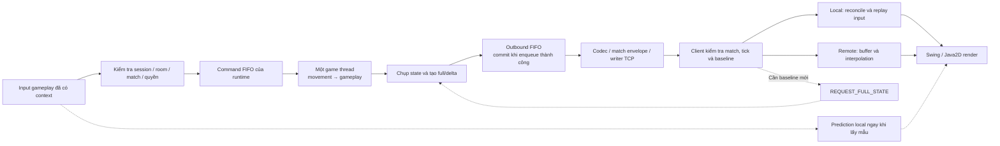

Sơ đồ tập trung luồng gameplay; các thao tác lobby như tạo/join/ready được tầng phòng xử lý trước khi có runtime,
không phải mọi thao tác phòng đều trở thành GameCommand. Đường resync là yêu cầu qua handler để đặt cờ full,
không phải client gọi trực tiếp builder. Bản nguồn: [07_01_giai_phap_tong_the.mmd](../figures/approach/07_01_giai_phap_tong_the.mmd).

### 7.1.2. Các mục tiêu và cơ chế tương ứng

**Bảng 7.1. Vấn đề cần giải quyết và cơ chế được chọn.**

| Vấn đề | Cơ chế | Phạm vi tác động |
|---|---|---|
| Client có thể gửi yêu cầu sai hoặc cũ | Xác thực session/room/match, validation và luật server | Quyền áp dụng thao tác |
| Nhiều nguồn input cùng sửa world | Command FIFO và một game thread/state theo runtime | Thứ tự cập nhật |
| Chờ state server làm điều khiển local chậm phản hồi | Prediction, ACK và replay | Biểu diễn local, vẫn có hiệu chỉnh |
| Dữ liệu remote nhận theo đợt | Buffer và nội suy tuyến tính | Độ liên tục hiển thị, có độ trễ |
| Lặp lại dữ liệu map/entity không đổi | Delta theo baseline và full phục hồi | Dung lượng đồng bộ, phát sinh chi phí so sánh |
| Mất transport tạm thời trong active match | Giữ session/runtime có thời hạn, kiểm tra token/ownership, full mới rồi tiếp tục delta | Quyền quay lại cùng trận; input bị khoá khi đồng bộ, không replay mọi thao tác |
| Client chậm hoặc queue đầy | Giới hạn pending, từ chối/đóng theo lớp lỗi | Kiểm soát backlog và vòng đời |

Giải pháp kết hợp các cơ chế vì chúng giải quyết các khâu khác nhau. Giảm byte snapshot không tự chứng minh
giảm latency; prediction không chứng minh world luôn đúng; queue hữu hạn không thay thế phép đo tải.
Mỗi mục tiêu được đối chiếu riêng với FR/NFR và bằng chứng trong các chương thực nghiệm.

> **Phân công: TV1 phụ trách connection/session/room; TV4 phối hợp identity, routing và vòng đời match.**

## 7.2. Quản lý connection, session và room

Nhóm tách connection socket, session người chơi, room chờ và match gameplay.
Một session tham gia tối đa một room; một lượt có roster cố định và một matchId riêng.
Session không trực tiếp chứa state nhân vật đang mô phỏng và room không tự tính luật bom/movement.

Khi host Start hợp lệ, tầng điều phối chụp roster, cấp mapping session→playerId, tạo spawn/runtime rồi
đưa GAME_STARTED vào writer trước snapshot gửi tới client. Client cài listener thường trực trước CONNECT,
tạo context/controller khi nhận metadata và chỉ bật input sau full có local player.
Giữ cùng TCP qua các lượt giúp không phải tạo lại toàn bộ kết nối mỗi lần chơi lại;
matchId và world/controller mới vẫn tách dữ liệu lượt cũ khỏi lượt sau.

Server dùng các kiểm tra membership, host, room state và match scope trước khi submit gameplay.
Đây là gate tiếp nhận; sau đó game thread còn kiểm tra luật nghiệp vụ.
Kết quả bình thường hoặc hủy lượt đều đi qua lifecycle dừng runtime và đưa phòng về WAITING.
Khi recovery được bật và active match còn hợp lệ, unexpected disconnect giữ session/ghế/runtime trong grace;
chỉ dừng điều khiển của người mất mạng, không lập tức huỷ lượt. Kết nối mới có token hợp lệ tiếp quản
identity cũ, nhận metadata cùng match và full state mới. GUI lobby mặc định bật auto reconnect;
constructor tổng quát và demo M1 không mặc nhiên có cùng cấu hình/hành vi.

Leave, đóng chủ động hoặc hard drop vẫn đi theo cleanup; hết grace có thể hủy cả lượt bằng ABORTED.
Match đã kết thúc trong thời gian offline không được tạo lại khi reconnect.
Session UUID, playerId số trong match và matchId được giữ đúng vai trò, không dùng thay nhau.
Luồng ownership, deadline và điều kiện hoàn tất recovery được trình bày ở mục 7.8;
đây là luồng đã được tích hợp và kiểm thử, thay cho mô tả chỉ có API/token dự phòng ở phiên bản cũ.
Nguồn hiện thực: [LobbyGameServer](../../src/main/java/com/bombit/server/app/LobbyGameServer.java)
và [DemoClientConnection](../../src/main/java/com/bombit/client/app/DemoClientConnection.java).

> **Phân công: TV2 phụ trách core/runtime/queue; TV3 xác nhận extension, TV4 xác nhận handoff tới network.**

## 7.3. Single-writer state, command queue và runtime theo phòng

### 7.3.1. Quyền sở hữu state và bước mô phỏng

Nhóm chọn mỗi runtime có map/state/extension riêng và một game thread cập nhật world.
Network đưa command vào queue thay vì sửa Player hoặc GameMap trên luồng đọc socket.
Đầu ra là snapshot bất biến qua outbound FIFO; worker gửi không cần đọc GameState mutable.

Lựa chọn bước mô phỏng cố định tham khảo các phân tích timestep của Fiedler.
[[9]](https://gafferongames.com/post/fix_your_timestep/)
Trong code của nhóm, bước mặc định là 50 ms và có giới hạn công việc lấy từ command queue.
Loop không chạy bù toàn bộ tick đã trễ; nó điều chỉnh mốc lịch khi quá hạn.
Vì vậy, đây là nhịp mục tiêu và bước mô phỏng đã chọn, không phải cam kết mọi server luôn theo kịp thời gian thực.

### 7.3.2. Mã giả xử lý tick

**Thuật toán 7.1. Vòng cập nhật theo room.**

```text
Gọi extension.onStart() trên game thread
Trong khi runtime còn chạy:
    Cho từng player: beginTick()
    sampled := tập rỗng
    Lặp tối đa 256 lần:
        c := commandQueue.peek()
        Nếu không có c: dừng đọc queue
        Nếu c là movement có sequence > 0 và playerId đã ở sampled:
            dừng đọc queue, không chuyển c xuống cuối hàng
        commandQueue.poll()
        Nếu c là command lifecycle:
            áp dụng chính sách frozen/remove hoặc mở lại của core
        Ngược lại nếu c là movement và player không frozen:
            thử áp dụng c bằng MovementSystem
            Nếu thành công và sequence > 0: thêm playerId vào sampled
        extension.processCommand(c)
    Buộc player frozen dừng movement
    movement.update(state, 0,05 giây)
    extension.update(thời gian hiện tại)
    tick := tick + 1
    PUBLISH(state, tick) theo Thuật toán 7.3
    Chờ tới lịch tick tiếp; nếu trễ thì điều chỉnh mốc lịch
Khi kết thúc hoặc có lỗi:
    gọi extension.onStop() trên game thread và dọn command queue
```

Nhánh lifecycle được nối với callback disconnect/reconnect của lobby khi recovery bật:
PlayerDisconnectedCommand giữ player nhưng đưa vào tập frozen; PlayerReconnectedCommand gỡ frozen và yêu cầu full.
Network không trực tiếp sửa world. Nếu queue từ chối lifecycle command, tầng điều phối xử lý kết thúc lượt;
không giả định command đã áp chỉ vì có lời gọi submit. RECONNECT được nhận ở ClientHandler trước router,
không đòi hỏi một route gameplay mới trong loop.
Đọc mẫu thứ hai của cùng player bằng peek rồi dừng bảo toàn FIFO toàn cục,
nhưng có thể làm command của player khác phía sau cũng chờ. Đây là đánh đổi của chính sách hiện hành;
rate limit phía network hỗ trợ hạn chế spam, chưa chứng minh công bằng tuyệt đối hoặc không có backlog.

Command queue mặc định 4096 và outbound queue 1024. Submit dùng offer, không chờ queue có chỗ;
loop dừng thì không nhận command mới. Các tham số cần được đo dưới workload thực tế trước khi kết luận năng lực tải.
Nguồn: [GameLoop](../../src/main/java/com/bombit/server/game/core/GameLoop.java),
[GameRuntime](../../src/main/java/com/bombit/server/game/runtime/GameRuntime.java)
và [GameRuntimeManager](../../src/main/java/com/bombit/server/game/runtime/GameRuntimeManager.java).

> **Phân công: TV2 phụ trách movement/collision và prediction/reconciliation/interpolation.**

## 7.4. Movement/collision và đồng bộ chuyển động phía client

### 7.4.1. Tính vị trí và va chạm phía server

MOVE cập nhật hướng/đi-dừng; bước movement tính quãng đường `d = speed × Δt`.
Nhân vật phải còn sống và input có sequence phải được áp dụng ở tick đó mới tiến thêm bước tương ứng.
Mẫu sequence không lớn hơn ACK được bỏ; không tăng tốc chỉ vì gửi lại input cũ.

Collision dùng hitbox hình chữ nhật, kiểm tra map/boundary và entity bom.
Quãng đường mỗi trục được chia thành bước tối đa 1 pixel rồi kiểm tra vị trí chiếm chỗ;
trục X xử lý trước Y. Cạnh phải/dưới của hitbox không được tính như phần bên trong,
tránh nhận nhầm tile kề khi đứng sát mép. Người đang chồng bom được đi ra nhưng không đi trở vào sau khi đã ra hết.
Đây là phương pháp đang dùng cho quy mô map và tốc độ hiện tại, chưa phải broad-phase/spatial index cho nhiều thực thể.
Nguồn: [MovementSystem](../../src/main/java/com/bombit/server/game/movement/MovementSystem.java)
và [CollisionSystem](../../src/main/java/com/bombit/server/game/movement/CollisionSystem.java).

### 7.4.2. Prediction, ACK và reconciliation

Nhóm kế thừa cách prediction/reconciliation của Gambetta: dự đoán input local,
nhận state server kèm input ACK, bỏ input đã xử lý và phát lại phần chưa được xác nhận.
[[4]](https://www.gabrielgambetta.com/client-side-prediction-server-reconciliation.html)

Client dùng movement/collision chung trên state local riêng, giữ pending theo sequence tăng dần.
Sau khi snapshot áp dụng hợp lệ, controller cập nhật map/entity dùng dự đoán trước khi restore player và replay.
Nếu respawn counter đổi, pending trước hồi sinh được xóa nhưng sequence không quay lại số đã dùng.
Nếu player bị loại, prediction không tiếp tục replay hành động cho player đó.

ACK nằm trong PlayerData sau movement, không phải ACK TCP hay xác nhận mới enqueue command.
Do client chỉ có world đã nhận gần nhất, bom/block mới đổi có thể gây khác biệt prediction;
reconciliation là bước cần thiết. Giới hạn 256 pending ngăn lịch sử tăng mãi, khi đầy báo lỗi cho caller;
không có bảo đảm tự retry/resync mọi tình huống.

### 7.4.3. Nội suy nhân vật từ xa

Nhân vật remote được hiển thị giữa các mẫu đã biết, thay vì giả định đã biết input tương lai của họ.
Cách tiếp cận tham khảo phần entity interpolation của Gambetta.
[[5]](https://www.gabrielgambetta.com/entity-interpolation.html)

Project giữ tối đa 32 frame vị trí; render timeline lùi 2 tick và giới hạn mức tiến của timeline khi thiếu update.
Giữa hai tick khác nhau, dùng `p(r) = p_a + (p_b − p_a) × α`, với `α` được chặn trong [0,1].
Ngoài vùng mẫu thì giữ vị trí biên, không ngoại suy vô hạn; respawn làm xóa buffer để không vẽ đường dịch chuyển qua map.
Render không sửa replica hoặc quyết định damage. Độ mượt, correction và độ trễ hiển thị còn cần nghiệm thu/đo riêng.
Nguồn: [PredictionController](../../src/main/java/com/bombit/client/game/movement/PredictionController.java),
[MovementClientController](../../src/main/java/com/bombit/client/game/movement/MovementClientController.java)
và [InterpolationController](../../src/main/java/com/bombit/client/game/movement/InterpolationController.java).

### 7.4.4. Input và lịch sử chuyển động khi phục hồi phiên

Ngay khi bắt đầu recovery, controller khoá input, tăng input generation và bỏ tác vụ gửi đang chờ;
tác vụ đã được lấy ra khỏi queue còn phải kiểm tra generation/trạng thái trước khi gửi.
InputController xoá phím giữ khi chuyển generation, kể cả recovery hoàn tất giữa hai lần lấy mẫu.
Các biện pháp này hạn chế input từ kết nối cũ lọt sang kết nối mới; chúng không thu hồi được lệnh
đã tới server trước khi mất transport hoặc đảo ngược tác động gameplay đã được server xử lý.

Client giữ controller/context để không reset sequence MOVE và counter request đặt bom.
Khi chuẩn bị phục hồi, replica được đánh dấu cần full, pending prediction cũ và interpolation được xoá;
world cũ có thể tiếp tục được hiển thị dưới trạng thái đang phục hồi nhưng không được dùng để mở điều khiển.
Sau khi full hợp lệ được áp, prediction lấy lại state authoritative và sequence không lùi;
người chơi lấy mẫu input mới thay vì phát lại mọi phím trong thời gian mất mạng.
ACK phiên riêng lẻ chưa thực hiện bước này. Vì thế, cơ chế khác với reconciliation thông thường
vốn replay các input pending chưa ACK khi transport vẫn liên tục.

> **Phân công: TV2 chủ trì State Delta Compression và replica; TV4 phối hợp codec, resync và phép đo.**

## 7.5. State Delta Compression và phục hồi baseline

### 7.5.1. Phần kế thừa và phần áp dụng của nhóm

Delta compression biểu diễn thay đổi so với baseline; phía nhận phải có baseline phù hợp để giải mã.
Nguyên tắc này đã được Fiedler trình bày.
[[3]](https://gafferongames.com/post/snapshot_compression/)
Nhóm áp dụng vào trạng thái Bomb It, với map/player/entity, ACK, frame gameplay và danh sách xóa.
Không giới hạn giải pháp ở việc so hai mảng tile, và không nhận đây là phát minh delta compression nói chung.

Gọi `C_t` là ảnh state cần đồng bộ chụp tại tick `t`, `B_b` là ảnh baseline đã commit tại tick `b`.
Update tăng dần có dạng `U_(b→t) = Diff(B_b, C_t)` và mang `baseTick=b`.
Mục tiêu khôi phục là: nếu replica đang đúng ảnh ở `b`, áp dụng update hợp lệ sẽ tạo đúng phần state được contract đồng bộ tại `t`.
Ký hiệu không bao gồm các đối tượng nội bộ như socket, queue hay toàn bộ lịch sử domain event.

### 7.5.2. Những dữ liệu được so sánh

**Bảng 7.2. Quy tắc phát hiện và biểu diễn thay đổi.**

| Thành phần | Cách xác định thay đổi | Dữ liệu gửi/giữ |
|---|---|---|
| Map nền | So từng tile ở cùng `(x,y)` | Record `x,y,newType`; full thì gửi toàn map theo hàng |
| Player | So toàn bộ trường PlayerData, kể cả ACK và double chính xác | Upsert cả PlayerData, chưa chỉ gửi field đổi |
| Player bị xóa | ID baseline không còn trong ảnh hiện tại | Danh sách removedPlayerIds |
| Bom/item | So EntityData theo key kind + ID và record equality | Upsert record mới/đổi; removedEntityKeys cho entity biến mất |
| Match state | So WAITING/RUNNING/FINISHED | State và cờ changed theo contract |
| MatchFrame | So timer, Stats và result | Khi phát snapshot có frame thì gửi trọn MatchFrame |
| BombFrame | So danh sách explosion; không chỉ vì serverTimeMillis tiến lên | Khi phát snapshot có frame thì gửi trọn effect list hiện tại |
| Notices | Có event chưa bàn giao | Gắn với update nội bộ để worker encode thành message riêng |

Vì PlayerData có `lastProcessedInput`, nhân vật đứng yên nhưng nhận mẫu input mới vẫn có thể tạo player upsert.
Match timer đổi giây, Stats, effect hoặc notice cũng có thể làm phát update dù không tile nào đổi.
Do đó, không dự đoán dung lượng từ số tile thay đổi đơn thuần.

Builder giữ bản sao tile/PlayerData và EntityData bất biến làm baseline;
nó không giữ Player mutable để rồi baseline vô tình đổi theo world.
Không lượng tử hóa tọa độ trước so sánh và chưa chọn full/delta theo kích thước encode nhỏ hơn.
Nguồn: [StateDeltaBuilder](../../src/main/java/com/bombit/server/game/movement/StateDeltaBuilder.java)
và [SnapshotPacketCodec](../../src/main/java/com/bombit/server/game/movement/SnapshotPacketCodec.java).

### 7.5.3. Mã giả tạo full/delta

**Thuật toán 7.2. Tạo update dựa trên baseline đã công bố.**

```text
BUILD_UPDATE(state, t, forceFull):
    C := chụp map, PlayerData và entity hiện tại trên game thread
    B := baseline đã commit, có tick b và các frame gameplay đã công bố
    Nếu forceFull hoặc B chưa tồn tại hoặc dimensions/tileSize đổi:
        U := FULL(t, baseTick=-1, toàn bộ map/player/entity)
    Ngược lại:
        tileChanges := các ô mà C.tile khác B.tile
        playerUpserts := player mới hoặc khác bất kỳ trường PlayerData nào
        removedPlayers := ID trong B nhưng không còn trong C
        entityUpserts := entity mới hoặc record khác theo key
        removedEntities := key trong B nhưng không còn trong C
        stateChanged := C.matchState khác B.matchState
        frameChanged := MatchFrame đổi hoặc danh sách explosion đổi
        Nếu mọi danh sách đổi/xóa rỗng,
           stateChanged=false, frameChanged=false và không có notices chờ:
            trả NONE, không tiến baseline
        U := DELTA(t, baseTick=b, các upsert/xóa và metadata)
    Gắn BombFrame/MatchFrame hiện tại và bản sao notices vào U
    Lưu pending frame/entity và đúng đối tượng pendingUpdate=U
    Trả U; bước này chưa commit baseline
```

Ở đây `B` gộp các trường published của implementation để viết gọn; code thực lưu frame, entity,
BombFrame và MatchFrame ở các trường riêng. So effect chỉ xét danh sách explosion khi quyết định bỏ tick rỗng,
nhưng snapshot đã phát vẫn mang serverTimeMillis mới để client biểu diễn effect theo thời lượng.
Danh sách notices là handoff nội bộ, không được encode thành một phần lịch sử event trong Base64 snapshot.

**Hình 7.2. Tạo delta, pending và commit. Nhóm tự vẽ từ StateDeltaBuilder/GameLoop.**

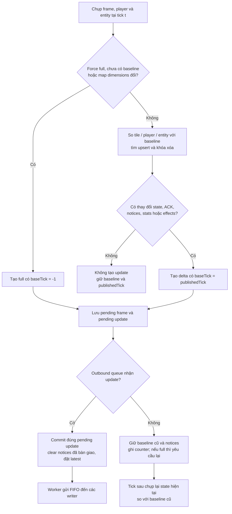

Mũi tên đến worker chỉ đường handoff, không có nghĩa commit chờ socket gửi xong.
Bản nguồn: [07_02_delta_va_commit.mmd](../figures/approach/07_02_delta_va_commit.mmd).

### 7.5.4. Commit sau enqueue và chính sách full

**Thuật toán 7.3. Công bố update mà không làm baseline tiến trước queue.**

```text
PUBLISH(state, t):
    requested := đọc và xóa cờ fullRequested một cách nguyên tử
    wantFull := requested hoặc t=1 hoặc t chia hết 100 hoặc state=FINISHED
    U := BUILD_UPDATE(state, t, wantFull)
    Nếu U là NONE: kết thúc bước publish
    Nếu outboundQueue.offer(U) thành công:
        builder.commit(U)              // chỉ chấp nhận đúng pendingUpdate
        state.clearGameNotices()
        latest := U
    Ngược lại:
        tăng outboundFull counter
        giữ baseline đã commit và notices chưa bàn giao
        Nếu wantFull: đặt lại cờ fullRequested
```

Nhóm dùng một consumer đọc outbound FIFO theo runtime để không bỏ delta trung gian.
`latest/createUpdate()` chỉ là ảnh công bố gần nhất, không thay chuỗi queue và không bảo đảm là full.
Nếu offer thất bại, lần build sau chụp state hiện tại rồi so với baseline cũ; không chỉ retry mù update cũ.
Phần state trung gian có thể được gộp về ảnh cuối, còn notices chưa bàn giao được giữ trong giới hạn backlog.

**Bảng 7.3. Ví dụ logic về baseline, không phải log thực nghiệm.**

| Tick | Điều kiện giả định | Kết quả publish | Baseline sau bước |
|---:|---|---|---:|
| 100 | Force full, queue nhận | Full có baseTick=-1 | 100 |
| 101 | Không trường đồng bộ/ACK/frame/notice nào đổi | Không update | 100 |
| 102 | Có thay đổi, queue nhận | Delta baseTick=100 | 102 |
| 103 | Có thay đổi, queue đầy | Có pending nhưng chưa công bố | 102 |
| 104 | Chụp state mới, queue nhận | Delta baseTick=102, gồm chênh lệch còn tồn tại | 104 |

Ví dụ cho thấy baseTick không phải mặc định `t−1`. Điều kiện tick 101 là giả định minh họa:
trong trận thật ACK/timer/notice vẫn có thể đổi dù nhân vật đứng yên.
Commit chỉ xác nhận queue nhận update, chưa phải từng client xác nhận receipt hoặc apply.
Nếu writer một client thất bại, transport/lobby xử lý disconnect theo chính sách;
không âm thầm bỏ delta rồi tiếp tục với giả định baseline client đã tiến.

### 7.5.5. Ghép replica và phục hồi baseline

**Thuật toán 7.4. Tiếp nhận update và đồng bộ movement phía client.**

```text
RECEIVE_UPDATE(packet):
    Kiểm tra match envelope; packet sai match thì bỏ
    Decode và kiểm tra cấu trúc U; lỗi decode đi theo đường fail controller
    Nếu U.tick <= replica.tick: bỏ stale, không lùi replica
    Kiểm tra dimensions, tọa độ và dữ liệu theo contract
    Nếu U là delta và (replica cần full hoặc U.baseTick != replica.tick
                      hoặc dimensions/tileSize không khớp):
        đánh dấu cần full, giữ world cũ
        yêu cầu full qua owner có giới hạn tần suất; kết thúc
    Nếu các kiểm tra apply khác thất bại:
        đánh dấu cần full theo ClientWorldState, yêu cầu full qua owner; kết thúc
    Nếu full: thay map/player/entity
    Nếu delta: áp tile changes, upsert và các danh sách xóa
    Thay các frame gameplay bằng frame đi kèm; đặt replica.tick=U.tick
    Đồng bộ scene và lấy player local
    Nếu full khi đang phục hồi phiên: xóa pending cũ và interpolation, giữ sequence/counter
    Ngược lại nếu respawn counter đổi: xóa pending trước hồi sinh
    Cập nhật world dùng prediction, restore player server và replay input > ACK
    Ghi frame vị trí cho interpolation
```

Đây là chuỗi logic tổng hợp từ controller/replica, không khẳng định tất cả validation nằm trong một hàm.
Khi replica từ chối update ở một kiểm tra khác, controller cũng gửi yêu cầu full như khi sai baseline.
Payload không decode được có thể làm controller fail; không coi mọi dữ liệu hỏng đều tự sửa được bằng resync.
Khi đang phục hồi phiên, owner áp thêm gate trước thuật toán: đúng connection epoch, đã nhận ACK/metadata
cùng context và update phải là full. Delta chưa được dùng để mở input; sau apply còn kiểm tra replica
không còn needsFullState và lastAppliedFullTick trùng full vừa nhận trước khi resume theo mục 7.8.

Resync dùng handler hiện có để lưu barrier tick và đặt cờ full cho runtime.
Worker duy nhất chờ full mới sau barrier rồi phát FULL_STATE_SYNC cho cả roster,
vì baseline đang dùng chung room. Client owner gộp request đang chờ và hạn chế tần suất;
tick client báo không được dùng để rewind world server.
Trong Session Recovery, callback resume chủ động yêu cầu full và đặt barrier cho player trở lại;
không cần client liên tục gửi REQUEST_FULL_STATE trong khoảng chờ recovery.
Update cũ trong queue và delta chưa có nền bị chặn đối với player đó cho tới full vượt barrier.

Lập luận khôi phục theo contract như sau: full thiết lập ảnh nền; với delta có đúng baseline,
những phần không được nêu giữ nguyên, phần upsert được thay và khóa xóa được loại bỏ.
Nếu các danh sách Diff đầy đủ và thứ tự update được giữ, replica thu được ảnh cần đồng bộ của tick đích.
Đây là lập luận thiết kế dưới điều kiện dữ liệu hợp lệ, không thay cho test correctness hoặc chứng minh hình thức toàn bộ hệ thống.
Nguồn: [ClientWorldState](../../src/main/java/com/bombit/client/game/movement/ClientWorldState.java),
[MovementClientController](../../src/main/java/com/bombit/client/game/movement/MovementClientController.java)
và `LobbyGameServer`.

### 7.5.6. Chi phí và trường hợp delta kém lợi

Với `N=W×H`, `P` là tổng số player cần xét ở ảnh cũ/mới, `E` là tổng entity cũ/mới,
`F` đại diện kích thước effect/frame/notice cần sao chép hoặc so sánh,
chi phí builder thông thường có cỡ `O(N+P+E+F)` khi lookup hash có chi phí kỳ vọng hằng số.
Builder vẫn quét/chụp toàn map mỗi lần, chưa dùng dirty-tile tracking để chỉ đọc ô thay đổi.
Giảm số byte truyền không đồng nghĩa chi phí CPU tạo delta chỉ phụ thuộc số ô đổi.

Baseline và pending cần bộ nhớ cùng cỡ dữ liệu được giữ; queue update còn tốn bộ nhớ riêng tùy số phần tử và kích thước update.
Ước lượng trên chỉ nói builder, không bao gồm encode/serialize, sắp xếp cell effect, khóa, I/O hoặc render.
Đây là phân tích từ các vòng lặp code, chưa phải phép đo thời gian hay RAM.

**Bảng 7.4. Minh họa byte phần giá trị tile theo layout hiện tại, không phải byte toàn packet.**

| Trường hợp map 17×15 | Full: 1 byte/tile | Delta: 4 byte x + 4 byte y + 1 byte type/ô đổi |
|---|---:|---:|
| 1 tile đổi | 255 byte | 9 byte |
| 29 tile đổi | 255 byte | 261 byte |

Bảng chỉ tính vùng dữ liệu tile, bỏ các count/header, player/entity và frame khác.
Nó minh họa vì sao nhiều ô đổi có thể làm phần tile của delta lớn hơn full,
không đặt một ngưỡng chuyển loại tự động cho implementation. Code hiện chọn full theo policy, không encode cả hai rồi chọn nhỏ hơn.
Mỗi PlayerData được gửi cả record; ACK đổi thường xuyên và toàn bộ Stats/effect gửi kèm còn làm giảm phần tiết kiệm tiềm năng.

Binary snapshot tiếp tục được bọc Base64 trong JSON.
Theo quy tắc Base64, dạng có padding có độ dài `4×ceil(n/3)` với `n` byte binary.
[[13]](https://www.rfc-editor.org/rfc/rfc4648.html)
Phép đo cần tính sau cùng một lớp biểu diễn ở hai chế độ, kể cả match envelope/frame và các full định kỳ/resync nếu có.
Không dùng “1000 byte so với 50–100 byte” như kết quả mặc định khi chưa đo đúng workload.

### 7.5.7. Cách đánh giá cải tiến

Nhóm chọn đối chứng gửi full mỗi tick và chế độ delta kết hợp full theo chính sách đang dùng,
trên cùng trạng thái đầu, chuỗi input, luật, thời lượng và điều kiện sinh item.
Đánh giá cần tối thiểu hai mặt: replica khôi phục đúng và lượng dữ liệu/chi phí xử lý.
Workload cần có idle với ACK thực, movement, bom/phá block/item và số người chơi đại diện,
không chỉ fixture ít thay đổi ở map.

Tỷ lệ tiết kiệm được tính bằng `100×(1−B_delta/B_full)` với tổng byte cùng scope và `B_full>0`.
Tính cả full đầu/định kỳ/phục hồi của chế độ delta; nếu đo toàn luồng, phải tính các notice/control theo cùng quy tắc ở cả hai chế độ.
Giá trị âm vẫn là kết quả cần báo cáo, không loại bỏ kịch bản delta kém lợi.
Chương giải pháp chưa chốt mức tiết kiệm hoặc lợi ích latency; các kết luận đó thuộc thực nghiệm/kết quả.

> **Phân công: TV3 phụ trách gameplay; TV2 phối hợp world adapter, runtime và respawn phía client.**

## 7.6. Bom/item/event, damage batch, respawn và kết quả

Gameplay được đưa vào loop qua GameplayExtension để giữ cùng thứ tự cập nhật state.
PLANT_BOMB đi qua gate/queue rồi mới kiểm tra placement; bom đến hạn được xét bằng thời lượng phía server trong update,
không tạo thread riêng sửa world cho từng bom.

Một batch nổ gom bom gốc và nổ dây chuyền, theo dõi bom đã xử lý, các block bị phá và player trúng.
Sau khi tính vùng ảnh hưởng, mỗi player nhận tối đa một hit trong batch.
Quy tắc giữ block đã phá làm barrier cho các tia còn lại trong cùng batch giúp định nghĩa nhất quán trường hợp nổ đồng thời.
Khiên chặn hit; còn mạng thì respawn và giữ nâng cấp, hết mạng mới bị loại.

Sau batch, extension xóa item cũ trong vùng nổ, xét drop mới từ block, thực hiện pickup theo thứ tự playerId,
rồi xác định người còn sống/timer/kết quả. Điều này tránh kết luận thắng khi batch chưa xử lý hết
hoặc gây damage lặp lên player vừa respawn trong cùng đợt.
Kết quả được chốt trong gameplay state; tầng lobby công bố rồi dừng runtime và chuyển lượt.
Freeze khi mất mạng không dừng extension.update: bom đã đặt, damage, respawn, item và timer vẫn tiến.
Extension đánh dấu player disconnected để chặn ý định đặt bom mới; phục hồi phiên không xoá bom đã đặt,
không cấp miễn damage và không áp lại effect item khi nhận full. Kết quả kết thúc khi player vắng mặt
vẫn là quyết định authoritative; resume sau đó không được đảo ngược kết quả hoặc dựng lại runtime.

Domain event được chuyển thành notices sau snapshot nhưng không làm client áp lại damage/pickup.
Stats và respawn counter trong snapshot mới quyết định state client; renderer chỉ biểu diễn.
Đặt bom được submit chưa có ACK nghiệp vụ riêng cho từng requestId ở callback lobby mặc định;
không bịa phản hồi lỗi gameplay mà code chưa gửi.
Nguồn: [BombSystem](../../src/main/java/com/bombit/server/game/bomb/BombSystem.java),
[MatchGameplayExtension](../../src/main/java/com/bombit/server/game/runtime/MatchGameplayExtension.java)
và [Player](../../src/main/java/com/bombit/server/game/core/Player.java).

> **Phân công: TV4 chủ trì protocol/routing/backpressure; TV1 transport/lifecycle, TV2 và TV3 xác nhận tác động tới gameplay.**

## 7.7. Protocol, match scope, routing và backpressure

### 7.7.1. Các quyết định thiết kế và đánh đổi

**Bảng 7.5. Lựa chọn hiện hành và hệ quả cần đánh giá.**

| Lựa chọn | Lý do áp dụng trong đề tài | Chi phí/giới hạn |
|---|---|---|
| TCP có length/type và JSON envelope | Dùng chung kênh điều khiển/gameplay, decoder biết biên message | Giao dữ liệu có thứ tự không bảo đảm hạn tick; cần kiểm soát backlog |
| Một game thread/state mỗi runtime | Tập trung thứ tự movement/gameplay/snapshot | Room vẫn chia sẻ CPU/pool và khóa điều phối; không chứng minh scale tuyến tính |
| Bước 50 ms và giới hạn command/tick | Ràng buộc bước mô phỏng và lượng công việc | FIFO có thể làm chờ input phía sau; tick có thể trễ |
| Delta theo record/tile + tombstone | Tránh lặp dữ liệu, biểu diễn được xóa | Quét map, giữ baseline, record ACK và metadata vẫn tốn byte |
| Full đầu/định kỳ/yêu cầu/FINISHED | Tạo và phục hồi nền đồng bộ theo policy | Chi phí full, chưa có tự chọn loại theo size |
| Baseline commit khi enqueue | Không tham chiếu update chưa vào luồng công bố | Không phải receipt ACK của từng client; queue/writer phải giữ chuỗi |
| Prediction local + nội suy remote | Kết hợp phản hồi local với biểu diễn remote | Có correction, buffer delay và lịch sử cần reset khi respawn |
| Match envelope và context mới mỗi lượt | Loại message cũ khi replay | Không thay kiểm tra session/socket; canonical codec hạn chế dạng JSON được nhận |
| Grace session, token và chuyển ownership socket | Cho phép trở lại cùng runtime sau mất nối tạm thời | Giữ state/timer trong RAM; token chưa có TLS/rotation; hết grace có thể hủy cả lượt |
| ACK → metadata → full được áp rồi mới mở input | Không điều khiển trên replica thiếu nền sau reconnect | Có khoảng chờ và dữ liệu full; không đảm bảo replay input/event lịch sử |
| Queue/budget hữu hạn và đóng client lỗi | Giới hạn một số dạng backlog, không tiếp tục sai baseline | Soft disconnect có thể recovery; hard drop/expiry/queue lifecycle lỗi có thể hủy lượt |

Các hướng kế thừa từ tài liệu đã nêu ở mục 5; thông số/policy và cách tích hợp trong bảng là lựa chọn của project.
Không tuyên bố một lựa chọn tối ưu cho mọi game hoặc mọi điều kiện mạng.

### 7.7.2. Gate tiếp nhận và ranh giới gửi

Chuỗi kiểm tra gồm frame/UTF-8 → schema → session/room/match/quyền → queue → luật gameplay.
Mã match giúp bỏ dữ liệu cũ, sequence xử lý input lặp trong match, requestId hạn chế đặt bom lặp,
còn eventId phục vụ notice. Các số này không thay thế nhau và không phải bằng chứng exactly-once toàn hệ thống.

Server có một writer theo socket; producer encode/enqueue rồi writer mới ghi/flush.
Client lấy mẫu trên UI nhưng gửi qua sender/control worker; callback mạng chuyển về owner UI tuần tự.
Quá tải được xử lý theo lớp: command bị từ chối, outbound không commit baseline, writer đầy/timeout đóng kết nối,
replica sai baseline xin full, payload hỏng có thể fail controller. Không coi mọi lỗi là một lần resync thành công.
Lỗi socket trong active match và đúng cấu hình có thể chuyển sang recovery thay vì đóng hẳn controller;
ERROR từ chối hoặc hết budget vẫn kết thúc chờ. Phân loại này không cho phép phục hồi session
đã chủ động rời, đã hard drop hoặc match không còn tồn tại.

Khóa và queue bảo vệ quyền sở hữu dữ liệu nhưng không tự bảo đảm UX hay tải tối đa.
Thiết kế đầy đủ của message, giới hạn và sequence đã được mô tả ở mục 9;
phần triển khai sẽ nêu các class/API và phần thực nghiệm kiểm chứng các trường hợp tương ứng.

### 7.7.3. Phạm vi đóng góp và bằng chứng cần có

**Bảng 7.6. Phần kế thừa, phần nhóm hiện thực và cách kiểm chứng.**

| Nội dung | Phần kế thừa/ý tưởng nền | Phần hiện thực và bằng chứng cần dùng |
|---|---|---|
| Server authoritative | Mô hình client gửi intent, server quyết định [2] | Gate identity, movement/gameplay và test quyền/luật |
| Prediction/reconciliation/interpolation | Các phương pháp trong [4], [5] | Controllers, ACK/replay/respawn, test và nghiệm thu chuyển động |
| State Delta Compression | Delta theo baseline [3] | Builder/codec/replica, commit/FIFO/full-resync, correctness và so sánh byte |
| Seamless Session Recovery | Ý tưởng phục hồi phiên tầng ứng dụng và đồng bộ state sau mất nối, không phải phát minh recovery nói chung | Token/ownership/grace; freeze qua queue; client epoch/timeout/input gate; full→delta; test token sai, expiry, reconnect lặp và gameplay offline |
| Runtime và giao tiếp | Kiến thức concurrency, loop và protocol thông dụng | Tích hợp theo room, queue/owner/lifecycle, test isolation/cleanup/fault và phép đo |

Đóng góp dự kiến là áp dụng và tích hợp các cơ chế trong một game hoạt động theo contract đã xác định,
đặc biệt phần full/delta và phục hồi cùng phiên trận trong bối cảnh Bomb It.
Mức độ novelty và hiệu quả cuối cùng chỉ được chốt từ implementation cùng bằng chứng phù hợp;
không chuyển số đo fixture cũ hoặc ví dụ lý thuyết thành kết quả mọi trận.
Lượt hồi quy mới ngoài sandbox đạt 171/171 JUnit cùng TV2/TCP checks; log giữ cả các attempt sandbox
có lỗi smoke ba tiến trình. Đây là kết quả kiểm thử cục bộ theo phiên bản working tree, không là benchmark
latency recovery hay thay thế nghiệm thu GUI/LAN/soak.
Nguồn: [kết quả kiểm thử mới](../session-recovery/03_KET_QUA_KIEM_THU_THUC_TE.md).

> **Phân công: TV1 chủ trì session/ownership và grace; TV2 runtime/snapshot/input, TV3 gameplay offline, TV4 protocol/GUI phối hợp.**

## 7.8. Seamless Session Recovery và tái đồng bộ trước khi tiếp tục

### 7.8.1. Mục tiêu và điều kiện tiếp nhận

Cải tiến giữ quyền trở lại **cùng phiên, cùng trận còn chạy** sau mất transport tạm thời.
Nó hoạt động khi tiến trình server còn giữ session/world và deadline cho phép, không phải cơ chế failover
hoặc khôi phục dữ liệu từ disk. “Liền mạch” ở đây là giữ identity/controller/cửa sổ và tiếp tục sau đồng bộ;
vẫn có khoảng khoá input và có thể thất bại khi hết grace hoặc trận kết thúc.

Khi server xử lý unexpected disconnect trong active match có recovery bật, nó giữ session ở DISCONNECTED,
ghi ticket thời gian và gọi lobby để submit PlayerDisconnectedCommand. Mỗi lần disconnect có ticket riêng;
callback timer cũ không được xoá session đã phục hồi hoặc grace của lần ngắt sau.
Grace 15 giây là tham số project chọn; RFC TCP không quy định con số đó.

Kết nối mới gửi RECONNECT với session UUID và token. ClientHandler kiểm tra sơ bộ để còn trả lỗi qua writer tạm,
sau đó SessionManager kiểm tra lại dưới khoá session và giữ một quyền handoff.
Nó có thể tiếp quản TCP half-open với token hợp lệ, nhưng từ chối handoff chồng nhau hoặc token/deadline sai.
Callback/cleanup của reader, writer hoặc heartbeat cũ phải đối chiếu socket mà nó sở hữu trước khi đóng phiên.
Việc giữ token chỉ cấp quyền resume theo contract; không chứng minh danh tính tài khoản hoặc bảo mật đường truyền.

### 7.8.2. Chuyển ownership và tạo full mới

Sau khi claim hợp lệ, manager huỷ ticket expiry và gắn socket mới trong khi vẫn giữ DISCONNECTED
để pump/heartbeat chưa sử dụng một writer chưa sẵn sàng. Handler bỏ session/writer tạm nhưng giữ socket,
tạo writer cho identity cũ và enqueue CONNECT_ACK. Manager phục hồi trạng thái rồi gọi callback lobby;
callback chạy ngoài khoá session để tránh giữ khoá session khi chờ khoá điều phối lobby.

Lobby xác minh match còn active, submit PlayerReconnectedCommand, gửi GAME_STARTED cùng context,
đặt recovery barrier theo tick công bố gần nhất và yêu cầu full. Snapshot pump bỏ update cũ hoặc delta
cho player đang chờ nền; chỉ đưa người đó vào tập initialized khi enqueue full mới sau barrier thành công.
Nếu queue lifecycle không nhận hoặc bước thiết lập lỗi, rollback/cleanup hoặc ABORT theo nhánh lỗi;
không mở tiếp luồng trên giả định state đã được cập nhật.

Do baseline chung theo match, full có thể đi tới cả roster; không khẳng định chỉ unicast riêng người reconnect.
Full được tạo trên game thread qua cơ chế snapshot hiện có, không phải network thread đọc world mutable.
Một full đã enqueue thành công **chưa phải client đã nhận hoặc áp xong**, nên client vẫn phải kiểm tra riêng.
Nếu callback thấy match đã kết thúc, server từ chối theo SessionRecoveryRejectedException và dọn phiên;
ACK identity có thể đã enqueue trước đó nhưng không đủ làm client resume.

### 7.8.3. State machine client và deadline

Client phân biệt CONNECTING/CONNECTED với RECONNECTING, WAITING_ACK, WAITING_FULL và CLOSED.
Mỗi attempt có connection epoch; packet/UI action của attempt cũ bị loại thay vì áp vào world mới.
Recovery dùng control worker cho connect/retry và watchdog riêng kiểm tra deadline, giữ I/O khỏi EDT.

**Bảng 7.7. Budget phục hồi mặc định của client, không phải SLA đã đo.**

| Tham số | Giá trị | Phạm vi |
|---|---:|---|
| Budget tổng | 14.000 ms | Từ khi client bắt đầu recovery; không reset khi retry |
| Chờ ACK | 2.500 ms/attempt | Bao gồm bước connect của attempt |
| Chờ full | 4.000 ms/attempt | Sau ACK, gồm metadata và full được xử lý trên UI |
| Connect timeout | Tối đa 1.500 ms | Giới hạn bởi budget tổng còn lại; không tự bao trọn DNS trước Socket.connect |
| Retry delay | 200 ms × số attempt, tối đa 500 ms | Backoff hữu hạn; không phải exponential backoff hoặc jitter |
| Watchdog period | 50 ms | Chu kỳ kiểm tra; scheduler có thể thực thi trễ |

Budget phía client và grace phía server bắt đầu ở các sự kiện khác nhau, không trừ hai con số thành
một biên an toàn thời gian thực. Các deadline dùng clock đo thời gian trôi trong tiến trình;
không lấy nanoTime của hai JVM để tính latency một chiều.
Chưa có benchmark độ trễ phục hồi hoặc kiểm thử mọi trường hợp DNS/timer wrap-around.

**Thuật toán 7.5. Phục hồi client với gate full state.**

```text
Khi mất transport và có context/token cùng cấu hình auto recovery:
    tạo recovery với deadline tổng; khoá input và bỏ pending cũ
    giữ controller/context/counter; đánh dấu replica cần full
    lên lịch attempt, không chặn EDT
Mỗi attempt:
    dừng reader/socket cũ; tăng connection epoch
    đặt WAITING_ACK và deadline pha; connect trong budget còn lại
    gửi RECONNECT(session UUID, token)
Khi nhận ACK ở đúng epoch/pha:
    kiểm tra identity; chuyển WAITING_FULL và đặt deadline pha
    vẫn khoá input
Khi nhận GAME_STARTED ở đúng epoch/pha:
    kiểm tra context trùng trận đang phục hồi; đánh dấu metadata sẵn sàng
Khi nhận snapshot ở đúng epoch, WAITING_FULL và đã có metadata:
    kiểm tra match envelope và decode; không dùng delta để hoàn tất recovery
    thử áp full hợp lệ vào controller/replica
    chỉ khi replica không cần full và lastAppliedFullTick đúng update vừa áp:
        reset prediction/interpolation phù hợp, giữ sequence/request counter
        resume input, xoá recovery và chuyển CONNECTED
Khi transport ngắt lại hoặc timeout pha:
    retry với epoch mới, không reset deadline tổng
Khi hết budget, lỗi không thể tiếp tục hoặc người dùng đóng:
    chuyển CLOSED, dọn transport/worker/timer/controller theo nhánh kết thúc
```

Mã giả lược bớt chi tiết lỗi và dispatch. Client bỏ packet sai match/epoch hoặc full stale;
payload full không decode được có thể fail, không retry mọi dữ liệu hỏng.
RATE_LIMITED/NOT_READY trong khi recovery không làm mở input và vẫn nằm trong deadline;
lỗi từ chối khác kết thúc recovery. Full hợp lệ được nhận dưới GAME_SNAPSHOT hay FULL_STATE_SYNC
đều phải thoả điều kiện apply; không chỉ căn cứ tên message để mở điều khiển.

### 7.8.4. Gameplay, hết hạn và mức bảo đảm

Trong grace, extension gameplay vẫn cập nhật: bom nổ, block/item đổi, timer giảm và player offline có thể
mất mạng sống, respawn hoặc bị loại. Full phản ánh world hiện tại nên không cần replay damage/pickup
từ lịch sử event; client cũng không tự cộng lại effect. Nếu GAME_OVER đã chốt, reconnect không tái tạo
runtime hoặc phát lại kết quả cũ cho người vắng mặt. Khi hết grace, hard drop/leave có thể ABORT cả trận,
gỡ ghế, chuyển host và đưa phòng về WAITING; không quảng cáo rằng mọi người còn lại luôn chơi tiếp.

Các ca đã chạy xác nhận nhiều input và bốn bom trước ngắt, ba vòng reconnect, full bằng peer ở cùng tick
rồi delta, request bom mới còn hiệu lực và request cũ không đặt lại; đồng thời có token sai, cả hai player
offline, grace 15 giây thực và GAME_OVER trong grace. Bộ test còn kiểm tra queue đầy, socket/timer cũ,
timeout ACK/full và UI action cũ. Đây là bằng chứng về các assertion xác định, không phải bảo đảm
exactly-once cho mọi thao tác hoặc chứng minh không còn mọi race/lỗi mạng.

Recovery và delta có mục tiêu khác nhau: recovery giữ quyền tham gia và thiết lập lại ảnh nền;
delta giảm dữ liệu giữa các ảnh khi đã có nền. Full bổ sung khi reconnect có chi phí và có thể ảnh hưởng
cả roster, nên tỷ lệ byte tiết kiệm của benchmark cũ không tự áp dụng cho workload có recovery.
Chưa có TLS/token rotation, persistence/failover, nghiệm thu GUI thủ công/LAN/Wi-Fi thực hoặc đo SLA.

Nguồn hiện thực: [SessionManager](../../src/main/java/com/bombit/server/session/SessionManager.java),
[ClientHandler](../../src/main/java/com/bombit/server/network/ClientHandler.java),
[LobbyGameServer](../../src/main/java/com/bombit/server/app/LobbyGameServer.java),
[DemoClientConnection](../../src/main/java/com/bombit/client/app/DemoClientConnection.java)
và [MovementClientController](../../src/main/java/com/bombit/client/game/movement/MovementClientController.java).
Truy vết thiết kế và bằng chứng: [nhiệm vụ 2](../session-recovery/02_XAC_MINH_THIET_KE_VA_NGUON.md),
[ma trận và lượt kiểm thử nhiệm vụ 3](../session-recovery/03_KET_QUA_KIEM_THU_THUC_TE.md).


# 8. Kiến trúc hệ thống

Bomb It Multiplayer được tổ chức thành một tiến trình server và nhiều tiến trình client desktop.
Server quản lý kết nối, phòng và trạng thái gameplay authoritative; client tiếp nhận điều khiển,
duy trì dữ liệu bản sao và biểu diễn game bằng Swing/Java2D.
Trong server, mỗi phòng đang chơi có runtime riêng; các runtime dùng chung hạ tầng kết nối và điều phối lobby.
Đây là kiến trúc các thành phần trong cùng ứng dụng Java, không phải một tập microservice triển khai độc lập.

Chương mô tả đường chạy lobby/gameplay mặc định, nối các yêu cầu FR/NFR ở
[mục 6](../chapters/06_DINH_NGHIA_BAI_TOAN.md) với thành phần thực tế trong code.
Thuật toán đồng bộ đã được giới thiệu ở mục 5; schema message và định dạng byte sẽ được trình bày ở mục 9.
Luồng Session Recovery nối session/transport với runtime và client owner theo giải pháp mục 7.8;
phạm vi là cùng tiến trình server còn hoạt động, cùng active match và deadline hợp lệ.

> **Phân công: TV4 ghép sơ đồ tổng thể; TV1/TV2/TV3 xác nhận các thành phần thuộc module mình.**

## 8.1. Sơ đồ tổng thể Client–Server

**Hình 8.1. Các thành phần chính và ranh giới tiến trình. Nhóm tự vẽ từ code project.**

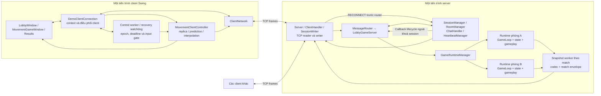

Mũi tên biểu diễn trao đổi dữ liệu hoặc gọi thành phần; chỉ đường nối TCP là giao tiếp giữa tiến trình.
Hai runtime A/B minh họa sự phân tách theo phòng, không phải hai server.
Ô snapshot worker đại diện cho các worker tương ứng từng match, không phải một worker duy nhất xử lý mọi trận.
Bản nguồn sơ đồ được lưu tại [08_01_tong_the.mmd](../figures/architecture/08_01_tong_the.mmd).

Điểm khởi tạo mặc định là
[ServerApplication](../../src/main/java/com/bombit/server/app/ServerApplication.java) tạo `LobbyGameServer`,
và [ClientApplication](../../src/main/java/com/bombit/client/app/ClientApplication.java) mở `LobbyWindow`.
Các nhánh demo/headless là đường chạy phục vụ mục đích riêng; không được dùng để thay mô tả toàn bộ luồng sản phẩm.
ServerApplication bật seamless recovery cho lobby; LobbyWindow bật auto reconnect.
Constructor tổng quát còn có cấu hình mặc định khác, vì vậy không suy ra demo M1 cũng có resume trận.

Dữ liệu trận, phòng và session chủ yếu nằm trong RAM của tiến trình server.
Kiến trúc hiện hành chưa tích hợp database cho tài khoản, lịch sử hoặc khôi phục trận sau khi server dừng.
Các file cấu hình, log hoặc CSV phục vụ phát triển/thực nghiệm không được coi là tầng persistence gameplay.

> **Phân công: TV1 phụ trách transport/session/room; TV4 xác nhận router, codec và tích hợp.**

## 8.2. Tầng transport, session và room

### 8.2.1. Phân tách trách nhiệm

**Bảng 8.1. Các thành phần hạ tầng server.**

| Thành phần | Trách nhiệm | Ranh giới với gameplay |
|---|---|---|
| `Server`, `ClientHandler`, `ConnectionManager` | Accept socket, tổ chức reader/writer, decode frame; chặn RECONNECT trước router, chuyển writer/socket về phiên cũ và cleanup theo captured socket | Không trực tiếp tính movement, damage hoặc item |
| `SessionManager`, `Session` | Danh tính/token, trạng thái phiên, heartbeat, grace ticket, claim recovery và cleanup | Quản lý quyền giữ phiên; không thay thế player state của match |
| `RoomManager`, `Room` | Thành viên, host, ready, trạng thái chờ/đang chơi và cập nhật phòng | Room không tự chứa thuật toán game loop |
| `MessageRouter`, `SessionHandlers` | Tra handler theo message type; xử lý các message phiên | Router gọi handler trên luồng gọi, không phải một worker queue riêng |
| `LobbyGameServer` | Ghép room/runtime, kiểm tra quyền/scope, ánh xạ roster, suspend/recovery barrier, snapshot/kết quả | Chuyển callback phiên thành command lifecycle; không sửa world mutable từ reader |
| `ChatHandler`, `HeartbeatManager` | Worker chat theo phòng và sweep phát hiện timeout | Không tạo thread riêng cho từng thao tác gameplay |

Căn cứ: [Server](../../src/main/java/com/bombit/server/network/Server.java),
[ClientHandler](../../src/main/java/com/bombit/server/network/ClientHandler.java),
[MessageRouter](../../src/main/java/com/bombit/server/dispatch/MessageRouter.java) và
[LobbyGameServer](../../src/main/java/com/bombit/server/app/LobbyGameServer.java).

### 8.2.2. Luồng tiếp nhận và phân quyền

Sau khi accept, `Server` đăng ký session và tạo writer cho socket; `ClientHandler` được đưa vào reader pool.
Handler đọc đủ frame, kiểm tra giới hạn, trạng thái handshake rồi gọi router bằng danh tính phiên server đang quản lý.
Các trường định danh mà client gửi không tự cấp quyền điều khiển một player khác.
Một socket mới đang ở trạng thái pending có thể gửi CONNECT để tạo luồng phiên mới, hoặc RECONNECT để xin tiếp quản phiên cũ.
Nhánh RECONNECT được ClientHandler nhận trước router: kiểm tra schema/token sơ bộ, gọi manager xác minh lại và claim,
rồi mới bỏ session/writer tạm nhưng giữ socket để gắn writer của identity cũ.
UUID người chơi trong request phải đi kèm token và kiểm tra manager; nó không tự cấp quyền bằng tên hoặc ID công khai.

`LobbyGameServer` kiểm tra thành viên phòng, quyền host, trạng thái trận và match envelope trước khi xử lý gameplay.
MOVE được đổi thành command qua `MovementHandler`; PLANT_BOMB cũng được đưa vào queue của runtime.
Thao tác hợp lệ ở tầng mạng mới chỉ được tiếp nhận: kết quả nghiệp vụ còn phụ thuộc game thread và luật gameplay.

Khi Start hợp lệ, tầng điều phối chụp roster, tạo spawn và ánh xạ session UUID sang playerId số trong match,
gọi `GameRuntimeManager.startGame`, tạo `MatchContext` và gửi `GAME_STARTED` trước khi worker phát snapshot.
Một session có thể chơi nhiều lượt qua cùng kết nối; mỗi lượt có match identity riêng.

### 8.2.3. Gửi dữ liệu và lỗi kết nối

Các producer sử dụng `SessionWriter.send` để encode frame và enqueue; writer thread tương ứng socket mới thực hiện
`write/flush`. Cách tổ chức này tách thao tác ghi socket khỏi bước mô phỏng và giữ các frame cùng kết nối không xen byte.
Queue/byte budget và watchdog giới hạn dữ liệu tồn đọng, phát hiện ghi kéo dài và đưa lỗi về cơ chế cleanup.
Chi tiết ở [SessionWriter](../../src/main/java/com/bombit/server/network/SessionWriter.java) và
[ConnectionManager](../../src/main/java/com/bombit/server/network/ConnectionManager.java).

Reader pool, writer, heartbeat và session expiry phối hợp qua SessionManager và callback lifecycle.
Trong active match có recovery bật, unexpected disconnect giữ session/ghế/runtime, đưa PlayerDisconnectedCommand
vào queue để dừng điều khiển, đồng thời chặn phát snapshot cho player suspended. Bom/item/timer vẫn chạy trên game thread.
Grace hết hạn hoặc leave/hard drop đi theo nhánh dọn phiên, có thể ABORT cả lượt.

SessionManager kiểm tra deadline và ownership dưới khoá session, nhưng gọi sink/lobby ngoài khoá đó.
Mỗi lần ngắt có DisconnectWindow riêng; timer cũ và cleanup của socket cũ phải đối chiếu ticket/socket trước khi tác động.
ConnectionManager tạo writer thay thế theo socket mới; late release không được xoá writer hiện tại chỉ dựa vào playerId.
Chi tiết các owner và trạng thái phục hồi được tổng hợp ở mục 8.7.

> **Phân công: TV2 phụ trách model/core/runtime/movement; TV1/TV4 xác nhận API tích hợp theo room.**

## 8.3. Model, state, runtime và movement

### 8.3.1. Mô hình dữ liệu và quyền sở hữu

**Bảng 8.2. Phân biệt dữ liệu model, state và dữ liệu bàn giao.**

| Nhóm | Thành phần tiêu biểu | Vai trò và cách sử dụng |
|---|---|---|
| Model giá trị | `Direction`, `TilePosition`, `TileType` | Enum/giá trị bất biến để thống nhất hướng, ô và loại nền |
| State đang mô phỏng | `GameState`, `GameMap`, `Player`, entity trong world | Mutable; sau khởi tạo được cập nhật bởi game thread của runtime |
| Input nghiệp vụ | `GameCommand`, movement/plant và `PlayerDisconnectedCommand`/`PlayerReconnectedCommand` | Handoff ý định và lifecycle sang game thread; không mang tham chiếu UI/socket |
| Snapshot/handoff | `GameStateUpdate`, `EntityData`, `BombFrame`, `MatchFrame`, `GameNotice` | Bản dữ liệu công bố để truyền trạng thái/diễn biến; không dùng state mutable làm payload chia sẻ |

`GameRuntimeManager` tạo map và state mới cho mỗi trận, kiểm tra spawn/định danh, tạo extension rồi khởi động runtime.
Map factory và extension factory phải cung cấp instance riêng; manager kiểm tra việc tái sử dụng map instance.
`GameRuntime` giữ roomId, matchId, mapping player và loop, cung cấp submit, poll update, request full và close.
API này không trả trực tiếp `GameState` cho network thread.

Đường chạy lobby inject `DefaultArenaMap` và `MatchGameplayExtension` đầy đủ.
Constructor manager không tham số còn có cấu hình tối giản phục vụ sử dụng/test khác;
không lấy cấu hình tối giản đó để kết luận gameplay mặc định chưa có bom/item.
Căn cứ:
[GameRuntimeManager](../../src/main/java/com/bombit/server/game/runtime/GameRuntimeManager.java) và
[GameRuntime](../../src/main/java/com/bombit/server/game/runtime/GameRuntime.java).

### 8.3.2. Trình tự của game loop

Sau `onStart` của extension, mỗi tick thực hiện:

1. Chuẩn bị cờ xử lý input của player, lấy command theo FIFO và chính sách giới hạn mỗi tick.
2. Áp dụng command movement; chuyển các command cần gameplay sang extension.
3. Cập nhật vị trí qua `MovementSystem` và `CollisionSystem` với bước mô phỏng cấu hình.
4. Gọi `GameplayExtension.update` để xử lý bom, item và kết quả.
5. Tạo full/delta update, đưa vào outbound FIFO và điều chỉnh lịch tick tiếp theo.

`MoveCommand` thay đổi ý định điều khiển; vị trí thực tế được tính trong bước movement.
Trạng thái ACK phản ánh input được áp dụng vào mô phỏng, không chỉ việc packet đã đến socket.
Các command cùng tick vẫn được xử lý theo chính sách FIFO; một mẫu movement mới thứ hai của cùng player
có thể làm phần command còn lại đợi tick sau.
Core xử lý tập frozen từ command disconnect/reconnect, buộc player frozen dừng movement trước bước cập nhật vị trí.
Extension vẫn nhận command lifecycle và tiếp tục update gameplay. Khi lobby không submit được freeze/unfreeze,
nó kết thúc lượt theo policy thay vì giả định game thread đã áp thay đổi.

Mặc định loop có bước 50 ms, command queue 4096, outbound queue 1024 và giới hạn đọc 256 command/tick.
Các giá trị là cấu hình hiện tại, không phải kết quả chứng minh tải tối đa hoặc luôn đạt 20 Hz.
Tick trễ điều chỉnh mốc chạy tiếp; code không chạy bù toàn bộ bằng accumulator.
Nguồn: [GameLoop](../../src/main/java/com/bombit/server/game/core/GameLoop.java).

### 8.3.3. Snapshot và baseline

`StateDeltaBuilder` chụp dữ liệu để so sánh với baseline đã commit.
Update được tạo trên game thread và bàn giao qua FIFO; chỉ enqueue thành công mới commit baseline,
xóa notices đã bàn giao và công bố ảnh `latest`.
Nếu outbound đầy thì baseline cũ được giữ để lần tạo tiếp vẫn tham chiếu phần đã công bố.

`createUpdate()` trả ảnh công bố gần nhất, có thể là delta; hàm không tạo snapshot mới từ network thread
và không thay thế việc đọc outbound FIFO. Nếu tầng gửi chỉ lấy ảnh mới nhất rồi bỏ các delta trung gian,
client có thể mất chuỗi baseline cần thiết.
Nhận vào queue cũng chưa phải ACK rằng từng client đã áp dụng dữ liệu.
Sau reconnect, snapshot worker dùng suspended/recoveryFullAfter để bỏ delta/full cũ cho người đang khôi phục.
Một full mới vượt barrier được enqueue thành công mới gỡ gate initialized phía server;
client vẫn chờ full được áp thành công trước khi mở input. Baseline chung theo match nên full có thể đi tới cả roster.
Các ranh giới này được xác định trong
[StateDeltaBuilder](../../src/main/java/com/bombit/server/game/movement/StateDeltaBuilder.java)
và `GameLoop`.

> **Phân công: TV3 phụ trách bomb/item/event; TV2 phối hợp extension contract và các world adapter.**

## 8.4. Gameplay extension và world adapters

### 8.4.1. Điểm mở rộng trong runtime

`GameplayExtension` định nghĩa `onStart`, `processCommand`, `update` và `onStop`.
Loop gọi chúng trên cùng game thread. Nhờ contract này, loop quản lý lịch và movement,
còn nghiệp vụ bom/item nằm trong implementation gameplay.
Factory được gọi khi khởi tạo để gắn extension với state của đúng trận.
Nguồn: [GameplayExtension](../../src/main/java/com/bombit/server/game/runtime/GameplayExtension.java).

Trong đường chạy mặc định, `MatchGameplayExtension` phối hợp `BombGameplayExtension` và `ItemSystem`.
Sau movement, extension xử lý bom đến hạn/nổ dây chuyền/damage, xóa item cũ trong vùng nổ,
xét drop từ block vừa phá, pickup theo thứ tự playerId rồi quyết định thời gian/kết quả.
Do các bước cùng dùng một owner thread, snapshot cuối tick phản ánh trạng thái sau chuỗi cập nhật đó.

### 8.4.2. Vai trò của world adapter

**Bảng 8.3. Các lớp liên kết gameplay với state và đầu ra.**

| Thành phần | Trách nhiệm |
|---|---|
| `BombSystem` qua `BombWorldAdapter` | Kiểm tra đặt bom, truy vấn ô/player, quản lý entity bom và thời lượng đã trôi qua; áp dụng tác động vào state |
| `ItemSystem` qua `ItemWorldAdapter` | Tạo/xóa entity item, tìm người nhặt và áp dụng effect theo bộ luật |
| `ItemEffectRegistry`, `ItemSpawnPolicy` | Catalog hiệu ứng và chính sách lựa chọn drop, tách khỏi luồng pickup/runtime |
| `MatchGameplayExtension` | Kết hợp các bước gameplay, mạng sống/respawn, timer, stats và kết quả trận |

Adapter dịch giữa định danh session của API gameplay với playerId/state của runtime,
đồng thời kiểm tra quyền truy cập theo game thread. Chúng không mở socket và không tự broadcast.
Bom đang chạy dùng kiểm tra thời lượng trong loop; `BombScheduler` còn trong repository không phải scheduler
của đường gameplay mặc định. Nguồn:
[MatchGameplayExtension](../../src/main/java/com/bombit/server/game/runtime/MatchGameplayExtension.java),
[BombWorldAdapter](../../src/main/java/com/bombit/server/game/runtime/BombWorldAdapter.java),
[ItemWorldAdapter](../../src/main/java/com/bombit/server/game/runtime/ItemWorldAdapter.java).

### 8.4.3. Domain event và thông điệp mạng

Game event không được đồng nhất với frame TCP. Một số event được ghi thành `GameNotice` để đi cùng
`GameStateUpdate` nội bộ; state và các frame hiệu ứng/stats được chụp trong update tương ứng.
Snapshot worker mới chuyển notices thành message chính thức và gửi sau snapshot qua writer queue của từng session.
Như vậy, domain system phát sinh diễn biến nhưng tầng tích hợp quyết định cách biểu diễn trên mạng.

Repository có hai interface cùng tên `GameEventSink` ở hai package:
`server.game.event` nhận domain event qua `publish`, còn `server.integration` nhận callback vòng đời session
như disconnect/hard drop. Chúng không phải một event bus chung và không chứng minh kiến trúc event sourcing.
Lúc cấu hình lobby, callback domain ngoài có thể là no-op; đường ghi state/notices nội bộ vẫn hoạt động.

> **Phân công: TV1 phụ trách lobby/results UI; TV2 movement/đồng bộ/render map-player; TV3 render bom/item/hiệu ứng; TV4 hạ tầng client dùng chung.**

## 8.5. Client lobby, movement, renderer và results

### 8.5.1. Điều phối kết nối và màn hình

**Bảng 8.4. Trách nhiệm các thành phần client.**

| Thành phần | Trách nhiệm |
|---|---|
| `LobbyWindow`, `MatchResultsPanel` | Giao diện kết nối/phòng/ready/chat và kết quả; giữ luồng chuyển giữa lobby và gameplay |
| `DemoClientConnection` | Owner transport/context/token; heartbeat/control sender, recovery state/epoch/deadline, watchdog riêng và listener xuyên các lượt |
| `ClientNetwork` | Kết nối TCP, encode/send có khóa, reader decode, phát listener và theo dõi byte; không tự cập nhật world/UI |
| `MovementClientController` | Nhận packet đúng match, ghép replica, điều phối prediction/reconciliation/interpolation, resync và worker gửi input |
| `InputController`, `PredictionController`, `ReconciliationController`, `InterpolationController` | Lấy mẫu thao tác và các bước xử lý movement tại client |
| `MovementGameWindow`, `TileGridRenderer`, `BombScene`, các renderer item/bom/lửa | Vẽ map, entity, nhân vật, hiệu ứng và HUD từ dữ liệu phía client |

Tên `DemoClientConnection` còn mang dấu mốc phát triển, nhưng `LobbyWindow` đang dùng lớp này làm owner
kết nối thật. Không có một lớp `LobbyController` riêng trong đường chạy đã khảo sát.
Nguồn: [LobbyWindow](../../src/main/java/com/bombit/client/lobby/LobbyWindow.java),
[DemoClientConnection](../../src/main/java/com/bombit/client/app/DemoClientConnection.java)
và [ClientNetwork](../../src/main/java/com/bombit/client/network/ClientNetwork.java).

Listener ứng dụng được cài trước CONNECT. Nó chuyển packet sang UI executor tuần tự,
xử lý `GAME_STARTED` của lượt mới để tạo controller/context, sau đó chuyển snapshot/notices cho controller hiện hành.
Controller được tạo với `subscribe=false` trong luồng này, tránh đăng ký thêm listener làm áp dụng packet hai lần.
API controller vẫn hỗ trợ tự đăng ký typed listener cho kiểu tích hợp khác.
Trong recovery, GAME_STARTED phải trùng context đang giữ; client giữ controller và cửa sổ hiện tại,
không đi theo nhánh tạo lượt mới làm reset sequence/counter đặt bom.

### 8.5.2. Phân biệt replica, prediction và dữ liệu render

`ClientWorldState` là replica của dữ liệu server đã áp dụng thành công.
`PredictionController` giữ state local riêng và lịch sử input chưa ACK, còn interpolation giữ các mẫu vị trí remote.
Ba loại dữ liệu có mục đích khác nhau; không dùng vị trí đã nội suy để sửa world authoritative hoặc tính damage.

Khi áp dụng snapshot, controller kiểm tra kết quả ghép replica. Nếu hợp lệ, nó đồng bộ scene bom,
reset lịch sử khi respawn, cập nhật world cho prediction, reconcile rồi ghi mẫu nội suy.
Nếu thiếu/sai baseline, controller yêu cầu full và tạm không sinh input mới theo điều kiện input-ready.
Khi phục hồi phiên, owner chủ động suspend input, tăng generation, bỏ sender task/pending prediction cũ,
xoá interpolation và đánh dấu replica cần full. World cũ được giữ để vẽ trạng thái chờ;
ACK phiên không đủ mở input. Full phải đúng match/epoch và áp thành công sau metadata hợp lệ.
Nguồn: [MovementClientController](../../src/main/java/com/bombit/client/game/movement/MovementClientController.java).

Client tái sử dụng `GameMap`, `Player` và movement/collision từ các package mang tên `server.game` để mô phỏng local.
Đây là tái sử dụng mã trong cùng repository, không phải client truy cập instance `GameState` đang chạy trên server.
Snapshot codec cũng nằm ở `server.game.movement`; vì vậy, ranh giới trách nhiệm logic chưa hoàn toàn trùng
với cách đặt package. Không mô tả project như đã tách mọi DTO/codec/game simulation thành thư viện common độc lập.

### 8.5.3. Render và kết quả

`MovementGameWindow` vẽ nhân vật local theo prediction, nhân vật khác theo interpolation,
map/item từ replica và bom/lửa từ `BombScene`. HUD lấy mạng sống, khiên, quota, range và timer từ dữ liệu server.
Client chỉ gửi ý định đặt bom; không tự tạo bom hoặc tự trừ damage như một kết quả authoritative.

Sau `GAME_OVER` đúng match, connection owner ghi kết quả, đóng movement controller và bỏ context trận;
lobby đóng cửa sổ gameplay, hiển thị `MatchResultsPanel` và giữ kết nối để ready/start lượt khác.
Render timer và input timer có vòng đời gắn với cửa sổ gameplay, không được để tiếp tục dùng controller của trận cũ.
Nguồn: [MovementGameWindow](../../src/main/java/com/bombit/client/game/movement/MovementGameWindow.java).

> **Phân công: TV4 ghép mục 8.6; TV1 xác nhận transport/session, TV2 loop và client state, TV3 gameplay cleanup.**

## 8.6. Router, worker, queue, quyền sở hữu thread và cleanup

### 8.6.1. Các ranh giới bàn giao dữ liệu

**Hình 8.2. Luồng command và snapshot qua các thread/queue. Nhóm tự vẽ từ code project.**

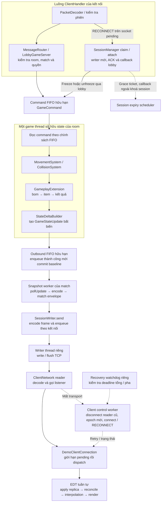

Sơ đồ tập trung đường gameplay mặc định. Queue writer chứa frame đã encode;
không đặt toàn bộ encode vào writer thread. Việc render chạy theo timer của UI sau các lần cập nhật state,
không phải một bước bắt buộc được gọi ngay sau mỗi packet.
Bản nguồn: [08_02_thread_va_queue.mmd](../figures/architecture/08_02_thread_va_queue.mmd).

**Bảng 8.5. Thread, dữ liệu sở hữu và cơ chế giới hạn.**

| Miền thực thi | Công việc/dữ liệu | Bàn giao và giới hạn chính |
|---|---|---|
| Accept và reader pool của server | Socket, đọc frame và route | Pool/queue hữu hạn; `MessageRouter` gọi đồng bộ handler |
| Điều phối lobby/session/room | Thành viên, match context, suspended/recovery barrier và grace ticket | Claim dưới khoá session; callback ngoài khoá; lobby/pump có synchronization riêng |
| GameLoop của từng runtime | State mutable, movement, extension và builder | Nhận command FIFO; xuất snapshot bất biến qua outbound FIFO |
| Snapshot worker của từng match | Poll update, codec, envelope, snapshot/notices/result | Không đọc state mutable; enqueue writer của từng session |
| Session writer của từng socket | Ghi/flush frame đã encode | Queue 256 frame chờ, budget 4 MiB tính cả frame đang ghi; watchdog ghi kéo dài |
| Worker/scheduler phụ trợ server | Chat, heartbeat, session expiry, watchdog và connection cleanup | Tách vòng đời hạ tầng khỏi bước update gameplay |
| Reader/control/sender của client | Decode; control/heartbeat/resync/input; connect/retry recovery | Epoch và input generation chặn task cũ; connect/close không giữ monitor xuyên I/O |
| Recovery watchdog client | Kiểm tra deadline tổng/từng pha trên scheduler riêng | Không đợi control worker đang connect; timeout dẫn retry hoặc close theo budget |
| Swing EDT | Replica, prediction/replay, buffer nội suy và UI | Dispatch tuần tự; input/render timer; giới hạn pending dispatch trước EDT |

Giới hạn pending dispatch của owner client không biến hàng đợi EDT toàn cục của Swing thành một queue hữu hạn.
Đường listener mặc định tắt pull queue của `ClientNetwork` để không giữ thêm bản packet không có consumer.
Nếu API `receive()` được dùng ở tích hợp khác, pull queue có giới hạn riêng.

State theo phòng được cách ly, nhưng toàn hệ thống vẫn dùng chung CPU, reader pool, manager và khóa điều phối.
Không suy ra mỗi room có tài nguyên độc lập hoàn toàn hoặc throughput tăng tuyến tính theo số room.

### 8.6.2. Luồng dữ liệu movement và snapshot

**Hình 8.3. Một lượt input đi qua runtime và trở về client. Nhóm tự vẽ từ code project.**

```mermaid
sequenceDiagram
    participant UI as Client EDT
    participant SEND as Movement-Sender
    participant IN as Server reader/router/lobby
    participant LOOP as GameRuntime / GameLoop
    participant PUMP as Snapshot worker
    participant WRITE as SessionWriter
    participant NET as ClientNetwork reader
    Note over UI,NET: Luồng sau khi đã nhận GAME_STARTED và full hợp lệ
    UI->>UI: Lấy mẫu input và prediction local
    UI->>SEND: Enqueue MOVE có sequence
    SEND->>IN: ClientNetwork.send → TCP frame
    IN->>LOOP: Kiểm tra scope, submit GameCommand
    Note over IN,LOOP: Submit thành công chưa phải ACK đã mô phỏng
    LOOP->>LOOP: Tick: command → movement → gameplay
    LOOP-->>PUMP: GameStateUpdate qua outbound FIFO
    PUMP->>WRITE: Snapshot rồi notices qua queue của từng session
    WRITE-->>NET: Ghi TCP frames
    NET->>UI: Listener ứng dụng dispatch tuần tự
    UI->>UI: Ghép replica, dùng ACK để reconcile, ghi mẫu nội suy
    UI->>UI: Render local prediction và remote interpolation
```

Sơ đồ mô tả các bước logic; một snapshot có thể phản ánh nhiều biến đổi và được phát cho cả roster,
không phải mỗi input luôn có ngay một packet phản hồi riêng. Gameplay notice chỉ được phát nếu có;
mỗi client khác nhận qua writer riêng. Bản nguồn: [08_03_luong_movement.mmd](../figures/architecture/08_03_luong_movement.mmd).

Với bom, nhánh đầu vào là PLANT_BOMB → kiểm tra scope/rate/requestId → command queue.
Game thread áp dụng placement và xử lý bom đến hạn qua extension; entity/map/player mới xuất hiện
trong snapshot, còn diễn biến tương ứng có thể đi qua notice/effect.
Với resync, client gửi REQUEST_FULL_STATE; tầng lobby đặt yêu cầu full cho runtime và snapshot worker
nhận diện full mới sau mốc yêu cầu để công bố FULL_STATE_SYNC.
Cả hai luồng giữ nguyên ranh giới state và I/O của hình 8.2.

### 8.6.3. Chính sách quá tải và lỗi

Command queue đầy làm submit thất bại, được tầng tích hợp trả lỗi thay vì chờ đến khi queue có chỗ.
Với callback lifecycle recovery, không có request gameplay để trả INPUT_QUEUE_FULL theo cách thông thường:
freeze/unfreeze không enqueue được thì lobby ABORT lượt; nhánh resume còn rollback/cleanup session.
Outbound runtime đầy giữ baseline chưa commit để lần tạo sau còn tham chiếu đúng dữ liệu đã enqueue.
Writer queue/budget đầy hoặc write deadline bị vượt có thể đóng kết nối và kích hoạt cleanup;
không tùy ý bỏ một delta rồi tiếp tục như thể client đã nhận đủ.

Ở client, hết budget dispatch hoặc queue gửi được xử lý bằng dừng controller/phiên và báo lỗi theo owner.
Lỗi gửi transport có thể kích hoạt recovery nếu active context/token/cấu hình còn cho phép;
lỗi decode/world không mặc nhiên được chuyển thành retry vô hạn.
Đối với sai baseline hợp lệ ở cấp đồng bộ, client yêu cầu full thay vì tự suy đoán phần thiếu.
Các cơ chế này giới hạn một số dạng backlog; hiệu quả dưới tải và các đường lỗi vẫn cần kiểm chứng trong Results.

### 8.6.4. Cleanup và chuyển lượt

Kết thúc gameplay bình thường đi qua kết quả trong snapshot; snapshot worker đưa kết quả về tầng lobby để đóng match.
Kết thúc hành chính, hard drop hoặc grace hết hạn có thể dùng ABORTED nếu lượt chưa có kết quả chốt.
Unexpected disconnect trong grace hợp lệ giữ runtime; không dọn match như một leave ngay lập tức.
Tầng điều phối đánh dấu match không còn active, dừng runtime, chuyển room về WAITING và công bố GAME_OVER/room state.

`GameLoop.stop` yêu cầu dừng, interrupt và chờ thread có thời hạn; `onStop` chạy trong phần cleanup của game thread
để extension dọn bom/item/effect. Snapshot worker thoát theo cờ/lifecycle runtime và tự rời danh sách worker.
Khi đóng cả server, `LobbyGameServer.close` còn đóng transport/manager và interrupt/join worker còn lại.

Transport đóng socket để đánh thức thao tác đọc/ghi đang chặn, dừng heartbeat/expiry/watchdog và reader pool/chat worker.
`ConnectionManager` chuyển callback lỗi writer sang cleanup executor để tránh gọi trực tiếp logic lobby trong lúc producer
còn giữ khóa. Phía client dừng timer, đóng movement sender, bỏ context trận cũ; khi đóng phiên mới đóng cả reader/control/network.
Việc dọn tài nguyên là trách nhiệm theo từng owner, không chỉ gọi `dispose()` cho cửa sổ.
Riêng recovery giữ controller và timer UI để biểu diễn trạng thái chờ, nhưng khoá input qua generation/readiness.
Khi recovery thất bại/đóng phiên, owner còn dừng recovery watchdog và control worker;
ở server, ticket expiry phải được huỷ hoặc xác minh thế hệ trước khi dọn session.

Một số frame đã vào writer có thể còn tới sau khi trận kết thúc. Match identity và context client giúp bỏ dữ liệu cũ;
lượt chơi lại tạo runtime/world/controller mới, đồng thời giữ TCP nếu phiên vẫn hợp lệ.
Match identity lọc dữ liệu lượt cũ; connection epoch và input generation bổ sung để lọc tác vụ của lần nối cũ
ngay trong cùng match. Resume chỉ thành công khi đầy đủ điều kiện session/lifecycle/full gate, không nhờ matchId riêng lẻ.

### 8.6.5. Liên hệ yêu cầu và giới hạn kiến trúc

**Bảng 8.6. Kiến trúc đáp ứng các nhóm yêu cầu ở mục 6.**

| Nhóm yêu cầu | Thành phần chịu trách nhiệm chính | Nội dung cần kiểm chứng tiếp |
|---|---|---|
| FR01–FR03 | Transport, session, room, router và lobby UI | Phân quyền, trạng thái phòng, chat đúng scope |
| FR04–FR09 | Runtime riêng room, movement và gameplay extension/adapters | Isolation, collision, bom/item/damage và thứ tự cập nhật |
| FR10–FR11 | Builder/codec, snapshot pump, replica và client controllers | Baseline/resync, ACK/replay, respawn và biểu diễn |
| FR12–FR14 | Lobby lifecycle, session writer, cleanup và context theo match | Kết thúc/chơi lại, dữ liệu cũ, queue đầy và lỗi kết nối |
| FR15 | SessionManager/ClientHandler/ConnectionManager; callback lobby/runtime; client recovery owner | Token/deadline/ownership, giữ runtime/controller, khoá input tới full, expiry và gameplay offline |
| NFR01–NFR08 | Các ranh giới owner/queue và công cụ đo/test | Tính đúng, nhịp/tải/byte, giải phóng tài nguyên và tái lập |

Mô tả kiến trúc giải thích cách các thành phần phối hợp, chưa xác nhận mọi thuộc tính chất lượng đã đạt.
Lượt mới ngoài sandbox đạt 171/171 JUnit và TV2/TCP checks; các lượt sandbox có lỗi smoke ba tiến trình
được giữ để chỉ rõ điều kiện chạy. Chưa nghiệm thu GUI thủ công/LAN/Wi-Fi/soak;
không dùng sơ đồ làm bằng chứng thay cho kiểm thử hoặc số liệu thực nghiệm.
Nguồn: [kết quả kiểm thử mới](../session-recovery/03_KET_QUA_KIEM_THU_THUC_TE.md).

## 8.7. Quyền sở hữu và trạng thái trong Session Recovery

### 8.7.1. Phân tách owner khi chuyển transport

**Bảng 8.7. Dữ liệu recovery và thành phần được phép thay đổi.**

| Dữ liệu | Owner/cơ chế | Ranh giới cần giữ |
|---|---|---|
| Session UUID/token, socket hiện tại, state trước disconnect | SessionManager/Session, khoá session | Session tồn tại qua nhiều socket; kiểm tra token không thay kiểm tra deadline/match |
| DisconnectWindow và ScheduledFuture | SessionManager, ticket riêng mỗi lần ngắt | Deadline kiểm tra lại khi claim; timer huỷ/đến muộn không xoá thế hệ sau |
| Writer và captured socket | ConnectionManager/SessionWriter | Bỏ writer tạm nhưng giữ socket để handoff; late cleanup không đóng writer mới |
| Match context, suspended, initialized, recoveryFullAfter | LobbyGameServer và snapshot pump dưới điều phối lobby | Không phát delta/notice cho người còn suspended/chưa có full nền mới |
| Player frozen, bom/item/damage/timer | GameLoop và gameplay extension | Chỉ game thread sửa world; lifecycle được queue nhận chưa có nghĩa đã áp ngay |
| RecoveryState, connection epoch, deadline | DemoClientConnection; control worker/watchdog và UI dispatch | Watchdog độc lập kiểm tra timeout; callback UI phải thuộc epoch hiện hành |
| Replica/prediction/interpolation và input generation | MovementClientController/InputController | Giữ world để vẽ; bỏ pending cũ; không mở input chỉ nhờ ACK |

Trong handoff, session vẫn DISCONNECTED khi attach socket và dựng writer; sau khi enqueue ACK mới phục hồi
state và gọi lobby. Nhánh lobby có thể từ chối do trận đã kết thúc, nên ACK không phải cam kết tiếp tục trận.
SessionRecoveryRejectedException đánh dấu từ chối nghiệp vụ; lỗi writer/setup thực vẫn đi vào diagnostics.
Không có enum ORPHAN_SESSION hoặc một service persistence/failover mới trong kiến trúc này.

### 8.7.2. Trạng thái client và gate gameplay

**Hình 8.4. State machine kết nối và recovery của client owner. Nhóm tự vẽ từ code đã xác minh.**

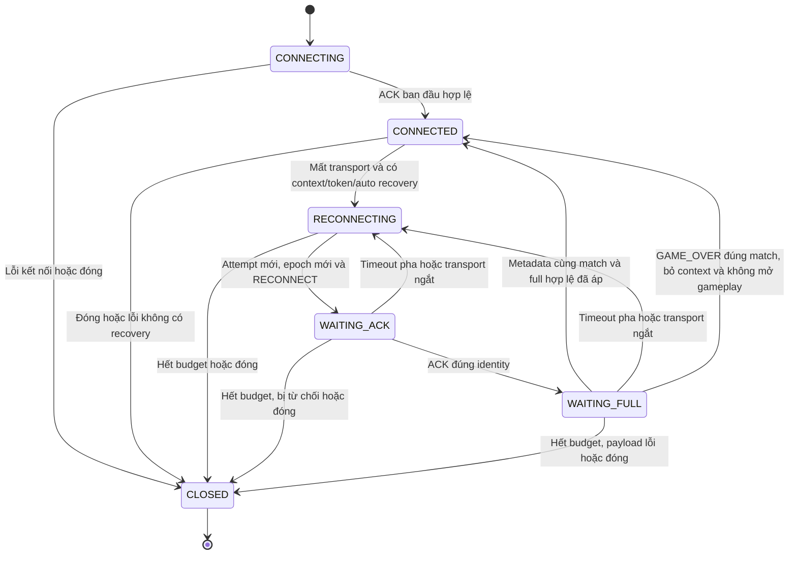

CONNECTED là enum kết nối, không đồng nghĩa luôn có gameplay sẵn sàng: sau ACK ban đầu còn chờ trận/full,
và sau GAME_OVER context đã bị bỏ. Khi GAME_OVER đúng match còn được nhận trong recovery, owner kết thúc
recovery và đóng controller; nhánh này áp dụng cả khi còn RECONNECTING/WAITING_ACK, hình chỉ vẽ đại diện từ WAITING_FULL.
Nếu không nhận được kết quả trong lúc offline, server không có replay lịch sử GAME_OVER để bảo đảm bổ sung.
Sơ đồ lược bớt callback trạng thái không đổi; UI readiness còn phụ thuộc controller/replica.

Bản nguồn: [08_04_trang_thai_recovery.mmd](../figures/architecture/08_04_trang_thai_recovery.mmd).
Các sequence có frame trên dây, nhánh sai token và hết hạn được trình bày tại mục 9.6.5–9.6.6;
tham số budget ở mục 7.8.3, phần 9 bổ sung cách diễn giải timeout theo giao thức.


# 9. Thiết kế giao tiếp mạng

Protocol của Bomb It Multiplayer là giao thức ứng dụng trên TCP, phục vụ kết nối, lobby/phòng và gameplay
trong cùng một phiên client. Chương này trình bày đường chạy lobby mặc định theo codec và handler hiện hành;
không coi mọi message có tên trong đặc tả lịch sử là chức năng đã được bật.
Kiến trúc thread/queue được giải thích ở [mục 8](../chapters/08_KIEN_TRUC_HE_THONG.md);
ở đây tập trung vào dữ liệu trên đường truyền, điều kiện xử lý và thứ tự trao đổi.
Phần cập nhật phản ánh Session Recovery đã nối end-to-end trong active match:
socket mới gửi RECONNECT trước router, tiếp quản phiên cũ rồi nhận metadata/full để tiếp tục delta.

Quy ước: `C→S` là client gửi server; `S→C` là server gửi một client; `S→Room` là phát tới các client thuộc phòng/trận.
`S`, `R`, `M` trong schema lần lượt biểu thị UUID session, room và match, không phải chuỗi literal gửi trên mạng.
Ký hiệu kiểu và trường có thể bỏ trong bảng dùng để mô tả schema; các ví dụ JSON riêng là dạng canonical khi có yêu cầu.

> **Phân công: TV4 phụ trách framing/codec/version; TV1 xác nhận transport và handshake.**

## 9.1. TCP framing, UTF-8, size limit và handshake protocol 2

### 9.1.1. Cấu trúc frame

**Bảng 9.1. Frame ứng dụng trên TCP.**

| Trường | Kích thước | Quy tắc |
|---|---|---|
| `length` | int32, 4 byte | Số byte của type + payload, không tính chính prefix này |
| `type` | int16, 2 byte | Mã message theo `PacketType` |
| `payload` | `length − 2` byte | JSON mã hóa UTF-8 |

Các số nhiều byte của frame dùng big-endian. Giới hạn `length` là 2..1.048.576 byte,
do đó payload tối đa 1.048.574 byte và tổng frame tối đa 1.048.580 byte.
Giới hạn tính sau khi đã thêm match envelope, JSON và Base64; không chỉ tính binary snapshot.
Không có newline phân cách frame. TCP có thể chia hoặc gộp dữ liệu giữa các lần đọc;
decoder đọc đủ 4 byte length rồi `readFully` phần body và kiểm tra UTF-8 trước khi chuyển cho handler.

Ví dụ với message PING `0x0040`, body canonical `{"pingId":1}` có 12 byte UTF-8,
`length=14` và tổng frame 18 byte:

```text
00 00 00 0E 00 40 7B 22 70 69 6E 67 49 64 22 3A 31 7D
```

Đây là ví dụ tính frame, chưa phải số đo packet TCP/IP.
Nguồn: [PacketEncoder](../../src/main/java/com/bombit/common/protocol/PacketEncoder.java),
[PacketDecoder](../../src/main/java/com/bombit/common/protocol/PacketDecoder.java) và
[PacketType](../../src/main/java/com/bombit/common/protocol/PacketType.java).

### 9.1.2. Phân lớp kiểm tra dữ liệu

Framing kiểm tra kích thước/UTF-8; codec kiểm tra schema; handler kiểm tra trạng thái, scope và quyền;
game thread quyết định kết quả luật chơi. Frame đọc được không đồng nghĩa request đã hợp lệ hoặc đã được mô phỏng.

`SessionPacketCodec` xử lý object control nhỏ; `LobbyPacketCodec`/`LobbyJson` xử lý object lobby và một số message gameplay.
MOVE, resync, metadata bắt đầu trận và snapshot còn dùng định dạng canonical riêng.
Một JSON tương đương nhưng đổi thứ tự trường hoặc thêm khoảng trắng có thể không được các codec canonical chấp nhận.
Client phải dùng encoder hiện có thay vì tự tạo JSON tùy ý cho các loại đó.

Request qua `LobbyPacketCodec.request` tối đa 4096 ký tự; parser `LobbyJson` có giới hạn tổng 65.536 ký tự,
độ sâu 8 và tối đa 256 phần tử trong array. Control object tối đa 1024 ký tự;
MOVE và resync inner body tối đa 128 ký tự. Đây là các giới hạn ở những lớp khác nhau,
không thay thế giới hạn byte của frame.

### 9.1.3. Thương lượng phiên bản

Ở luồng kết nối phiên mới, client mở TCP rồi gửi:

```json
{"playerName":"PlayerA","protocolVersion":2}
```

Server chỉ chấp nhận handshake protocol 2 trong đường chạy tích hợp.
Tên được strip, dài 1–32 code point và không chứa control character.
CONNECT sai version được trả `UNSUPPORTED_VERSION`, sau đó kết nối bị dọn theo chính sách transport.
`protocolVersion` không phải `snapshotVersion`: trường thứ nhất quy định contract tích hợp,
trường thứ hai mô tả layout binary của snapshot.
Ở luồng phục hồi, frame đầu có thể là RECONNECT theo mục 9.2.4 thay cho CONNECT.
RECONNECT không có trường protocolVersion riêng; client/server phải dùng bộ phát hành tương thích,
và client vẫn kiểm tra protocolVersion trong CONNECT_ACK nhận lại.

Thông tin ACK gồm `playerId` UUID phiên, token, `serverVersion`, protocol version và các giá trị heartbeat/grace.
`serverVersion` hiện là chuỗi `0.1.0`; đó không phải mã revision kiểm thử và không chứng minh tương thích với mọi binary snapshot.
Nguồn: [SessionPacketCodec](../../src/main/java/com/bombit/common/protocol/SessionPacketCodec.java)
và [SessionHandlers](../../src/main/java/com/bombit/server/dispatch/SessionHandlers.java).

> **Phân công: TV1 phụ trách danh tính và vòng đời phiên/phòng; TV4 kiểm tra envelope/context, TV2 xác nhận mapping runtime.**

## 9.2. Session, room, match identity và vòng đời kết nối

### 9.2.1. Hệ thống định danh

**Bảng 9.2. Định danh và phạm vi ý nghĩa.**

| Trường | Kiểu/phạm vi | Cách sử dụng |
|---|---|---|
| Session ID | UUID string server cấp | Field `playerId` trong CONNECT_ACK/RECONNECT và roster phòng; giữ nguyên khi socket mới tiếp quản phiên hợp lệ |
| Reconnect token | UUID string bí mật theo phiên | Gửi cùng session playerId để xin resume; không phải matchId hoặc mật khẩu tài khoản; chưa rotation qua recovery |
| Room ID | UUID string | Membership và quyền thao tác phòng |
| Match ID | UUID mới cho mỗi runtime/lượt | Lọc lệnh và state thuộc lượt cũ, kể cả chơi lại cùng phòng |
| Gameplay player ID | int32 dương, trong match | Ánh xạ từ session qua MatchContext/runtime; không nhận từ MOVE |
| Bomb/item ID | int32 dương trong namespace kind + match | Entity bom và item có thể có cùng số nhưng khác key `BOMB:id`/`ITEM:id` |
| Sequence, tick, baseTick, requestId, eventId | int64 Java; JSON integer khi ở JSON | Đánh số input, baseline, yêu cầu và event; không dùng float thay ID |

Client lấy session UUID từ CONNECT_ACK rồi đối chiếu roster GAME_STARTED để biết local playerId số.
`EntityData.ownerId` của bom vẫn là UUID chủ sở hữu, trong khi `ownerPlayerId` của event wire là int gameplay.
Không chuyển hai dạng này bằng cách parse UUID thành số nguyên.

### 9.2.2. Match envelope

Message gameplay được bọc bằng field `matchId` ở đầu object. Ví dụ MOVE trên dây:

```json
{"matchId":"11111111-1111-4111-8111-111111111111","sequence":7,"direction":"RIGHT","moving":false}
```

`MatchEnvelopeCodec` kiểm tra type, prefix UUID kỳ vọng, header lặp và kích thước frame.
Sau unwrap, codec chuyên biệt tiếp tục kiểm tra body; envelope không phải parser đầy đủ cho JSON bên trong.
Server lấy danh tính từ session/socket đang xử lý và đối chiếu runtime; client kiểm tra matchId trước áp dụng state.

Envelope áp dụng cho MOVE, PLANT_BOMB, snapshot/full-sync/resync, END_GAME, GAME_OVER và các notice gameplay.
GAME_STARTED đã tự chứa matchId; message session, heartbeat và lobby không bọc envelope.
Các API legacy không envelope vẫn có thể phục vụ fixture, nhưng không được suy ra thành contract production protocol 2.
Nguồn: [MatchEnvelopeCodec](../../src/main/java/com/bombit/common/protocol/MatchEnvelopeCodec.java).

### 9.2.3. Heartbeat và kết thúc kết nối

**Bảng 9.3. Các message phiên/control đang được sử dụng.**

| Mã | Message/hướng | Body chính và ngữ nghĩa |
|---|---|---|
| `0x0001` | CONNECT, C→S | `playerName`, `protocolVersion:2`; frame đầu cho phiên mới trước yêu cầu lobby/gameplay |
| `0x0002` | CONNECT_ACK, S→C | `playerId:S`, `reconnectToken`, `serverVersion`, `protocolVersion:2`, `heartbeatIntervalMs:2000`, `heartbeatTimeoutMs:10000`, `reconnectGraceMs:15000` |
| `0x0040` | PING, C→S | `pingId:int32`; client mặc định gửi theo chu kỳ 2 giây |
| `0x0041` | PONG, S→C | Echo đúng JSON body PING đã qua kiểm tra |
| `0x0042` | DISCONNECT, C→S | `reason:"USER_QUIT"`; handler hỗ trợ đóng phiên chủ động |
| `0x0043` | RECONNECT, C→S | `playerId:S,reconnectToken:UUID`; frame đầu trên socket mới, không bọc match envelope |
| `0x00FF` | ERROR, S→C | `errorCode`, `message`, `requestId` có thể null; cách xử lý tùy lớp lỗi |

Server sweep heartbeat mặc định mỗi 2 giây và timeout 10 giây; việc phát hiện không phải deadline chính xác tại giây thứ 10.
Frame được route thành công có thể cập nhật liveness; dữ liệu chưa decode hoặc request bị từ chối không mặc nhiên giữ phiên sống.
Client owner ghi thời điểm nhận packet đã decode và kiểm tra timeout qua control worker;
không yêu cầu chỉ PONG mới được tính là hoạt động từ server.

Đường đóng client hiện tại có thể đóng socket trực tiếp, được server nhận qua EOF; không khẳng định mỗi lần người dùng
đóng cửa sổ đều phát DISCONNECT. Vì vậy, thao tác đóng ở client và graceful DISCONNECT trên dây không luôn đồng nhất:
server có thể giữ phiên theo grace nếu quan sát nó như unexpected disconnect trong active match.
Client đóng chủ động dừng retry; server sẽ dọn theo policy/grace nếu không nhận được một yêu cầu leave/disconnect hợp lệ.

### 9.2.4. RECONNECT, ACK và quyền tiếp tục phiên

Body RECONNECT là control object phẳng, không có matchId, username, sequence hay protocolVersion:

```json
{"playerId":"11111111-1111-4111-8111-111111111111","reconnectToken":"22222222-2222-4222-8222-222222222222"}
```

Hai UUID trong ví dụ chỉ minh hoạ, không phải token thật hoặc thông tin đăng nhập để sử dụng.
SessionPacketCodec kiểm tra đúng hai field, kiểu string/UUID và giới hạn object control;
không tự suy ra quyền hợp lệ chỉ từ việc parse được UUID. Token phải trùng session server đang giữ,
deadline admission chưa hết, không có handoff khác đang giữ quyền và lobby phải còn active match cho phiên.
Token hiện không rotation khi nối lại; token hợp lệ cũng có thể tiếp quản TCP half-open.
Kênh chưa có TLS, nên không mô tả cơ chế này như bằng chứng bảo mật token trên đường truyền.

Server accept socket mới cùng session/writer tạm ở CONNECTED. ClientHandler cho phép RECONNECT ở cổng pending,
decode/preflight rồi gọi SessionManager claim nguyên tử; nhánh này chạy **trước MessageRouter**.
Chỉ sau claim, handler mới bỏ writer/session tạm nhưng giữ socket, mở writer cho identity cũ và enqueue ACK.
Session phục hồi state, callback lobby enqueue GAME_STARTED cùng context, đặt full barrier và request full.
Không cần đăng ký thêm router route RECONNECT để có luồng này. CONNECT/RECONNECT gửi lại trên socket đã handshake
bị INVALID_PACKET, không được dùng để thay identity ngay giữa luồng request thường.

ACK phục hồi có cùng schema CONNECT_ACK ở Bảng 9.3: playerId/token của phiên cũ, version và heartbeat/grace.
Client kiểm tra identity và protocolVersion rồi chuyển WAITING_FULL, giữ input bị khoá.
Chỉ sau GAME_STARTED trùng context và full hợp lệ đã áp vào replica mới tiếp tục gameplay;
không có message ACK-full hay một mã RECOVERY_SUCCESS riêng trên dây.
Session state trong grace là DISCONNECTED; không thêm enum ORPHAN_SESSION hoặc packet mang tên đó.

Grace 15 giây tính từ server xử lý disconnect; manager kiểm tra lại elapsed khi claim dù expiry task chưa chạy.
Claim hợp lệ huỷ ticket expiry để làm handoff; đây là deadline tiếp nhận, không phải cam kết full đã tới client
trước đúng mốc 15 giây. Hết hạn hoặc hard drop gỡ phiên và có thể ABORT cả match.
Nếu trận đã kết thúc trong grace, callback từ chối và dọn session, không tạo lại trận hoặc replay GAME_OVER.

### 9.2.5. Mã khai báo không thay thế cơ chế phát hiện mất mạng

NETWORK_LOST `0x0044` hiện có mã khai báo nhưng chưa có flow phát/nhận trong đường lobby khảo sát.
PLAYER_DISCONNECTED `0x0032` được RoomCleanupSink dùng ở nhánh hạ tầng khác, không phải ACK hoàn tất recovery
hoặc message client bắt buộc phải gửi trước khi mất kết nối.
Không giả định một mạng đã đứt vẫn chuyển được thông báo cuối. Luồng phục hồi hiện dựa vào EOF/I/O/heartbeat,
RECONNECT và snapshot; dữ liệu player/world sau freeze được phản ánh qua state gửi tới peer còn kết nối.
Reason RECONNECT trong REQUEST_FULL_STATE là lý do resync trên một phiên đã được tiếp nhận,
không thay thế handshake RECONNECT bằng token. Cấu hình recovery và khả năng resume phải xét theo profile lobby.

Căn cứ: [LobbyGameServer](../../src/main/java/com/bombit/server/app/LobbyGameServer.java),
[ClientHandler](../../src/main/java/com/bombit/server/network/ClientHandler.java),
[DemoClientConnection](../../src/main/java/com/bombit/client/app/DemoClientConnection.java)
và [xác minh thiết kế recovery](../session-recovery/02_XAC_MINH_THIET_KE_VA_NGUON.md).

> **Phân công: TV1 phụ trách nội dung lobby/phòng; TV4 chuẩn hóa schema và hướng truyền.**

## 9.3. Message lobby và room

**Bảng 9.4. Các message phòng đang nối vào server/client mặc định.**

| Mã | Message/hướng | Body và điều kiện chính |
|---|---|---|
| `0x0010` | CREATE_ROOM, C→S | `roomName` 1–64 code point, `maxPlayers` 2–4; `mode` có thể bỏ hoặc là `STANDARD` |
| `0x0011` | JOIN_ROOM, C→S | `roomId:R`; phòng đang WAITING, còn chỗ, client chưa ở phòng khác |
| `0x0012` | ROOM_STATE, S→Room | `roomId,roomName,hostId,state,maxPlayers,players:[{playerId:S,username,state}]` |
| `0x0013` | READY, C→S | `roomId:R,ready:boolean`; đặt trạng thái ready, không phải yêu cầu toggle |
| `0x0014` | START_GAME, C→S | `roomId:R`; host, ít nhất hai người và mọi khách ready |
| `0x0015` | GAME_STARTED, S→Room | `roomId:R,matchId:M,tickMillis:50,inputStepMillis:50,mapId:"demo",players:[{sessionId:S,playerId:int,username}]` |
| `0x0016` | LEAVE_ROOM, C→S/S→C | Request `roomId:R`; ACK cùng type `{roomId:R,left:true}`; người còn lại nhận cập nhật phòng |
| `0x0017` | CHAT, C→S/S→Room | Request `roomId:R,message` 1–256 code point; response thêm `playerId:S,username` từ session |
| `0x0018` | LIST_ROOMS, C→S/S→C | Request `{}`; response `{rooms:[ROOM_STATE body...]}`; cũng được server chủ động phát khi danh sách đổi |
| `0x0035` | END_GAME, C→S | Envelope chỉ chứa `matchId:M`, inner `{}`; host của lượt hiện tại |

Với READY, START_GAME, CHAT và LEAVE_ROOM, handler còn chấp nhận dạng rút gọn thiếu roomId bằng membership hiện tại;
nếu có roomId thì phải khớp. JOIN_ROOM vẫn cần roomId. Sau CREATE/JOIN, trạng thái phòng và danh sách được cập nhật,
không có một mã CREATE_ACK hoặc JOIN_ACK riêng.

Chat chỉ phát trong phòng, cả lúc WAITING và PLAYING. Tên tác giả lấy từ session, không tin tác giả tự khai trong request.
Phòng đang chơi không cho join trực tiếp. Khi host rời, quyền host chuyển cho thành viên còn lại theo thứ tự phòng.

GAME_STARTED hiện được `DemoPacketCodec` encode với `mapId:"demo"` ngay cả ở lobby mặc định dùng DefaultArenaMap.
Client không dùng chuỗi này để tự suy ra layout: map đầy đủ lấy từ full snapshot.
Đây là giá trị metadata hiện tại, không phải tuyên bố ứng dụng chỉ chạy profile movement demo.
Trong recovery, GAME_STARTED được gửi riêng về kết nối đã tiếp quản với roomId/matchId/roster cũ;
không phải broadcast một lượt mới hoặc đổi matchId. Client giữ controller/context nếu metadata đúng trận cần phục hồi.
Nguồn: [LobbyPacketCodec](../../src/main/java/com/bombit/common/protocol/LobbyPacketCodec.java),
[DemoPacketCodec](../../src/main/java/com/bombit/common/protocol/DemoPacketCodec.java)
và `LobbyGameServer`.

> **Phân công: TV2 phụ trách input/snapshot/baseline; TV4 phối hợp codec, match envelope và resync.**

## 9.4. MOVE, input sequence/ACK, snapshot v2–v5 và full/delta/resync

### 9.4.1. Message movement và phục hồi

**Bảng 9.5. Message đồng bộ trạng thái, đều có match envelope ở protocol 2.**

| Mã | Message/hướng | Inner body và ý nghĩa |
|---|---|---|
| `0x0020` | MOVE, C→S | `sequence:int64>0,direction:UP/DOWN/LEFT/RIGHT,moving:boolean` |
| `0x0030` | GAME_SNAPSHOT, S→Room | `snapshotVersion,data:Base64`; có thể full hoặc delta theo binary kind |
| `0x0033` | FULL_STATE_SYNC, S→Room | Cùng schema snapshot, nhưng binary kind bắt buộc full |
| `0x0034` | REQUEST_FULL_STATE, C→S | `lastAppliedTick>=-1,reason:COLD_START/BASELINE_MISMATCH/RECONNECT` |

Client phát mẫu input mỗi 50 ms, kể cả mẫu đứng yên. Sequence bắt đầu 1 trong lượt mới; server bỏ mẫu
không lớn hơn `lastProcessedInput` và có thể chấp nhận khoảng trống sequence. Một tick áp dụng tối đa
một mẫu movement mới mỗi player theo FIFO toàn cục. Với input có sequence, khi không có mẫu mới được áp dụng
thì movement không tự tiếp tục thêm một bước cho player đó.
Nối lại cùng match giữ sequence và bộ đếm request bom, không khởi tạo lại như một lượt mới.
Trong recovery client ngừng lấy/gửi input gameplay; sau full chỉ nhận input mới, bỏ pending cũ thay vì replay tất cả.

ACK nằm trong PlayerData của snapshot sau bước movement, không có MOVE_ACK riêng và không dùng ACK TCP thay nó.
Client bỏ input pending có sequence ≤ ACK, khôi phục state server rồi replay phần còn lại.
Khi đã có 256 input chưa ACK, prediction từ chối tạo mẫu tiếp và báo lỗi cho caller,
không tự xóa mẫu hoặc bảo đảm tự khởi động resync.
Đây là khả năng của controller; không tuyên bố đã có tự động gửi lại mọi input bị từ chối bởi server.
Nguồn: [MovePacketCodec](../../src/main/java/com/bombit/server/game/movement/MovePacketCodec.java),
[MovementSystem](../../src/main/java/com/bombit/server/game/movement/MovementSystem.java)
và [PredictionController](../../src/main/java/com/bombit/client/game/movement/PredictionController.java).

### 9.4.2. Lớp binary snapshot và version

Dữ liệu trên dây có các lớp: frame → JSON match envelope → `snapshotVersion,data` → Base64 → binary snapshot.
Base64 chỉ biểu diễn byte, phần tránh gửi lại dữ liệu đến từ builder full/delta.
Binary dùng big-endian; int32/int64 lần lượt 4/8 byte, double 8 byte, ordinal 1 byte;
encoder ghi boolean bằng một byte 0/1. Chuỗi `writeUTF` dùng modified UTF-8 có prefix độ dài uint16,
khác UTF-8 của JSON bên ngoài.

**Bảng 9.6. Thứ tự các khối binary cơ sở v2.**

| Thứ tự | Trường/khối | Kiểu và nội dung |
|---|---|---|
| 1 | kind, tick, baseTick | uint8 full=0/delta=1; int64; int64 |
| 2 | mapWidth, mapHeight, tileSize | Ba int32 |
| 3 | matchState, matchStateChanged | uint8 WAITING/RUNNING/FINISHED; boolean |
| 4 | Full map | count:int32, rồi tile:uint8 theo thứ tự `y*width+x` |
| 5 | Tile changes | count:int32, mỗi record `x:int32,y:int32,type:uint8` |
| 6 | Players | count:int32, các PlayerData đầy đủ hoặc upsert theo loại update |
| 7 | Removed players | count:int32, rồi các playerId:int32 |
| 8 | Entities | count:int32, các EntityData đầy đủ hoặc upsert |
| 9 | Removed entities | count:int32, rồi key:`writeUTF` |

Một PlayerData gồm `id:int32`, năm double `x,y,width,height,speed`, `direction:uint8`,
`moving:boolean`, `alive:boolean`, `lastProcessedInput:int64`.
Một EntityData gồm `kind:uint8`, ba int32 `id,tileX,tileY`, `ownerId:writeUTF`, `variant:int32`, `expiresAtMillis:int64`.
Với bom, variant là range và ownerId là UUID; với item, variant là wireId cố định và ownerId rỗng.
Các key xóa dạng `BOMB:<id>`/`ITEM:<id>` là phần bắt buộc để biết entity đã biến mất.

Direction wire cố định `UP=0,DOWN=1,LEFT=2,RIGHT=3`; tile `EMPTY=0,HARD_WALL=1,BREAKABLE_BLOCK=2`;
match state `WAITING=0,RUNNING=1,FINISHED=2`; entity `BOMB=0,ITEM=1`.
OUT_OF_BOUNDS không phải tile được lưu/truyền. Item dùng mã riêng
`BOMB_UP=0,FIRE_UP=1,SPEED_UP=2,LIFE_UP=3,SHIELD=4`.
Thay layout, ordinal hoặc ý nghĩa trường cần migration/version tương ứng.

**Bảng 9.7. Các version snapshot được decoder hiện tại hỗ trợ.**

| Version | Phần dữ liệu thêm so với nền v2 | Tình trạng trong encoder hiện tại |
|---|---|---|
| 2 | Map/player/entity và ACK | Phát khi update không có BombFrame/MatchFrame |
| 3 | Sau v2: serverTimeMillis và danh sách toàn bộ explosion còn hiển thị | Phát khi có BombFrame nhưng không MatchFrame |
| 4 | Sau v3: remainingSeconds, Stats cũ, hasResult và result JSON qua writeUTF | Decode để tương thích; encoder hiện tại không chọn phát v4 |
| 5 | Sau v3: MatchFrame như v4, nhưng Stats thêm lives/shield/respawns | Lobby gameplay hiện phát v5 |

Phần v3 gồm `serverTimeMillis:int64`, `explosionCount:int32`; mỗi explosion có
`bombId:int32,startedAtMillis:int64,visibleUntilMillis:int64,cellCount:int32`, rồi các cặp `x,y:int32`.
Danh sách này là toàn bộ effect còn hiệu lực trong cả full và delta, không phải danh sách effect chênh lệch.
Giới hạn DTO là 256 explosion, mỗi explosion tối đa 1024 ô; duration hiển thị hiện 600 ms.
State/effect từ snapshot mới quyết định cảnh bom/lửa, không tự xóa bom vì đồng hồ client vừa đếm về 0.

MatchFrame v5 gồm `remainingSeconds:int32,statsCount:int32`, mỗi Stats gồm
`playerId:int32,bombLimit:int32,range:int32,lives:int32,shield:boolean,respawns:int32`,
sau đó `hasResult:boolean`; nếu true thì `result:writeUTF` chứa inner JSON GAME_OVER.
Cả full và delta mang toàn bộ Stats, không chỉ player có tọa độ đổi. V4 thiếu ba trường mới được đọc với
lives=1, shield=false, respawns=0. Result trong snapshot phải thuộc state FINISHED và không có tick lớn hơn snapshot.

Decoder từ chối dữ liệu dư, count không phù hợp, số/enum không hợp lệ và body không nhất quán full/delta;
replica tiếp tục kiểm tra tọa độ và tập ID Stats trước khi apply.
Các bộ encode/decode hiện tại phải được phân phối tương thích giữa client/server; handshake version 2
không tự bảo đảm một client cũ đọc được v5.
Nguồn: [SnapshotPacketCodec](../../src/main/java/com/bombit/server/game/movement/SnapshotPacketCodec.java),
[BombFrame](../../src/main/java/com/bombit/common/dto/BombFrame.java) và
[MatchFrame](../../src/main/java/com/bombit/common/dto/MatchFrame.java).

### 9.4.3. Full, delta và điều kiện áp dụng

Full có `baseTick=-1`, đủ `width*height` tile và toàn bộ player/entity; không kèm tile changes hoặc danh sách xóa.
Delta có `0<=baseTick<tick`, không chứa full map, dùng record upsert và danh sách xóa rõ ràng.
Không có record trong delta không có nghĩa đối tượng bị xóa. Khi một player đổi, codec gửi cả PlayerData,
chưa nén riêng từng field.

Replica bỏ update có `tick<=tick` đang giữ. Delta chỉ áp dụng khi baseTick khớp tick replica,
kích thước map/ô không đổi và các kiểm tra dữ liệu thành công.
Nếu cần full, replica giữ dữ liệu cũ để hiển thị và báo NEED_FULL_STATE; không ghép một phần delta sai.
Full hợp lệ thay dữ liệu cũ và tạo baseline mới.

Server tạo full đầu, full mỗi 100 tick, full khi được yêu cầu và full FINISHED.
100 tick tương ứng khoảng 5 giây nếu loop theo kịp nhịp 50 ms; không phải bảo đảm thời gian thực dưới mọi tải.
Update không đổi có thể không được phát, nên baseline không nhất thiết là tick ngay trước.
Builder chỉ commit khi enqueue vào outbound FIFO thành công, chưa phải khi client ACK đã áp dụng.
Nguồn: [StateDeltaBuilder](../../src/main/java/com/bombit/server/game/movement/StateDeltaBuilder.java),
[GameLoop](../../src/main/java/com/bombit/server/game/core/GameLoop.java)
và [ClientWorldState](../../src/main/java/com/bombit/client/game/movement/ClientWorldState.java).

### 9.4.4. Request full và phục hồi baseline

Ví dụ request canonical trên dây:

```json
{"matchId":"11111111-1111-4111-8111-111111111111","lastAppliedTick":40,"reason":"BASELINE_MISMATCH"}
```

`lastAppliedTick=-1` nghĩa chưa có baseline. Handler kiểm tra request nhưng không dùng tick client để rewind world.
Nó lưu barrier từ update gần nhất, đặt cờ request full; consumer snapshot hiện có chờ full với tick mới hơn barrier
để phát FULL_STATE_SYNC. Không thêm consumer cạnh tranh outbound FIFO và không coi `createUpdate()` là full.

Baseline chung theo runtime/room nên full phục hồi được phát cho cả roster, dù một client yêu cầu.
Server giới hạn tối thiểu 1 giây giữa các request; client owner hiện lập lịch cách tối thiểu 1100 ms
và gộp request đang chờ. FULL_STATE_SYNC dùng cùng body version tương ứng update, bắt buộc full.
Không diễn giải resync như giao thức reconnect hoặc bảo đảm sửa được mọi payload hỏng.
Recovery dùng lại cơ chế tạo full, nhưng yêu cầu full được callback resume phía server đặt chủ động.
Trong lúc reconnecting, client owner không tiếp tục phát request full từ task resync cũ;
epoch/context được kiểm tra để task của connection trước không gửi vào phiên mới.

### 9.4.5. Full gate riêng cho Session Recovery

Lobby đánh dấu player suspended khi ngắt, bỏ initialized và submit freeze. Khi resume được tiếp nhận,
nó đặt recoveryFullAfter theo tick công bố gần nhất và request full; pump bỏ delta/full chưa vượt barrier cho player đó.
Sau full mới enqueue thành công mới gỡ recoveryFullAfter và đánh dấu initialized.
Gate này là ở phía server, khác gate phía client đang chờ metadata/full được áp.

Client chỉ xử lý full phục hồi khi đúng epoch, đã ACK identity và nhận metadata cùng match.
Sau decode/apply, replica phải không còn needsFullState và lastAppliedFullTick phải trùng tick full vừa nhận;
lúc đó mới reset dữ liệu chuyển động phù hợp và mở input. Full stale/sai match, delta hoặc ACK riêng lẻ không đủ.
Normal flow phát FULL_STATE_SYNC khi barrier được vượt; payload full hợp lệ dưới GAME_SNAPSHOT cũng có thể thoả gate,
vì kiểu full/delta thực tế được kiểm tra trong snapshot, không chỉ theo tên packet.

Sau full, delta kế tiếp phải tham chiếu baseline replica đúng như mục 9.4.3. Full có thể tới các peer đang online
vì baseline dùng chung; không phải cơ chế replay event theo offset riêng từng người nhận.
Snapshot full không phát lại pending MOVE/PLANT_BOMB, damage hoặc pickup đã xử lý trước đó.
Nguồn: [ResyncPacketCodec](../../src/main/java/com/bombit/common/protocol/ResyncPacketCodec.java),
[LobbyGameServer](../../src/main/java/com/bombit/server/app/LobbyGameServer.java)
và [DemoClientConnection](../../src/main/java/com/bombit/client/app/DemoClientConnection.java).

> **Phân công: TV3 phụ trách nội dung bom/item/damage/kết quả; TV4 codec và envelope, TV2 state/notice handoff.**

## 9.5. PLANT_BOMB, event, dedupe và GAME_OVER

### 9.5.1. Tiếp nhận lệnh đặt bom

PLANT_BOMB `0x0021` có inner body `{"requestId":1}`, requestId int64 dương và tăng theo player/match.
Không truyền tọa độ, range hoặc owner do client tự khai. Server lấy player từ session/context và vị trí từ world authoritative.

Handler bỏ requestId cũ/trùng trước khi tính giới hạn riêng của đặt bom, nhưng frame đó vẫn được tính vào tổng rate limit kết nối.
Chỉ ghi nhận requestId sau khi submit command thành công; queue đầy có thể thử lại cùng ID theo contract.
Không suy ra client hiện đã tự động retry mọi yêu cầu bị từ chối.
Khi recovery cùng match, client giữ controller và request counter để không quay lại ID đã dùng;
server vẫn giữ dedupe state của match. Điều này không tạo bảo đảm exactly-once end-to-end cho mọi lệnh.

Submit thành công cũng chưa bảo đảm bom được tạo: game thread còn kiểm tra player sống, quota và ô đặt.
Trong cấu hình lobby hiện tại, callback `BombCommandResult` bên ngoài là no-op, chưa có message ACK riêng
báo thành công/thất bại nghiệp vụ cho từng requestId. Bom đặt thành công được phản ánh qua snapshot và BOMB_PLANTED;
các lỗi như quota đầy ở bước gameplay không mặc nhiên được gửi thành ERROR có requestId tương ứng.

### 9.5.2. Notice và kết quả trên dây

Mỗi notice trong bảng có thêm bộ trường chung `eventId:int64>0,tick:int64>0,occurredAtMillis:int64`,
trừ GAME_OVER dùng schema riêng. Các message dưới đây là `S→Room` và có match envelope.

**Bảng 9.8. Body inner của các thông báo gameplay và kết quả.**

| Mã | Message | Các trường ngoài bộ notice chung |
|---|---|---|
| `0x0022` | BOMB_PLANTED | `bombId:int,ownerPlayerId:int,x:int,y:int,fuseMs:long,explodeAtMillis:long,range:int` |
| `0x0023` | BOMB_EXPLODE | `bombId:int,x:int,y:int,affectedCells:[{x:int,y:int}]` |
| `0x0024` | ITEM_SPAWN | `itemId:int,itemType:string,x:int,y:int` |
| `0x0025` | ITEM_PICKED_UP | `itemId:int,playerId:int,itemType:string` |
| `0x0026` | PLAYER_DIE | `playerId:int,killerPlayerId:int hoặc null,cause:"EXPLOSION"` |
| `0x0031` | GAME_OVER | Schema riêng: `tick:long,winnerPlayerId:int hoặc null,reason,rankings:[{playerId:int,rank:int}]` |

`itemType` là một trong BOMB_UP/FIRE_UP/SPEED_UP/LIFE_UP/SHIELD.
PLAYER_DIE chỉ mô tả bị loại; khiên chặn hoặc mất một mạng rồi respawn được thể hiện qua snapshot Stats,
không phát PLAYER_DIE cho mọi lần nhận damage.
Không có packet BLOCK_DESTROYED riêng: thay đổi nền đi qua snapshot, còn event block nội bộ phục vụ gameplay/drop.

EventId được cấp trên game thread theo match; snapshot worker encode notice đã bàn giao sau snapshot tương ứng,
qua cùng writer FIFO của từng session. Client không dùng notice để áp lại damage, pickup hoặc thay đổi map.
Scene bom ghi nhận notice cùng tick replica và dedupe trong cache 256 ID; notice item/death được validate nhưng
không cộng lại chỉ số. Không khái quát cơ chế cache này thành bảo đảm exactly-once đầu cuối cho mọi message.

Full/resync mang state và effect hiện tại, không phát lại toàn bộ lịch sử notices.
Nguồn: [BombPacketCodec](../../src/main/java/com/bombit/common/protocol/BombPacketCodec.java),
[GameplayPacketCodec](../../src/main/java/com/bombit/common/protocol/GameplayPacketCodec.java),
[BombScene](../../src/main/java/com/bombit/client/game/bomb/BombScene.java)
và [MovementClientController](../../src/main/java/com/bombit/client/game/movement/MovementClientController.java).

### 9.5.3. GAME_OVER và chính sách kết thúc

Reason là LAST_ALIVE, ALL_DEAD, TIMEOUT hoặc ABORTED. Chỉ LAST_ALIVE có winnerPlayerId;
ABORTED không có người thắng và rankings rỗng. Lượt kết thúc bình thường có full FINISHED/result,
sau đó notices nếu có và GAME_OVER. Client owner áp dụng snapshot trên cùng UI executor trước khi xử lý GAME_OVER.

Hủy hành chính không giả tạo snapshot FINISHED; server dừng runtime và gửi GAME_OVER theo chính sách hủy
nếu chưa có kết quả chốt. Client bỏ context/controller cũ, hiển thị kết quả và giữ TCP để chơi lượt sau nếu kết nối còn hợp lệ.
GAME_OVER cũ/trùng không mở lại world đã đóng; match mới luôn có identity mới.
Nếu match kết thúc khi player offline, các peer còn nối nhận kết quả nhưng người vắng mặt không được bảo đảm
nhận lại GAME_OVER sau reconnect. Callback recovery từ chối khi không còn active match, kể cả ACK identity
đã có thể được enqueue; client không mở input chỉ vì ACK đó.

> **Phân công: TV4 ghép sơ đồ; TV1 xác nhận kết nối/phòng, TV2 movement/resync, TV3 gameplay/kết quả.**

## 9.6. Sơ đồ tuần tự các luồng chính

Các mũi tên server→client dưới đây là frame ứng dụng được enqueue/ghi theo writer tương ứng;
không phải mỗi mũi tên tương đương đúng một TCP segment. Các sơ đồ bỏ bớt heartbeat và cập nhật LIST_ROOMS lặp
để tập trung luồng chính; không bỏ các kiểm tra của handler trong hiện thực.

### 9.6.1. Kết nối, vào phòng và bắt đầu

**Hình 9.1. Kết nối và bắt đầu một trận hai người. Nhóm tự vẽ từ code project.**

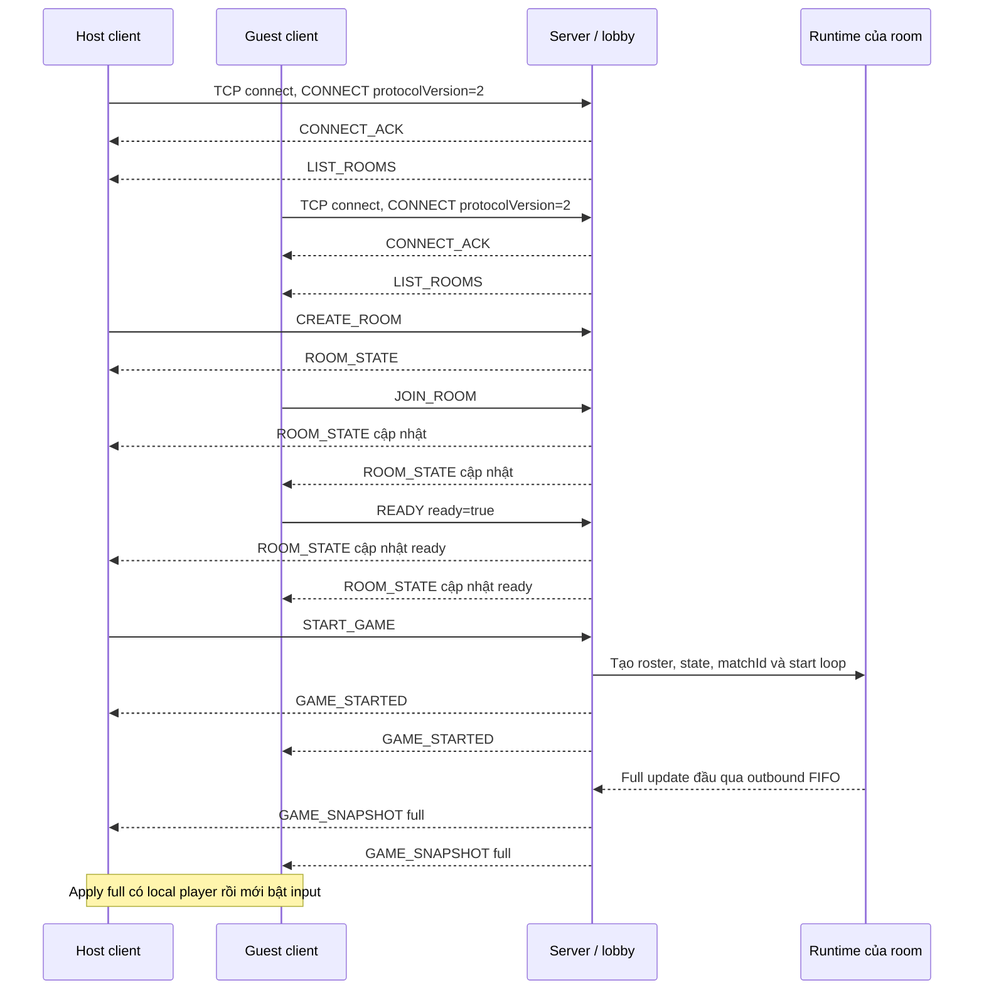

Runtime có thể đã tạo update trước khi worker bắt đầu đọc queue; bảo đảm cần thể hiện là GAME_STARTED vào writer
trước full gửi cho client, không phải game thread chỉ bắt đầu mô phỏng sau khi metadata đã tới client.
Server dùng dấu initialized sau enqueue full; client chỉ bật input sau khi thực sự apply full.
Không có message ACK-full riêng. Bản gốc: [09_01_ket_noi_va_start.mmd](../figures/network/09_01_ket_noi_va_start.mmd).

### 9.6.2. Di chuyển, ACK và resync

**Hình 9.2. Input sequence và nhánh phục hồi baseline. Nhóm tự vẽ từ code project.**

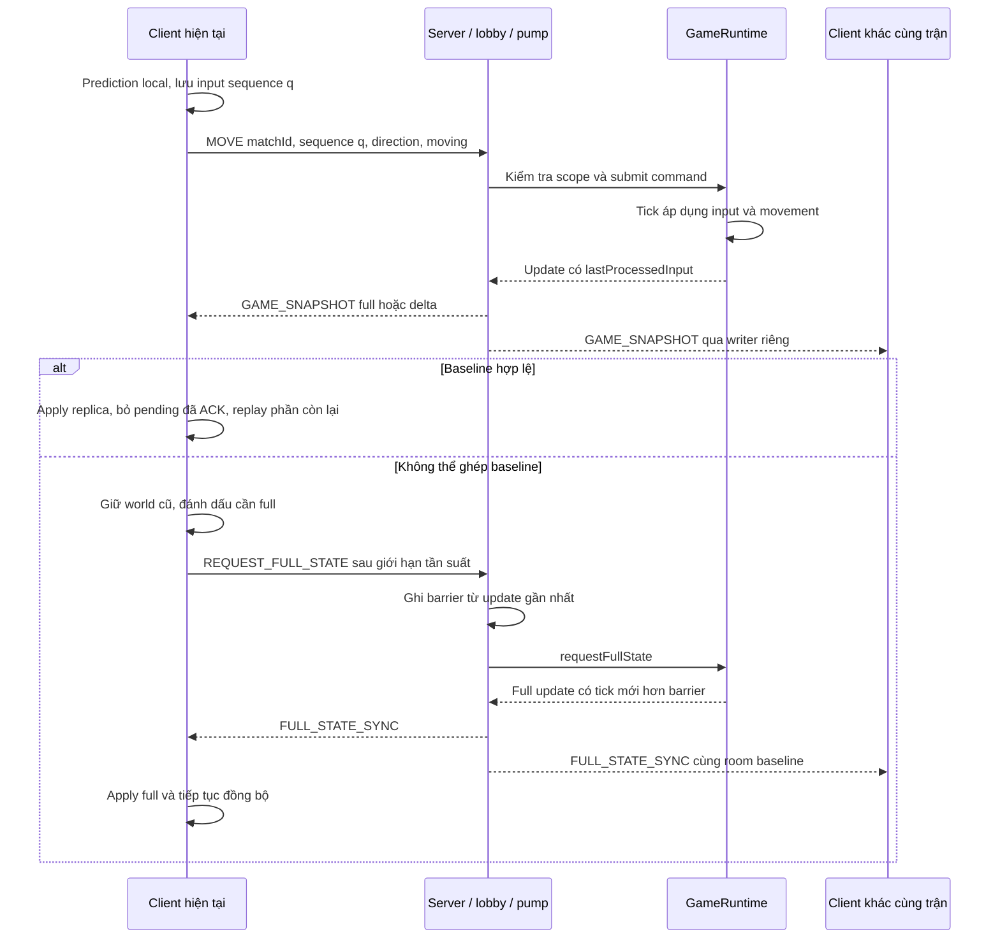

Nhánh sai baseline là lỗi/thiếu chuỗi ở lớp ứng dụng, không giả định TCP giao segment sai thứ tự như UDP.
Bản gốc: [09_02_move_va_resync.mmd](../figures/network/09_02_move_va_resync.mmd).

### 9.6.3. Đặt bom và thông báo diễn biến

**Hình 9.3. Nhánh đặt bom thành công và vụ nổ sau đó. Nhóm tự vẽ từ code project.**

```mermaid
sequenceDiagram
    participant C as Client
    participant S as Server / lobby / pump
    participant R as GameLoop và gameplay
    Note over C,R: Minh họa nhánh đặt bom thành công
    C->>S: PLANT_BOMB matchId, requestId
    S->>S: Kiểm tra scope, ID trùng/cũ và rate limit
    S->>R: Submit PlantBombCommand
    R->>R: Kiểm tra sống, ô đặt, quota; tạo bom
    R-->>S: Snapshot và notice placement qua FIFO
    S-->>C: GAME_SNAPSHOT có entity bom
    S-->>C: BOMB_PLANTED
    Note over C,R: Khi bom đến hạn hoặc được kích nổ dây chuyền
    R->>R: Nổ, damage batch, block/item và cập nhật state
    R-->>S: Snapshot và notices mới
    S-->>C: GAME_SNAPSHOT state/effects mới
    S-->>C: BOMB_EXPLODE và notices khác nếu có
    C->>C: Render từ snapshot; notice không áp damage/pickup lần hai
```

Thông báo được phát cho cả roster, không chỉ người đặt. Request trùng không tạo thêm command;
request hợp lệ ở transport nhưng không đạt luật đặt bom không đi qua nhánh tạo entity trong hình.
Bản gốc: [09_03_bom_va_event.mmd](../figures/network/09_03_bom_va_event.mmd).

### 9.6.4. Kết thúc và chơi lại

**Hình 9.4. Kết thúc gameplay bình thường và mở lượt mới. Nhóm tự vẽ từ code project.**

```mermaid
sequenceDiagram
    participant H as Host client
    participant C as Guest client
    participant S as Server / lobby / pump
    participant R as Runtime
    R-->>S: Full FINISHED có MatchResult
    S-->>H: GAME_SNAPSHOT full FINISHED
    S-->>C: GAME_SNAPSHOT full FINISHED
    opt Có gameplay notices của tick cuối
        S-->>H: Notices sau snapshot
        S-->>C: Notices sau snapshot
    end
    S->>R: Stop runtime
    S-->>H: GAME_OVER
    S-->>C: GAME_OVER
    S-->>H: ROOM_STATE WAITING
    S-->>C: ROOM_STATE WAITING
    Note over H,C: Đóng controller cũ, hiển thị kết quả; giữ TCP nếu còn hợp lệ
    C->>S: READY ready=true
    H->>S: START_GAME
    S->>R: Tạo runtime/world mới với matchId mới
    S-->>H: GAME_STARTED của lượt mới
    S-->>C: GAME_STARTED của lượt mới
    S-->>H: Full snapshot lượt mới
    S-->>C: Full snapshot lượt mới
```

Nhánh host End/leave/hard drop hoặc hết grace bỏ phần full FINISHED nếu chưa có kết quả gameplay;
nó dừng runtime và gửi ABORTED. Socket đã mất không được bảo đảm nhận thông báo cuối;
các thành viên còn kết nối được cập nhật theo khả năng gửi.
Unexpected disconnect còn trong grace hợp lệ giữ runtime và đi theo Hình 9.5, không tự đi nhánh ABORT này.
Bản gốc: [09_04_ket_thuc_va_choi_lai.mmd](../figures/network/09_04_ket_thuc_va_choi_lai.mmd).

### 9.6.5. Reconnect hợp lệ, full mới và tiếp tục delta

**Hình 9.5. Phục hồi cùng phiên trận sau mất transport tạm thời. Nhóm tự vẽ từ code đã xác minh.**

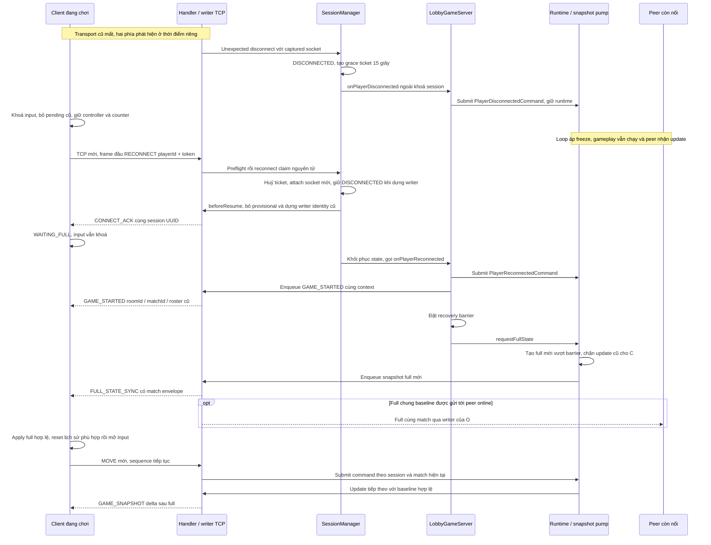

Hình gộp runtime/pump và handler/writer cho dễ đọc; đó không phải cùng một thread thực tế.
GAME_STARTED và full được enqueue theo thứ tự trên writer của người trở lại; các mũi tên enqueue chưa chứng minh receipt/apply.
Unfreeze đi qua command queue, không phải lobby sửa trực tiếp player. Dòng full cho peer là khả năng của baseline chung,
không tạo writer của peer từ socket C. Các update xen giữa có thể làm baseTick tiến qua nhiều tick;
client phải áp đủ chuỗi, không mặc định delta luôn tham chiếu tick full ban đầu.
Reconnect thành công giữ runtime/controller/context; không CREATE_ROOM, JOIN_ROOM hoặc START_GAME lại.

Bản nguồn: [09_05_reconnect_full_delta.mmd](../figures/network/09_05_reconnect_full_delta.mmd).

### 9.6.6. Từ chối phục hồi, hết grace và match đã kết thúc

**Hình 9.6. Các nhánh recovery không được tiếp tục trận. Nhóm tự vẽ từ code đã xác minh.**

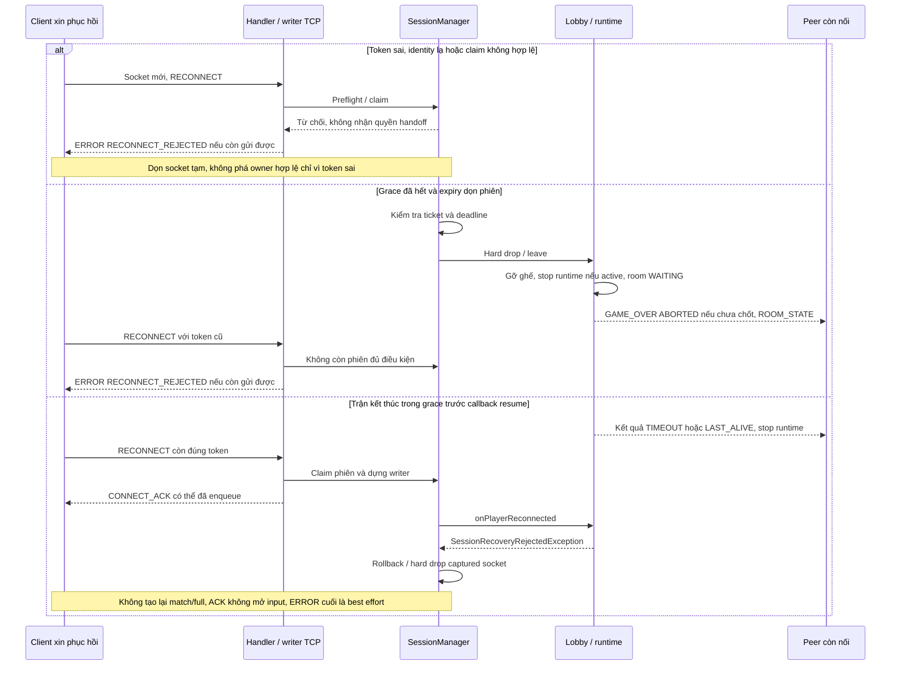

Ba nhánh là các trường hợp độc lập; không ngụ ý mọi lỗi đều xảy ra theo thứ tự đó trong một phiên.
Deadline admission còn được kiểm tra trực tiếp khi claim, nên request tại/sau mốc hết grace bị từ chối
kể cả scheduler chưa chạy cleanup. Request thiếu trường hoặc UUID không hợp lệ đi nhánh INVALID_PACKET trước preflight,
khác token có cú pháp hợp lệ nhưng không được cấp quyền. ERROR sau handoff có thể không đến được client nếu socket đã đóng.

Timeout ACK/full và ngắt lại giữa các pha được state machine Hình 8.4 biểu diễn: client tạo attempt/epoch mới trong budget,
giữ input khoá và giữ deadline tổng; hết budget hoặc nhận từ chối thì đóng. Người đóng app không bị buộc tự nối lại.
Không có event replay bù GAME_OVER cho người offline trong các nhánh trên.

Bản nguồn: [09_06_reconnect_tu_choi_va_het_han.mmd](../figures/network/09_06_reconnect_tu_choi_va_het_han.mmd).

> **Phân công: TV1/TV4 phụ trách transport, timeout và validation; TV2 queue/baseline, TV3 kiểm tra tác động gameplay.**

## 9.7. Packet lỗi, timeout, client chậm, queue đầy và stale match

### 9.7.1. Giới hạn vận hành của giao thức

**Bảng 9.9. Các giới hạn mặc định liên quan đến giao tiếp.**

| Lớp/loại | Giới hạn hiện tại | Khi vượt/không đáp ứng |
|---|---|---|
| Tổng frame đã decode | 100 frame/giây/kết nối, kể cả unknown/rejected | RATE_LIMITED và đóng sau drain có thời hạn |
| CHAT và LIST_ROOMS | Mỗi loại 5 request/giây/kết nối | RATE_LIMITED; chưa đóng chỉ vì vượt loại nếu chưa vượt tổng |
| MOVE | 40 request/giây trong cửa sổ một giây | RATE_LIMITED; chưa enqueue request vượt |
| PLANT_BOMB | 5 request mới/giây/session/match | Bỏ ID cũ/trùng trước giới hạn riêng; request mới vượt trả RATE_LIMITED |
| Request full | Khoảng cách tối thiểu 1000 ms ở server | RATE_LIMITED; client owner hiện dùng 1100 ms |
| Đọc frame server | Deadline toàn frame mặc định 10 giây | Đóng captured connection; không gia hạn vô hạn theo từng byte |
| Ghi socket | Watchdog mặc định 5 giây ở server/client | Đóng socket để thoát I/O chặn, báo/dọn theo owner |
| Writer server | Queue 256 frame chờ; byte budget 4 MiB tính cả frame đang ghi | Đóng kết nối khi đầy; không bỏ một delta rồi tiếp tục |
| Runtime | Command 4096, outbound 1024 | Submit thất bại hoặc giữ baseline chưa commit như mục 9.4 |
| Recovery admission server | Grace 15.000 ms từ lúc xử lý disconnect | Tại/sau deadline từ chối claim; expiry dẫn hard drop/leave, có thể ABORT match |
| Recovery client | Tổng 14.000 ms; ACK 2.500 ms, full 4.000 ms/attempt; connect tối đa 1.500 ms | Timeout pha retry trong budget tổng; hết budget đóng; retry delay 200 ms × attempt, trần 500 ms |
| Pending phía client | Pull queue tùy chọn 1024 packet; UI dispatch count hữu hạn, budget 4 MiB | Overflow gây lỗi/dừng; owner mặc định tắt pull queue không dùng |

Các rate limit là cửa sổ/điều kiện trong handler, không phải bảo đảm throughput thực đạt.
MOVE/PLANT/resync còn chịu giới hạn tổng kết nối. Control và input sender của client có giới hạn pending riêng;
UI owner hiện cho tối đa 256 dispatch đang chờ, không có nghĩa toàn bộ EDT được biến thành queue hữu hạn.
Watchdog/scheduler có chu kỳ kiểm tra nên các thời gian trên là cấu hình phát hiện, không phải SLA ngắt chính xác.
Recovery watchdog client kiểm tra mỗi 50 ms trên scheduler riêng; deadline full tính cả metadata và UI apply.
Connect timeout không tự bao trọn DNS trước connect; grace server và budget client không có chung mốc bắt đầu.
Nguồn: [InboundRateLimiter](../../src/main/java/com/bombit/server/network/InboundRateLimiter.java),
[ClientHandler](../../src/main/java/com/bombit/server/network/ClientHandler.java),
[SessionWriter](../../src/main/java/com/bombit/server/network/SessionWriter.java)
và [ClientNetwork](../../src/main/java/com/bombit/client/network/ClientNetwork.java).

### 9.7.2. Phân loại lỗi và hành động

**Bảng 9.10. Cách xử lý theo lớp lỗi thực tế.**

| Tình huống | Phản hồi/hành động server hoặc client | Lưu ý |
|---|---|---|
| Length/UTF-8 không hợp lệ | Server đóng kết nối có kiểm soát | Không cố tìm biên frame tiếp theo, không bảo đảm gửi ERROR |
| EOF, frame thiếu byte hoặc timeout I/O | Dọn captured connection; active match có recovery bật giữ phiên/grace và freeze qua queue | Hard drop, hết grace hoặc lifecycle queue lỗi có thể ABORT lượt |
| Request trước handshake hoặc version không hỗ trợ | Pending chỉ nhận CONNECT/RECONNECT; loại khác NOT_CONNECTED; CONNECT sai version UNSUPPORTED_VERSION | CONNECT/RECONNECT lặp sau handshake là INVALID_PACKET |
| RECONNECT sai field/UUID | INVALID_PACKET rồi đóng socket tạm theo transport | Không phá owner đang chờ recovery chỉ vì request bên ngoài sai schema |
| Token/identity không hợp lệ, hết hạn hoặc claim chồng nhau | Từ chối RECONNECT; ERROR RECONNECT_REJECTED khi writer còn gửi được, rồi dọn captured connection | Nếu handoff đã đổi ownership hoặc socket lỗi, không bảo đảm phản hồi cuối |
| Match đã kết thúc trong grace | Callback từ chối nghiệp vụ, rollback/hard drop phiên; không tạo lại runtime/full | ACK identity có thể đã enqueue; không hứa client luôn nhận ERROR hoặc replay GAME_OVER |
| JSON/field sai sau handshake | INVALID_PACKET; thông thường tiếp tục phiên | Codec, handler và trạng thái quyết định đường lỗi cụ thể |
| Sai phòng/quyền/trạng thái | NOT_IN_ROOM, NOT_HOST, NOT_READY, NOT_PLAYING hoặc lỗi lobby tương ứng | Không được sửa world để chấp nhận yêu cầu |
| Sai/mất match envelope | Handler gameplay trả STALE_MATCH; client bỏ packet sai match | UUID đúng chưa thay cho kiểm tra session/socket/membership |
| Command queue không nhận | INPUT_QUEUE_FULL | Chưa bảo đảm command đã được xử lý; không có replay tự động mọi request |
| Queue không nhận freeze/unfreeze | Lobby ABORT theo policy; nhánh handoff lỗi dọn/rollback phiên | Không giả vờ lifecycle thành công và không trả ACK nghiệp vụ cho command nội bộ |
| Writer đầy/ghi quá hạn | Đóng captured socket và gọi policy disconnect | Có thể vào grace nếu còn điều kiện; không coi mọi lỗi writer đều lập tức hủy trận |
| Replica không ghép được baseline | Giữ world cũ, xin full, tạm chặn input mới theo input-ready | Payload decode hỏng có thể gây fail controller thay vì đi qua resync |
| Client đang recovery thiếu ACK/full hoặc transport ngắt lại | Retry attempt với epoch mới trong deadline tổng; hết budget đóng owner | RATE_LIMITED/NOT_READY không mở input, không reset deadline; lỗi từ chối khác kết thúc recovery |
| RuntimeException ngoài validation trong handler | SERVER_ERROR, ghi diagnostics rồi đóng kết nối | Lỗi runtime/pump được xử lý qua failure và endMatch; không hứa luôn phát MATCH_FAILED |

Các lỗi lobby còn gồm ROOM_NOT_FOUND, ROOM_FULL, ROOM_PLAYING, ALREADY_IN_ROOM,
INVALID_ROOM_STATE, ROOM_LIMIT, MODE_NOT_SUPPORTED, CHAT_QUEUE_FULL và MATCH_START_FAILED theo handler tương ứng.
Type không có handler sau handshake trả UNKNOWN_MESSAGE; một type có tên trong PacketType không tự cho phép gửi ở mọi hướng.

Ví dụ ERROR do transport/handler hiện tạo:

```json
{"errorCode":"INPUT_QUEUE_FULL","message":"INPUT_QUEUE_FULL","requestId":null}
```

Schema cho phép trường requestId, nhưng helper hiện đặt null; không mô tả ERROR như cơ chế correlation hoàn chỉnh
cho từng MOVE/PLANT_BOMB. Nếu writer/socket đã hỏng thì phản hồi cuối có thể không gửi được.
Ở lobby client, ERROR nghiệp vụ được chuyển lên UI để người dùng xử lý, không mặc định ngắt phiên;
codec/listener hoặc I/O failure có thể đóng owner để tránh tiếp tục với state không an toàn.
Khi đang recovery, ERROR được owner xử lý trước listener lobby: RATE_LIMITED/NOT_READY giữ trạng thái chờ
trong budget, các lỗi từ chối khác làm fail. Việc có listener lobby không được nuốt lỗi recovery.

### 9.7.3. Thứ tự, dữ liệu cũ và giới hạn kết luận

Mỗi kết nối server có writer riêng; snapshot, notice và kết quả được enqueue theo thứ tự của luồng công bố.
Client dùng listener ứng dụng thường trực và UI executor tuần tự để xử lý metadata/state/kết quả.
Match identity ngăn dữ liệu lượt trước ảnh hưởng lượt mới; tick và baseline kiểm tra thứ tự state trong cùng match.
Connection epoch phía client loại packet/UI action cũ của socket trước trong cùng match;
input generation loại task/phím giữ cũ. Server kiểm tra captured socket để callback cũ không đóng kết nối thay thế.
Không thay các tầng kiểm tra này bằng giả định “TCP tin cậy nên ứng dụng luôn đồng bộ”.

Protocol có reconnect resume theo điều kiện đã mô tả, nhưng không có receipt ACK riêng cho snapshot
hoặc ACK nghiệp vụ cho mọi lệnh. Giữ session/full state không tương đương replay mọi message hoặc exactly-once.
Mức đúng/ổn định dưới phân mảnh, quá tải, lỗi, nhiều client hoặc nhiều process cần minh chứng test/đo tương ứng.
Lượt mới ngoài sandbox đạt 171/171; các attempt sandbox có lỗi smoke được giữ riêng.
Thiết kế không được dùng để suy ra đã nghiệm thu GUI/LAN/Wi-Fi/soak, đạt SLA recovery
hoặc tiếp tục trận sau server restart. Nguồn: [kết quả thực chạy](../session-recovery/03_KET_QUA_KIEM_THU_THUC_TE.md).


# 10. Triển khai hệ thống

Chương này mô tả cách các phương pháp và contract ở mục 7–9 được hiện thực bằng class, API,
cấu hình và công cụ trong repository BombItMultiplayer-Structure.
Trọng tâm là đường chạy lobby/gameplay mặc định. Tên module hoặc API legacy được phân biệt với luồng đang tích hợp,
tránh lấy sự tồn tại của một phương thức làm bằng chứng một tính năng end-to-end đã hoạt động.
Trách nhiệm TV1–TV4 dưới đây là phân công module/phần viết, không dùng thay xác nhận tác giả lịch sử hay tỷ lệ đóng góp.
Phần cập nhật Session Recovery mô tả phiên bản HEAD `492c031` cộng các sửa trong working tree đã được
[kiểm thử lại](../session-recovery/03_KET_QUA_KIEM_THU_THUC_TE.md), không gán mọi thay đổi cho riêng commit tích hợp.

> **Phân công: TV4 tổng hợp công nghệ/cấu trúc/bootstrap; cả nhóm xác nhận cấu hình và cách chạy module.**

## 10.1. Java 25, Swing, Maven, cấu trúc project và bootstrap

### 10.1.1. Công nghệ và cấu hình build

**Bảng 10.1. Stack và cấu hình được khai báo trong project.**

| Thành phần | Cấu hình hiện tại | Vai trò |
|---|---|---|
| Java | `maven.compiler.release=25`, source encoding UTF-8 | Ngôn ngữ/runtime và API chuẩn |
| Maven artifact | `com.bombit:bomb-it-multiplayer:0.1.0-SNAPSHOT` | Định danh build trong POM |
| Compiler plugin | `maven-compiler-plugin:3.13.0` | Biên dịch theo release đã chọn |
| Kiểm thử Maven | `maven-surefire-plugin:3.5.2`, `useModulePath=false` | Chạy test theo cấu hình classpath |
| Thư viện test | `org.junit.jupiter:junit-jupiter:5.11.4`, scope test | Unit/integration tests dùng JUnit |
| Giao diện | Swing/AWT và Java2D trong code client | Cửa sổ, input, renderer và bảng kết quả |
| Network/concurrency | `java.net`, `java.io`, `java.util.concurrent` | TCP socket, framing, pool, queue và scheduler |
| JSON và persistence | Codec/parser nội bộ; chưa có dependency database/JSON bên ngoài trong POM | Contract hiện tại không dùng Gson/Jackson hoặc JDBC trong đường triển khai đã khảo sát |

Nguồn cấu hình: [pom.xml](../../pom.xml).
POM hiện chỉ khai báo dependency JUnit ở scope test; production chủ yếu dùng JDK và mã trong repository.
Không mô tả Java 17 là baseline build của phiên bản này từ tài liệu cũ.
Môi trường JDK/Maven thực dùng khi kiểm thử được ghi riêng ở Experimental Setup;
giá trị trong POM không thay cho biên bản lần chạy.

### 10.1.2. Cấu trúc mã nguồn và tài liệu

```text
pom.xml
src/main/java/com/bombit/
    common/dto/, common/protocol/       dữ liệu và codec tích hợp
    server/app/                        bootstrap và điều phối lobby/gameplay
    server/network/, server/dispatch/  transport, writer, handler và router
    server/session/, server/room/      phiên, thành viên, host và ready
    server/chat/, server/heartbeat/    worker chat và phát hiện timeout
    server/integration/                callback vòng đời giữa các tầng
    server/game/                       model, core, movement, runtime, bom/item/event/map
    client/app/, client/network/       connection owner, entry point và TCP client
    client/lobby/, client/game/        UI phòng/kết quả và gameplay/renderer
    metrics/, tools/                   monitor và benchmark runner
src/test/java/                         JUnit, Check/Demo/main và công cụ kiểm tra
scripts/                               build, run, test, package và benchmark
docs/                                  contract, tài liệu kỹ thuật và dữ liệu đã lưu
phancong/                              yêu cầu giảng viên và phân công
report/                                hồ sơ/bản thảo báo cáo theo từng nhiệm vụ
target/                                output sinh từ build/test/đóng gói
```

Cây trên nhóm theo trách nhiệm, không liệt kê mọi package/file.
`src/test/java` còn chứa các chương trình Check/Demo/main; chúng không tự động trở thành JUnit test chỉ vì nằm trong thư mục test.
`target/` là output có thể bị tạo lại; log/CSV cần dẫn làm bằng chứng báo cáo được lưu riêng kèm metadata trước khi clean build.
State trận chủ yếu nằm trong RAM, chưa có tầng database tài khoản/lịch sử/khôi phục world.

### 10.1.3. Entry point và composition

[ServerApplication](../../src/main/java/com/bombit/server/app/ServerApplication.java) mặc định tạo `LobbyGameServer`
với cổng mặc định 8888. Ứng dụng cài shutdown hook gọi close, chạy accept loop và dùng try-with-resources cho owner server.
Trước `start`, bootstrap gọi `lobby.setSeamlessRecovery(true)`. Cờ ở constructor LobbyGameServer trực tiếp vẫn mặc định false;
fixture hoặc công cụ tạo server riêng phải bật rõ nếu cần giữ match khi unexpected disconnect.
Nhánh nhận số người ở đối số thứ hai chạy `DemoGameServer`; đây là profile khác, không thay thế luồng phòng mặc định.

[ClientApplication](../../src/main/java/com/bombit/client/app/ClientApplication.java) đọc host/port/name,
mặc định mở `LobbyWindow` trên EDT. Nhánh `--demo` và `--headless` phục vụ đường demo/smoke riêng.
Kết nối từ cửa sổ lobby được đưa sang worker để không thực hiện bước connect chặn ngay trên EDT.
Lớp `DemoClientConnection` vẫn được dùng làm owner kết nối trong lobby dù tên còn mang dấu mốc phát triển.
`LobbyWindow.connect` gọi `setAutoReconnect(true)` trên owner mới; lớp connection tổng quát mặc định false.
Nhánh M1 `--demo`/headless không được tự gán khả năng resume lobby chỉ vì dùng chung client class.

`LobbyGameServer` là nơi nối các phần: tạo `Server`, lấy RoomManager, đăng ký các handler lobby/gameplay,
inject map/extension factory vào runtime manager và cài observer cho disconnect/reconnect/hard drop.
Constructor mặc định tạo DefaultArenaMap và MatchGameplayExtension cho từng runtime.
Chi tiết state/gameplay được viết ở các phần TV2/TV3, còn chương kiến trúc đã trình bày quan hệ thành phần.

### 10.1.4. Build, chạy, test và đóng gói

**Bảng 10.2. Các script hiện có và đầu ra/chức năng.**

| Script | Hành vi chính | Điểm cần ghi đúng trong báo cáo |
|---|---|---|
| `build-demo.cmd` → `build.ps1` | `javac --release 25`, tạo `target/demo-classes`, JAR và BUILD_INFO | Tên script còn “demo” nhưng biên dịch source production; không đồng nhất với chỉ build profile M1 |
| `run-server.cmd`, `run-client.cmd` | Gọi entry point qua classpath đã chọn và chuyển tiếp đối số | Dùng `java-env.cmd`; chế độ thực phụ thuộc đối số entry point |
| `classpath.cmd` | Chọn classes/JAR đang có | Ưu tiên JAR ở root → JAR trong target → target/demo-classes; cần ghi đúng artifact đã chạy |
| `test.cmd` | Maven test → Check TV2 → NetworkTest main, dừng khi một bước lỗi | Nếu Maven fail thì các bước sau không tự được chạy |
| `package.cmd` → `package.ps1` | Đóng JAR, launcher, docs, BUILD_INFO vào ZIP và tạo SHA256 | Có script không có nghĩa đã tái đóng gói/nghiệm thu bản nộp |
| `run-benchmark.cmd` | Gọi `com.bombit.tools.NetworkBenchmark` với các tùy chọn | Là công cụ đo; số liệu thuộc lần chạy và cấu hình cụ thể |

Ví dụ lệnh ở root repository, chỉ minh họa cách vận hành, không phải log của nhiệm vụ viết này:

```text
scripts\build-demo.cmd
scripts\run-server.cmd 8888
scripts\run-client.cmd 127.0.0.1 8888 PlayerA
```

Server và mỗi client cần terminal/tiến trình riêng khi chơi nhiều người theo cách này.
`java-env.cmd` chọn công cụ theo JAVA_HOME hoặc PATH trong phạm vi script;
Maven test script cho phép đặt `BOMBIT_MVN` để chỉ binary Maven có sẵn.
Build script tìm javac/jar, tạo source list UTF-8, manifest main là ClientApplication,
và ghi thời gian UTC, source revision/dirty, target Java, SHA256 JAR vào BUILD_INFO.
Source revision trong metadata không tự bảo đảm mọi file chưa theo dõi đã được commit.

Nguồn: [build.ps1](../../scripts/build.ps1), [classpath.cmd](../../scripts/classpath.cmd),
[test.cmd](../../scripts/test.cmd) và [package.ps1](../../scripts/package.ps1).
Trong nhiệm vụ này chỉ đọc các script, không chạy build/test/package hoặc thay artifact.

> **Phân công: TV1 phụ trách TCP/session/room/chat/heartbeat; TV4 phối hợp codec/router và tích hợp đường chạy thật.**

## 10.2. TCP server/client lifecycle, room/lobby/chat/heartbeat

### 10.2.1. Các API hạ tầng TV1

**Bảng 10.3. Class/API chính và điểm nối vào ứng dụng.**

| Class | API tiêu biểu | Chức năng triển khai |
|---|---|---|
| `Server` | `start`, `close`, `getRouter`, `setGameObserver` | Sở hữu accept loop, reader pool và các manager/service hạ tầng |
| `ClientHandler` | `run`, `readFrame` | Gate CONNECT/RECONNECT; intercept recovery trước router, đổi session/writer và cleanup captured socket |
| `ConnectionManager` | `open`, `releasePreservingSocket`, `release(id,socket)`, `setFailureHandler` | Handoff writer theo socket, late cleanup, watchdog và cleanup executor |
| `SessionWriter` | `send`, `finishAndAwait`, `close`, `expireWrite` | Encode/enqueue frame, ghi socket trên worker và dừng có thời hạn |
| `SessionManager` | `canReconnect`, `reconnect`, `discardProvisional`, `handleUnexpectedDisconnect`, `handleHeartbeatTimeout`, `hardDrop` | Map phiên, grace ticket/deadline, claim/ownership, rollback và callback vòng đời |
| `RoomManager` | `createRoom`, `joinRoom`, `setReady`, `leaveRoom`, `publishRoomState` | Map phòng, membership và dữ liệu công bố |
| `ChatHandler`, `HeartbeatManager` | `enqueue/close`, `sweep/close` | Chat worker và sweep liveness theo scheduler |

Đây là API đang có; cách ứng dụng gọi API quyết định tính năng thực tế.
Ví dụ, RoomManager có `startGame` legacy nhưng lobby mặc định không dùng hàm đó để tạo runtime/MatchContext.

### 10.2.2. Accept, reader pool và cổng kiểm tra

[Server](../../src/main/java/com/bombit/server/network/Server.java) mở ServerSocket trong constructor.
`start()` chỉ được gọi một lần, nhận socket, đặt TCP_NODELAY, tạo session tạm và writer,
rồi submit ClientHandler vào ThreadPoolExecutor.
Pool có 32 reader worker và queue 32 task; số session đang giữ bị chặn tại 256, gồm cả metadata chờ expiry.
Reader pool từ chối task thì session tương ứng bị hard drop. Các giới hạn này khác số người mỗi phòng
và không được dùng làm kết quả benchmark số client phục vụ ổn định.

[ClientHandler](../../src/main/java/com/bombit/server/network/ClientHandler.java) capture socket nhưng giữ session/writer
bằng tham chiếu có thể thay thế trong handoff. Trong `run`, handler đọc frame, áp rate limit tổng/riêng,
chỉ cho CONNECT hoặc RECONNECT khi session tạm còn CONNECTED. CONNECT đi qua SessionHandlers;
RECONNECT được decode/claim ngay trước MessageRouter. Sau handshake, cả CONNECT và RECONNECT lặp đều bị từ chối;
request nghiệp vụ sai không tự sửa world.

`readFrame()` tạo deadline tuyệt đối cho một frame, tính thời gian còn lại trước các lần đọc và đặt SO_TIMEOUT tương ứng.
Deadline mặc định 10 giây không được gia hạn từ đầu sau mỗi byte.
Ở `finally`, handler gọi hard drop/unexpected disconnect với expectedSocket và release theo `(playerId,socket)`.
Manager kiểm tra lại ownership dưới khoá; callback của reader cũ không được đóng socket mới của cùng UUID.
Các guard này là một phần recovery đang tích hợp, cùng với claim, callback runtime và full gate phía client.

### 10.2.3. Writer, broadcast và cleanup kết nối

[SessionWriter](../../src/main/java/com/bombit/server/network/SessionWriter.java) capture socket lúc khởi tạo.
`send` chuyển OutboundMessage thành Packet, encode ra byte, kiểm tra lifecycle/byte budget rồi offer vào queue.
Encode xảy ra trên producer; worker writer lấy frame và thực hiện write/flush.
Queue mặc định chứa tối đa 256 frame đang chờ; budget 4 MiB còn tính frame đang ghi.

Writer lỗi hoặc đầy gọi đường fail: ngừng nhận, đóng socket để đánh thức I/O, interrupt worker và gọi callback một lần.
[ConnectionManager](../../src/main/java/com/bombit/server/network/ConnectionManager.java) chuyển xử lý failure
sang cleanup executor rồi release writer đúng socket. Watchdog kiểm tra ghi kéo dài theo write timeout mặc định 5 giây.
Việc tách callback tránh chạy trực tiếp logic lobby/session ngay lúc producer có thể đang giữ khóa nghiệp vụ.
`ConnectionManager.open` kiểm tra writer hiện tại có sở hữu cùng socket không: cùng socket là mở trùng và bị từ chối;
writer bắt socket cũ được gỡ đúng instance/đóng trước khi tạo writer thay thế.
`releasePreservingSocket` dùng `writer.close(false)` để bỏ writer tạm mà không cắt socket đang chuyển cho identity cũ.
Nhánh failure trong Server cũng truyền captured socket vào SessionManager thay vì chỉ dựa vào phép so sánh bên ngoài khoá.

OutboundMessage clone mảng byte khi tạo và khi trả payload để caller không sửa ngầm nội dung đã bàn giao.
BroadcastSender tìm outbound sender gắn với session và chuyển tiếp, không tự ghi trực tiếp cùng socket từ nhiều thread.
Khi writer đã đóng/đầy, wrapper có thể bắt IllegalStateException để producer tiếp tục xử lý các session khác;
việc đóng và cleanup vẫn thuộc writer/connection owner, không phải bảo đảm gửi đủ cho mọi thành viên.
Nguồn: [OutboundMessage](../../src/main/java/com/bombit/server/network/OutboundMessage.java)
và [BroadcastSender](../../src/main/java/com/bombit/server/network/BroadcastSender.java).

### 10.2.4. Session và trạng thái ứng dụng

[Session](../../src/main/java/com/bombit/server/session/Session.java) tạo UUID playerId phiên và token,
giữ username, socket, roomId, outbound sender và heartbeat bằng nanoTime.
State dùng AtomicReference; các bước transition/restore/setState đồng bộ trên cùng monitor session dùng khi attach socket.
`completeHandshake` chuyển phiên tạm sang IN_LOBBY sau khi CONNECT đã được kiểm tra.
Tên `playerId` ở lớp Session là UUID phiên, khác int playerId trong gameplay.

**Bảng 10.4. Ý nghĩa các SessionState trong luồng hiện tại.**

| State | Ý nghĩa | Điểm chuyển tiêu biểu |
|---|---|---|
| CONNECTED | TCP đã đăng ký, chưa hoàn tất handshake | Tạo Session khi accept |
| IN_LOBBY | Handshake hợp lệ, chưa ở phòng | `completeHandshake` hoặc rời phòng còn kết nối |
| IN_ROOM | Là thành viên phòng, chưa ready/đã hết lượt | Create/join hoặc endMatch |
| READY | Khách/người chơi đặt trạng thái sẵn sàng | `RoomManager.setReady` |
| PLAYING | Thuộc roster lượt đang chạy | `LobbyGameServer.startMatch` |
| DISCONNECTED | Socket mất hoặc đang handoff; active match hợp lệ có thể được giữ trong grace | `handleUnexpectedDisconnect`, attach socket trước khi dựng writer |
| CLOSED | Phiên bị loại khỏi manager/đang dọn | `hardDrop`, đóng toàn manager |

[SessionManager](../../src/main/java/com/bombit/server/session/SessionManager.java) dùng map concurrent để quản lý phiên,
map DisconnectWindow và ScheduledThreadPoolExecutor cho expiry. Mỗi window giữ `started` theo nanoClock và future;
scheduler bật `setRemoveOnCancelPolicy(true)` để task huỷ không giữ lại tới hạn cũ.
`handleUnexpectedDisconnect` xác minh instance/socket dưới khoá session, đánh dấu DISCONNECTED, đóng transport cũ
và ghi ticket; callback observer chạy ngoài khoá. Sau callback, manager chỉ lên lịch nếu session/ticket vẫn còn khớp,
tính delay còn lại thay vì bắt đầu lại toàn bộ grace sau thời gian callback đã tiêu tốn.

`expire` kiểm tra cùng ticket, state và elapsed dưới cùng khoá trước khi xoá session; timer cũ đã huỷ nhưng vẫn chạy
không xoá được lần grace mới. Điều kiện `elapsed >= graceNanos` còn được kiểm tra trực tiếp trong eligibility khi claim,
nên scheduler trễ không làm admission quá hạn được chấp nhận.
Trong active match có recovery bật, callback lobby giữ roster/runtime và submit freeze; ngoài phạm vi đó hoặc hard drop,
lobby đi nhánh leave/cleanup. Enum thực tế là DISCONNECTED, không có ORPHAN_SESSION.

### 10.2.5. Room, lobby và start/end thật

[Room](../../src/main/java/com/bombit/server/room/Room.java) giữ roster, host, sức chứa và WAITING/PLAYING;
các thao tác thành viên có synchronization.
[RoomManager](../../src/main/java/com/bombit/server/room/RoomManager.java) quản lý map phòng concurrent,
kiểm tra instance/membership khi join, đặt trạng thái ready và công bố RoomView qua broadcaster được inject.
Snapshot thành viên dùng bản sao; host rời thì người còn lại đầu danh sách nhận quyền host, phòng trống được xóa.

API `setReady(session, boolean)` đặt trạng thái đích, phù hợp request READY idempotent;
`toggleReady` còn tồn tại không phải handler READY được dùng trên dây.
Tương tự, `RoomManager.startGame` legacy chuyển trạng thái/phát metadata cũ,
còn [LobbyGameServer](../../src/main/java/com/bombit/server/app/LobbyGameServer.java) thực hiện Start tích hợp:
kiểm tra host/ready, chụp roster, tạo spawn/mapping, khởi động runtime, tạo MatchContext và gửi GAME_STARTED trước snapshot worker.

Các handler lobby được đăng ký theo bảng type; phần `handle` được synchronized trên owner để phối hợp vòng đời room/match.
Quản lý phòng còn áp sức chứa 2–4, tối đa 32 phòng và từ chối join giữa trận.
Shared lock này giúp tuần tự hóa một số bước nhưng vẫn là tài nguyên dùng chung, không chứng minh không có contention dưới tải.

Khi nhận kết quả bình thường hoặc End/leave/hard drop dẫn kết thúc, `endMatch` dừng runtime, reset session/room,
gửi GAME_OVER và công bố ROOM_STATE; lượt mới có MatchContext/world mới.
Soft disconnect còn trong grace không gọi endMatch ngay; resume dùng match/context/runtime đang giữ,
không tạo room hoặc chạy startMatch lần nữa. Hết grace có thể dẫn ABORT cả match qua leave.
Các bước tạo snapshot/gameplay được mô tả ở phần TV2/TV3, không đặt vào RoomManager.

### 10.2.6. Chat theo phòng

[ChatHandler](../../src/main/java/com/bombit/server/chat/ChatHandler.java) dùng LinkedBlockingQueue hữu hạn và một chat-worker.
Handler network kiểm tra room và text, lấy senderId/tên từ session rồi enqueue ChatMessage;
đường server hiện cấp queue capacity 256.

Worker không broadcast mù dữ liệu đã đợi trong queue: nó tìm lại room và kiểm tra sender còn là thành viên,
không DISCONNECTED/CLOSED. Sau đó tạo CHAT JSON qua LobbyPacketCodec và gửi cho các session nhận hợp lệ.
Kiểm tra lại ở thời điểm consume giúp loại message của người đã rời phòng trong thời gian chờ.
Chat không phải global chat và không dùng frame plaintext legacy khác với CHAT hiện tại.

`close()` ngừng nhận, clear queue, interrupt và join worker có thời hạn.
Các API `pendingMessages`, `isAlive`, `failure` hỗ trợ kiểm tra backlog/lifecycle;
chúng chưa thay cho kết quả test hay khả năng lưu lịch sử chat bền vững.

### 10.2.7. Heartbeat và shutdown

[HeartbeatManager](../../src/main/java/com/bombit/server/heartbeat/HeartbeatManager.java) dùng scheduler sweep mặc định 2 giây,
so elapsed nanoTime với timeout 10 giây trên session.
Phiên chưa handshake hết hạn bị hard drop; phiên đã handshake đi qua unexpected disconnect và callback lifecycle.
Timeout được phát hiện theo lịch sweep, không bảo đảm dọn chính xác tại giây thứ 10.
Sweep capture socket trước khi đọc heartbeat rồi gọi `handleHeartbeatTimeout(id, expectedSocket, timeoutNanos)`.
Manager kiểm tra lại cả ownership và heartbeat trong khoá: PING vừa cập nhật hoặc reconnect thay socket
không bị sweep dựa trên quan sát cũ làm disconnect nhầm. DISCONNECTED/CLOSED không bị sweep như phiên online.

Route PING hiện được đăng ký trong SessionHandlers: parse pingId, update heartbeat rồi echo PONG.
`HeartbeatManager.onPing` vẫn có API nhưng không phải phương thức mà route PING sản phẩm đang gọi.
Client owner có control scheduler riêng gửi PING và kiểm tra khoảng thời gian không nhận packet.
Liveness của session và phép đo RTT bằng LatencyMonitor là hai trách nhiệm khác nhau.

`Server.close` ngừng accept bằng đóng ServerSocket, dừng heartbeat, đóng session/socket/writer,
rồi shutdown và await reader pool; chỉ dùng shutdownNow khi chưa dừng trong thời hạn hoặc bị interrupt.
Chat worker cũng được đóng. Owner `LobbyGameServer.close` còn dừng các runtime/snapshot worker trước/qua chuỗi đóng hạ tầng.
Các phương thức close có guard để hạn chế thực hiện lại lifecycle, nhưng báo cáo không suy ra mọi race đã được loại bỏ.

### 10.2.8. Handoff recovery, rollback và gate snapshot của lobby

ClientHandler dùng `SessionPacketCodec.reconnect` để kiểm tra request, rồi `canReconnect` làm preflight.
Request sai field/UUID hoặc token không hợp lệ còn writer tạm để phản hồi lỗi trước khi dọn socket tạm.
Preflight không cấp quyền cuối cùng: `SessionManager.reconnect(id, token, socket, beforeResume)` kiểm tra lại
trong monitor session và đưa session vào tập `recovering` để một handoff đang thiết lập không bị attempt khác thay thế.
Nếu socket cũ vẫn bị xem là online, manager đưa nó qua unexpected disconnect để tiếp quản half-open theo cùng policy.

Sau xác minh state/ticket/deadline, manager huỷ timer và attach socket mới nhưng giữ state DISCONNECTED.
Callback `beforeResume` của handler gọi releasePreservingSocket/discardProvisional, dựng writer identity cũ,
cập nhật tham chiếu session/writer trong handler rồi enqueue CONNECT_ACK.
Manager restore state, gọi `onPlayerReconnected` ngoài khoá và cuối cùng bỏ quyền recovering.
Callback thiết lập lỗi hoặc shutdown giữa chừng không được để socket mới sống cùng một phiên không còn trong manager.

`SessionRecoveryRejectedException` tách nhánh từ chối khi match đã kết thúc/không được recover:
manager hard drop đúng captured socket mà không ghi nó như system failure. RuntimeException do writer/setup thật
vẫn được lưu vào `failure` rồi dọn tài nguyên. ACK có thể đã enqueue trước callback lobby từ chối;
không cam kết ERROR cuối tới được client hoặc coi ACK là quyền bắt đầu gameplay.

Trong `LobbyGameServer.onPlayerDisconnected`, match đánh dấu session suspended, xoá initialized và submit
`PlayerDisconnectedCommand(playerNum,false)`. `onPlayerReconnected` kiểm tra active match, submit
`PlayerReconnectedCommand`, enqueue GAME_STARTED cùng roster/context, ghi barrier từ createUpdate gần nhất
và gọi requestFullState. Nếu freeze/unfreeze submit trả false, lobby kết thúc lượt thay vì bỏ qua lỗi queue.

Snapshot `pump` phối hợp với lifecycle dưới khoá lobby: skip suspended; nếu còn recoveryFullAfter thì chỉ cho full
có tick vượt barrier, bỏ delta/full cũ còn trong outbound. `send` thành công với full mới đặt initialized và bỏ gate.
Notice được enqueue sau snapshot và cũng bị chặn cho player đang suspended/chưa qua full gate.
Baseline chung có thể làm full phát tới cả roster; builder/codec không bị thay thành network thread đọc GameState.
MOVE/PLANT_BOMB còn kiểm tra initialized; phía client vẫn cần gate apply full riêng ở 10.8.5.

Nguồn: [SessionManager](../../src/main/java/com/bombit/server/session/SessionManager.java),
[ConnectionManager](../../src/main/java/com/bombit/server/network/ConnectionManager.java),
[SessionRecoveryRejectedException](../../src/main/java/com/bombit/server/session/SessionRecoveryRejectedException.java)
và [LobbyGameServer](../../src/main/java/com/bombit/server/app/LobbyGameServer.java).

> **Phân công: TV2 — model, state, command và vòng đời runtime.**

## 10.3. Model/map/state, command queue, GameLoop và runtime

### 10.3.1. Model dùng chung và quy ước tọa độ

Package `server/game/model` cung cấp ba kiểu dùng chung cho core, movement và các module gameplay.
[Direction](../../src/main/java/com/bombit/server/game/model/Direction.java) là enum bốn hướng với
`deltaX`, `deltaY`: trục x tăng sang phải, trục y tăng xuống dưới.
[TileType](../../src/main/java/com/bombit/server/game/model/TileType.java) phân biệt `EMPTY`,
`HARD_WALL`, `BREAKABLE_BLOCK`, `OUT_OF_BOUNDS`; chỉ `EMPTY` cho phép đi qua.
[TilePosition](../../src/main/java/com/bombit/server/game/model/TilePosition.java) là record bất biến.
Phép đổi pixel sang ô dùng `floor`, kiểm tra số hữu hạn và tile size dương; phép dịch ô kiểm tra tràn số nguyên.
Record vẫn cho phép tọa độ âm để biểu diễn các bước duyệt ra ngoài bản đồ, còn map quyết định ô đó có hợp lệ hay không.

Vị trí `Player.x/y` là góc trên trái hitbox trong đơn vị pixel. Khi cần xác định ô người chơi đang đứng,
`Player.tilePosition` dùng tâm hitbox. Hai cách biểu diễn phục vụ hai mục đích: collision xét toàn bộ hình chữ nhật,
còn thao tác theo lưới dùng một ô đại diện. Enum lồng `Player.Direction` và `GameMap.TileType` vẫn còn dưới dạng
API `@Deprecated` để tương thích; triển khai mới dùng model chung, không khẳng định đã xóa toàn bộ bridge cũ.

### 10.3.2. Map, Player và quyền sở hữu GameState

[GameMap](../../src/main/java/com/bombit/server/game/core/GameMap.java) lưu mảng `tiles[y][x]` và tile size.
`tileAt` trả sentinel `OUT_OF_BOUNDS` khi truy vấn ngoài map; sentinel không được lưu như một ô thật.
`destroyBlock` chỉ đổi breakable block thành ô trống. API legacy `getTile` có hành vi kiểm tra biên và ném lỗi,
vì vậy caller không nên coi hai API là hoàn toàn tương đương.

[GameState](../../src/main/java/com/bombit/server/game/core/GameState.java) sở hữu map, tập Player theo ID,
entity theo khóa, trạng thái trận, frame gameplay và các notice chờ xuất bản.
Player chỉ được thêm khi `WAITING`; `startMatch` chuyển sang `RUNNING` nếu có người chơi.
Core chấp nhận một người để phục vụ API/test, trong khi điều kiện bắt đầu trận lobby là một lớp kiểm tra khác.
`finishMatch` chuyển sang `FINISHED` và dừng ý định di chuyển, nhưng không tự kết thúc thread game loop.
Luồng tích hợp lobby chịu trách nhiệm đóng runtime sau khi xử lý kết quả.

[Player](../../src/main/java/com/bombit/server/game/core/Player.java) giữ vị trí, hitbox, hướng, tốc độ,
trạng thái sống, movement intent, sequence input đã xử lý và dữ liệu gameplay như lives/respawns.
Các trường này có thể thay đổi trong mô phỏng. `getPlayers()` trả danh sách sao chép không cho sửa cấu trúc,
nhưng phần tử Player vẫn mutable; đây không phải snapshot để network thread sử dụng.
Quy tắc sở hữu là một loop cập nhật state của một trận, còn các thread khác gửi command hoặc nhận update đã chụp.

Bản đồ dùng trong lobby do [DefaultArenaMap](../../src/main/java/com/bombit/server/game/map/DefaultArenaMap.java)
tạo: 17 × 15 ô, mỗi ô 32 pixel, bốn vị trí spawn theo góc sân. Tham số ban đầu trong
[PlayerMovementRules](../../src/main/java/com/bombit/server/game/runtime/PlayerMovementRules.java)
là hitbox 24 pixel và tốc độ 80 pixel/giây theo cấu hình mặc định; hitbox được đặt giữa ô spawn.
Không nên dùng map tối giản của constructor runtime mặc định để mô tả sân thực tế của lobby.

### 10.3.3. Command có kiểu và queue có giới hạn

[GameCommand](../../src/main/java/com/bombit/server/game/core/GameCommand.java) hiện là **sealed class**,
không phải sealed interface như phương án ban đầu. Base class giữ constructor legacy đã deprecated;
các subclass final biểu diễn `MoveCommand`, `StopMovingCommand`, `PlantBombCommand`,
`PlayerDisconnectedCommand`, `PlayerReconnectedCommand`.
Các field command là dữ liệu bất biến. Sequence dương dùng cho input mạng; sequence 0 còn phục vụ tương thích nội bộ.
TV2 cung cấp contract đặt bom, còn xử lý bom thực tế do extension gameplay đảm nhiệm.

Queue đầu vào của [GameLoop](../../src/main/java/com/bombit/server/game/core/GameLoop.java)
là `LinkedBlockingQueue` có capacity, runtime cấu hình mặc định 4096 command.
`submit` kiểm tra loop đang chạy và gọi `offer`, không chờ vô hạn đến khi còn chỗ.
Khi đầy queue, counter rejected tăng và kết quả là `false`; việc submit lúc loop đã dừng cũng trả `false`
nhưng không được tính vào counter queue đầy. FIFO được xác định theo thứ tự các lần enqueue thành công;
hai producer đồng thời không có thứ tự nghiệp vụ cố định trước khi enqueue.

Mỗi tick đọc tối đa 256 command để tránh dành toàn bộ thời gian cho input.
Với movement có sequence dương, loop chỉ áp dụng một mẫu thành công cho mỗi player trong tick.
Nếu command đầu queue tiếp theo là movement của player đã được lấy mẫu, loop dừng đọc tick đó thay vì bỏ qua nó.
Cách này giữ FIFO nhưng có thể khiến command của player khác phía sau phải đợi.
Command disconnect đóng băng movement và có thể xóa player theo cờ; reconnect mở đóng băng và yêu cầu full state.
Đường lobby recovery đang dùng `removePlayer=false`, giữ player trong world và nhận các command này qua callback 10.2.8.
Loop đưa ID vào/ra tập frozen, dừng player frozen trước movement update; không biến thao tác attachSocket thành sửa Player trực tiếp.
Extension vẫn nhận command lifecycle để chặn đặt bom mới từ player disconnected và tiếp tục cập nhật bom đã tồn tại.

### 10.3.4. Tạo và quản lý runtime theo room

[PlayerSpawn](../../src/main/java/com/bombit/server/game/runtime/PlayerSpawn.java) là dữ liệu đầu vào bất biến:
session ID, gameplay player ID, vị trí, kích thước và tốc độ đã kiểm tra hợp lệ; không chứa socket.
[GameRuntimeManager](../../src/main/java/com/bombit/server/game/runtime/GameRuntimeManager.java)
giữ bảng room ID → runtime và đồng bộ các thao tác quản lý vòng đời.

**Bảng 10.5. API runtime và ranh giới dữ liệu TV2.**

| API | Xử lý chính | Dữ liệu/giới hạn |
|---|---|---|
| `startGame(roomId, players)` | Tạo map/state/player/extension, start match và loop | 1–4 spawn ở API core; kiểm tra ID trùng, spawn và room đang chạy |
| `findGame(roomId)` | Tìm runtime bằng room | Trả `Optional<GameRuntime>` |
| `submit(roomId, command)` | Chuyển command tới runtime tương ứng | Trả boolean, không trả tham chiếu GameState |
| `stopGame(roomId)` | Đóng runtime trước khi bỏ khỏi bảng | Đợi thread dừng trong thời hạn của loop |
| `GameRuntime.pollUpdate(timeout, unit)` | Lấy update từ queue đầu ra | Consumer có thể chờ có giới hạn |
| `GameRuntime.createUpdate()` | Đọc update gần nhất đã xuất bản | Không chụp state trực tiếp từ network thread |
| `requestFullState()` | Đặt cờ yêu cầu full ở tick kế tiếp | Không encode/gửi socket ngay |

Manager gọi map factory cho mỗi trận và phát hiện việc tái dùng cùng một instance map;
player/state/extension cũng được tạo cho từng runtime. Spawn được kiểm tra bằng collision trước khi chạy.
Mỗi [GameRuntime](../../src/main/java/com/bombit/server/game/runtime/GameRuntime.java) có `matchId` UUID mới,
bản sao bất biến mapping session → player và một GameLoop riêng. Constructor manager mặc định dùng map tối giản
và extension không làm gì; đường lobby truyền factory arena và extension gameplay đầy đủ.
Khi resume cùng trận, lobby tìm runtime đang giữ thay vì gọi startGame để cấp matchId mới.
`createUpdate` chỉ được dùng đọc tick công bố để đặt barrier; full mới vẫn được loop tạo qua requestFullState.

### 10.3.5. Tick, extension và dừng thread

Runtime dùng chu kỳ 50.000.000 ns, tương ứng mục tiêu 20 tick/giây. Một tick thực hiện tuần tự:
reset cờ input của player → đọc command → giữ player bị đóng băng ở trạng thái dừng → cập nhật movement
với bước thời gian cố định → gọi extension update → tăng tick → tạo/xuất bản snapshot.
`GameplayExtension.processCommand` nhận mỗi command đã lấy ra khỏi queue, kể cả command không phải movement;
`update(nowMillis)` chạy sau movement. Hook `onStart`/`onStop` phục vụ vòng đời module.
Nhờ [GameplayExtension](../../src/main/java/com/bombit/server/game/runtime/GameplayExtension.java),
TV3 có thể gắn bom/item mà không thêm logic gameplay vào thân GameLoop.

Loop dùng thời gian đơn điệu để tính khoảng ngủ tới tick tiếp theo, còn extension nhận thời gian millisecond.
Khi tick trễ, loop đặt lại mốc lịch; hiện không chạy một chuỗi tick bù bằng accumulator.
Do đó 20 Hz là mục tiêu cấu hình, không phải kết quả đo đảm bảo trong mọi tải.

`start` chỉ cho chạy một lần trên một instance loop và yêu cầu state đang RUNNING.
`stop` đổi cờ, interrupt rồi join tối đa 2 giây khi được gọi từ thread khác; monitor được thả trước khi join.
Nếu thread vẫn sống, phương thức báo lỗi thay vì coi là đã dừng thành công.
Khối `finally` gọi extension cleanup, ghi nhận failure và xóa command còn chờ.
Các API `isRunning`, `isThreadAlive`, `failure` giúp caller phân biệt cờ chạy với việc thread đã giải phóng.

> **Phân công: TV2; TV4 phối hợp framing, packet type và tích hợp mạng.**

## 10.4. Movement, collision, snapshot builder và delta codec

### 10.4.1. Từ MOVE packet đến movement command

[MovePacketCodec](../../src/main/java/com/bombit/server/game/movement/MovePacketCodec.java) encode/decode
payload input gồm sequence, direction và moving, giới hạn độ dài và yêu cầu sequence mạng lớn hơn 0.
Client không được cung cấp tọa độ, tốc độ hoặc kết quả va chạm qua message này.
[MovementHandler](../../src/main/java/com/bombit/server/game/movement/MovementHandler.java)
tra Session đang PLAYING, tìm runtime theo room, suy ra gameplay player ID từ session rồi tạo Move/Stop command.
Việc kiểm tra match envelope ở đường lobby diễn ra trước khi gọi phần xử lý payload này.
Command được đưa vào queue; handler không trực tiếp dịch chuyển Player trên network thread.

### 10.4.2. Áp dụng input và bước mô phỏng

[MovementSystem](../../src/main/java/com/bombit/server/game/movement/MovementSystem.java)
chỉ áp dụng input khi trận RUNNING và player còn sống. Input sequence đã xử lý bị bỏ qua;
input mới cập nhật ACK cùng hướng/ý định di chuyển. ACK ở đây là sequence input authoritative đã xử lý,
khác cơ chế xác nhận byte của TCP.
`StopMovingCommand` tắt movement intent. Các command nội bộ sequence 0 vẫn có đường tương thích riêng.

`update(dt)` kiểm tra bước thời gian hữu hạn, không âm và chặn tối đa 0,1 giây.
Khoảng dịch chuyển là speed × dt theo hướng hiện tại rồi giao cho CollisionSystem.
Với input mạng có sequence, cờ lấy mẫu của Player ngăn tiếp tục mô phỏng một mẫu cũ qua nhiều tick không nhận input mới.
Vì vậy client gửi cả mẫu đứng yên và giữ phím theo nhịp, thay vì chỉ gửi sự kiện nhấn phím đầu tiên.
Player chết hoặc player không được phép tiến bước trong tick không được movement cập nhật vị trí.

### 10.4.3. Collision trên hitbox và entity

[CollisionSystem](../../src/main/java/com/bombit/server/game/movement/CollisionSystem.java)
kiểm tra toàn bộ hitbox nằm trong map và mọi tile bị phủ đều walkable.
Biên phải/dưới dùng `Math.nextDown` trước khi đổi sang ô để hình chữ nhật vừa chạm biên không chiếm thêm ô kế bên.
Hard wall, breakable block và ngoài map đều chặn movement.

Phép di chuyển chia thành bước không quá 1 pixel, xét theo từng trục và dừng trước vị trí không thể chiếm.
Cách này giảm nguy cơ bước dịch chuyển bỏ qua tường mỏng trong một lần cập nhật.
Danh sách entity của tick cũng tham gia kiểm tra: bom chặn việc đi vào vùng overlap mới;
player đang overlap quả bom có thể đi ra khỏi nó. Hiện collision không triển khai va chạm player với player.
Kết quả vị trí cuối cùng vẫn do server quyết định; client dùng cùng quy tắc để dự đoán trong world replica.

### 10.4.4. Snapshot bất biến ở ranh giới thread

[GameStateUpdate](../../src/main/java/com/bombit/server/game/movement/GameStateUpdate.java)
chứa kind FULL_STATE/DELTA, tick/base tick, kích thước map, tile/player/entity thay đổi,
danh sách xóa và frame gameplay. TileChange/PlayerData là giá trị bất biến;
các collection được sao chép hoặc bọc không cho sửa. API bổ sung frame tạo update mới thay vì sửa instance đã xuất bản.
Một số field frame nội bộ không khai báo `final`, nên tính bất biến ở đây được mô tả theo API công khai và cách xuất bản,
không phải khẳng định mọi field trong class đều final.

[EntityData](../../src/main/java/com/bombit/server/game/movement/EntityData.java) là record dùng cho bom/item,
với khóa kind + ID, tọa độ tile, owner, variant và thời điểm hết hạn.
Thời điểm hết hạn là một mốc thời gian, không phải bộ đếm giảm từng tick khiến entity luôn bị coi là thay đổi.
Snapshot không trả tham chiếu mutable Player hoặc mảng map gốc cho network thread.
Notice được mang theo update để chuyển tiếp sự kiện; không phải một lịch sử sự kiện đầy đủ bên trong payload snapshot.

### 10.4.5. Capture, diff và commit baseline

[StateDeltaBuilder](../../src/main/java/com/bombit/server/game/movement/StateDeltaBuilder.java)
chụp map và PlayerData của tick hiện tại, lập bảng entity, rồi so sánh với baseline đã commit.
Full state được tạo khi bắt buộc hoặc chưa có baseline phù hợp. Delta chứa tile đổi loại, player đổi dữ liệu,
entity thêm/sửa và ID/khóa bị xóa. So sánh player bao gồm vị trí, trạng thái và ACK;
không có quantization tọa độ hoặc nén riêng từng field trong một PlayerData.

Điểm commit nằm sau `outbound.offer(update)` thành công trong GameLoop.
Queue đầu ra có capacity 1024. Nếu queue đầy, builder không được chuyển baseline sang update chưa được xếp hàng;
lần tạo sau vẫn so với snapshot đã được chấp nhận trước đó.
`baseTick` vì vậy là tick đã xuất bản, không bắt buộc bằng current tick trừ 1.
`commit` còn kiểm tra đúng instance update đang pending, tránh chốt nhầm một kết quả build cũ.
Việc vào queue chưa chứng minh client đã nhận hoặc áp dụng update; đây là ranh giới xuất bản nội bộ server.

Nếu không có thay đổi có ý nghĩa, builder có thể trả null. Thời gian server trong BombFrame thay đổi một mình
không đủ để bắt buộc phát delta; thay đổi explosion, match frame, notice hoặc state được xét riêng.
Loop ép full ở tick đầu, theo yêu cầu, mỗi 100 tick và khi FINISHED.
Yêu cầu full bị mất do queue đầy được đặt lại để thử tiếp.
Khi enqueue thành công, loop mới commit baseline, xóa notice đã chuyển giao và cập nhật latest update.
Implementation hiện quét/so sánh state; chưa dùng dirty tracking hoặc tự chọn full theo kích thước encode nhỏ nhất.

### 10.4.6. Codec và điểm nối với mạng

[SnapshotPacketCodec](../../src/main/java/com/bombit/server/game/movement/SnapshotPacketCodec.java)
chuyển update thành binary big-endian rồi Base64 trong packet; decode kiểm tra cấu trúc, giới hạn và dữ liệu thừa.
Encoder chọn v2 khi không có BombFrame, v3 khi có BombFrame nhưng chưa có MatchFrame, v5 khi có MatchFrame;
decoder giữ tương thích v2/v3/v4/v5. Không mô tả v4 là phiên bản encoder hiện phát.
Match envelope và frame TCP do các lớp bên ngoài đảm nhiệm như mục 9.

TV2 cung cấp dữ liệu và codec gameplay; hạ tầng gửi packet không được đọc GameState trực tiếp.
Các frame bom/trận là điểm nối với TV3, chi tiết adapter được viết ở 10.6.
Recovery dùng lại codec snapshot này; không thêm một layout FULL_STATE_SYNC chứa tham chiếu world mutable.
Server pump gắn type full-sync khi full vượt barrier, còn client kiểm tra kind/tick/context và kết quả apply;
full hợp lệ dưới GAME_SNAPSHOT cũng phải qua cùng gate, không mở input chỉ theo tên message.
Dung lượng tiết kiệm thực tế phải đo sau binary/Base64/envelope theo cùng một quy tắc;
sự tồn tại của thuật toán không đủ để kết luận gói tin luôn giảm xuống một khoảng byte cố định.

> **Phân công: TV2 — input, replica, prediction và hiển thị movement phía client.**

## 10.5. Input, prediction, replay, interpolation và respawn reset

### 10.5.1. Phân lớp controller phía client

**Bảng 10.6. Các lớp đồng bộ movement và trách nhiệm.**

| Class | Trách nhiệm | Ranh giới |
|---|---|---|
| `InputController` | Key bindings, Timer và clear phím theo input generation | Chỉ lấy mẫu khi canSample/readiness cho phép |
| `ClientWorldState` | Ghép full/delta, requireFullState giữ world để vẽ khi chờ | Kiểm tra tick/baseTick và dữ liệu trước apply |
| `PredictionController` | Mô phỏng local, pending và resetAfterRecovery | Bỏ pending cũ nhưng giữ sequence tăng; không dự đoán bom/damage |
| `ReconciliationController` | Cập nhật world, phục hồi authoritative và replay | Không thực hiện visual smoothing |
| `InterpolationController` | Giữ frame, lấy vị trí remote và clear khi recovery | Nội suy có giới hạn, không kéo lịch sử cũ qua handoff |
| `MovementClientController` | Replica/sender; suspend, prepare/resume recovery và lastAppliedFullTick | Giữ controller/counter, không sở hữu vòng đời ClientNetwork |

### 10.5.2. Lấy mẫu input và gửi ngoài EDT

[InputController](../../src/main/java/com/bombit/client/game/movement/InputController.java)
gắn bốn phím mũi tên qua Swing key bindings và dùng Timer chu kỳ 50 ms.
Tập phím đang giữ có thứ tự: phím nhấn sau cùng được ưu tiên; thả nó sẽ quay về phím còn giữ trước đó.
Khi không có phím hướng, mẫu input vẫn được tạo với moving=false.
Mất focus xóa phím đang giữ để tránh nhân vật tiếp tục đi khi cửa sổ không còn nhận key release.
Overload InputController nhận `canSample` và LongSupplier generation; cả key action và sample gọi refreshGeneration.
Khi generation đổi hoặc không được lấy mẫu, tập pressed bị xoá. Nhờ vậy phím từ trước disconnect không tự được
phát lại sau resume, kể cả recovery bắt đầu và kết thúc giữa hai mẫu Timer 50 ms.
`close` dừng Timer, bỏ listener và khôi phục bindings đã thay thế.

Mỗi mẫu được prediction áp dụng trước, sau đó mới giao cho sender.
[MovementClientController](../../src/main/java/com/bombit/client/game/movement/MovementClientController.java)
dùng executor một thread với queue 256 tác vụ để giữ thứ tự encode/gửi;
EDT không trực tiếp chờ socket write. Queue và pending input đều có giới hạn;
lỗi gửi transport gọi transport error handler để owner có thể recovery khi đủ điều kiện; queue/payload/world lỗi
đi theo đường failure phù hợp. Việc bỏ pending/tác vụ cũ trong recovery là chủ đích và đi cùng khoá input/full gate,
không tiếp tục mô phỏng âm thầm trên một baseline thiếu dữ liệu.
Phím Space tạo yêu cầu đặt bom theo cạnh nhấn và qua cùng đường sender, nhưng client không tạo bom dự đoán.

### 10.5.3. Áp dụng full/delta và yêu cầu đồng bộ lại

[ClientWorldState](../../src/main/java/com/bombit/client/game/movement/ClientWorldState.java)
giữ replica của map, player, entity và frame gameplay. Update có tick cũ hoặc bằng tick đã áp dụng trả STALE.
Full hợp lệ thay thế dữ liệu nền; delta chỉ được áp dụng khi base tick bằng tick replica hiện tại và kích thước phù hợp.
Các kiểm tra tọa độ, số lượng và dữ liệu thống kê/entity bảo vệ bước áp dụng.
Khi không thể áp dụng, kết quả NEED_FULL giữ nguyên state cũ và đánh dấu cần đồng bộ lại.

Controller giải mã packet và đưa việc cập nhật world về thread UI.
Nó lọc match envelope trước khi áp dụng, gộp yêu cầu full đang chờ bằng cờ resyncPending,
và gửi yêu cầu qua sender. Sau update APPLIED, controller cập nhật scene gameplay, xử lý local player,
reconcile prediction rồi ghi frame nội suy từ replica hoàn chỉnh.
Một delta không chứa mọi player vẫn tạo frame nội suy đầy đủ vì nguồn ghi là world sau khi merge.

Controller có chế độ tự subscribe typed listener, nhưng đường ứng dụng lobby hiện tại tạo nó với subscribe=false;
[DemoClientConnection](../../src/main/java/com/bombit/client/app/DemoClientConnection.java)
giữ listener ứng dụng thường trực và dispatch packet theo thứ tự UI.
Không gắn thêm listener thứ hai trên đường này để tránh áp dụng hai lần cùng một message.
`ClientWorldState.requireFullState()` chỉ đánh dấu cần ảnh nền mới, giữ map/player/entity cũ để vẽ lúc chờ.
Trong recovery, owner tạm bỏ delta/notices và chỉ đưa full qua controller sau ACK/metadata phù hợp;
không dùng một delta ngẫu nhiên để xóa cờ cần full.

### 10.5.4. Prediction, ACK và replay

[PredictionController](../../src/main/java/com/bombit/client/game/movement/PredictionController.java)
tạo state mô phỏng local player và dùng lại MovementSystem/CollisionSystem với bước 0,05 giây.
Input có sequence tăng dần được giữ trong TreeMap, tối đa 256 mẫu chưa ACK.
Trước khi reconcile, bản sao map/entity được cập nhật từ replica để replay dùng các vật cản mới nhất đã biết.
Nếu kích thước world thay đổi, prediction yêu cầu được tạo lại thay vì tự đổi kích thước state bên trong.

Khi nhận PlayerData authoritative, controller bỏ ACK cũ, xóa các input có sequence không lớn hơn ACK mới,
phục hồi vị trí/hướng/tốc độ/trạng thái sống authoritative rồi mô phỏng lại input còn chờ theo thứ tự sequence.
ACK của snapshot phản ánh công việc server đã xử lý, không phải mọi input client đã gửi.
Server không phát lại đường đi cho client; bộ đệm input cục bộ cung cấp dữ liệu replay.

[ReconciliationController](../../src/main/java/com/bombit/client/game/movement/ReconciliationController.java)
thực hiện cập nhật world rồi gọi reconcile. Giá trị sai lệch nó trả về là khoảng cách từ vị trí predicted trước reconcile
đến vị trí authoritative nhận được. Hai vị trí có thể thuộc hai thời điểm mô phỏng khác nhau;
không dùng trực tiếp giá trị này làm bằng chứng sai số còn lại sau replay hoặc độ giật người dùng nhìn thấy.
Đường hiển thị hiện lấy vị trí predicted sau reconcile, chưa có lớp làm mượt riêng cho correction local player.
`resetAfterRecovery(authoritative)` xoá pending rồi reconcile state, giữ nextSequence không lùi so với ACK hoặc số đã dùng.
Đây là đường khác với replay pending thông thường: input trước ngắt bị bỏ, không được coi đã thực thi lại chắc chắn.

### 10.5.5. Nội suy remote player và reset khi respawn

[InterpolationController](../../src/main/java/com/bombit/client/game/movement/InterpolationController.java)
giữ tối đa 32 frame theo tick, bỏ frame cũ và nội suy tuyến tính giữa hai mẫu bao quanh render tick.
Ngoài khoảng mẫu, nó giữ endpoint phù hợp; không dự đoán remote player chạy tiếp vô hạn.
Các chuyển trạng thái sống/chết dùng endpoint để tránh trộn hai trạng thái không liên tục.

MovementClientController tính render tick từ tick replica cộng phần thời gian đã trôi qua, chặn phần cộng tối đa hai tick,
rồi lùi hai tick. Vì snapshot có thể không phát khi world không đổi và có jitter,
không diễn giải công thức này thành độ trễ hiển thị luôn đúng 100 ms trong mọi tình huống.

Respawn là thay đổi vị trí có tính gián đoạn. Khi bộ đếm respawns thay đổi,
controller xóa input pending trước reconcile nhưng giữ sequence tăng dần;
InterpolationController xóa lịch sử frame khi phát hiện respawn để tránh kéo nhân vật qua cả bản đồ.
Player chết không tiếp tục được predict movement, nhưng replica/render các player khác vẫn hoạt động.

### 10.5.6. Đóng controller

`MovementClientController.close` đánh dấu đóng, bỏ listener do chính nó đăng ký nếu có và shutdown sender.
Nó không đóng ClientNetwork dùng chung với lobby. Cửa sổ gameplay dừng Timer/input/controller khi dispose;
tầng ứng dụng quyết định rời phòng hay đóng kết nối.
Phân chia ownership này cho phép chuyển màn hình trong cùng connection mà không để Timer cũ tiếp tục gửi input.

### 10.5.7. Suspend/prepare/resume và bộ đếm khi nối lại

`suspendForRecovery()` có thể được gọi từ nhánh lỗi transport: đặt recoverySuspended, tăng AtomicLong inputGeneration
và clear queue sender. Mỗi task MOVE/PLANT capture generation rồi kiểm tra lại generation/trạng thái trước send;
lỗi gửi của generation cũ không được đẩy nhầm vào một lần recovery mới.
Đã clear queue không đồng nghĩa thu hồi được lệnh đang ghi hoặc đã tới server trước đó.

`prepareRecoveryOnUi()` chạy trên owner UI: đặt resetAfterRecovery, gọi world.requireFullState, clear interpolation
và reset pending prediction khi có local player. Nó giữ instance controller, prediction và counter plantRequest,
tránh counter request bom quay về ID server đã dedupe trong cùng match.
Khi full APPLIED, controller reset prediction từ PlayerData mới, cập nhật scene/reconciliation/interpolation,
ghi lastAppliedFullTick và bỏ resetAfterRecovery. Full mang stats/entity hiện tại, không gọi lại damage/item effect.

`resumeAfterRecovery()` từ chối mở khi controller đã closed, reset chưa xong hoặc world còn needsFullState;
owner chỉ gọi sau khi lastAppliedFullTick đúng full vừa nhận. `isInputReady()` xét closed/recoverySuspended,
prediction, needsFullState và match RUNNING; trạng thái sống được movement/prediction và plantBomb kiểm tra riêng.
Game kết thúc hoặc player bị loại không được diễn giải thành quyền đi/đặt bom mới
chỉ vì transport đã reconnect. Runtime ACK, sequence local và requestId bom vẫn là các bộ đếm có ý nghĩa khác nhau.

> **Phân công: TV3 phụ trách luật bom/item, event và kết quả gameplay; TV2 phối hợp adapter/extension vào runtime; TV4 phối hợp codec và chuyển tiếp packet.**

## 10.6. Bom, chain reaction, block, item, lives/shield/damage/result

### 10.6.1. Composition và điểm nối với runtime

[MatchGameplayExtension](../../src/main/java/com/bombit/server/game/runtime/MatchGameplayExtension.java)
là extension tổng hợp được factory của LobbyGameServer tạo riêng cho từng trận.
Nó ghép BombGameplayExtension, ItemSystem, hai world adapter, luật trận và bộ sinh vật phẩm.
Các hook chạy trên game thread đã mô tả ở 10.3.5; extension và adapter ghi nhận thread owner,
kiểm tra khi truy cập mutable world và cleanup trên cùng thread. Không tạo thread riêng để sửa map/player.
Constructor cho phép truyền clock, spawn policy, event sink và callback kết quả đặt bom,
giúp tách quyết định luật khỏi TCP và hỗ trợ kiểm thử với thời gian điều khiển được.
`BombGameplayExtension.processCommand` thêm/xoá player ID trong tập disconnected khi nhận command lifecycle,
và từ chối PlantBombCommand mới của người đang disconnected. Hook update vẫn xử lý bom đến hạn;
`MatchGameplayExtension` vẫn xét item/damage/respawn/timer/kết quả, không pause vì còn session ở grace.
Do đó full sau recovery phản ánh tác động đã xảy ra khi player offline, không chạy lại các effect từ notice lịch sử.

**Bảng 10.7. Thành phần TV3 và cầu nối gameplay.**

| Thành phần | Dữ liệu/API chính | Vai trò trong đường runtime |
|---|---|---|
| `BombSystem` | `plantBomb`, `explodeBombs` | Kiểm tra đặt bom, duyệt tia và xử lý nổ theo batch |
| `BombWorldAdapter` | Bomb theo ID/ô, truy cập player/map | Chiếu bom thành entity snapshot và thực thi thay đổi world |
| `BombGameplayExtension` | `processCommand`, `update` | Ghép command, deadline ngòi nổ và frame hiệu ứng |
| `ItemSystem` | `trySpawn`, `tryPickUp` | Sinh/nhặt vật phẩm và phát event |
| `ItemWorldAdapter` | Item theo ID/ô, `applyItemEffect` | Chiếu item thành entity và áp dụng effect qua registry |
| `MatchGameplayExtension` | Hook vòng đời, `update` | Thứ tự xử lý tổng hợp, thống kê và quyết định kết thúc |

[BombWorldAdapter](../../src/main/java/com/bombit/server/game/runtime/BombWorldAdapter.java)
dịch session ID của hệ thống bom sang gameplay player ID của GameState.
Adapter giữ chỉ mục ID/ô để tìm bom, kiểm tra quota/range từ Player và dùng tâm hitbox để chọn ô đặt bom.
Khi thêm/xóa bom, nó đồng thời thêm/xóa `EntityData.Kind.BOMB` trong GameState;
variant chứa range và expiresAtMillis chứa thời điểm nổ phục vụ presentation.
[ItemWorldAdapter](../../src/main/java/com/bombit/server/game/runtime/ItemWorldAdapter.java)
làm tương tự với `EntityData.Kind.ITEM`, dùng wire ID của ItemType làm variant.
Entity là phép chiếu để collision/snapshot sử dụng, không phải một Bomb/Item mutable được chia sẻ cho network.

### 10.6.2. Đặt bom và quản lý thời gian

[BombSystem](../../src/main/java/com/bombit/server/game/bomb/BombSystem.java) kiểm tra lần lượt player tồn tại,
còn sống, ô EMPTY, chưa có bom và số bom đang hoạt động chưa đạt giới hạn.
Range/quota lấy từ world tại lúc đặt, vì chúng có thể đã được tăng bởi vật phẩm.
Đặt thành công tạo Bomb có ID, owner, vị trí và thời điểm; thêm vào world rồi phát BombPlacedEvent.
Thất bại trả BombError cụ thể. BombGameplayExtension kiểm tra thêm trạng thái trận và player disconnected
trước khi gọi system, rồi chuyển kết quả vào callback BombCommandResult.
Factory lobby hiện truyền callback rỗng; callback này không phải packet ACK placement riêng gửi cho client.

[Bomb](../../src/main/java/com/bombit/server/game/bomb/Bomb.java) có state ARMED,
QUEUED_TO_EXPLODE, EXPLODED hoặc CANCELLED. `markExploded` không cho bom đã nổ/hủy nổ lại.
Đường runtime trong [BombGameplayExtension](../../src/main/java/com/bombit/server/game/bomb/BombGameplayExtension.java)
không dùng ScheduledExecutor: adapter ghi nanoTime lúc đặt, `update` chọn các bom đã đủ fuse và đưa chung vào một batch.
Clock đơn điệu dùng cho kiểm tra thời hạn; timestamp epoch millisecond trong entity/event/frame dùng cho truyền dữ liệu
và quy đổi presentation. Clock được inject nên test không nhất thiết cần sleep thật.

[BombScheduler](../../src/main/java/com/bombit/server/game/bomb/BombScheduler.java) vẫn tồn tại như một API độc lập:
task hết hạn chỉ đưa ID vào command sink, không tự cập nhật GameState.
Không đưa scheduler này vào mô tả đường gọi thực tế của MatchGameplayExtension, cũng không coi nó là thread nổ bom
chạy song song với loop hiện tại. Shutdown extension hủy/xóa bom còn lại cùng dữ liệu hiệu ứng của trận.

### 10.6.3. Nổ lan truyền, phá block và damage batch

`explodeBombs` dùng queue các bom cần nổ và tập processed ID để mỗi bom được xử lý nhiều nhất một lần trong batch.
Vùng ảnh hưởng gồm ô đặt bom và tia theo bốn Direction đến giới hạn range.
Hard wall hoặc ngoài map dừng tia trước ô đó. Breakable block được tính là ô chịu ảnh hưởng,
bị phá rồi dừng tia; ô trống cho tia tiếp tục. Bom gặp trong vùng ảnh hưởng được đưa vào queue để chain reaction.

Tập destroyedBlocks được dùng chung cho mọi tia và mọi bom của batch.
Dù block đã đổi sang EMPTY trong GameMap, những tia xử lý sau trong cùng batch vẫn coi ô đó là vật cản.
Nhờ vậy, kết quả không vô tình cho tia thứ hai xuyên qua block vừa bị tia thứ nhất phá trong cùng lần cập nhật.
Từng bom phát BombExplodedEvent chứa đúng tập ô mà server đã tính;
BlockDestroyedEvent được phát một lần cho mỗi block đã phá.

Adapter xác định người trúng đòn bằng giao nhau giữa hitbox và ô lửa,
khác phép chọn một ô theo tâm khi đặt bom/nhặt item.
System gom player trúng vào một bảng trước khi áp damage: mỗi player nhận tối đa một lần damage trong batch,
kể cả đứng trong nhiều tia hoặc nhiều bom chain reaction.
Damage được giải quyết sau khi duyệt hết tia, tránh respawn rồi bị đánh tiếp bởi chính batch đó.

`Player.takeDamage` tiêu hao shield trước, không giảm lives trong lần đó.
Nếu không có shield, lives giảm một; còn lives thì về spawn ban đầu và tăng respawns,
hết lives mới chuyển alive=false. Nâng cấp được giữ khi respawn; không có cơ chế miễn thương có thời hạn
được suy thêm từ animation. PlayerDiedEvent chỉ được phát khi bị loại sau damage,
không phải mỗi lần mất lives. Killer được lấy từ hit đầu tiên ghi vào bảng của batch;
không mô tả đây là hệ thống chấm điểm nhiều nguồn sát thương.

### 10.6.4. Thứ tự item và effect registry

Sau cập nhật bom/damage, MatchGameplayExtension thực hiện theo thứ tự:
xóa item đang nằm trong vùng blast → thử sinh item tại block vừa phá → nhặt item → cập nhật kết quả trận.
Item mới rơi sau bước xóa không bị chính bước xóa của batch hiện tại loại bỏ.
Player còn sống có thể nhặt item theo vị trí sau movement/damage; không có một bước pickup độc lập trên network thread.
Khi nhiều player cùng đủ điều kiện tại một ô, thứ tự gameplay player ID tăng dần quyết định lượt kiểm tra,
thay vì thứ tự packet đến từ các connection.

[ItemSystem](../../src/main/java/com/bombit/server/game/item/ItemSystem.java) gọi ItemSpawnPolicy,
tạo Item nếu policy chọn một loại và ô chưa có item, thêm vào world rồi phát ItemSpawnedEvent.
`tryPickUp` kiểm tra player sống, tìm item tại ô tâm player và chuyển trạng thái pickup trước khi xóa/apply effect;
một item không thể cấp effect hai lần qua các lần pickup thành công.
[RandomItemSpawnPolicy](../../src/main/java/com/bombit/server/game/item/RandomItemSpawnPolicy.java)
kiểm tra xác suất rơi rồi chọn đều một trong năm ItemType; có thể inject RandomGenerator có seed khi test.
Đường lobby dùng `new Random()`, không khẳng định seed cố định hay chuỗi item giống nhau giữa các trận.

[ItemEffectRegistry](../../src/main/java/com/bombit/server/game/item/ItemEffectRegistry.java)
giữ map effect không cho thay đổi cấu trúc sau tạo và kiểm tra đủ mọi ItemType.
Adapter gọi registry để thay đổi Player theo MatchRules, tránh gắn từng luật tăng chỉ số vào control flow pickup.

**Bảng 10.8. ItemType, mã truyền và effect mặc định.**

| Loại | Wire ID | Effect authoritative |
|---|---:|---|
| BOMB_UP | 0 | Tăng bombLimit một đơn vị nếu chưa tới maxBombs |
| FIRE_UP | 1 | Tăng range một đơn vị nếu chưa tới maxRange |
| SPEED_UP | 2 | Tăng speedIncrement, chặn tại maxSpeed |
| LIFE_UP | 3 | Tăng lives một đơn vị nếu chưa tới maxLives |
| SHIELD | 4 | Đặt shield=true, không cộng dồn số lớp |

Mã wire được khai báo rõ trong [ItemType](../../src/main/java/com/bombit/server/game/item/ItemType.java),
không suy từ ordinal khi decode. Item vẫn được tiêu thụ nếu chỉ số đã ở cap;
player đã bị loại không được nhặt LIFE_UP để tự hồi sinh.

### 10.6.5. Luật trận, thống kê và kết quả

[MatchRules.demo](../../src/main/java/com/bombit/server/game/runtime/MatchRules.java) mặc định thời lượng 180 giây,
xác suất rơi 0,75, maxBombs=5, maxRange=8, maxSpeed=144, speedIncrement=8, initialLives=3 và maxLives=99.
Các giá trị được đọc từ system property tương ứng; đây là cấu hình mặc định trong code, không phải số liệu thực nghiệm.
Lobby mặc định tạo BombRules với fuse 3000 ms, range=1 và quota=1.
Constructor MatchRules sáu tham số còn dùng profile legacy/test một life, không đại diện mặc định lobby hiện tại.
Extension từ chối cấu hình cap thấp hơn chỉ số ban đầu.

Sau pickup, extension ghi tick bị loại đầu tiên của từng player, đếm người còn lại và tính thời gian bằng nanoTime.
Ưu tiên kết thúc là ALL_DEAD khi không còn ai, LAST_ALIVE khi còn một người, rồi TIMEOUT khi hết thời lượng.
Chỉ LAST_ALIVE có winnerPlayerId; timeout không tự chọn người nhiều lives nhất làm winner.
Người sống nhận rank 1; người bị loại xếp sau người sống và những người bị loại ở tick muộn hơn.
Các player bị loại cùng tick có thể đồng hạng. Danh sách được sắp theo rank rồi player ID để truyền ổn định.

Kết quả MatchResult được giữ lại, state chuyển FINISHED và MatchFrame chứa thời gian còn lại,
bombLimit/range/lives/shield/respawns cùng kết quả. Update tiếp theo mang dữ liệu này tới snapshot worker.
Lobby dừng runtime và phát GAME_OVER; trường hợp rời phòng/đóng trận khi chưa có outcome có thể tạo ABORTED.
UI bảng kết quả ở 10.7.3 chỉ hiển thị DTO này, không tính lại thứ hạng ở client.

### 10.6.6. Event nội bộ, notice mạng và snapshot

Package [game/event](../../src/main/java/com/bombit/server/game/event/GameEvent.java) khai báo sự kiện miền:
BombPlaced, BombExploded, BlockDestroyed, ItemSpawned, ItemPickedUp và PlayerDied.
Event sink là callback đồng bộ trong luồng gameplay, không phải message broker hoặc hàng đợi bền vững.
Match extension dùng event để gom block/blast cho các bước item;
những thay đổi map/entity/player vẫn được phản ánh qua snapshot như 10.4.

[GameNotice](../../src/main/java/com/bombit/common/dto/GameNotice.java) là dữ liệu chuyển giao nội bộ có event ID,
chỉ nhận các event bom, item và player bị loại; BlockDestroyed không có notice riêng trong contract này.
Việc block biến mất được truyền bằng tile delta/full state.
GameState giữ notice chờ xuất bản với giới hạn backlog; GameLoop chỉ clear sau enqueue update thành công.
Đây không phải event log lưu trên đĩa hoặc cam kết replay sau reconnect.

[LobbyGameServer.pump](../../src/main/java/com/bombit/server/app/LobbyGameServer.java)
gửi snapshot trước, sau đó encode các notice thuộc update bằng
[GameplayPacketCodec](../../src/main/java/com/bombit/common/protocol/GameplayPacketCodec.java)
và BombPacketCodec, bọc match ID rồi đưa vào cùng writer queue của từng session.
Context chuyển session ID trong event thành player ID số trên wire.
Các schema, framing và match scope đã trình bày ở mục 9; ở đây chỉ xác định nơi tạo và nơi chuyển tiếp dữ liệu.
Thứ tự enqueue trên một connection không thay thế kiểm tra failure/backpressure của writer hoặc xác nhận client đã áp dụng.

Client lấy snapshot đã áp dụng làm nguồn world và hình ảnh chính.
Notice item/death được validate; BombScene dùng notice bom để ghi nhận thông tin theo tick/event ID,
không thực thi lại phá block, xóa bom, cộng item hoặc damage.
Sự phân chia này tránh nhân đôi effect khi cùng thay đổi xuất hiện ở cả snapshot và notice.

> **Phân công: TV2 render map/player/HUD, TV3 bom/item/hiệu ứng, TV1 bảng kết quả; TV4 phối hợp dữ liệu tích hợp.**

## 10.7. Renderer bom/item, grid/HUD và bảng kết quả

### 10.7.1. Grid, nhân vật và HUD — phần TV2

[TileGridRenderer](../../src/main/java/com/bombit/client/game/movement/TileGridRenderer.java)
vẽ ô theo thứ tự row-major từ replica: nền trống xen màu, hard wall dạng đá và breakable block dạng thùng.
Renderer tạo bản sao Graphics2D rồi dispose sau khi vẽ để không làm rò trạng thái nét/màu sang thành phần khác.
`markPlayerCell` đánh dấu ô theo vị trí local player đã được server xác nhận;
ô đánh dấu có thể khác vị trí predicted đang hiển thị trong thời gian input chưa được ACK.

[MovementGameWindow](../../src/main/java/com/bombit/client/game/movement/MovementGameWindow.java)
dùng Swing render Timer 16 ms và dữ liệu trong controller để repaint.
Đây là chu kỳ yêu cầu vẽ, không phải cam kết đạt 60 FPS hay nhịp simulation server.
Map lấy từ replica; local player lấy tọa độ prediction khi có, remote player lấy mẫu interpolation.
Nhân vật được vẽ bằng hình oval theo hitbox, có màu trạng thái chết và vòng shield;
không mô tả bản hiện tại là một hệ thống animation sprite hoàn chỉnh.

HUD hiển thị thời gian còn lại, lives, shield, quota bom, range và speed từ dữ liệu authoritative.
Timer hiển thị, vị trí predicted và hiệu ứng không cấp quyền thay đổi kết quả trận.
Cửa sổ chỉ khởi tạo InputController khi movement đã sẵn sàng;
nhấn Space có cờ giữ để tránh gửi lặp liên tục, mất focus cũng reset cờ này.
Bom/item/effect được nối vào cùng luồng paint và mô tả chi tiết ở 10.7.2.
Window truyền `movement::isInputReady` và `movement::inputGeneration` cho InputController;
Space cũng kiểm tra readiness trước plantBomb. `setRecoveryStatus` cập nhật lớp hiển thị đang phục hồi
trên world cũ thay vì đóng/tạo lại game window. Trạng thái trình bày không tự cấp quyền gửi lệnh:
controller và owner còn kiểm tra recovery/generation trước khi send.

### 10.7.2. Bom, item và hiệu ứng — phần TV3

[BombScene](../../src/main/java/com/bombit/client/game/bomb/BombScene.java) đồng bộ danh sách BombView từ entity bom
và ExplosionView từ BombFrame mỗi khi replica áp dụng snapshot thành công.
Mốc epoch của server được quy đổi sang thời gian local bằng độ lệch so với `frame.serverTimeMillis` tại lúc nhận;
sau đó thời gian animation tiến theo nanoTime local. Cách này tránh yêu cầu hai máy có đồng hồ epoch giống hệt nhau,
nhưng không phải thuật toán ước lượng chính xác độ trễ một chiều hay bù đầy đủ network jitter.
Scene bỏ hiệu ứng đã hết hạn và giữ bộ nhớ event ID notice có giới hạn 256 mục;
notice lệch tick scene hiện tại không làm thay đổi hình ảnh.

[BombRenderer](../../src/main/java/com/bombit/client/game/bomb/BombRenderer.java) dùng Java 2D vẽ thân bom,
dây ngòi, tia lửa dao động và chữ đếm ngược. Countdown chỉ là presentation;
bom không tự nổ ở client khi chữ hết thời gian. Renderer giữ chữ tối thiểu 1 trong khi bom vẫn còn trong danh sách,
chờ snapshot authoritative thay đổi entity.
[ExplosionRenderer](../../src/main/java/com/bombit/client/game/bomb/ExplosionRenderer.java)
vẽ từng ô affectedCells do server gửi với màu/độ sáng thay đổi theo tiến độ và dừng khi hết visibleUntil.
Không tự raycast lại tường hoặc tính chain reaction từ hình ảnh.

[ItemRenderer](../../src/main/java/com/bombit/client/game/item/ItemRenderer.java)
vẽ đủ năm loại item bằng biểu tượng Java 2D, màu riêng và chuyển động nhấp nhô theo thời gian.
Đường gameplay chính trong MovementGameWindow tạo ItemView trực tiếp từ entity replica khi paint,
không dùng notice ITEM_SPAWN/ITEM_PICKED_UP để tự sửa danh sách item.
[BombPresentationState](../../src/main/java/com/bombit/client/game/bomb/BombPresentationState.java) có API thay toàn bộ
danh sách để BombScene dùng; các API cập nhật riêng lẻ vẫn phục vụ cách dùng độc lập.
[ItemPresentationState](../../src/main/java/com/bombit/client/game/item/ItemPresentationState.java)
cũng có API spawn/pickup/replace cho presentation độc lập, nhưng không phải owner item world của đường lobby hiện tại.

Thứ tự paint chung là grid và ô đánh dấu → item → bom/lửa → player và vòng shield.
Phần movement/HUD ở 10.7.1 và phần effect này dùng chung replica đã merge;
không tạo một timer mô phỏng damage riêng theo số lần repaint.
Các renderer tạo/dispose Graphics2D riêng và không cần tải sprite bên ngoài.
Demo effect độc lập hỗ trợ xem hình thức trình bày; nó không thay bằng chứng tích hợp TCP hoặc chạy GUI nhiều client.

### 10.7.3. Bảng kết quả và chuyển lại phòng — phần UI TV1

[MatchResultsPanel](../../src/main/java/com/bombit/client/lobby/MatchResultsPanel.java) là JPanel chứa summary và JTable,
dùng DefaultTableModel không cho sửa ô. `showResult(MatchResult, Map<Integer,String>)` hiển thị reason/winner/rank
do server cung cấp, ánh xạ playerId sang tên hoặc fallback `P<id>`; panel không tính lại người thắng từ replica local.
`clear()` xóa dữ liệu khi bắt đầu lượt mới.

[LobbyWindow](../../src/main/java/com/bombit/client/lobby/LobbyWindow.java) giữ panel kết quả trong tab riêng.
Khi nhận GAME_OVER hợp lệ qua connection owner, lobby đóng cửa sổ gameplay, hiển thị result đã decode
và chuyển UI về luồng ready/start lại. Room state mới điều khiển các nút; cửa sổ không tự khởi tạo world mới từ bảng kết quả.

Lobby cài các action Connect/Create/Join/Refresh/Ready/Start/Leave/End/chat.
Gửi control đi qua DemoClientConnection thay vì ghi socket trực tiếp trong ActionListener.
Khi đóng cửa sổ gameplay trong trạng thái kết nối bình thường, caller quyết định host End hay người chơi Leave;
đóng hẳn lobby đóng connection owner. Nếu đang recovery, đóng game window gọi client.close để huỷ phục hồi,
không cố gửi End/Leave trên transport chưa sẵn sàng.
`disposeGame` và `ClientNetwork.close` có phạm vi khác nhau, nên thao tác kết thúc lượt vẫn có thể giữ TCP để chơi lại.

GUI dùng `setRecoveryStateListener` thay vì suy trạng thái kết nối chỉ từ chuỗi status.
Callback kiểm tra owner hiện tại trước khi sửa UI để lần Connect cũ không ghi đè lần mới.
`updateButtons` chỉ cho thao tác khi connected, owner chưa closed và không reconnecting;
Create/Join/Refresh/Ready/Start/Leave/End/chat được khoá theo điều kiện đó và trạng thái room.
Game window giữ nguyên qua handoff, nhận thông báo “Đang phục hồi phiên” và khoá di chuyển/đặt bom qua readiness/generation.
Khi state CLOSED hoặc lỗi cuối, lobby bỏ room, đóng game window và bật lại Connect;
khi full hợp lệ đã áp, callback bỏ thông báo chờ và các nút được tính lại từ trạng thái hiện tại.
Những thay đổi giao diện này đã có test EDT/input và TCP client tương ứng, chưa thay cho nghiệm thu GUI thủ công trên LAN.

> **Phân công: TV4 phụ trách protocol/router/ClientNetwork/metrics/công cụ; TV1 phối hợp transport, TV2/TV3 xác nhận dữ liệu gameplay.**

## 10.8. Router, ClientNetwork, metrics, benchmark và vận hành

### 10.8.1. Hạ tầng protocol và API tích hợp

**Bảng 10.9. Các lớp hạ tầng TV4 và vai trò hiện thực.**

| Nhóm/class | API tiêu biểu | Điểm nối |
|---|---|---|
| `Packet`, `PacketType` | Type constants, payload getter, name lookup | Mô hình packet dùng chung và mã contract |
| `PacketEncoder`, `PacketDecoder` | `encode`, `decode` | Byte frame ↔ Packet, độc lập socket owner |
| `SessionPacketCodec`, `LobbyPacketCodec`, `LobbyJson` | Encode/parse/validate theo message | Session/room/chat và object JSON có giới hạn |
| `MatchEnvelopeCodec`, `MatchContext` | `wrap`, `unwrap`, session/player lookup | Scope lượt và mapping identity |
| `DemoPacketCodec`, `BombPacketCodec`, `GameplayPacketCodec`, `ResyncPacketCodec` | Metadata, placement/notice/result, request full | Contract cụ thể; body movement/snapshot phối hợp TV2 |
| `MessageRouter`, `MessageHandler`, `SessionHandlers` | Register/route và callback handler | Dispatch type tới nghiệp vụ trên thread gọi |
| `ClientNetwork` | Connect/send/listener/receive/disconnect/close | TCP client dùng chung, không tự điều khiển world/UI |

SnapshotPacketCodec/MovePacketCodec nằm trong package `server.game.movement` và được client dùng lại;
không mô tả repository như đã đưa toàn bộ protocol gameplay vào common độc lập.
Vai trò module trong bảng là trách nhiệm phối hợp triển khai/viết, không xác nhận một người viết toàn bộ từng file.

### 10.8.2. Encoder, decoder và codec

[PacketEncoder](../../src/main/java/com/bombit/common/protocol/PacketEncoder.java) mã hóa JSON sang byte UTF-8,
kiểm tra length tính type+payload, cấp mảng prefix/body và ghi big-endian.
Overload ghi OutputStream dùng cùng mảng frame và flush, tránh có hai cách tính length khác nhau.
Decoder dùng DataInputStream đọc length, kiểm tra trước cấp mảng, `readFully` body và giải mã UTF-8 với chế độ báo lỗi.
Các lần read ngắn không bị coi là đã có đủ một packet.
Nguồn: [PacketDecoder](../../src/main/java/com/bombit/common/protocol/PacketDecoder.java).

Packet decoder không kiểm tra JSON nghiệp vụ. `SessionPacketCodec` kiểm soát object control phẳng,
`LobbyJson` là parser/encoder nội bộ giới hạn kích thước/độ sâu/array, còn từng codec đặt điều kiện trường/kiểu.
MOVE, metadata, resync và snapshot còn có các kiểm tra canonical riêng như đã nêu ở mục 9.
Vì vậy, đổi cách tạo JSON mà không dùng encoder có thể bị từ chối dù ý nghĩa object có vẻ tương đương.

`MatchEnvelopeCodec` thêm/loại matchId canonical quanh inner object và kiểm tra kích thước qua encoder;
codec không thay kiểm tra membership hoặc schema bên trong. Handler/server và client context tiếp tục kiểm tra scope.
Các lớp DTO/codec chính có nguồn tại [common/protocol](../../src/main/java/com/bombit/common/protocol)
và [common/dto](../../src/main/java/com/bombit/common/dto).

### 10.8.3. Router và phân loại lỗi

[MessageRouter](../../src/main/java/com/bombit/server/dispatch/MessageRouter.java) dùng ConcurrentMap type→MessageHandler,
hỗ trợ register/unregister và trả false nếu type không có handler.
`route(clientId, packet)` gọi handler đồng bộ trên thread hiện tại; router không tạo một queue xử lý riêng.
Hạ tầng reader pool, khóa lobby và command queue mới là các ranh giới thực thi khác nhau.

[SessionHandlers](../../src/main/java/com/bombit/server/dispatch/SessionHandlers.java) đăng ký CONNECT/PING/DISCONNECT.
CONNECT parse/kiểm tra version, gọi completeHandshake, gửi ACK rồi callback để lobby công bố danh sách phòng.
`LobbyGameServer` đăng ký các type lobby/gameplay. RECONNECT không đi qua router: ClientHandler intercept ở cổng pending
và gọi SessionManager theo 10.2.8. NETWORK_LOST vẫn chỉ có mã khai báo trong đường lobby khảo sát;
không suy ra thiếu router RECONNECT đồng nghĩa thiếu resume.

ClientHandler phân biệt RequestRejectedException, IllegalArgumentException, unsupported version và RuntimeException khác.
Các nhánh đó quyết định ERROR/giữ phiên/đóng socket, còn frame hỏng không cố khôi phục bằng tìm byte biên tiếp theo.
Error helper hiện có requestId=null; runtime failure ở snapshot pump đi qua failure/endMatch,
không hứa mọi lỗi đều có message MATCH_FAILED hoặc correlation theo từng command.

### 10.8.4. ClientNetwork: I/O, listener và pull queue

[ClientNetwork](../../src/main/java/com/bombit/client/network/ClientNetwork.java) có overload `connect(host,port,timeoutMillis)`;
overload hai đối số dùng 5 giây, recovery truyền timeout ngắn hơn theo budget còn lại.
Hàm tạo candidate Socket và cờ connecting dưới monitor rồi thả monitor trước resolve/connect,
để disconnect/close có thể đóng candidate mà không chờ một monitor bị giữ suốt I/O.
Sau connect, nó đặt TCP_NODELAY rồi kiểm tra lại candidate vẫn thuộc instance và chưa bị đóng trước khi
clear pull queue cũ, khởi động reader và write watchdog. DNS qua InetSocketAddress xảy ra trước Socket.connect;
timeout connect không tự giới hạn toàn bộ bước resolve hostname.
`send(Packet)` capture socket, kiểm tra đang chạy, khóa sendLock rồi encode/write/flush trọn frame.
Hàm này có thể chặn I/O; sender/control worker ở tầng ứng dụng phải gọi nó ngoài EDT.

Reader `listen(active, guard)` decode packet liên tục, cập nhật bộ đếm byte rồi chuyển cho global listener và typed listener.
Các callback chạy trên reader, không tự chuyển sang EDT. Nếu listener ném RuntimeException,
network coi đó là lỗi để kết thúc connection thay vì im lặng bỏ packet rồi tiếp tục world có thể thiếu dữ liệu.

API pull `receive(Duration)` và `receive()` dùng queue 1024 packet, budget 4 MiB;
listener và pull mode có thể cùng nhận packet nên caller phải chọn cách tích hợp phù hợp.
Đường lobby hiện tại gọi `setPacketQueueEnabled(false)` và dùng một listener ứng dụng thường trực,
tránh giữ bản sao pull không có consumer. ReceiveLock/generation phục vụ quản lý queue/byte khi clear/thay kết nối;
không thay match scope và state machine gameplay.

`disconnect()` dừng trạng thái, đóng socket để đánh thức reader, dừng watchdog, interrupt/join reader có thời hạn rồi clear queue.
`close()` còn xóa listener và callback disconnect. Kiểm tra captured socket giúp reader cũ không tự đóng một socket khác;
owner dùng disconnect giữa các attempt để giữ listener ứng dụng, chỉ close khi kết thúc hẳn phiên.
Transport cung cấp cơ chế thay socket; quyền recovery/gameplay vẫn do owner, server và full gate phối hợp.
Constructor socket factory package-private phục vụ test cancel connect, không thay đổi API giao tiếp trên dây.

### 10.8.5. Connection owner và dispatcher phía client

[DemoClientConnection](../../src/main/java/com/bombit/client/app/DemoClientConnection.java) sở hữu ClientNetwork,
control scheduler, recovery watchdog, sessionId/token, MatchContext và controller gameplay hiện tại.
Listener được đăng ký trước connect, chuyển packet sang executor UI tuần tự có giới hạn pending count/byte.
Control send được giới hạn qua semaphore trước khi submit vào executor; không phải toàn bộ hàng đợi executor/EDT của JDK đều hữu hạn.

Khi GAME_STARTED của lượt mới đến, owner đóng movement cũ nếu có, tạo context/controller với `subscribe=false`,
rồi callback cho lobby tạo cửa sổ gameplay. Snapshot/notices tiếp theo được chuyển trên UI owner trước GAME_OVER.
Heartbeat, gửi yêu cầu lobby và resync đi qua control scheduler; input movement có worker gửi riêng trong controller TV2.
ClientNetwork sendLock bảo vệ frame khi hai nguồn gửi cùng dùng một socket.

Khi transport lỗi và có context/token cùng autoReconnect, `connectionLost` tạo đối tượng Recovery chứa match,
deadline tổng, epoch và trạng thái metadata. Nó suspend movement ngay, dispatch prepareRecoveryOnUi,
phát RecoveryState rồi lên lịch attempt trên control. Recovery đang có không được thay bằng một deadline tổng mới
chỉ vì lại nhận callback mất transport.

`attempt` gọi network.disconnect để dừng/join reader cũ trên worker, sau đó mới tăng wireEpoch,
đặt WAITING_ACK và phaseDeadline, connect với timeout còn lại và gửi SessionPacketCodec.reconnectRequest.
Listener mạng capture epoch trước dispatch và action UI chỉ chạy packet handler nếu epoch vẫn khớp;
packet đã nằm chờ UI của socket cũ không được áp như packet của attempt mới.
`retry` kiểm tra đúng Recovery/epoch, suspend input lại và lên lịch delay tăng theo attempt nhưng trần 500 ms.

`RecoveryTimeouts` mặc định chứa total=14000, ack=2500, full=4000, retry=200, connect=1500 (ms).
Constructor package-private cho test truyền budget riêng; số nhỏ trong fixture không phải cấu hình GUI mặc định.
Scheduler `Client-Recovery-Watchdog` gọi checkRecoveryTimeouts mỗi 50 ms, độc lập với control có thể đang connect/send.
Hết pha ACK/full thì retry trong deadline tổng; hết tổng thì beginClose/finishClose.
Mốc ACK gồm connect, mốc full gồm metadata/UI apply; không ghi 14 giây như SLA hard real-time trên mọi DNS/lịch OS.

Trong packet handler, ACK recovery phải cùng sessionId mới chuyển WAITING_FULL.
GAME_STARTED phải trùng MatchContext đang giữ; nhánh này chỉ đánh dấu metadata, giữ controller/counter và không callback
`started` để mở window mới. Snapshot recovery phải đúng epoch/pha/match, có metadata và là full;
sau movement.acceptOnUiThread, owner còn kiểm tra controller chưa closed, world không needsFullState
và lastAppliedFullTick bằng tick full vừa áp. Chỉ sau đó mới resumeAfterRecovery và chuyển CONNECTED.
Delta, full stale/sai match hoặc ACK riêng lẻ không được mở input; payload full hỏng có thể fail owner.

ERROR trong recovery được xử lý trước listener lobby: RATE_LIMITED/NOT_READY giữ chờ trong budget,
lỗi khác làm fail. GAME_OVER đúng match nếu còn nhận được sẽ bỏ recovery/context, đóng movement rồi chuyển kết quả về lobby;
CONNECTED lúc đó không có nghĩa tiếp tục gameplay. Server không replay GAME_OVER cho người đã bỏ lỡ khi offline.

`send` bắt epoch trước enqueue, kiểm tra reconnecting cả trước và trong control task để tránh giữ lệnh room/chat/End cũ
rồi phát sau resume. requestFullState cũng bỏ qua khi reconnecting và kiểm tra epoch/context trước khi gửi;
full phục hồi được server yêu cầu chủ động, không tạo consumer/listener snapshot thứ hai.

`beginClose` idempotent dưới recoveryLock; `finishClose` thực hiện shutdown control/watchdog, đóng network/movement
ngoài lock rồi dispatch cleanup context/UI. Không giữ recoveryLock trong khi đóng/join network.
workersStopped kiểm tra control/watchdog terminated và reader đã dừng; lifecycle sender/UI được kiểm tra thêm qua owner/test tương ứng.
Close theo kết thúc lượt không mặc nhiên đóng cả TCP; close hẳn owner hoặc recovery thất bại mới đi nhánh dọn toàn phiên.

### 10.8.6. Monitor và benchmark runner

**Bảng 10.10. Công cụ đo và phạm vi dữ liệu được ghi.**

| Thành phần | Hiện thực/chức năng | Giới hạn diễn giải |
|---|---|---|
| `LatencyMonitor` | Ghép pingId với nanoTime, lưu duration ms, avg/min/max/p95 nearest-rank | Là RTT/timing mức ứng dụng theo caller; không phải one-way latency |
| `ThroughputMonitor` | Atomic counter tổng/window packet và byte; rate theo elapsed nanoTime | Byte tại điểm instrument, không tự quan sát TCP/IP header hay retransmission |
| `NetworkBenchmark` | Peer TCP, workload transport/idle/movement/bombs/suite, window và CSV | Có runner không đồng nghĩa đã nghiệm thu mọi workload/môi trường |
| `BenchmarkCsv` | Append UTF-8, escape field, đối chiếu header và tạo thư mục output | Mỗi process sở hữu file riêng; không có cơ chế ghi cạnh tranh nhiều process vào cùng CSV |

[LatencyMonitor](../../src/main/java/com/bombit/metrics/LatencyMonitor.java) giữ mặc định tối đa 10.000 mẫu,
loại mẫu cũ khi đầy; pending PING được remove khi nhận PONG tương ứng, reset xóa cả pending/mẫu.
Giới hạn mẫu không tự giới hạn mọi pending ping: caller cần quản lý chu kỳ/ID và vòng đời đo.
Các hàm thống kê trả 0 khi chưa có mẫu, nên báo cáo phải kèm sample count thay vì coi 0 là một RTT đã đo.

[ThroughputMonitor](../../src/main/java/com/bombit/metrics/ThroughputMonitor.java) cập nhật khi ClientNetwork gửi/nhận frame.
Monitor gộp traffic instrument ở instance đó; benchmark còn có bộ đếm tx/rx riêng theo cửa sổ và theo PacketEncoder.
Không cộng hai bộ đếm như hai nguồn traffic độc lập.

[NetworkBenchmark](../../src/main/java/com/bombit/tools/NetworkBenchmark.java) có local runner tự tạo server
và remote/distributed runner dùng kết nối thật. Mode suite local lần lượt chạy transport với 1/2/4 client,
các mode gameplay với 2/4 client; đó là danh sách kịch bản của code, chưa phải kết quả tất cả đều đạt.
Runner handshake, tạo/join/ready/start và gửi input/đặt bom bằng packet, không sửa world authoritative ngoài luồng mạng.

CSV ghi run ID, nhãn/revision/scope, topology và môi trường, tx/rx byte/packet,
RTT sample/statistics, MOVE ACK delay, full/delta, snapshot byte, stale/resync, quan sát bom và cleanup.
`plant_ack_ms` trong runner được suy ra khi replica lần đầu thấy bom của chính session,
không phải một ACK placement riêng trên protocol. Các con số trong CSV phụ thuộc nơi timestamp, poll/scheduling và cửa sổ đo.

[BenchmarkCsv](../../src/main/java/com/bombit/tools/BenchmarkCsv.java) kiểm tra header file trước append,
escape dấu phẩy/dấu nháy/xuống dòng và ghi UTF-8 theo các cột đã chọn.
Khi đo nhiều process, dùng file riêng rồi tổng hợp theo scope; không suy ra đồng bộ ghi file liên process chỉ vì hàm append tồn tại.
Setup và Results sẽ chọn lần chạy, số lặp và dữ liệu gốc phù hợp, không chép CSV lịch sử như vừa tái đo revision mới.

### 10.8.7. Vận hành, chẩn đoán và ranh giới bằng chứng

Các owner có API quan sát như connection/runtime failure, pending queue, thread alive/terminated,
listener count và cleanup status để phục vụ test hoặc runner.
Các hook này hỗ trợ chẩn đoán, không thay một hệ thống monitoring tập trung hay phép đo tải/soak.

Script test tổng chạy tuần tự Maven, Check TV2 và NetworkTest main; mỗi bước phải đọc exit code thực.
Lượt mới lưu ở nhiệm vụ cập nhật báo cáo 3 đạt 171/171 JUnit, 44 class, TV2/TCP PASS ngoài sandbox.
Các attempt sandbox có lỗi smoke ba tiến trình vẫn được giữ; không gộp smoke chạy riêng với lượt full
hoặc xoá failure lịch sử để kết luận mọi môi trường đều đạt.
Trong nhiệm vụ viết này không chạy lại test, GUI, LAN, benchmark hoặc package.

Chương Implementation phân biệt API legacy, đường chạy thực và phần còn thiếu bằng chứng.
Mục 10.2 mô tả transport/lobby, 10.3–10.5 mô tả runtime và đồng bộ movement,
10.6 mô tả luật gameplay cùng điểm ghép, 10.7 mô tả presentation và 10.8 mô tả hạ tầng/công cụ.
Thuật toán tổng thể và định dạng byte được dẫn về mục 7/9 để tránh lặp lại toàn bộ trong chương này.
Kết quả và hạn chế được trình bày ở các chương riêng,
dựa trên [xác minh thiết kế](../session-recovery/02_XAC_MINH_THIET_KE_VA_NGUON.md)
và [lượt kiểm thử mới](../session-recovery/03_KET_QUA_KIEM_THU_THUC_TE.md).
Những test như SessionRecoveryTest/RecoveryWriterTest kiểm tra ticket/ownership/rollback,
SessionRecoveryClientTest/RecoveryInputTest/ConnectCancellationTest kiểm tra gate/timeout/epoch/input/cancel,
còn RecoveryGameplayIntegrationTest kiểm tra full→delta và gameplay offline qua TCP thật.
Các hook kiểm thử package-private và clock được tiêm không thay cho nghiệm thu GUI/LAN/Wi-Fi/soak hoặc đo latency recovery.


# 11. Thiết lập thực nghiệm — Experimental Setup

> **Phân công: TV4 chủ trì thiết kế, lưu bằng chứng và tổng hợp; TV1 phụ trách transport/session/room và lỗi kết nối; TV2 phụ trách runtime/movement, replica và full/delta; TV3 phụ trách bom/item/damage/result. Cả nhóm xác nhận cấu hình và giới hạn của từng lần chạy.**

Theo [Instruction, mục 8.11 và mục 9](../../phancong/Instruction.md), thực nghiệm cần mô tả phần cứng,
OS, ngôn ngữ/thư viện, cấu hình mạng, dữ liệu và kịch bản; kết quả phải có số liệu thực tế.
Thiết kế này đánh giá bốn câu hỏi: hệ thống thực hiện đúng contract gameplay hay không;
State Delta Compression giảm bao nhiêu byte trên cùng chuỗi trạng thái;
latency, ACK và lượng message thay đổi thế nào với workload và số client;
Session Recovery có giữ đúng phiên/trận, thiết lập lại baseline và xử lý lỗi/lifecycle theo contract không.
Các mục 11.1–11.6 giữ thiết kế và phạm vi benchmark ở baseline cũ; trạng thái đã chạy được ghi riêng theo nhóm.
Mục 11.7 bổ sung thiết lập recovery của phiên bản tích hợp mới. Không đổi nhãn CSV cũ thành số đo recovery.
Kết quả D0/D1, T1 và ba lượt reliability nằm tại [mục 12.4–12.6](../chapters/12_KET_QUA.md);
kết quả recovery và các attempt ngày 27/10/2026 nằm tại mục 12.8.
Benchmark nhiều JVM/LAN có điều kiện vẫn không được tính là đã đo chỉ vì có process smoke hoặc test TCP cục bộ.

## 11.1. Revision, phần cứng, OS/JDK và cấu hình

### 11.1.1. Môi trường đã được ghi nhận

**Bảng 11.1. Môi trường khảo sát đã có bằng chứng và thông tin cần bổ sung.**

| Thuộc tính | Thông tin đã xác minh | Phạm vi sử dụng |
|---|---|---|
| Revision baseline | `e333050997c5dbf78ec4b9b42a9bc9a73ce6a0d5` | Nguồn của các phép đo D0/D1/network/reliability cũ; recovery dùng mốc riêng tại 11.7 |
| Hệ điều hành | Windows 11, build 10.0.22631, AMD64 | Máy khảo sát nhiệm vụ 1 |
| Bộ xử lý logic | 16 theo manifest khảo sát | Không suy thành 16 lõi vật lý hoặc 16 người chơi đạt tải |
| Tên CPU, lõi vật lý, RAM | Chưa có dữ liệu được xác minh trong hồ sơ | Phải bổ sung cho từng máy trước khi công bố kết quả hiệu năng |
| Runtime/compiler | Java/Javac 25.0.1; HotSpot 64-Bit | Phiên bản ghi trong manifest nhiệm vụ 1 |
| Maven | 3.9.12; dependency lấy từ local cache ở lần khảo sát | Đường cài Maven là cấu hình máy, không hard-code cho mọi thành viên |
| Build/test | Release 25, compiler plugin 3.13.0, Surefire 3.5.2, JUnit Jupiter 5.11.4 | Theo POM; JUnit là test dependency |
| Giao diện/giao tiếp | Swing/AWT, Java 2D, TCP socket | Runner headless không đánh giá trải nghiệm GUI |

Căn cứ: [manifest khảo sát](../evidence/task01-2026-10-26/manifest.json),
[hồ sơ môi trường/lệnh](../evidence/task01-2026-10-26/README.md) và [pom.xml](../../pom.xml).
Mục 11 không chạy lại suite hoặc benchmark. Truy vấn phần cứng ở lượt biên soạn này không lấy được CPU/RAM;
không dùng suy đoán để lấp khoảng trống. Khi chạy chính thức, bổ sung tên CPU, RAM vật lý, OS/JDK,
nguồn điện và topology thực tế cho server lẫn client. Không dùng thông số máy hiện tại để gán ngược cho CSV lịch sử.

### 11.1.2. Khóa cấu hình và artifact

Mỗi đợt đo ghi `git rev-parse HEAD`, `git status --short`, hash source/config liên quan,
hash JAR hoặc class inventory thực sự chạy, `java -version`, `javac -version`, `mvn -version` và toàn bộ lệnh.
Nếu có sửa source chưa commit, ghi dirty cùng diff hoặc bản sao source; chỉ ghi revision là chưa đủ để tái lập.
Giữ mặc định JVM trừ khi có lý do cụ thể; mọi heap/GC/system property override phải nằm trong manifest.
Hạn chế ứng dụng nền, dùng cùng chế độ nguồn điện và ghi các sự cố tải nền quan sát được.
Không cần cài framework/game engine hoặc database mới để thực hiện các phép đo này.

[classpath.cmd](../../scripts/classpath.cmd) ưu tiên JAR ở root rồi JAR trong target trước `target/demo-classes`.
Vì vậy build source mới xong chưa đủ để kết luận wrapper benchmark đang dùng class mới.
Đợt đo từ source ưu tiên chạy trực tiếp classpath `target/demo-classes` sau build thành công;
đợt đo bản phát hành dùng đúng JAR đã hash. Không trộn hai loại artifact trong một nhóm so sánh.
Không cần xóa artifact cũ để lựa chọn classpath đúng.

## 11.2. Môi trường loopback, nhiều process và LAN nếu có

**Bảng 11.2. Topology và kết luận được phép rút ra.**

| Mã | Bố trí | Cách dùng | Giới hạn |
|---|---|---|---|
| T0 | State/codec trong một process, không socket | So sánh byte và tính đúng full/delta | Không đo TCP latency hoặc băng thông đường truyền |
| T1 | `--local`, một JVM chứa server và các client, TCP qua 127.0.0.1 | Nhóm benchmark chính có thể tái lập bằng runner hiện tại | Chia sẻ CPU/GC; không đại diện mạng LAN |
| T2 | Server JVM riêng, runner JVM riêng trên cùng máy | Kiểm tra ảnh hưởng phân process và process smoke | Vẫn dùng tài nguyên máy chung, vẫn là loopback |
| T3 | Server và client/runner ở nhiều máy qua LAN | Nhóm bổ sung khi có máy và biên bản thực tế | Phải ghi loại mạng, IP/port, Wi-Fi/Ethernet và bố trí máy |

T1 dùng ephemeral port khi runner tự tạo server. Benchmark T2/T3 thủ công dùng port được ghi trong manifest;
ví dụ lệnh bên dưới dùng 8888. Runner dùng TCP thật và luồng lobby/match hiện tại,
không thay world qua một đường debug để tạo số liệu mạng.
Process smoke và fixture recovery có thể dùng port 0 rồi đọc cổng được cấp; không gán port 8888 cho các lượt đó.
Không bật giả lập delay/loss trong nhóm chính. Nếu làm nhóm bổ sung có impairment,
ghi công cụ, cấu hình và tách label; runner chưa có tùy chọn tự tạo packet loss/delay.

Mỗi file CSV chỉ có một process ghi. Với distributed runner, host giữ room và công bố ROOM_ID,
guest dùng `--clients 1 --expected-clients N --room-id UUID`; mỗi máy lưu CSV riêng.
Chỉ gom những file có cùng run ID/roster/topology sau khi đối chiếu log.
Runner phân tán bắt đầu cửa sổ đo riêng từng process, không có barrier thời gian chung toàn máy;
không coi tổng các hàng đó là một cửa sổ server throughput được đồng bộ tuyệt đối.
Timestamp UTC giúp ghép hồ sơ, còn duration trong một process dùng nanoTime, không trừ timestamp hai máy để suy one-way delay.

## 11.3. Map, luật game, input workload và seed

### 11.3.1. Dữ liệu đầu vào

Không có dataset huấn luyện hoặc dữ liệu người dùng ngoài hệ thống.
Dataset thực nghiệm là cấu hình map/luật, roster, chuỗi input/sự kiện có mô tả,
snapshot và output test/CSV/log được tạo trong từng lần chạy.
Map gameplay chuẩn lấy từ [DefaultArenaMap](../../src/main/java/com/bombit/server/game/map/DefaultArenaMap.java):
17 × 15 ô, tile 32 pixel, bốn spawn cố định. Lưu hash factory/map cùng source để phát hiện đổi layout.
Hitbox/tốc độ ban đầu lấy theo PlayerMovementRules; mọi property override phải được lưu.

### 11.3.2. Cấu hình của benchmark hiện có

[NetworkBenchmark](../../src/main/java/com/bombit/tools/NetworkBenchmark.java) ở chế độ local khởi tạo
BombRules(3000, 1, 1), MatchRules với dropChance=0,75, cap bom/range/speed lần lượt 5/8/144,
speedIncrement=8, initialLives=3 và maxLives=99. Thời lượng trận local là
`seconds + warmup + 30` giây, không phải mặc định 180 giây của server lobby thông thường.
Chạy remote phải cấu hình và ghi luật ở process server; không suy runner tự đổi luật server từ CLI.

**Bảng 11.3. Workload và nhịp phát của runner.**

| Mode | Số client/người hỗ trợ trong nhóm chính | Input trong cửa sổ đo | Mục đích |
|---|---|---|---|
| transport | 1, 2, 4 client; không tạo match | PING khoảng mỗi 200 ms | RTT và chi phí message của tầng kết nối |
| idle | 2, 4 người | Có PING, không phát MOVE/đặt bom | Lưu lượng nền và snapshot của trận đứng yên |
| movement | 2, 4 người | MOVE khoảng mỗi 50 ms, đổi hướng sau mỗi 20 bước gửi | ACK input và lưu lượng khi player di chuyển |
| bombs | 2, 4 người | Mỗi client đặt một bom đầu cửa sổ; movement theo đường thoát rồi dừng | Bom/lửa được mọi peer quan sát, thời gian thấy bom authoritative |

Nhịp trên là lịch gửi mục tiêu của runner; scheduling có thể khiến số mẫu thực khác phép tính lý tưởng.
Warm-up runner chủ yếu poll/PING, chưa làm nóng đầy đủ workload movement/bombs.
Khi phân tích phải nêu giới hạn này, không gọi đó là steady-state warm-up đầy đủ cho mọi module.
Mode bombs không phải stress đặt bom liên tục và thường chỉ có một plant observation mỗi client mỗi lần chạy.
Idle cũng không đồng nghĩa không có snapshot: timer trận, full định kỳ hoặc thay đổi frame có thể tạo update.

Đường local dùng Random không có seed CLI và không xuất trace input thô.
Giữ nguyên cách chạy hiện có khi báo cáo benchmark hệ thống, ghi seed là không điều khiển/không được lưu;
không khẳng định hai lần chạy có chuỗi drop giống nhau.
Các test gameplay cần đối chứng chính xác dùng policy/clock được inject theo fixture.
Phép so sánh codec ở 11.5 dùng **cùng chuỗi state** cho cả hai nhánh, không phụ thuộc hai trận ngẫu nhiên độc lập.

## 11.4. Kịch bản chức năng và lỗi

**Bảng 11.4. Ma trận kiểm chứng chức năng và fault handling.**

| Mã | Kịch bản/điều kiện | Điều kiện kiểm tra | Phụ trách và loại bằng chứng |
|---|---|---|---|
| F01 | CONNECT, room, host/ready/start, chat và leave | State transition/roster đúng; message không sang phòng khác | TV1; JUnit/TCP log |
| F02 | Hai runtime và nhiều producer submit | State tách room, FIFO enqueue, queue có giới hạn, không hỏng dữ liệu | TV2; RuntimeContractTest và log check |
| F03 | MOVE/STOP tại tường, block, biên và bom | Không đi xuyên; player chết không di chuyển; ACK không lùi | TV2; movement/collision test |
| F04 | Full/delta, thêm/xóa player/entity, bỏ một update ở replica | Snapshot không bị sửa; baseline lệch được phát hiện; full phục hồi world | TV2/TV4; codec/replica assertions |
| F05 | Prediction/replay, interpolation và respawn | Bỏ input đã ACK, không replay input trước respawn hoặc kéo nhân vật qua map | TV2; controller test; GUI bổ sung |
| F06 | Placement lỗi, fuse, chain và block chung batch | Đúng quota/ô, bom không nổ hai lần, tia không xuyên block vừa phá trong batch | TV3; BombSystem/BombRuntimeIntegration test |
| F07 | Damage/lives/shield/item/result | Một damage/player/batch, pickup không lặp, cap và ranking/reason đúng | TV3; MatchGameplay/ExtendedItems test |
| F08 | Frame sai/cắt dở, timeout, client chậm và disconnect | Bị từ chối/cleanup theo contract; không treo vô hạn hoặc làm hỏng phòng khác | TV1/TV4; transport/writer/lifecycle test |
| F09 | Start/stop lặp và kết thúc trận | Runtime/reader/writer/worker được giải phóng theo timeout test | TV2/TV4; thread/cleanup assertion |
| F10 | GUI hai/bốn người, mất focus, bom/item/HUD và trở lại phòng | Input/render theo snapshot, kết quả khớp server | Cả nhóm; biên bản người kiểm tra, ảnh/video và log cùng run |
| F11 | Phục hồi phiên active match trong grace và full→delta | Đúng token/context, giữ runtime/controller, input chỉ mở sau full, cleanup/từ chối đúng policy | TV1/TV2/TV3/TV4; nhóm recovery riêng ở 11.7 |

Các mã F là nhóm kịch bản, không thay số lượng JUnit test. Tên test/API cụ thể đã được truy vết ở
[hồ sơ khảo sát](../01_HO_SO_KHAO_SAT.md) và chương 10.
Không lấy việc lớp test tồn tại làm kết quả pass.
Bỏ update ở fixture F04 là fault injection tại tầng replica, không phải bằng chứng TCP tự làm mất message.
Baseline cũ không có tiêu chí recovery end-to-end; bản tích hợp bổ sung F11 theo FR15/NFR07 ở mục 6.
Soft disconnect còn trong grace giữ match; leave/hard drop/expiry hoặc lỗi queue lifecycle vẫn có thể ABORT lượt.

Kế hoạch chạy full suite một lần và từng check/main riêng một lần để ghi nhận tổng quan.
Các nhóm concurrency/lifecycle/fault có tính thời gian được chạy thêm ba lần độc lập với log riêng;
báo cả ba kết quả, không chỉ chọn lần đạt. Nếu full suite dừng khiến các bước check/main phía sau không chạy,
chạy riêng để thu bằng chứng và giữ trạng thái full suite thất bại.
Lỗi process smoke lịch sử phải được giữ cùng các lượt xác minh mới; mốc recovery có cả attempt sandbox lỗi
và lượt ngoài sandbox đạt, không quy mọi failure này thành lỗi handshake recovery hoặc tự nhận đã sửa nguyên nhân.
Không tự tăng timeout, sửa test hoặc đổi source trong một đợt đo để làm kết quả đẹp hơn.

## 11.5. Đối chứng full mỗi tick so với delta + full định kỳ

### 11.5.1. Hai nhánh so sánh và phạm vi byte

Nhánh B0 gửi FULL_STATE ở mọi tick. Nhánh B1 dùng StateDeltaBuilder, full tại tick 1 và mỗi 100 tick,
delta khi có thay đổi, không phát packet khi builder trả null; full do resync được tính nếu kịch bản có resync.
Hai nhánh nhận cùng state ở cùng tick, cùng phiên bản codec và cùng nội dung gameplay.
Commit baseline B1 theo đúng điều kiện xuất bản của harness; không bỏ các full định kỳ khỏi tổng byte.
Kết quả này đo cả lợi ích chọn dữ liệu thay đổi và việc bỏ update rỗng, không gán toàn bộ mức giảm riêng cho tile diff.

Thước đo chính là tổng độ dài frame ứng dụng sau encode: 4 byte length + 2 byte type + payload UTF-8,
bao gồm binary snapshot đã Base64/JSON và match envelope nếu harness có dùng.
Không gọi số này là tổng byte trên dây TCP/IP: chưa gồm header mạng, ACK TCP, retransmission hoặc mã hóa tầng khác.
Nếu cần so sánh riêng binary payload, ghi thành cột bổ sung và giữ phạm vi đo hai nhánh giống nhau.

### 11.5.2. Fixture hiện có và mở rộng được thiết kế

**Bảng 11.5. Phép đo delta và mức sẵn sàng của công cụ.**

| Mã | Chuỗi đầu vào | Phạm vi đo | Trạng thái công cụ |
|---|---|---|---|
| D0 | 200 tick; map trống 17 × 15, một player; di chuyển tick 1–80, thêm bom tick 40, xóa tick 100, thêm item tick 120 | Snapshot v2 + PacketEncoder, không match envelope/BombFrame/MatchFrame | Có trong DeltaCompressionCheck |
| D1 | 600 tick, 2/4 player, arena; các trace idle, movement và bomb/block/item được lưu cố định | Snapshot v5 + match envelope giống đường gameplay | Harness báo cáo đã được hiện thực và đo ở [mục 12.5](../chapters/12_KET_QUA.md); không thay runtime production |

[DeltaCompressionCheck](../../src/test/java/com/bombit/server/game/movement/DeltaCompressionCheck.java)
đồng thời kiểm tra codec, baseline, xóa entity/player và full phục hồi trước vòng đo D0.
Vòng đo D0 không phá block và không mô phỏng đầy đủ lives/shield/notice của trận hiện tại;
200 tick tương ứng 10 giây **thời gian mô phỏng**, không phải benchmark chạy đủ 10 giây đồng hồ.
Không suy trực tiếp mức tiết kiệm D0 thành mức tiết kiệm bandwidth v5 ở LAN.

D0 chạy năm lần bằng process mới để kiểm tra output byte có lặp lại;
đây là fixture xác định nên năm số bằng nhau không tạo bằng chứng biến thiên thống kê về mạng.
D1 chỉ được công bố khi đã có harness lưu trace và kiểm tra equality replica sau mỗi tick.
Trace cần ghi player input/ACK, map change, entity add/remove, BombFrame/MatchFrame và thời điểm sự kiện;
nhánh full/delta phải đọc cùng trace, dùng cùng match ID hoặc envelope cùng chiều dài.
Nếu sinh trace bằng RNG, lưu thuật toán, seed và trace thực tế. Không sửa bộ sinh state khác nhau cho hai nhánh.

Mỗi tick có dòng `tick,full_frame_bytes,delta_frame_bytes,kind,base_tick` ở harness D1;
D0 hiện chỉ xuất ba cột đầu và dòng PASS cuối, nên lưu stdout nguyên trạng như log rồi tách đúng các dòng số thành CSV.
Không đọc toàn stdout D0 như một file CSV thuần hoặc tự bịa kind/base_tick cho fixture hiện có.
Equality replica là điều kiện chấp nhận phép đo: giảm byte mà world cuối/từng tick sai thì không được nhận là cải tiến đạt.

## 11.6. Metric, đơn vị, công cụ, số lần lặp và cách tái lập

### 11.6.1. Định nghĩa metric và cửa sổ quan sát

**Bảng 11.6. Metric và cách diễn giải.**

| Metric | Định nghĩa/đơn vị | Công cụ hoặc bằng chứng | Giới hạn |
|---|---|---|---|
| Byte full/delta | `F = Σ full_frame_bytes`, `D = Σ delta_frame_bytes`, byte | D0/D1 sau PacketEncoder | Null update tính 0; giữ cả full định kỳ |
| Tỷ lệ giảm | `100 × (1 − D/F)` %, khi F > 0 | Tính từ tổng byte cùng trace | Không lấy trung bình tỷ lệ giảm từng packet |
| Snapshot rate | `(full_snapshots + delta_snapshots) / T`, message/s | CSV runner, T là window_seconds thực đo | Snapshot nhận/được poll, không bảo đảm mọi snapshot đã APPLIED |
| Message rate | `tx_packets/T`, `rx_packets/T`, message/s | CSV theo peer | Message ứng dụng, không phải số TCP segment |
| Throughput ứng dụng | `tx_bytes/T`, `rx_bytes/T`, byte/s | CSV theo peer | Có framing/envelope, chưa tính TCP/IP |
| Ping RTT | Thời gian startPing đến xử lý PONG trên cùng client, ms | LatencyMonitor, mean/min/p95/max và sample count | Bao gồm poll/scheduling, không chia đôi để tuyên bố one-way latency |
| Input ACK delay | Từ ghi timestamp gửi MOVE đến poll snapshot APPLIED có ACK ≥ sequence, ms | move_ack_samples/mean/p95 | Một snapshot có thể xác nhận nhiều input; không phải render latency |
| Plant observation | Từ yêu cầu đặt bom đến replica thấy bom của local session, ms | plant_ack_ms | Không có ACK placement packet riêng; ít mẫu ở mode bombs |
| Pending cuối cửa sổ | pending_ping_end, pending_move_end, số request | CSV runner | Chưa hoàn tất ở mốc kết thúc, không tự kết luận packet loss |
| Stale/resync | Số snapshot cũ/yêu cầu full trong cửa sổ | stale_snapshots, resync_requests | Phân tích nguyên nhân, không thay bằng tỷ lệ loss mạng |
| Tính đúng | Pass/fail assertion, equality replica và đúng result | Log test/harness | Không suy từ throughput cao |
| Cleanup/error | status, error, cleanup_ok và exit code | CSV/log/thread assertion | Local kiểm tra server; remote runner không tự chứng minh server đã dừng sạch |

T trong các tỷ suất là thời gian đo thực tế bằng nanoTime, không lấy cố định `--seconds` nếu process bị trễ.
Byte runner đếm ở send/poll ứng dụng, không phải timestamp capture NIC.
Mẫu nằm sát cuối cửa sổ có thể còn pending; giữ số pending để tránh chỉ báo latency của các request hoàn tất nhanh.
Nếu một peer không có RTT/ACK sample, ghi thiếu dữ liệu hoặc FAIL theo runner, không thay bằng 0 ms.
P95 trong LatencyMonitor dùng nearest-rank: sắp n mẫu và chọn vị trí `ceil(0,95n)`, đánh số từ 1.

Không cộng cả TX phía client với RX phía server để báo lượng traffic duy nhất của cùng message.
Trong nhóm này tổng TX hoặc tổng RX của client là metric tổng hợp riêng có tên rõ ràng.
Trung bình mean giữa peer chỉ hợp lệ khi ghi đó là mean theo peer;
muốn pooled mean cần trọng số số mẫu, còn pooled p95 cần raw sample.
CSV hiện chỉ có thống kê tổng hợp, nên không tái dựng pooled p95 bằng cách lấy trung bình các p95.
Chỉ số correction local, frame time/FPS, CPU/RAM và queue rejection không tự có trong CSV runner hiện tại;
nếu đo bổ sung cần instrumentation/log riêng và tách khỏi các cột sẵn có.

### 11.6.2. Số lần chạy và quy tắc tổng hợp

**Bảng 11.7. Thiết kế số lần chạy và trạng thái theo từng mốc bằng chứng.**

| Nhóm | Cấu hình | Thiết kế số lặp | Cửa sổ/chú ý và trạng thái |
|---|---|---:|---|
| TCP T1 | 9 ô: transport 1/2/4; idle/movement/bombs 2/4 | 5/ô | Warm-up 2 s; đo 10 s; đã có 45 scenario-run ở baseline cũ |
| TCP T2 | Cùng 9 ô với server process riêng | 5/ô nếu đo | Chưa thực hiện benchmark này; process smoke không thay thế |
| LAN T3 | Ưu tiên movement/bombs 2/4 | 5/ô thực sự đo | Chưa thực hiện; cần bố trí máy/mạng và log tương ứng |
| D0 | Fixture 200 tick | 5 | Đã có năm lượt xác định ở mốc delta cũ; không phải năm mẫu latency |
| D1 | 2/4 player × idle/movement/bomb-block-item | 5/trace | Đã có 30 lượt ở mốc delta cũ, 600 tick/trace, full mỗi 100 tick |
| F01–F09 | Suite/check và concurrency/fault/lifecycle baseline | 1 tổng; 3 lần nhóm nhạy thời gian | Đã có suite 133 và 84 execution reliability theo revision cũ |
| F10 | GUI hai/bốn người | 3 lượt/kịch bản nếu nghiệm thu | Chưa có biên bản người thao tác; không nhận là đã chạy |
| F11 / recovery | Suite và nhóm recovery trên working tree đã sửa | Một lượt full cuối; giữ tất cả attempt chẩn đoán | Đã chạy tại nhiệm vụ recovery 3; không thiết kế thành năm benchmark latency, xem 11.7/12.8 |

T1 chính có 45 scenario-run; vì CSV có một hàng cho mỗi client, năm vòng suite đầy đủ dự kiến 125 hàng,
không phải 125 lần chạy độc lập. Một suite gồm 9 scenario tuần tự, mỗi scenario local tạo server/client mới;
chúng không phải 9 scenario chạy song song. Thứ tự suite cố định là một hạn chế cần ghi nhận.
T2/T3 và F10 là nhóm còn có điều kiện; D1 đã được đo trong đợt delta ở baseline riêng.
Không tính số dự kiến vào Results và không chuyển số lặp của nhóm cũ sang số lặp recovery.
Năm lần lặp là lựa chọn thiết kế của nhóm để quan sát độ ổn định, không phải con số bắt buộc do giảng viên đưa ra.

Cho mỗi ô, báo số attempt, số thành công/thất bại và cleanup trước khi tổng hợp latency/byte.
Với dữ liệu hiệu năng hợp lệ, báo median và min–max của metric theo lần chạy, kèm từng hàng gốc.
Có thể tính một chỉ số tổng hợp peer trong từng run trước khi lấy median qua năm run, nhưng phải nêu công thức.
Không coi các ping, peer hoặc tick cùng run là các lần lặp độc lập.
Giữ FAIL trong dữ liệu; lần chạy lại dùng attempt ID mới và không ghi đè.
Nếu thay code/cấu hình để sửa lỗi, tạo đợt đo mới, chạy lại hai nhánh đối chứng và ghi lý do thay đổi.

### 11.6.3. Lệnh tái lập và kiểm soát classpath

Các ví dụ sau dành cho PowerShell ở root repository, **chưa được thực thi trong nhiệm vụ viết này**.
Máy cần JDK 25 và Maven đã cài; JAVA_HOME/BOMBIT_MVN cấu hình theo máy.
[scripts/test.cmd](../../scripts/test.cmd) chạy Maven rồi Check TV2/NetworkTest main khi các bước trước đạt;
[scripts/check-tv2.cmd](../../scripts/check-tv2.cmd) có thể chạy riêng để biên dịch check và xuất D0.

```powershell
# Lưu output và exit code vào thư mục run trước khi phân tích.
cmd /c scripts\test.cmd
cmd /c scripts\check-tv2.cmd

# Build production từ source; chỉ đo sau khi build trả exit code 0.
cmd /c scripts\build-demo.cmd
```

Ví dụ một vòng suite T1, với classpath chỉ định rõ để không lấy nhầm JAR cũ:

```powershell
$experimentJava = if ($env:JAVA_HOME) {
    Join-Path $env:JAVA_HOME 'bin/java.exe'
} else { 'java' }
$experimentRevision = git rev-parse HEAD
$experimentRun = 'T1-r01'  # Đổi r01..r05; lưu dirty/diff riêng trong manifest.
$experimentDir = Join-Path 'report/evidence/experiments' $experimentRun
New-Item -ItemType Directory -Force -Path $experimentDir | Out-Null
& $experimentJava -cp 'target/demo-classes' com.bombit.tools.NetworkBenchmark `
    --local --mode suite --seconds 10 --warmup 2 `
    --label 'single-jvm-loopback' --revision $experimentRevision --run-id $experimentRun `
    --csv (Join-Path $experimentDir 'runner.csv') *> (Join-Path $experimentDir 'runner.log')
$LASTEXITCODE | Set-Content (Join-Path $experimentDir 'exit-code.txt')
```

Tạo r02–r05 bằng các process Java mới và thư mục mới, giữ log nguyên trạng.
Không chạy lại với cùng thư mục/ID rồi để append tạo bộ dữ liệu không phân biệt attempt.
CLI runner hiện giới hạn seconds 1–300, warmup 0–30; bombs/suite cần ít nhất 4 giây đo,
gameplay cần 2/4 người. Thiết kế 10 giây nằm trong các giới hạn này.
[run-benchmark.cmd](../../scripts/run-benchmark.cmd) là wrapper tương đương nếu đã xác nhận đúng artifact/classpath.

D0 có thể lấy từ `target/delta-compression-results.csv` do check-tv2 tạo, nhưng phải sao lưu trước lần check tiếp theo.
Sau check compile thành công, chạy riêng fixture để lưu mỗi attempt:

```powershell
& $experimentJava -cp 'target/tv2-check' `
    com.bombit.server.game.movement.DeltaCompressionCheck `
    *> (Join-Path $experimentDir 'delta-raw.log')
$LASTEXITCODE | Set-Content (Join-Path $experimentDir 'delta-exit-code.txt')
```

D0 dùng thư mục/ID riêng thay cho T1-r01 trong ví dụ.
Để thực hiện T2, khởi chạy ServerApplication trong process riêng rồi bỏ `--local`,
truyền `--host 127.0.0.1 --port 8888 --clients N --mode MODE` cho runner.
T3 thay host bằng IP LAN và lưu log server/runner từng máy; nếu chia peer ra nhiều runner, dùng expected-clients/room-id như 11.2.
Đây là hướng dẫn bố trí, không xác nhận server remote/LAN đã được chạy.

### 11.6.4. Hồ sơ bằng chứng và điều kiện chấp nhận

Mỗi run lưu ngoài `target` để không mất khi clean. Cấu trúc đề xuất:

```text
report/evidence/experiments/<batch>/<run-id>/<machine-id>/
    manifest.json           revision, dirty, artifact/source hash, hardware, topology, rules
    commands.txt            cwd, lệnh đầy đủ, giờ bắt đầu/kết thúc
    runner.csv              một process sở hữu file
    runner.log              stdout/stderr nguyên trạng
    server.log              nếu server là process do máy này sở hữu
    exit-code.txt
    delta-raw.log           chỉ với nhóm D
    trace.csv               chỉ khi harness D1 đã xuất trace
    screenshots/            nếu nghiệm thu GUI
    checksums.sha256        hash các file evidence sau khi kết thúc
```

Tên `<batch>/<run-id>/<machine-id>` tránh trộn nguồn giữa máy và lần lặp;
ví dụ ngắn T1-r01 ở trên có thể đặt bên trong batch tương ứng khi tổ chức đợt đo.
Manifest ghi loại run, mode, số client thực tế, seed hoặc lý do không có seed, cấu hình luật,
thời lượng yêu cầu/thực đo, sample count, trạng thái và file gốc.
Raw CSV giữ nguyên; dữ liệu tổng hợp và script phân tích nằm thư mục khác, có hash và lệnh chạy riêng.
CSV theo [BenchmarkCsv](../../src/main/java/com/bombit/tools/BenchmarkCsv.java) là UTF-8, header cố định;
không ghép trực tiếp file khác header hoặc gộp hàng từ nhiều revision mà bỏ metadata.

Một run hiệu năng chỉ hợp lệ khi setup đúng roster/topology, có mẫu phù hợp, không mất baseline chưa phục hồi,
không có lỗi runtime/runner và cleanup đạt theo phạm vi công cụ kiểm tra.
Lần FAIL vẫn được lưu để phân tích reliability, không xóa khỏi mẫu attempt.
Remote runner chỉ xác minh cleanup client do nó sở hữu; server cần log/assertion riêng.
Đối chứng D cần thêm equality replica từng tick và cùng trace/codec/byte scope.
GUI cần người kiểm tra ký nhận kết quả quan sát, không suy từ headless PASS.

Hồ sơ nhiệm vụ 1 ghi nhận 133 JUnit test với 132 pass, 1 process smoke failure,
các check/main được chạy riêng; CSV ngày 22/10 thuộc revision lịch sử khác.
Đó là mốc khảo sát ban đầu, không thay cho các lượt đo/thử đã lưu riêng theo nhóm trong Bảng 11.7.
Chương 12 sẽ tách dữ liệu đã thu, lỗi còn tồn tại và nhóm chưa thực hiện khỏi thiết kế thực nghiệm này.

## 11.7. Thiết lập kiểm thử Session Recovery trên phiên bản tích hợp

### 11.7.1. Phiên bản, môi trường và loại bằng chứng

**Bảng 11.8. Môi trường của lượt kiểm thử recovery mới.**

| Thuộc tính | Giá trị đã lưu | Cách sử dụng |
|---|---|---|
| HEAD / nhánh | `492c03127f15a25f4fc685fd004eafe424d53f9f`, integration/session-recovery | Phải đọc cùng working tree và inventory, không gán 171 ca cho riêng HEAD |
| Source thực tế | 219 file Java main/test trùng inventory lượt test, có snapshot và tracked diff | Có cả file mới chưa commit; số file không phải số test |
| Hệ điều hành | Windows 11, build 10.0.22631, AMD64 | Máy cục bộ, không dùng thông số này để gán ngược cho mọi benchmark cũ |
| CPU đọc được | 16 logical CPU; processor identifier AMD64 Family 25 Model 116 Stepping 1, AuthenticAMD | Không suy tên thương mại/lõi vật lý/RAM; CIM bị từ chối |
| Runtime/build | Oracle JDK 25.0.1, Maven 3.9.12 offline; JUnit 5.11.4, Surefire 3.5.2 | Dùng cache dependency sẵn có; không thêm framework |
| Network | TCP loopback 127.0.0.1, port động | Socket/codec/reader/writer thật; không phải rút cáp hoặc LAN nhiều máy |
| Điều kiện thực thi cuối | Ngoài sandbox, đã được cho phép | Các attempt trong sandbox được giữ riêng, không xoá failure |
| Profile recovery | LobbyGameServer bật seamless recovery; auto client bật auto reconnect trong fixture tương ứng | Không gán recovery cho demo M1 hoặc mọi constructor mặc định |

Nguồn: [run-manifest](../evidence/recovery-report-task03-20261027-200413/run-manifest.json),
[source inventory](../evidence/recovery-report-task03-20261027-200413/source-inventory.json)
và [snapshot source](../evidence/recovery-report-task03-20261027-200413/source/).
Đây là thiết lập lượt mới ngày 27/10/2026, khác các run ngày 26/10/2026 ở phần trước.

### 11.7.2. Fixture và cách gây gián đoạn

RecoveryGameplayIntegrationTest tạo server thật với hai peer ClientNetwork/ClientWorldState,
map 17×15 tile 32, tường biên và một block tại (2,1). BombRules dùng fuse 1000 ms, range 1, quota 5;
MatchRules dùng trần quota/range/speed 5/8/144, speed increment 8, max lives 99 và initial lives 3 hoặc 1 theo case.
Thời lượng trận fixture là 30 s hoặc 5 s; policy drop trả SPEED_UP cố định để tái lập.
Đây không phải map/luật mặc định 180 s và fuse 3000 ms của sản phẩm.

Peer chủ động đóng transport để tạo unexpected disconnect rồi mở socket mới gửi RECONNECT;
không gửi LEAVE_ROOM/DISCONNECT như một yêu cầu rời trận có chủ ý.
Fixture chờ server quan sát DISCONNECTED trước bước kiểm chứng offline; PING 500 ms giữ peer còn nối sống
trong case chờ grace thực, khác nhịp heartbeat 2000 ms của client ứng dụng mặc định.
Ca auto-client riêng dùng DemoClientConnection và controller thực để kiểm tra ba lần tự phục hồi,
không thay mọi peer raw của fixture bằng một thao tác GUI thủ công.

Clock monotonic của gameplay được điều khiển bằng AtomicLong để gây nổ/timeout khi player đang offline.
Clock session trong case TCP expiry vẫn chạy thật với grace mặc định 15 s; chỉ unit test biên manager
tiêm clock/scheduler để kiểm tra 15 s−1 ns, đúng 15 s và 15 s+1 ns.
Không chờ thực 30 s để gọi đây là một trận đầy đủ 30 s wall-clock, và không nói mọi test timeout đều dùng 15 s thật.

### 11.7.3. Kịch bản, metric và tiêu chí chấp nhận

**Bảng 11.9. Ma trận recovery được dùng trong lượt kiểm thử mới.**

| Nhóm | Tác động thử | Tiêu chí chấp nhận | Yêu cầu liên quan |
|---|---|---|---|
| R01–R03 | Nhiều MOVE, 4 bom trước ngắt, 3 reconnect; peer khác vẫn gửi input | Giữ identity/runtime, player offline dừng movement; full bằng peer cùng tick rồi delta; thêm được bom 5, request trùng không lặp | FR05/06/10/15 |
| R04–R06 | Bom nổ và block/item/respawn/timer đổi khi offline; resume rồi pickup/thêm full | Full phản ánh world hiện tại; damage/pickup không áp lặp | FR07–FR11/15 |
| R07–R08 | Token sai/ID lạ/thiếu trường; cả hai player offline rồi về | Request sai không phá owner hợp lệ; cùng runtime, không ghost session/timer | FR14/15, NFR07 |
| R09–R10 | TIMEOUT hoặc LAST_ALIVE trong grace | Peer nhận kết quả, runtime dừng; reconnect không tạo lại trận/player | FR12/13/15 |
| R11–R12 | Hết grace 15 s thật; ba biên clock điều khiển | Từ chối đúng deadline; ABORT/ghế/host/WAITING/cleanup đúng policy | FR13–FR15, NFR07 |
| R13–R14 | App client auto recovery 3 vòng và teardown từng fixture | Cùng controller/counter/listener; dừng thread/worker/transport/timer thuộc fixture | FR11/15, NFR07 |
| Client gate/fault | Thiếu ACK/full, ngắt nhiều pha, callback UI cũ, giữ phím, cancel connect | Không mở input sớm/ghi đè world mới, budget tổng không reset; close được | FR10/11/15, NFR03/07 |
| Server race/fault | Timer/socket/heartbeat cũ, claim chồng, shutdown/writer fault, queue lifecycle đầy | Đúng ownership/ticket/rollback; lỗi thật được ghi; không giả freeze/unfreeze thành công | FR14/15, NFR06/07 |

Các mã R là nhóm kịch bản theo [thiết kế test](../session-recovery/03_THIET_KE_KIEM_THU.md), không phải số execution độc lập.
R01/R02/R03 cùng một test; R04/R05/R06 cùng một test; TIMEOUT/LAST_ALIVE là hai execution parameterized.
Equality full so cùng tick gồm dimensions/tileSize/match state, map, toàn bộ PlayerData/ACK,
entity, MatchFrame/HUD và BombFrame theo biểu diễn chuẩn hoá trong test. Không chỉ so vị trí hoặc số entity.

Metric của đợt này là số execution pass/fail/error/skipped và các assertion nghiệp vụ/cleanup.
`observed_wait_ms` của case expiry bắt đầu sau khi test đã quan sát DISCONNECTED và kết thúc khi nhận GAME_OVER;
không bằng mốc tạo ticket server và không phải recovery latency. Time của JUnit/Maven gồm setup/chờ/teardown,
không dùng làm P50/P95 thời gian phục hồi, throughput hoặc chi phí byte của full khi reconnect.

### 11.7.4. Lượt chạy, tái lập và bảo toàn dữ liệu

Đợt thực hiện có hai full suite trong sandbox đều có một failure process smoke M1,
một smoke chạy riêng trong sandbox cũng lỗi; sau đó smoke riêng và full suite ngoài sandbox đạt.
Đã biên dịch production lại từ cùng source giữa các attempt để loại trừ class cũ, không đổi source/assertion/timeout.
Không thiết kế đây thành một loạt mẫu thống kê recovery: các attempt khác phạm vi và môi trường,
các vòng reconnect lồng trong testcase cũng không phải các run độc lập.

Lượt full cuối có log/XML của tất cả class; TV2 checks và NetworkTest main chạy riêng và lưu exit code riêng.
Collector đối chiếu tổng XML với log full và tên suite, tách 11 marker stdout, lưu 171 dòng execution CSV,
source snapshot/hash, manifest và checksum ngoài target. Log raw PowerShell có thể là UTF-16LE;
CSV tổng hợp là UTF-8 có BOM. Không ghi đè các log thất bại trước khi chạy lại.

Lệnh tái lập ở root, cấu hình đường Maven/JDK theo máy và lưu log/exit code vào thư mục run mới:

```powershell
$env:JAVA_HOME='D:/JavaJDK' # Giá trị của máy đã đo; thay theo máy tái lập.
$recoveryMaven = if ($env:BOMBIT_MVN) { $env:BOMBIT_MVN } else { 'mvn.cmd' }
& $recoveryMaven '-o' test
# Ghi ngay $LASTEXITCODE; offline chỉ dùng được khi dependency đã có trong local repository.
cmd /c scripts\check-tv2.cmd
& (Join-Path $env:JAVA_HOME 'bin/java.exe') -cp 'target/classes;target/test-classes' `
    com.bombit.integration.NetworkTest
```

Máy đã đo truyền thêm `-Dmaven.repo.local=C:/Users/Chinh/.m2/repository` và dùng Maven binary có trong wrapper cache.
Muốn chạy riêng nhóm phục hồi, Surefire có thể chọn SessionRecoveryTest, RecoveryWriterTest,
SessionRecoveryClientTest, RecoveryInputTest, ConnectCancellationTest, RecoveryGameplayIntegrationTest
và các lớp tích hợp chung; kết quả chạy riêng phải mang run ID riêng, không ghép XML vào full suite cũ.
Thông tin môi trường/attempt và lệnh cụ thể được lưu tại [evidence lượt mới](../evidence/recovery-report-task03-20261027-200413/README.md).

Không có đối chứng recovery=true/false về latency/byte trong đợt này. Những fixture policy khác nhau kiểm tra
luật tương ứng, không tự tạo một A/B benchmark chứng minh recovery cải thiện X%.
Chưa thực hiện GUI thủ công, LAN/Wi-Fi vật lý, network impairment có kiểm soát, tải tối đa hoặc soak recovery.
Các giới hạn này phải đi cùng kết quả ở mục 12.8.


# 12. Kết quả — Results

> **Phân công tổng hợp: TV4; TV1 xác nhận phòng/kết nối, TV2 xác nhận movement/runtime/đồng bộ, TV3 xác nhận gameplay. Mỗi thành viên chịu trách nhiệm giải thích assertion và log của phần mình.**
>
Chương phân biệt **baseline cũ ở mục 12.1–12.6** với **Session Recovery ở mục 12.8**.
Baseline dùng revision `e333050`; recovery dùng HEAD `492c031` cộng working tree đã sửa và inventory riêng.
Mục 12.7 tổng hợp phần còn thiếu theo cả hai mốc. Không thay các tổng 133 test, 35 lượt delta,
45 scenario-run mạng hoặc 84 execution reliability cũ thành kết quả của phiên bản recovery.

Ngày 26/10/2026, nhóm chạy lại bộ test từ source tại revision
`e333050997c5dbf78ec4b9b42a9bc9a73ce6a0d5`, không thay production code, test, luật game hoặc timeout.
Maven dùng JDK 25 tại máy khảo sát và dependency cache offline.
Log và XML mới được sao lưu ngoài target tại [hồ sơ nhiệm vụ 12](../evidence/task12-2026-10-26/README.md).
Lượt suite đầy đủ này là một lần thực thi tự động; các lần lặp mạng/reliability bổ sung được trình bày ở 12.4/12.6.
Nghiệm thu GUI/LAN của thiết kế mục 11 chưa được thực hiện.

**Bảng 12.1. Kết quả thực chạy và phạm vi đếm.**

| Lượt | Kết quả thực tế | Cách đọc |
|---|---|---|
| Gọi wrapper test trong sandbox | Dừng trước khi chạy test do không tạo được local Maven repository | Lỗi môi trường thực thi; không tính là test case fail |
| Maven offline, gọi trực tiếp sau khi được phép truy cập môi trường | 38 class, 133 test; 133 pass, 0 failure/error/skipped; BUILD SUCCESS; Maven báo 39,743 s | Tổng suite, có cả test công cụ/protocol, không phải 133 kịch bản GUI |
| Check TV2 độc lập | Exit 0; bốn nhóm check API, movement, runtime và delta đều PASS | Không cộng bốn dòng PASS vào số 133 JUnit |
| NetworkTest main độc lập | Exit 0; codec/framing/validation/router/metrics/TCP loopback PASS | Main độc lập, không cộng vào số JUnit |
| Khảo sát nhiệm vụ 1, cùng revision | 133 test, 132 pass, 1 failure; smoke đa tiến trình thất bại cả lần chạy riêng | Dữ liệu lịch sử được giữ; một lần PASS mới không chứng minh đã sửa nguyên nhân |

Nguồn tổng hợp: [junit-summary.json](../evidence/task12-2026-10-26/junit-summary.json),
[Maven log](../evidence/task12-2026-10-26/maven-tests.log),
[TV2 log](../evidence/task12-2026-10-26/tv2-checks.log),
[NetworkTest log](../evidence/task12-2026-10-26/network-main.log) và
[khảo sát trước](../evidence/task01-2026-10-26/junit-first-run-summary.json).
Số giây Maven là thời gian công cụ báo cho build/test, không phải latency gameplay hay throughput.

Trong các bảng dưới đây, “đạt” nghĩa assertion của lớp test được chạy ở lượt mới đều đạt.
Một dòng có thể gom nhiều assertion; số test của một lớp không phải số tính năng độc lập.
Các lớp tích hợp có thể xuất hiện ở nhiều bảng vì kiểm tra nhiều phần của cùng luồng;
không cộng lại số của các bảng để tính tổng suite.
“Lượt mới” trong mục 12.1–12.6 là lượt của đợt baseline 26/10/2026, không phải lượt recovery 27/10/2026.
Link source trong các mục lịch sử giúp tìm module; số execution/assertion của mốc cũ phải đối chiếu XML/hash
được lưu theo revision, vì các lớp như LobbyLifecycleTest/BombClientIntegrationTest đã được bổ sung về sau.

> **Phân công: TV1; TV4 phối hợp contract và đối chiếu log TCP.**

## 12.1. Chức năng phòng/kết nối

**Bảng 12.2. Kết quả phòng, session và lobby.**

| Nguồn test | Đầu vào/kịch bản thực thi | Điều kiện đã kiểm tra | Kết quả lượt mới |
|---|---|---|---|
| RoomManagerTest | Tạo phòng, thêm guest, lấy snapshot roster | Đủ hai thành viên; snapshot không cho sửa cấu trúc | 1/1 đạt |
| SessionManagerTest | Các fixture quản lý phiên trong lớp | Quản lý session theo assertion đã khai báo | 3/3 đạt; không suy tính năng resume trận |
| LobbyContractTest | Payload/request lobby hợp lệ và không hợp lệ | Encode/decode và kiểm tra contract | 4/4 đạt |
| LobbyLifecycleTest | Phòng bốn người, người thứ năm; quyền/ready/start; hai phòng; chat/resync; concurrent start; leave/disconnect; chơi lượt mới cùng TCP | Roster/quyền authoritative, room tách biệt, match epoch mới, quay lại phòng và cleanup | 7/7 đạt qua TCP loopback |
| ChatFaultTest | Fixture lỗi luồng chat | Hành vi từ chối/cleanup theo assertion | 1/1 đạt |

Nguồn: [RoomManagerTest](../../src/test/java/com/bombit/server/room/RoomManagerTest.java),
[SessionManagerTest](../../src/test/java/com/bombit/server/session/SessionManagerTest.java),
[LobbyContractTest](../../src/test/java/com/bombit/common/protocol/LobbyContractTest.java),
[LobbyLifecycleTest](../../src/test/java/com/bombit/integration/LobbyLifecycleTest.java) và
[ChatFaultTest](../../src/test/java/com/bombit/server/chat/ChatFaultTest.java).
Trạng thái thực chạy từng lớp nằm trong summary/XML của lượt mới.

Đáng chú ý, `fourPlayerRoomRejectsFifthAndCanonicalRequestsWork` kiểm tra capacity qua đường request thật;
`independentRoomsChatMovementResyncAndCleanup` kiểm tra nhiều chức năng cùng ranh giới phòng;
`realClientControllersReturnToRoomAndReplayOnSameTcpConnections` dùng controller ứng dụng để kiểm tra vòng đời.
Những kết quả này hỗ trợ kết luận lobby/room đã tích hợp qua TCP trong các fixture đã chạy.
Riêng các fixture baseline này chưa chứng minh bốn người ở bốn máy thao tác GUI hoặc reconnect khôi phục trận.
Bằng chứng recovery trên phiên bản tích hợp được trình bày riêng ở mục 12.8; nghiệm thu GUI/LAN nhiều máy vẫn chưa có.

> **Phân công: TV2; TV4 phối hợp packet và các kiểm tra tích hợp.**

## 12.2. Movement/runtime/client synchronization

### 12.2.1. Movement, collision và ranh giới runtime

**Bảng 12.3. Kết quả movement và runtime.**

| Nguồn test/check | Tình huống kiểm tra | Kết quả assertion tiêu biểu | Kết quả lượt mới |
|---|---|---|---|
| RuntimeContractTest → RuntimeContractCheck | Queue nhỏ bị đầy, hai producer, hai runtime, STOP, wall/block/biên, player chết, extension lỗi | Reject được đếm; giữ thứ tự từng producer; đủ 200 command identity; A dừng không làm B dừng; snapshot cũ giữ nguyên; thread được join | 1/1 JUnit đạt; check riêng cũng PASS |
| MovementFeatureTest → MovementFeatureCheck | Hai bước prediction, ACK/replay, interpolation, collision bom và runtime/TCP | Replay chỉ input chưa ACK; giữ endpoint ngoài buffer; đi ra ô bom được nhưng không đi vào lại; không chạy tiếp vô hạn khi thiếu mẫu input | 1/1 JUnit đạt; check riêng cũng PASS |
| MovementBalanceTest | Fixture cân bằng hitbox/tốc độ và movement | Các assertion cấu hình/chuyển động của lớp đạt | 4/4 đạt |
| MovementDemoTest | Hai client MOVE/STOP/biên; hard/soft wall qua TCP; resync/rate gate; roster và cleanup | Client nhận state authoritative; controller nhận full và tự yêu cầu resync theo fixture | 8/8 đạt |
| RespawnPredictionTest | Respawn local và remote | Xóa input pending cũ nhưng không dùng lại sequence; remote teleport thay vì nội suy xuyên map | 2/2 đạt |

Nguồn: [RuntimeContractCheck](../../src/test/java/com/bombit/server/game/runtime/RuntimeContractCheck.java),
[MovementFeatureCheck](../../src/test/java/com/bombit/server/game/movement/MovementFeatureCheck.java),
[MovementBalanceTest](../../src/test/java/com/bombit/server/game/runtime/MovementBalanceTest.java),
[MovementDemoTest](../../src/test/java/com/bombit/integration/MovementDemoTest.java) và
[RespawnPredictionTest](../../src/test/java/com/bombit/client/game/movement/RespawnPredictionTest.java).
RuntimeContractTest và MovementFeatureTest là wrapper JUnit cho check tương ứng,
vì vậy việc chạy lại check độc lập không tạo thêm coverage độc lập tương đương một nhóm tính năng mới.

FIFO được kiểm tra theo enqueue/thứ tự producer, không phải tuyên bố thứ tự thời gian tuyệt đối giữa hai thread.
Các mốc vị trí được assert trong fixture với map/tốc độ cụ thể; không suy mọi tốc độ/map đều không có lỗi va chạm.
Prediction/interpolation được kiểm tra bằng giá trị state, chưa có phép đo độ mượt, correction nhìn thấy hoặc FPS GUI.

### 12.2.2. Snapshot và khôi phục replica

**Bảng 12.4. Kết quả kiểm tra đồng bộ.**

| Nguồn | Tình huống | Kết quả lượt mới và phạm vi |
|---|---|---|
| IntegrationContractTest | Contract packet/match scope và dữ liệu snapshot theo fixture | 8/8 đạt |
| DeltaCompressionTest → DeltaCompressionCheck | Full đầu, delta tile/entity, xóa entity/player, build chưa commit, bỏ update, full phục hồi và full cũ | 1/1 JUnit đạt; check riêng PASS |
| MovementDemoTest | First full và tự resync của client controller, xử lý request theo match/rate gate | Đạt trong 8 test của lớp; không đếm lại thành 8 test mới |
| MatchLifecycleIntegrationTest | Stats/pickup/result, respawn/shield, full resync và lượt mới qua hai client TCP | 5/5 đạt; dữ liệu client/server khớp assertion |

Nguồn: [IntegrationContractTest](../../src/test/java/com/bombit/common/protocol/IntegrationContractTest.java),
[DeltaCompressionCheck](../../src/test/java/com/bombit/server/game/movement/DeltaCompressionCheck.java) và
[MatchLifecycleIntegrationTest](../../src/test/java/com/bombit/integration/MatchLifecycleIntegrationTest.java).

Fixture delta kiểm tra build không commit giữ baseline cũ, client phát hiện base tick thiếu và giữ state cũ khi từ chối,
sau đó full state phục hồi được replica. Vòng trace còn đối chiếu map, số entity và vị trí x của player với nhánh full
trên từng tick của fixture. Không mô tả assertion chọn lọc này là kiểm tra equality mọi field của mọi snapshot v5.
Thao tác bỏ update diễn ra có chủ ý trong test replica, không phải đo packet loss trên TCP.
Phần byte được in cùng check sẽ được phân tích riêng ở 12.5, tránh trộn kiểm chứng tính đúng với kết luận hiệu năng.

> **Phân công: TV3; TV2 phối hợp world adapter và runtime, TV4 phối hợp wire contract.**

## 12.3. Gameplay bomb/item/lives/result

**Bảng 12.5. Kết quả gameplay và tích hợp presentation.**

| Nguồn test | Kịch bản chính | Điều kiện đạt theo assertion | Kết quả lượt mới |
|---|---|---|---|
| BombSystemTest | Trùng ô bom, block dừng tia, chain và death event | Mỗi bom nổ một lần; block bị phá đúng; death event theo fixture | 4/4 đạt |
| BombGameplayTest | Các fixture luật placement/explosion | Các nhánh luật được lớp test kiểm tra đạt | 10/10 đạt |
| BombRuntimeIntegrationTest | Loop thật đặt/nổ/xóa entity, room tách kho bom, lỗi callback, hai client TCP | Entity/map/alive được xuất bản; lỗi vẫn cleanup trên game thread; resync thấy trạng thái bom | 4/4 đạt |
| ItemSystemTest | Spawn và pickup qua ItemWorld fixture | Sinh/nhặt và effect/event theo assertion | 2/2 đạt |
| MatchGameplayTest | Drop/pickup cùng ô, upgrade quota, chết cùng tick, last alive, timeout, cap và foreign thread | Một người thắng pickup; không xuất winner trung gian khi cùng chết; rank/reason đúng; adapter từ chối thread khác | 5/5 đạt |
| ExtendedItemsTest | Năm loại item, shield, blast chồng, respawn, LIFE_UP tranh chấp, range và seeded drop | Shield không cộng dồn; một damage/batch; upgrade giữ khi respawn; không hồi sinh người đã bị loại | 6/6 đạt |
| BombClientIntegrationTest | Hai client trên đường giao tiếp bom | Các assertion tích hợp trong hai fixture đạt | 2/2 đạt |
| MatchLifecycleIntegrationTest | Kết quả cuối, replay/disconnect và trạng thái mở rộng | Final snapshot, GAME_OVER và state client theo assertion | 5/5 đạt; trùng lớp đã dẫn ở 12.2 |
| BombSceneTest | Snapshot/notice và presentation qua controller | Hình ảnh scene theo state authoritative trong fixture | 2/2 đạt |
| Java2DRendererTest | Vẽ BufferedImage và năm icon item | Có pixel hiển thị; năm icon có chữ ký pixel khác nhau | 2/2 đạt; chưa phải ảnh nghiệm thu GUI |
| TileGridRendererTest / MatchResultsPanelTest | Grid và bảng kết quả theo fixture | Assertion renderer/UI component đạt | Mỗi lớp 1/1 đạt |

Nguồn chi tiết: [BombSystemTest](../../src/test/java/com/bombit/server/game/bomb/BombSystemTest.java),
[BombGameplayTest](../../src/test/java/com/bombit/server/game/bomb/BombGameplayTest.java),
[BombRuntimeIntegrationTest](../../src/test/java/com/bombit/server/game/runtime/BombRuntimeIntegrationTest.java),
[ItemSystemTest](../../src/test/java/com/bombit/server/game/item/ItemSystemTest.java),
[MatchGameplayTest](../../src/test/java/com/bombit/server/game/runtime/MatchGameplayTest.java),
[ExtendedItemsTest](../../src/test/java/com/bombit/server/game/runtime/ExtendedItemsTest.java),
[BombClientIntegrationTest](../../src/test/java/com/bombit/integration/BombClientIntegrationTest.java),
[BombSceneTest](../../src/test/java/com/bombit/client/game/bomb/BombSceneTest.java),
[Java2DRendererTest](../../src/test/java/com/bombit/client/game/bomb/Java2DRendererTest.java),
[TileGridRendererTest](../../src/test/java/com/bombit/client/game/movement/TileGridRendererTest.java) và
[MatchResultsPanelTest](../../src/test/java/com/bombit/client/lobby/MatchResultsPanelTest.java).

Các test gameplay dùng world/policy/clock được điều khiển để kiểm tra quy tắc cụ thể;
các test TCP bổ sung bằng chứng các lớp đó được ghép vào runtime và client.
Sự kết hợp này hỗ trợ kết luận logic bom/item/lives/result đã có kiểm chứng ở cả fixture và một số luồng tích hợp.
Nó chưa chứng minh mọi thứ tự nhận input hoặc mọi vị trí respawn đều đã được kiểm tra.
Test renderer dùng ảnh trong bộ nhớ, không lưu PNG và không đánh giá bố cục cửa sổ, trải nghiệm điều khiển hoặc khả năng đọc HUD.
Không lấy một ảnh dựng lại sau test làm screenshot của một trận mạng đã chạy.

> **Phân công: TV4 tổng hợp; TV1/TV2/TV3 xác nhận cleanup tài nguyên do module mình sở hữu.**

## 12.4. Concurrency, fault handling và cleanup

### 12.4.1. Kết quả lifecycle chức năng đã có

**Bảng 12.6. Kết quả lifecycle và process smoke.**

| Nguồn | Nội dung đã chạy | Kết quả lượt mới | Giới hạn kết luận |
|---|---|---|---|
| RuntimeContractTest | Queue, producer, stop từng room và extension failure | 1/1 đạt | Không phải stress vô hạn |
| StabilityLifecycleTest | 20 vòng lượt chơi; injected runtime fault; 10 chu kỳ start/stop server | 3/3 đạt | Vòng lặp nằm trong fixture, không phải 20 lần thực nghiệm độc lập hoặc soak dài hạn |
| LobbyLifecycleTest | Concurrent start, replay match epoch, disconnect/host transfer và start failure | 7/7 đạt | Luồng TCP loopback đã kiểm tra, chưa phải LAN |
| MovementDemoProcessTest | Một server và hai headless client ở ba Java process | 1/1 đạt; hai client READY players=2, FINAL ack=78 | Profile demo/headless; không thay GUI/lobby nhiều máy |

Nguồn: [StabilityLifecycleTest](../../src/test/java/com/bombit/integration/StabilityLifecycleTest.java),
[MovementDemoProcessTest](../../src/test/java/com/bombit/integration/MovementDemoProcessTest.java),
[client A log](../evidence/task12-2026-10-26/m1-client-a-process.log),
[client B log](../evidence/task12-2026-10-26/m1-client-b-process.log) và
[server log](../evidence/task12-2026-10-26/m1-server-process.log).
Hai client cùng ghi match ID `f69d2c20-5415-4906-b5be-733d95b8669e`; đây là định danh của lần chạy, không hard-code vào test.
ACK=78 là output quan sát được, không dùng làm ngưỡng hiệu năng hoặc mong đợi cố định cho các lần chạy sau.

Process smoke trước đây thất bại với `No full snapshot before smoke deadline`, kể cả lần retry ở nhiệm vụ 1.
Lần mới pass với source không đổi và assertion/timeout không đổi.
Do điều kiện môi trường/chạy process khác nhau có thể ảnh hưởng, kết luận hiện tại là
**chưa tái hiện lỗi trong lần chạy mới**, chưa xác định nguyên nhân và chưa có bằng chứng một bản sửa đã giải quyết lỗi.
Các lần lặp bổ sung được trình bày ở 12.4.2, giữ riêng với lượt suite đầy đủ và log lịch sử.

### 12.4.2. Ba lượt concurrency/fault/lifecycle độc lập

Sau nhóm benchmark mạng, bảy lớp test được chạy lại bằng ba Maven invocation độc lập,
giữ nguyên assertion, timeout và source. Mỗi lượt có 28 test; XML mới và log ba process smoke
được lưu riêng trước lần tiếp theo. Các lượt này không chạy đồng thời với cửa sổ đo latency.

**Bảng 12.7. Test concurrency/reliability theo lớp và số lần lặp.**

| Class | Test/lượt | Số lượt | PASS / tổng lần thực thi test | Điều kiện đã kiểm tra |
|---|---:|---:|---:|---|
| RuntimeContractTest | 1 | 3 | 3/3 | FIFO/2 producer, queue đầy, room isolation, snapshot và stop/failure |
| SessionWriterTest | 3 | 3 | 9/9 | Budget byte, queue đầy, validation trước enqueue |
| TransportStabilityTest | 6 | 3 | 18/18 | Heartbeat, absolute frame deadline, blocked writer, lỗi handler và rate limit |
| ClientStabilityTest | 7 | 3 | 21/21 | Pull/UI queue đầy, byte budget, listener lỗi, write deadline và cleanup |
| StabilityLifecycleTest | 3 | 3 | 9/9 | 20 lượt trận, lỗi runtime được inject và 10 chu kỳ server start/stop trong fixture |
| MovementDemoProcessTest | 1 | 3 | 3/3 | Server và hai headless client ở ba process riêng |
| LobbyLifecycleTest | 7 | 3 | 21/21 | Capacity/quyền, concurrent start, replay, disconnect và lỗi start |
| Tổng | 28 | 3 | 84/84 | Không cộng các lần lặp này vào 133 test của suite nhiệm vụ 12 |

Nguồn: [reliability-summary.json](../evidence/task14-2026-10-26/reliability-summary.json),
[RuntimeContractCheck](../../src/test/java/com/bombit/server/game/runtime/RuntimeContractCheck.java),
[SessionWriterTest](../../src/test/java/com/bombit/server/network/SessionWriterTest.java),
[TransportStabilityTest](../../src/test/java/com/bombit/server/network/TransportStabilityTest.java),
[ClientStabilityTest](../../src/test/java/com/bombit/client/network/ClientStabilityTest.java) và
[StabilityLifecycleTest](../../src/test/java/com/bombit/integration/StabilityLifecycleTest.java).
Các lớp còn lại đã dẫn ở 12.1/12.4.1. Raw log/XML của từng attempt nằm trong
[hồ sơ nhiệm vụ 14](../evidence/task14-2026-10-26/README.md).

Ở RuntimeContractCheck, hai producer gửi tổng 200 command; assertion kiểm tra đủ identity và thứ tự từng producer.
Fixture queue nhỏ kiểm tra submit không vượt capacity và counter reject tăng.
SessionWriter/ClientStability chủ động làm chậm consumer, đầy queue hoặc vượt byte budget,
rồi kiểm tra kết nối đóng/báo lỗi và tài nguyên được giải phóng thay vì âm thầm bỏ snapshot.
TransportStability kiểm tra peer gửi frame dở không kéo dài absolute deadline, writer bị chặn vẫn timeout
dù peer tiếp tục PING và client khỏe khác vẫn dùng được.

Các exception như `injected runtime fault` hoặc `injected handler failure` là đầu vào chủ động,
không phải lỗi ngoài dự kiến của lượt test. Test PASS nghĩa hệ thống đã phản ứng theo assertion của fixture.
Một số deadline của fixture được rút ngắn để kiểm tra nhánh timeout; không dùng chúng làm thông số timeout production.
20 lượt trận hoặc 10 chu kỳ server bên trong một test không phải 20/10 run hiệu năng độc lập,
và không thay soak dài hạn hoặc profiler chứng minh không còn mọi memory leak.

### 12.4.3. Lịch sử lỗi và lỗi môi trường thực thi

Smoke ba process đạt cả ba lần lặp mới, ngoài một lần đạt ở nhiệm vụ 12.
Tuy nhiên lỗi `No full snapshot before smoke deadline` của nhiệm vụ 1 vẫn chưa có nguyên nhân được xác minh;
không có bản sửa source/assertion/timeout để gán kết quả PASS mới cho một fix cụ thể.
Kết luận tại đợt baseline 26/10/2026 là lỗi không tái hiện trong bốn lần đạt đã lưu, không phải xác suất lỗi bằng không.
Ở đợt recovery sau đó, lỗi smoke lại xuất hiện trong sandbox và đạt ngoài sandbox với cùng source;
các attempt mới được trình bày ở 12.8, không sửa ngược kết quả baseline này.

Lần đầu gọi script reliability bị policy chặn trước khi script chạy.
Lần gọi PowerShell tiếp theo truyền sai JAVA_HOME nên ba invocation Maven đều dừng ở bước môi trường,
chưa chạy test và chưa sinh XML mới. Sau khi sửa cách truyền biến môi trường của process,
ba lượt thực thi test ở bảng trên hoàn tất. Những log lỗi chuẩn bị vẫn được giữ riêng,
không tính chúng là test case fail hoặc xóa để tạo bộ bằng chứng chỉ có PASS.

> **Phân công: TV2 thiết kế trace, baseline và kiểm tra replica; TV4 chạy lặp, lưu dữ liệu, tính tổng và vẽ biểu đồ. TV3 đối chiếu ý nghĩa dữ liệu bom/item/frame.**

## 12.5. Full so với delta

### 12.5.1. Phép đo thực hiện và đối chứng

Ngày 26/10/2026, thực nghiệm chạy năm process Java mới cho fixture D0 và năm process cho harness D1;
mỗi process D1 chạy sáu cấu hình tuần tự, tổng cộng 35 scenario-run.
Không sửa source production hoặc bật nén ở transport.
[DeltaExperiment.java](../experiments/DeltaExperiment.java) và
[analyze_delta.py](../experiments/analyze_delta.py) là công cụ thực nghiệm nằm trong thư mục báo cáo.
Raw data, log, trace và bảng tổng hợp được giữ tại [hồ sơ nhiệm vụ 13](../evidence/task13-2026-10-26/README.md).

D0 chạy lại DeltaCompressionCheck với 200 tick, map trống 17 × 15 và một player, dùng snapshot v2 không match envelope.
D1 dùng arena 17 × 15, 2/4 player, 600 tick, BombFrame/MatchFrame để encoder phát v5,
cùng match UUID cố định cho hai nhánh và framing PacketEncoder.
Mỗi tick lấy cùng một GameState làm đầu vào: B0 tạo full, B1 tạo full/delta hoặc bỏ tick rỗng.
Full bắt buộc ở tick 1 và các bội 100; D0 có ba full, D1 có bảy full.
Không có full do mất baseline, queue đầy hoặc disconnect trong phép đo này.

Byte được đo là frame ứng dụng hoàn chỉnh, gồm length/type, JSON/Base64 và envelope nếu có;
không gồm TCP/IP, retransmission hoặc traffic notice riêng.
Không so trực tiếp tổng D0 với D1 như hai cách encode cùng thời lượng: chúng khác phiên bản, số player và số tick.
Mỗi tỷ lệ giảm chỉ so B0 và B1 trong cùng một hàng cấu hình.

### 12.5.2. Trace D1 và kiểm tra tính đúng

Ba trace D1 được dựng xác định, không dùng RNG:

- **Idle:** không phát movement input, MatchFrame giảm remainingSeconds mỗi 20 tick.
- **Movement:** tất cả player nhận input sequence tăng mỗi tick, đi ngang theo hướng đổi sau 40 tick,
  dùng MovementSystem với dt=0,05 giây; ACK vì vậy thay đổi liên tục.
- **Bom/block/item theo script:** movement ở tick 1–80, STOP ở tick 81; thêm bom tại (3,2) ở tick 100;
  tick 160 xóa bom, phá block (3,3), thêm item và frame lửa; tick 172 bỏ frame lửa;
  tick 220 xóa item và tăng bombLimit player 1. Những tick còn lại chủ yếu chỉ thay timer trận.

Trace thứ ba trực tiếp dựng thay đổi state để đo kích thước serialization, không chạy BombSystem/ItemSystem
và không kiểm tra player có thật sự đứng ở ô pickup. Không diễn giải nó thành log của một trận gameplay tự nhiên.
Luật placement/damage/pickup thực tế có bằng chứng kiểm thử riêng ở 12.3.
Mỗi trace lưu full frame dạng Base64 theo từng tick cùng nhãn sự kiện, đủ để đối chiếu lại dữ liệu đầu vào.

Harness D1 decode cả full và delta qua PacketDecoder, match envelope, snapshot codec rồi áp vào hai ClientWorldState.
Sau mỗi tick, kể cả tick B1 không gửi, harness so sánh map/dimensions, match state,
mọi field PlayerData được codec truyền, entity, MatchFrame và danh sách explosion.
So sánh chuẩn hóa thứ tự player/entity, bỏ metadata tick và serverTimeMillis của BombFrame:
replica không nhận packet có thể giữ tick/clock cũ dù state gameplay vẫn đúng.
Timestamp bắt đầu/kết thúc và cells của explosion vẫn được giữ trong phép so sánh.
Không so notice vì nó không nằm trong payload snapshot.

Cả 30 scenario-run D1 hoàn tất, **18.000/18.000 lần so sánh state chuẩn hóa đạt**.
D0 cũng hoàn tất đủ năm lần với assertion gốc, nhưng kiểm tra equality của D0 chỉ bao phủ các field fixture đã assert,
không được gộp thành kiểm tra mọi field v5. Đây là kiểm tra harness, không làm tăng số 133 JUnit ở 12.1.

### 12.5.3. Tổng byte và tỷ lệ giảm

**Bảng 12.8. Full so với delta trên cùng trace; số byte của một lần chạy đại diện.**

| Cấu hình | Tick | Tổng full B0 (byte) | Tổng delta B1 (byte) | Byte tiết kiệm | Tỷ lệ giảm |
|---|---:|---:|---:|---:|---:|
| D0 v2, 1 player | 200 | 110076 | 16411 | 93665 | 85,09% |
| D1 idle, 2 player | 600 | 438000 | 11014 | 426986 | 97,49% |
| D1 idle, 4 player | 600 | 560400 | 13786 | 546614 | 97,54% |
| D1 movement, 2 player | 600 | 438000 | 236380 | 201620 | 46,03% |
| D1 movement, 4 player | 600 | 560400 | 358780 | 201620 | 35,98% |
| D1 bom/block/item, 2 player | 600 | 445968 | 41724 | 404244 | 90,64% |
| D1 bom/block/item, 4 player | 600 | 568368 | 60648 | 507720 | 89,33% |

Nguồn: [summary.csv](../evidence/task13-2026-10-26/summary.csv) và
[all-runs.csv](../evidence/task13-2026-10-26/all-runs.csv).
Tính theo `100 × (1 − tổng byte B1 / tổng byte B0)`, không lấy trung bình phần trăm giảm từng packet.
Với mỗi cấu hình, cả năm lần có cùng tổng byte và số packet; median, min và max tổng byte bằng giá trị trong bảng.
Đây là độ lặp của phép đo size trên fixture xác định, không phải bằng chứng sai số thống kê của latency/bandwidth mạng.

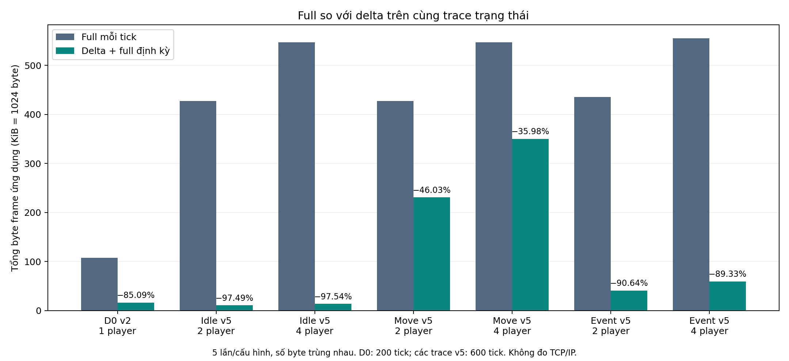

*Hình 12.1. Tổng frame ứng dụng theo cấu hình; phần trăm ghi trên cột delta là tỷ lệ giảm so với full của cùng hàng.
Đơn vị trục là KiB = 1024 byte; D0 có 200 tick, D1 có 600 tick. Nguồn hình: script phân tích dữ liệu thực chạy.*

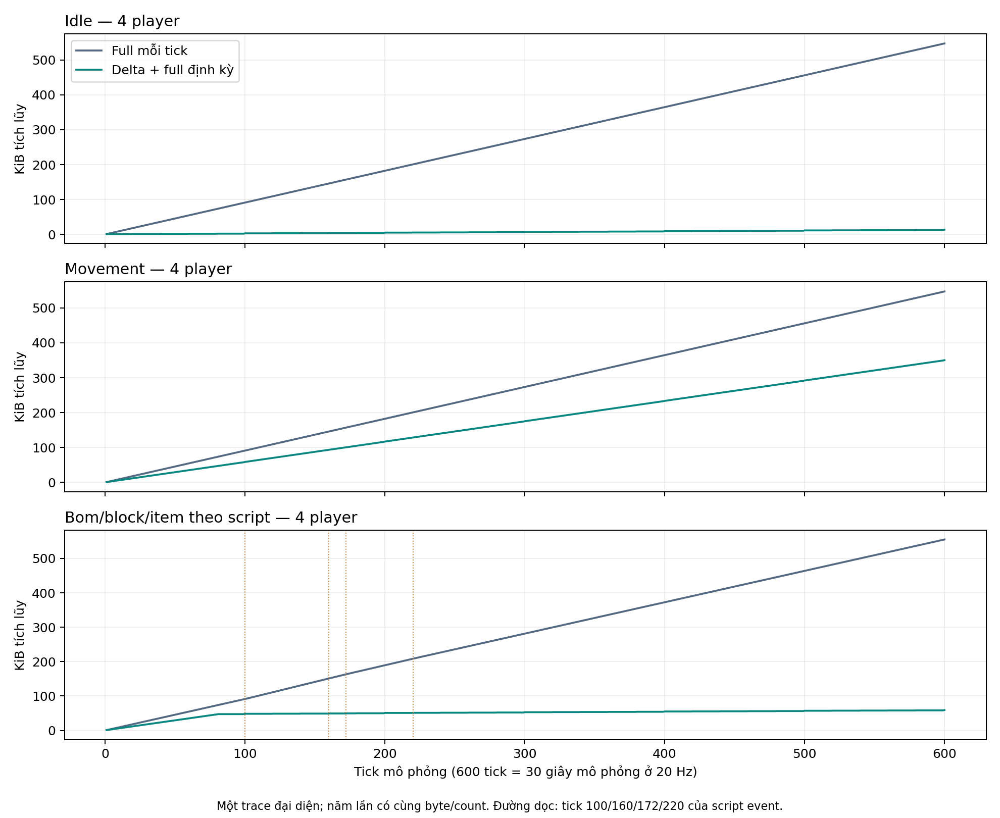

*Hình 12.2. Byte tích lũy của các trace D1 bốn player. Đường dọc ở trace sự kiện chỉ tick 100/160/172/220;
đường delta vẫn có chi phí full định kỳ và update timer. Trục tick là thời gian mô phỏng, không phải thời gian đo mạng.*

Bản vector để ghép DOCX/in: [hình 12.1 SVG](../figures/delta/12_5_full_vs_delta.svg),
[PDF](../figures/delta/12_5_full_vs_delta.pdf), [hình 12.2 SVG](../figures/delta/12_5_cumulative_bytes.svg),
[PDF](../figures/delta/12_5_cumulative_bytes.pdf).

### 12.5.4. Số packet và lý do mức giảm khác nhau

**Bảng 12.9. Chi phí phát packet và phân biệt byte/tick với byte/packet.**

| Cấu hình | Full của B1 | Delta của B1 | Tick không gửi | Byte/tick B1 | Byte/packet B1 đã gửi |
|---|---:|---:|---:|---:|---:|
| D0 v2 | 3 | 80 | 117 | 82,06 | 197,72 |
| D1 idle, 2 player | 7 | 24 | 569 | 18,36 | 355,29 |
| D1 idle, 4 player | 7 | 24 | 569 | 22,98 | 444,71 |
| D1 movement, 2 player | 7 | 593 | 0 | 393,97 | 393,97 |
| D1 movement, 4 player | 7 | 593 | 0 | 597,97 | 597,97 |
| D1 bom/block/item, 2 player | 7 | 101 | 492 | 69,54 | 386,33 |
| D1 bom/block/item, 4 player | 7 | 101 | 492 | 101,08 | 561,56 |

Byte/tick lấy tổng byte chia toàn bộ tick, gồm cả tick không gửi.
Byte/packet lấy tổng byte chia số packet B1 thật sự phát, gồm full và delta; không phải size trung bình chỉ của DELTA.
Do đó không thể dùng 18–23 byte/tick ở idle hoặc 70–101 byte/tick ở trace sự kiện
để tuyên bố mỗi gói v5 chỉ có 50–100 byte.

Idle tiết kiệm nhiều vì chỉ phát 31 packet trong 600 tick, gồm cả update timer và full định kỳ.
Trace movement phát đủ 600 packet: mỗi player đổi vị trí/ACK liên tục nên builder gửi lại PlayerData,
trong khi MatchFrame và metadata vẫn chiếm byte. Khi tăng từ hai lên bốn player,
phần PlayerData phải phát lớn hơn; tỷ lệ giảm còn 35,98% dù tổng byte vẫn thấp hơn full.
Trace bom/block/item có 492 tick không phát nên mức giảm cao hơn movement;
kết quả này chịu ảnh hưởng mạnh của đoạn ít thay đổi sau sự kiện cuối.

### 12.5.5. Giới hạn và kết luận trong phạm vi đo

Các kết quả chứng minh implementation giảm tổng byte snapshot so với full mỗi tick trên **bảy fixture đã đo**,
đồng thời giữ state replica theo các assertion của từng harness.
Mức giảm 35,98–97,54% của các trace D1 không phải khoảng đảm bảo cho mọi trận.
Không lấy một tỷ lệ trung bình chung cho các workload khác nhau để quảng bá mức tiết kiệm cố định.

Phép đo đồng thời hưởng lợi từ diff và bỏ tick rỗng; chưa có ablation tách riêng đóng góp hai cơ chế.
Không đo CPU/GC, thời gian scan map, latency encode/decode hoặc bộ nhớ baseline.
Chưa có trace map thay đổi dày đặc, nhiều entity hoặc resync lặp để xác định trường hợp delta có thể lớn hơn full.
Builder hiện không tự chọn packet nhỏ nhất sau encode, nên không kết luận delta luôn tối ưu.

D1 là codec harness một process, không chạy queue/loop/network, không có backpressure,
không phát notice packet và không nhân traffic cho nhiều connection nhận broadcast.
Đối với cùng một danh sách notice ở hai nhánh, thêm cùng số byte notice sẽ làm tỷ lệ giảm của **toàn luồng** thấp hơn
tỷ lệ snapshot trong bảng. Muốn kết luận bandwidth/latency hệ thống phải đo TCP riêng ở 12.6.
Số 600 tick là 30 giây mô phỏng theo 20 Hz, không phải mỗi process chạy đủ 30 giây thực.
Năm lần lặp cho size xác định không thay cho nhóm loopback/LAN nhiều lần của mục 11.

> **Phân công: TV4 thu thập và tổng hợp; TV1 xác nhận transport, TV2 xác nhận input/ACK/snapshot, TV3 xác nhận workload bom.**

## 12.6. Latency/ACK/throughput/message rate theo workload

### 12.6.1. Môi trường, số run và quy tắc tổng hợp

Thực nghiệm ngày 26/10/2026 chạy NetworkBenchmark với classpath `target/classes` đã kiểm tra hash,
JDK 25.0.1, Windows 11/amd64, 16 logical processors theo metadata runner.
Server và client trong cùng JVM nhưng giao tiếp TCP thật qua 127.0.0.1; mỗi scenario tạo server/client mới.
Năm suite process độc lập, mỗi suite chín scenario, tạo **45 scenario-run và 125 hàng peer**.
Mỗi scenario warm-up 2 giây, đo 10 giây yêu cầu; tỷ suất dùng window_seconds thực đo.
Không chạy test Maven hoặc plotting đồng thời với benchmark.
CPU model/RAM chưa được xác minh; vì vậy không dùng kết quả này làm mốc hiệu năng phần cứng chuẩn.

Nguồn: [started-manifest.json](../evidence/task14-2026-10-26/started-manifest.json),
[all-peer-rows.csv](../evidence/task14-2026-10-26/all-peer-rows.csv),
[per-run-metrics.csv](../evidence/task14-2026-10-26/per-run-metrics.csv) và
[network-summary.csv](../evidence/task14-2026-10-26/network-summary.csv).
Không trộn CSV lịch sử ngày 22/10 hoặc dữ liệu codec D0/D1 vào các bảng mạng này.

Trong từng run, mean RTT/ACK được tính từ mean từng peer với trọng số số mẫu;
RX/TX byte/s và message/s được cộng theo các client trong cùng cửa sổ.
P95 theo run lấy giá trị p95 cao nhất của các peer, gọi là **worst-peer p95**;
không gọi nó là pooled p95 của mọi ping/input.
Mỗi ô bên dưới trình bày **median (min–max) qua năm run**, không phải confidence interval.
Stat đầu vào đã được runner làm tròn ba chữ số thập phân, nên số tổng hợp cũng chịu sai số làm tròn.

### 12.6.2. Ping RTT và input ACK delay

**Bảng 12.10. Latency theo cấu hình, đơn vị ms.**

| Cấu hình | Run PASS/attempt | RTT mean theo run, ms | Worst-peer RTT p95, ms | ACK mean theo run, ms | Worst-peer ACK p95, ms |
|---|---:|---|---|---|---|
| transport-1 | 5/5 | 1,94 (1,89–2,04) | 2,31 (2,12–2,80) | — | — |
| transport-2 | 5/5 | 1,85 (1,80–1,96) | 2,42 (2,33–2,52) | — | — |
| transport-4 | 5/5 | 1,70 (1,62–1,95) | 2,27 (2,05–3,02) | — | — |
| idle-2 | 5/5 | 1,79 (1,72–2,00) | 2,23 (2,09–2,53) | — | — |
| idle-4 | 5/5 | 1,66 (1,63–1,79) | 2,26 (2,13–2,52) | — | — |
| movement-2 | 5/5 | 1,74 (1,70–1,78) | 2,27 (2,05–2,49) | 26,11 (25,68–27,63) | 48,34 (47,00–49,32) |
| movement-4 | 5/5 | 1,76 (1,73–1,82) | 2,40 (2,32–2,68) | 27,07 (26,04–30,11) | 49,02 (47,99–50,13) |
| bombs-2 | 5/5 | 1,68 (1,62–1,83) | 2,23 (2,09–2,93) | 27,22 (26,19–27,95) | 49,56 (47,36–50,52) |
| bombs-4 | 5/5 | 1,69 (1,61–1,97) | 2,17 (2,11–2,52) | 26,22 (25,70–28,62) | 49,19 (47,56–49,97) |

Mean RTT có median theo cấu hình khoảng 1,66–1,94 ms trong môi trường loopback này;
không có xu hướng đơn điệu tăng theo số client và không đủ căn cứ nói thêm client làm latency thấp hơn.
RTT nhỏ phản ánh đường TCP cục bộ và polling của runner, chưa đại diện LAN/Wi-Fi hoặc render latency.

Các mode có MOVE đạt median mean ACK khoảng 26,11–27,22 ms và median worst-peer ACK p95 khoảng 48,34–49,56 ms.
Khoảng này phù hợp với việc server lấy mẫu theo tick mục tiêu 50 ms, nhưng phép đo không tách riêng
thời gian queue, chờ tick, socket và poll nên không gán toàn bộ độ trễ cho GameLoop.
Không chia RTT đôi để suy one-way latency, không dùng ACK cuối process smoke thay ACK duration.
Ô không có MOVE được ghi “—”, không thay bằng 0 ms.

Mode bombs chỉ có một placement/client/run. Median qua run của median peer plant observation
là 53,01 ms ở hai client (min–max 49,20–54,19) và 46,28 ms ở bốn client (45,43–47,30).
Đó là thời gian đến khi replica thấy bom authoritative, không có packet ACK placement riêng.
Số mẫu ít và khác pha tick, nên không kết luận bốn client đặt bom nhanh hơn hai client.

### 12.6.3. Throughput và message rate ứng dụng

**Bảng 12.11. Tổng lưu lượng phía client; median (min–max) theo run.**

| Cấu hình | Tổng TX KiB/s | Tổng RX KiB/s | TX message/s | RX message/s | Mẫu RTT / mẫu ACK, cả 5 run |
|---|---|---|---|---|---:|
| transport-1 | 0,09 (0,09–0,09) | 0,09 (0,09–0,09) | 5,00 (5,00–5,00) | 5,00 (5,00–5,00) | 250 / 0 |
| transport-2 | 0,19 (0,19–0,19) | 0,19 (0,19–0,19) | 10,00 (10,00–10,00) | 10,00 (10,00–10,00) | 500 / 0 |
| transport-4 | 0,37 (0,37–0,37) | 0,37 (0,37–0,37) | 20,00 (20,00–20,00) | 20,00 (20,00–20,00) | 1000 / 0 |
| idle-2 | 0,19 (0,19–0,19) | 0,95 (0,95–0,95) | 10,00 (10,00–10,00) | 12,40 (12,40–12,40) | 500 / 0 |
| idle-4 | 0,37 (0,37–0,37) | 2,28 (2,28–2,28) | 20,00 (20,00–20,00) | 24,80 (24,80–24,80) | 1000 / 0 |
| movement-2 | 4,15 (4,13–4,15) | 15,32 (15,32–15,40) | 49,59 (49,40–49,60) | 49,40 (49,39–49,60) | 500 / 1974 |
| movement-4 | 8,29 (8,25–8,30) | 46,57 (46,34–46,81) | 99,19 (98,80–99,20) | 99,20 (98,80–99,59) | 1000 / 3952 |
| bombs-2 | 4,25 (4,23–4,25) | 15,88 (15,87–16,00) | 49,80 (49,60–49,80) | 50,19 (50,19–50,60) | 500 / 1974 |
| bombs-4 | 8,49 (8,45–8,49) | 48,68 (48,46–48,91) | 99,59 (99,19–99,60) | 102,39 (101,99–102,79) | 1000 / 3948 |

KiB/s là 1024 byte/giây, đo frame ứng dụng sau framing/envelope, không phải tổng byte TCP/IP.
Tổng RX là tổng frame mà các client nhận/poll; nếu một snapshot được broadcast cho bốn client,
bốn bản nhận được tính bốn lần. Không cộng TX vào RX rồi gọi đó là lượng message duy nhất.
Số mẫu cuối bảng là tổng sample count qua năm run, không phải năm lần lặp mới của cùng một peer.

Transport chủ yếu là PING/PONG nên tổng rate tăng gần với số client và nhịp mục tiêu 5 PING/giây/client.
Idle vẫn có snapshot do timer trận/full định kỳ, nên RX cao hơn transport dù không gửi MOVE.
Movement bốn client có tổng RX median 46,57 KiB/s, so với 15,32 KiB/s ở hai client;
đây là lưu lượng do workload tạo ra, không phải khả năng xử lý tối đa của server.
Snapshot chứa nhiều PlayerData hơn và được gửi cho nhiều receiver hơn khi roster tăng,
nên không kỳ vọng tổng RX luôn tăng tuyến tính theo số player.
Mode bombs cao hơn movement ở cùng số client vì có entity/effect/notice, nhưng không đại diện spam bom liên tục.

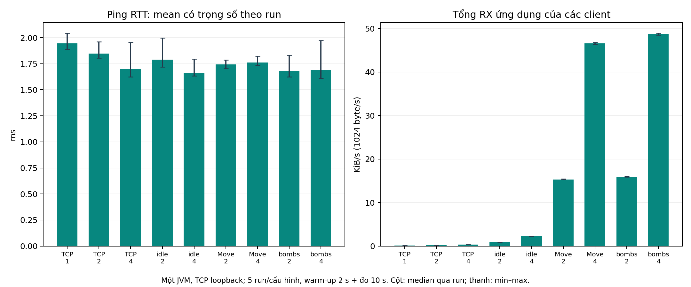

*Hình 12.3. Mean RTT có trọng số và tổng RX client; cột là median qua năm run, thanh là min–max.
Nhãn TCP tương ứng mode transport, Move tương ứng movement. Đo một JVM/loopback; không suy thành tải tối đa hoặc LAN.*

Bản xuất để ghép DOCX/in: [SVG](../figures/network-results/12_6_loopback.svg),
[PDF](../figures/network-results/12_6_loopback.pdf).

### 12.6.4. Lỗi, cleanup và request cuối cửa sổ

**Bảng 12.12. Trạng thái và số đếm qua năm run/cấu hình.**

| Cấu hình | FAIL / attempt | Cleanup lỗi | Pending PING cuối cửa sổ, tổng | Pending MOVE cuối cửa sổ, tổng | Stale / resync, tổng |
|---|---:|---:|---:|---:|---:|
| transport-1 | 0/5 | 0 | 0 | 0 | 0 / 0 |
| transport-2 | 0/5 | 0 | 0 | 0 | 0 / 0 |
| transport-4 | 0/5 | 0 | 0 | 0 | 0 / 0 |
| idle-2 | 0/5 | 0 | 0 | 0 | 0 / 0 |
| idle-4 | 0/5 | 0 | 0 | 0 | 0 / 0 |
| movement-2 | 0/5 | 0 | 0 | 2 | 0 / 0 |
| movement-4 | 0/5 | 0 | 0 | 4 | 0 / 0 |
| bombs-2 | 0/5 | 0 | 0 | 4 | 0 / 0 |
| bombs-4 | 0/5 | 0 | 0 | 4 | 0 / 0 |

45/45 scenario-run PASS, 0/45 FAIL và không có cleanup lỗi theo kiểm tra local runner;
cả năm suite process trả exit code 0. Các giá trị status/cleanup ở hàng peer cùng scenario
chia sẻ trạng thái run, không phải 125 lần kiểm chứng độc lập.
Không có stale snapshot hoặc resync request trong nhóm workload bình thường này;
khả năng phục hồi baseline được kiểm tra bằng fixture riêng, không phải do benchmark đã gây mất delta.

Tổng 14 MOVE vẫn pending tại mốc kết thúc của các cửa sổ, còn PING pending bằng 0.
Những input chưa ACK không được đưa vào mean/p95 ACK; bảng giữ số pending để lộ giới hạn quan sát này.
Runner ngừng đo rồi cleanup, không theo dõi completion của mọi input sau cửa sổ.
Do đó không gọi 14 request này là message loss, không tuyên bố loss rate bằng 0 từ số FAIL bằng 0,
và không coi các mean ACK chỉ của mẫu hoàn tất là độ trễ của toàn bộ input đã gửi.

Ở bombs-2, tổng năm run quan sát 20 notice đặt bom và 20 notice nổ;
ở bombs-4 là 80 và 80, do mỗi peer quan sát bom của mọi player.
Đó là số quan sát phía client, không phải 20/80 quả bom duy nhất; mỗi run thực tế chỉ đặt 2/4 bom.
Runner cũng kiểm tra local player còn sống và baseline hợp lệ ở cuối cửa sổ.

### 12.6.5. Kết luận trong phạm vi chạy được

Trong cấu hình loopback đã đo, hệ thống hoàn tất workload transport 1/2/4 client và gameplay 2/4 player
với latency/throughput và trạng thái như các bảng trên; các fixture lỗi lặp lại cũng đạt assertion.
Đây là bằng chứng cho những mức tải và điều kiện cụ thể, không phải chứng nhận reliability tổng quát.
Không đo trên nhiều máy, mạng có jitter/loss chủ động, tải vượt bốn client, trận dài hạn,
CPU/GC hoặc tài nguyên phần cứng đầy đủ. Warm-up hiện tại chủ yếu poll/PING, chưa làm nóng mọi đường movement/bom.
Suite có thứ tự mode cố định, không randomize và không ước lượng confidence interval từ năm run.
Các giới hạn này được giữ khi diễn giải novelty và đề xuất mở rộng ở các chương sau.

> **Phân công: cả nhóm xác nhận; TV4 theo dõi bằng chứng còn thiếu.**

## 12.7. Test chưa đạt và phần chưa có bằng chứng

**Bảng 12.13. Bằng chứng cần bổ sung trước khi nộp.**

| Nội dung | Hiện trạng | Log/ảnh/biên bản cần thêm | Phụ trách |
|---|---|---|---|
| Lỗi smoke lịch sử/môi trường | Baseline có lượt đạt; đợt recovery smoke lỗi trong sandbox, đạt ngoài sandbox cùng source | Đã giữ cả attempt lỗi/đạt ở 12.8; chưa kết luận chính xác policy môi trường gây khác biệt | TV2/TV4 |
| GUI phòng hai/bốn người | Test controller/TCP đạt; chưa có biên bản người thao tác | Ảnh roster/ready/start/chat; ghi run/match, tên máy, người kiểm tra và kết quả từng bước | TV1/TV4 |
| Movement và mất focus | Logic/state test đạt; chưa nghiệm thu điều khiển GUI | Video/phân đoạn log nhấn/thả/mất focus, chạm tường/block/biên và STOP; không suy từ ảnh tĩnh | TV2 |
| Bom, item, shield/respawn và HUD | Fixture/integration đạt; chưa có ảnh trận mạng nghiệm thu | Ảnh trước/sau placement, block/item, lives/shield/respawn và HUD cùng match; log server/client tương ứng | TV3/TV2 |
| Kết quả và lượt chơi lại | Test authoritative result/replay đạt | Ảnh kết quả hai client, trở lại phòng và match mới; đối chiếu result DTO/log | TV1/TV3/TV4 |
| LAN nhiều máy | Chưa thực hiện trong lượt này | Topology/hardware/IP/port, lệnh, CSV từng process, log và ảnh hai đầu | Cả nhóm |
| Lặp timing/concurrency/fault | Đã hoàn thành ba lượt, 84/84 lần thực thi test đạt | Đã lưu XML/log từng attempt; bổ sung soak hoặc tải khác nếu mở rộng kết luận | TV4 và owner module |
| Hiệu năng full/delta và mạng | Đã đo codec D0/D1 và 45 scenario-run TCP loopback; chưa đo LAN hoặc tải dày đặc | Đã lưu CSV/sample/pending/cleanup; cần LAN/trace thực tế nếu mở rộng | TV2/TV4 |
| Recovery correctness | Đã kiểm tra token/expiry/full→delta, reconnect lặp, input/GUI state, gameplay offline và cleanup trong fixture cục bộ | Evidence 171/171 ngoài sandbox ở 12.8; bổ sung nghiệm thu thao tác GUI/mạng thật nếu mở rộng kết luận | TV1/TV2/TV3/TV4 |
| Recovery latency/overhead | Chưa có benchmark latency P50/P95/P99 hoặc tổng byte full khi reconnect | Cần workload/metric/mốc đo riêng; 15001 ms chờ expiry và thời gian suite không thay được | TV1/TV2/TV4 |

Không có failure ở suite nhiệm vụ 12 hoặc các lượt test nhiệm vụ 14; điều đó không xóa lịch sử fail hoặc các nhóm chưa nghiệm thu.
Mốc recovery cũng có cả full attempt lỗi trong sandbox và full cuối đạt; không bỏ failure khỏi hồ sơ.
Lỗi Maven repository, execution policy và JAVA_HOME ở bước chuẩn bị được lưu như lỗi môi trường/cách gọi lệnh,
không trộn vào thống kê test case.
Không sửa test/source để đổi kết quả và không tạo ảnh giả cho kịch bản chưa chạy.
Các ảnh/video sẽ gắn caption gồm thời điểm, topology, run/match ID và điều kiện quan sát;
ảnh thiếu log đối chiếu chỉ minh họa giao diện, chưa chứng minh đồng bộ hay cleanup.

> **Phân công: TV1 giải thích session/token/expiry và ownership; TV2 runtime/snapshot/input; TV3 gameplay offline; TV4 tổng hợp log, môi trường và giới hạn kết luận.**

## 12.8. Kết quả Session Recovery trên phiên bản tích hợp

### 12.8.1. Phiên bản và các attempt thực tế

Đợt ngày **27/10/2026** chạy trên nhánh integration/session-recovery, HEAD
`492c03127f15a25f4fc685fd004eafe424d53f9f` cộng các sửa server/client trong working tree.
219 source Java được snapshot/hash; không gọi riêng HEAD là phiên bản đã có toàn bộ bản sửa và 171 test đạt.
Thiết lập đầy đủ tại 11.7; đây là kiểm thử tính đúng qua fixture/TCP loopback, không đo recovery latency.

**Bảng 12.14. Các attempt của đợt recovery và kết quả hồi quy.**

| Lượt | Điều kiện/phạm vi | Kết quả đã lưu | Diễn giải |
|---|---|---|---|
| A1 | Full suite trong sandbox | 171 execution, 170 pass, 1 failure, 0 error/skipped | MovementDemoProcessTest: No full snapshot before smoke deadline |
| A2 | Chạy riêng smoke ba process trong sandbox | 1 execution, 1 failure | Cùng hiện tượng, không phải một full suite khác |
| A3 | Full suite trong sandbox sau javac production tường minh | 171 execution, 170 pass, 1 failure, 0 error/skipped | Cùng smoke vẫn lỗi, javac exit 0; không thay source/timeout |
| A4 | Smoke riêng ngoài sandbox | 1/1 pass | Cùng source/assertion/timeout; không ghép XML này vào tổng A5 |
| A5 | Full suite ngoài sandbox | **171/171 pass, 44 class, 0 failure/error/skipped** | BUILD SUCCESS; kết thúc 19:58:23+07:00, Maven total 01:10 min |
| Kiểm tra riêng | Check TV2 và NetworkTest main ngoài sandbox | Cả hai exit 0/PASS | Không cộng vào số JUnit hoặc số case recovery |

Nguồn: [A1](../evidence/recovery-report-task03-attempt01-2026-10-27/),
[A2](../evidence/recovery-report-task03-smoke-recheck-2026-10-27/),
[A3](../evidence/recovery-report-task03-attempt02-2026-10-27/),
[A4](../evidence/recovery-report-task03-smoke-unrestricted-2026-10-27/)
và [A5](../evidence/recovery-report-task03-20261027-200413/README.md).
Tổng suite A5 đối chiếu từ [junit-summary.json](../evidence/recovery-report-task03-20261027-200413/junit-summary.json)
và [log Maven full](../evidence/recovery-report-task03-20261027-200413/report-recovery-task03-full.log).

Failure A1/A2/A3 là smoke **demo M1 ba tiến trình Java**, không phải testcase handshake recovery của lobby.
Hai full attempt lỗi vẫn có các nhóm recovery đạt. A4/A5 đạt ngoài sandbox cho thấy sự phụ thuộc điều kiện chạy,
nhưng chưa chỉ ra chính xác thành phần sandbox gây khác biệt; không nhận đã sửa một lỗi production hoặc firewall cụ thể.
Không cộng các attempt khác phạm vi thành một tỷ lệ thành công recovery và không coi 01:10 min là latency phục hồi.

### 12.8.2. Các lớp kiểm thử recovery và phạm vi đếm

**Bảng 12.15. Execution của các lớp liên quan trong lượt A5.**

| Test class | Pass/tổng | Assertion chính |
|---|---:|---|
| SessionRecoveryClientTest | 9/9 | ACK/full gate, timeout từng pha/tổng, retry, identity, EDT, UI packet cũ, close |
| RecoveryInputTest | 2/2 | Clear input khi paused và đổi generation giữa hai mẫu |
| ConnectCancellationTest | 1/1 | Đóng candidate socket khi connect đang chờ |
| RecoveryGameplayIntegrationTest | 8/8 | Full→delta, nhiều input/bom, token sai, gameplay offline, hai player offline, expiry/GAME_OVER, auto client |
| RecoveryWriterTest | 1/1 | Thay writer và bỏ late release của socket cũ |
| SessionRecoveryTest | 10/10 | Ba biên grace, timer/heartbeat/socket cũ, claim chồng, writer fault và shutdown |
| BombClientIntegrationTest | 3/3 | Lớp tích hợp chung có thêm recovery giữ controller/counter |
| LobbyLifecycleTest | 13/13 | Lớp lifecycle chung gồm recovery, queue đầy và readiness barrier |

Sáu lớp đầu có 31 execution; hai lớp dùng chung có 16 execution, không gọi mọi ca của chúng là recovery riêng.
Tổng tám lớp là 47 trong 171, không cộng thêm vào 171. Mỗi hàng có 0 failure/error/skipped.
Marker stdout 11 dòng cũng không thay tổng testcase JUnit.

Nguồn chi tiết: [class-results.csv](../evidence/recovery-report-task03-20261027-200413/class-results.csv),
[test-executions.csv](../evidence/recovery-report-task03-20261027-200413/test-executions.csv)
và [44 XML Surefire](../evidence/recovery-report-task03-20261027-200413/surefire/).
Source assertion tương ứng nằm trong snapshot cùng evidence, ví dụ
[RecoveryGameplayIntegrationTest](../evidence/recovery-report-task03-20261027-200413/source/src/test/java/com/bombit/integration/RecoveryGameplayIntegrationTest.java).
Lớp hiện tại đã có thêm ca so với baseline 133; không sửa các bảng 12.2–12.7 thành số của A5.

### 12.8.3. Kết quả nghiệp vụ, full→delta và gameplay offline

**Bảng 12.16. Kết quả kiểm chứng theo nhóm kịch bản recovery.**

| Mã | Kết quả quan sát/assertion | Kết luận trong phạm vi fixture |
|---|---|---|
| R01 | 4 bom trước ngắt; 3 recovery; 3 full bằng peer cùng tick và 3 lần ghép delta sau full | Identity/match/runtime và baseline được giữ/phục hồi đúng trong ba vòng |
| R02 | Request bom cũ không tạo thêm command; request mới đưa tổng bom lên 5, sequence tiếp tục | Không reset counter/đặt lặp theo ID cũ; không suy exactly-once cho mọi lệnh |
| R03 | Player offline còn trong world, moving=false và vị trí ổn định qua snapshot quan sát | Freeze dừng movement; peer online vẫn nhận update |
| R04 | Lives 3→2, respawns=1; block (2,1) bị phá, item sinh; timer 30→29 s | Bom/damage/respawn/item/timer tiếp tục khi offline |
| R05 | Full cùng tick bằng peer về dimensions, tileSize, match state, tiles, PlayerData/ACK, entities, MatchFrame và BombFrame | Full khôi phục ảnh world hiện tại, không chỉ vị trí nhân vật |
| R06 | SPEED_UP nhặt một lần, speed 80→88; full tiếp theo không cộng lại; lives vẫn 2 | State authoritative không bị lặp effect vì resync |
| R07 | Ba request sai bị từ chối; valid_owner_resumed=true | Token sai, identity lạ, thiếu field không phá phiên chủ hợp lệ |
| R08 | recovered_players=2, same_runtime=true; không timer thừa | Cả hai có thể offline rồi về cùng runtime trong fixture |
| R09 | TIMEOUT, resurrected=false; runtime/worker dừng | Resume không tạo lại match đã kết thúc |
| R10 | LAST_ALIVE, player offline hết mạng; resurrected=false | Kết quả gameplay không bị reconnect đảo ngược |
| R11 | Grace configured=15 s; token muộn bị từ chối; ABORTED, gỡ ghế/chuyển host, WAITING, runtime/timer dọn | Hết grace theo hard drop/leave, không hứa peer luôn chơi tiếp |
| R12 | Trước biên nhận, tại/sau biên từ chối theo Bảng 12.17 | Admission kiểm tra deadline kể cả timer chưa chạy |
| R13 | Auto client 3 vòng, same_controller=true, bomb_request_counter_continued=true | Giữ controller/context/listener và bộ đếm qua tự nối lại |
| R14 | Mỗi fixture kiểm tra accept/runtime/snapshot/transport/executor đã dừng và map/session/timer được dọn theo phạm vi | Cleanup đạt assertion trong các ca, không thay cho soak hoặc chứng minh mọi memory leak |

R01/R02/R03 dùng chung một testcase; R04/R05/R06 dùng chung một testcase; các hàng R không được cộng thành số execution.
Các giá trị in từ lượt A5 nằm trong [case-results.csv](../evidence/recovery-report-task03-20261027-200413/case-results.csv)
và [case-results.json](../evidence/recovery-report-task03-20261027-200413/case-results.json).
CSV có 8 record integration (TIMEOUT/LAST_ALIVE riêng) và 3 record boundary;
những assertion chi tiết không in thành marker vẫn cần đối chiếu source/XML, không tự suy ra chỉ từ tên scenario.

Các test client/server khác còn xác nhận ACK/delta/full cũ chưa mở input, thiếu ACK/full không chờ vô hạn,
packet chờ UI của attempt cũ không ghi đè world mới, giữ phím không phát lại sau recovery,
old socket/timer/heartbeat không đóng nhầm lần nối mới và freeze/unfreeze queue đầy không bị coi thành công.
Writer setup fault thực vẫn được ghi trong failure; từ chối do trận đã kết thúc được phân loại nghiệp vụ và cleanup,
không gắn thành server crash chỉ vì không còn match để phục hồi.

### 12.8.4. Biên grace và ý nghĩa số đo chờ hết hạn

**Bảng 12.17. Admission quanh biên 15 giây với clock điều khiển.**

| elapsed_nanos | So với grace 15 s | admitted | Kết quả assertion |
|---:|---|---|---|
| 14.999.999.999 | Trước 1 ns | true | PASS |
| 15.000.000.000 | Đúng biên | false | PASS |
| 15.000.000.001 | Sau 1 ns | false | PASS |

Đây là unit test clock/scheduler được tiêm, không phải ba phép đo khả năng lập lịch OS ở độ phân giải nanosecond.
Case TCP expiry riêng dùng **15 giây thực**, ghi `observed_wait_ms=15001` trong A5.
Thời gian này tính sau khi test đã quan sát state DISCONNECTED tới khi nhận GAME_OVER;
không trùng thời điểm tạo ticket server và không đo từ lúc Wi-Fi/cáp vật lý mất.
Không kết luận recovery mất 15001 ms, không lấy nó làm độ trễ P95 hoặc chứng minh timer chính xác ±1 ms.

### 12.8.5. Kết luận và giới hạn phép kiểm chứng

Kết quả hỗ trợ nhận định Session Recovery đã được tích hợp và đạt các assertion cục bộ đã thiết kế,
gồm giữ phiên/runtime/controller, khoá input tới full được áp, tiếp tục delta, xử lý token/grace/lifecycle
và phản ánh gameplay xảy ra trong thời gian offline. Nó bổ sung bằng chứng cho FR15/NFR07,
không thay đổi ý nghĩa các benchmark baseline cũ.

Chưa đo tỷ lệ thành công ngoài thực tế, recovery latency P50/P95/P99, throughput/byte overhead của recovery,
GUI thủ công/LAN/Wi-Fi vật lý, tải tối đa, soak hoặc khôi phục sau server restart.
Không có phép đo A/B recovery bật/tắt mới; số tiết kiệm byte ở 12.5 và RTT ở 12.6 không được dùng
để tuyên bố recovery cải thiện tương ứng. Tên “liền mạch” không có nghĩa không gián đoạn input hoặc không mất lệnh.
Các failure sandbox và khác biệt môi trường phải được giữ khi diễn giải reliability.

Toàn bộ evidence dùng cho phần mới được kiểm tra checksum và inventory source;
biên tập chương này không chạy test mới, không đổi source/assertion/timeout hoặc tạo ảnh GUI cho kịch bản chưa thực hiện.


# 13. Thảo luận — Discussion

> **Phân công: TV2 phân tích full/delta, tick, ACK và đồng bộ; TV4 tổng hợp metric, concurrency/reliability và giới hạn suy luận; TV1 đối chiếu transport/lobby; TV3 đối chiếu gameplay/event.**

Chương này giải thích các kết quả ở mục 12 dựa trên cơ chế đã triển khai ở mục 7–10.
Căn cứ định lượng là fixture codec D0/D1 và benchmark TCP loopback; căn cứ tính đúng là assertion cùng log/XML.
Phần recovery sử dụng riêng thiết lập 11.7/kết quả 12.8 của HEAD `492c031` cộng working tree đã sửa;
các tỷ lệ byte và RTT/ACK baseline không được chuyển thành hiệu quả định lượng của recovery.
Các khả năng gây nghẽn được suy từ code sẽ được ghi rõ là giả thuyết, không coi là kết quả profiler.
Phạm vi dữ liệu giữ nguyên revision và điều kiện thực nghiệm ở mục 11–12, không thực hiện phép đo mới trong lượt viết này.

## 13.1. Mức đáp ứng mục tiêu và điều kiện thực nghiệm

**Bảng 13.1. Mục tiêu, bằng chứng và mức kết luận được hỗ trợ.**

| Mục tiêu trong mục 6 | Bằng chứng đã có | Kết luận và phần còn thiếu |
|---|---|---|
| Phòng, quyền, movement và gameplay authoritative — FR01–FR09 | Suite baseline 133/133; test lobby/TCP, collision, bom/item/lives; lượt tích hợp mới có hồi quy 171/171 | Assertion theo từng revision đạt; chưa nghiệm thu mọi thao tác GUI/LAN |
| Replica và lượt trận đúng contract — FR10–FR12, NFR01 | Test baseline/resync/match scope/respawn; 18.000 đối chiếu state chuẩn hóa D1 đạt | Có bằng chứng logic và tích hợp; equality D1 không kiểm tra metadata tick/clock hoặc notice |
| Đồng thời, giới hạn queue và cleanup — NFR02/NFR06/NFR07 | 84/84 lần thực thi test qua ba lượt; queue đầy, thread owner, writer/client chậm | Phản ứng theo fixture đạt; không chứng minh mọi race, mọi tải hoặc không còn memory leak |
| Giảm byte đồng bộ — NFR05 | B0/B1 cùng trace; D1 giảm 35,98–97,54% tùy workload | Chứng minh giảm frame snapshot ở fixture đã đo; chưa tách lợi ích diff và bỏ tick rỗng |
| Phản hồi và nhịp cập nhật — NFR03/NFR04 | 45/45 scenario-run loopback PASS; mean ACK/RTT và pending được lưu | Có số đo phía ứng dụng; chưa đo residual correction, frame time hoặc mức trễ tick bằng profiler |
| Phục hồi phiên trong active match — FR15/NFR07 | Test token/grace/ownership, full→delta, input/controller, gameplay offline; full mới 171/171 ngoài sandbox | Recovery đạt assertion cục bộ; không chứng minh SLA, replay mọi lệnh hoặc khôi phục sau server restart |
| Khả năng kiểm tra/tái lập — NFR08 | Raw CSV/XML/trace, revision, class hash và script | Truy vết được các kết quả; CPU model/RAM chưa xác minh, nhóm LAN/soak chưa thực hiện |

Nguồn: [kết quả chức năng và thực nghiệm](../chapters/12_KET_QUA.md),
[delta summary](../evidence/task13-2026-10-26/summary.csv),
[network summary](../evidence/task14-2026-10-26/network-summary.csv) và
[reliability summary](../evidence/task14-2026-10-26/reliability-summary.json).
Không cộng số test, scenario-run, peer và tick thành một tổng “số lần thành công” vì chúng là các đơn vị khác nhau.

Những kết quả trên hỗ trợ kết luận hệ thống đã ghép được transport, runtime, gameplay và replica trong phạm vi đã kiểm tra.
Chưa đủ cơ sở kết luận toàn bộ sản phẩm đã nghiệm thu: game chạy đúng assertion trong một fixture khác với
bốn người thao tác trên bốn máy, nơi còn có input focus, lịch EDT và điều kiện mạng thực.
Tương tự, không có ngưỡng SLA đã xác lập để từ RTT thấp ở loopback kết luận đáp ứng yêu cầu mọi mạng.

## 13.2. Hiệu quả/chi phí và trường hợp delta kém lợi

### 13.2.1. Vì sao hiệu quả phụ thuộc workload

Trong D1 idle bốn player, nhánh full gửi 560400 byte, nhánh delta gửi 13786 byte trong 600 tick,
giảm 97,54%. B1 chỉ phát 31 packet, gồm bảy full định kỳ/bắt buộc và 24 delta; 569 tick không phát.
Lợi ích lớn vì world ít thay đổi và harness không sinh input ACK mới mỗi tick.
Match timer vẫn tạo update, nên đây không phải trạng thái hoàn toàn không có dữ liệu nền.

Với D1 movement bốn player, B1 phát đủ 600 packet, gồm bảy full và 593 delta.
Tổng byte giảm từ 560400 xuống 358780, tương ứng 35,98%.
Ở trace này mọi player có input/ACK thay đổi, nên PlayerData tiếp tục xuất hiện dù map không đổi.
Builder chỉ loại phần record không thay đổi, không mã hóa từng field riêng trong PlayerData.
Như vậy delta vẫn có lợi trên trace chuyển động liên tục, nhưng mức giảm thấp hơn nhiều so với idle.

Hai trace movement có cùng số byte tiết kiệm tuyệt đối 201620 khi tăng từ hai lên bốn player,
trong khi phần full và delta đều lớn hơn với bốn player.
Điều này phù hợp với code: map cố định được loại khỏi các delta, còn các player đang đổi vẫn phải gửi.
Không dùng con số này để suy một quy luật tuyến tính cho mọi kích thước map hoặc roster.
Nguồn cơ chế: [StateDeltaBuilder](../../src/main/java/com/bombit/server/game/movement/StateDeltaBuilder.java);
nguồn từng tick: [movement-4, run 1](../evidence/task13-2026-10-26/d1/movement-4/r1.csv).

**Bảng 13.2. Cách đọc hiệu quả delta theo loại dữ liệu.**

| Điều kiện | Kết quả đã đo hoặc suy luận từ code | Ý nghĩa |
|---|---|---|
| Idle không phát input | D1 giảm 97,49–97,54%, 569/600 tick không gửi | Lợi ích gồm cả giảm số packet, không chỉ giảm size delta |
| Mọi player đổi vị trí/ACK | D1 giảm 46,03% ở hai player, 35,98% ở bốn player; không skip | PlayerData/metadata còn là chi phí thường xuyên |
| Bom/block/item theo script | D1 giảm 89,33–90,64%; 492 tick không gửi | Phụ thuộc đoạn ít thay đổi sau sự kiện; không đại diện đặt bom liên tục |
| Nhiều tile/entity cùng đổi | Chưa đo; list upsert/tombstone và chỉ mục có thể lớn | Chưa xác lập ngưỡng delta bắt đầu kém full |
| Resync lặp hoặc FINISHED | Code có thể ép full; không có trong D1 | Kết quả fixture không bao gồm mọi nguồn chi phí full |

### 13.2.2. Idle của harness khác người chơi không giữ phím

[InputController](../../src/main/java/com/bombit/client/game/movement/InputController.java)
vẫn lấy mẫu và gửi moving=false khi không giữ phím, nếu controller còn sẵn sàng.
[PredictionController](../../src/main/java/com/bombit/client/game/movement/PredictionController.java)
cấp sequence mới, còn StateDeltaBuilder so sánh cả lastProcessedInput.
Do đó một player có vị trí đứng yên vẫn có thể tạo PlayerData thay đổi vì ACK.
Ngược lại, D1 idle và mode idle của benchmark không gửi MOVE.

Đây là giới hạn đối chiếu workload quan trọng: mức tiết kiệm idle cao đã đo không phải lời hứa cho mọi client GUI đứng yên.
Suy luận từ code cho thấy mẫu đứng yên liên tục có thể làm giảm số tick skip; mức ảnh hưởng chính xác cần trace/benchmark riêng.
Chưa có phép đo đó nên không gán phần trăm cụ thể hoặc tự bỏ mẫu input trong production.
Mẫu đứng yên hiện còn phục vụ contract input/ACK, vì vậy tối ưu nó phải xét cả tính đúng, không chỉ số byte.

### 13.2.3. Chi phí còn lại và trường hợp có thể kém lợi

Builder quét/chụp state và giữ baseline; snapshot còn có metadata, MatchFrame và Base64/JSON envelope.
Đây là đổi chác giữa lượng dữ liệu gửi, công việc so sánh và bộ nhớ; phép đo byte chưa xác định chi phí CPU/GC.
Không thể từ “giảm 35,98% byte” kết luận “giảm 35,98% thời gian xử lý” hoặc “tăng FPS tương ứng”.

Nếu phần lớn tile/entity đổi, danh sách tọa độ/chỉ mục, record mới và khóa xóa có thể làm delta kém lợi.
Code chưa encode thử cả full/delta để chọn bản nhỏ hơn, nên không có bảo đảm delta luôn nhỏ nhất.
Full định kỳ còn cần cho chính sách đồng bộ và phải được tính trong tổng, như các bảng kết quả đã làm.
Việc chọn chu kỳ full khác có thể thay đổi byte/phục hồi, nhưng chưa có sweep tham số để gọi 100 tick là tối ưu.

## 13.3. Tick, FIFO, backlog, prediction correction và độ trễ

### 13.3.1. RTT thấp không loại bỏ thời gian chờ mô phỏng

Median mean RTT theo cấu hình ở loopback khoảng 1,66–1,94 ms,
trong khi median mean input ACK ở workload có MOVE khoảng 26,11–27,22 ms.
Hai metric có timestamp và đường xử lý khác nhau: PING/PONG không chứng minh input đã được mô phỏng,
còn ACK chỉ xuất hiện khi snapshot phản ánh sequence server đã xử lý.
Khoảng ACK p95 gần một chu kỳ 50 ms phù hợp với việc có thể chờ tick,
nhưng chưa có trace nội bộ để tách thời gian queue, tick, socket và poll.

GameLoop đọc tối đa 256 command/tick và chỉ áp dụng một mẫu movement dương thành công/player/tick.
Nếu đầu queue là mẫu tiếp theo của player vừa được xử lý, loop dừng đọc để giữ FIFO;
command của player khác phía sau cũng phải chờ.
Đây là một khả năng gây backlog/fairness hạn chế, không phải bottleneck đã được chứng minh ở tải bốn client.
Con số 256 không đồng nghĩa server xử lý được 256 movement của cùng một player trong một tick.
Nguồn: [GameLoop](../../src/main/java/com/bombit/server/game/core/GameLoop.java).

### 13.3.2. Backpressure bảo vệ state nhưng có chi phí trải nghiệm

Command queue dùng offer có giới hạn; outbound chỉ commit baseline sau enqueue thành công.
Writer/client queue đầy hoặc write deadline có thể đóng connection để tránh tiếp tục với chuỗi snapshot thiếu dữ liệu.
Cách xử lý này bảo vệ một số invariant về tài nguyên và thứ tự, nhưng có thể kết thúc lượt theo ABORTED.
Không nên gọi đây là phục hồi trong suốt cho người chơi hoặc exactly-once toàn hệ thống.
Ở bản tích hợp, lỗi transport còn có nhánh giữ session/runtime trong grace; queue lifecycle không nhận freeze/unfreeze
hoặc hết grace vẫn có thể ABORT. Recovery bổ sung khả năng trở lại, không loại bỏ mọi hậu quả của backpressure.

TCP cung cấp byte stream có thứ tự và tin cậy [1]; contract ứng dụng vẫn phải kiểm tra match/baseline.
([RFC 9293, §2.2](https://www.rfc-editor.org/rfc/rfc9293.html#section-2.2)).
Việc update vào outbound queue không xác nhận client đã nhận, và ACK TCP không xác nhận replica đã áp dụng.
Trong nhóm mạng đã đo, không có stale/resync nhưng còn tổng 14 MOVE pending cuối cửa sổ.
Đó là giới hạn quan sát completion, chưa chứng minh message loss hoặc đã mất tính nhất quán.

### 13.3.3. Prediction và interpolation chưa có bằng chứng UX định lượng

Prediction/reconciliation dùng input chưa ACK để mô phỏng lại theo hướng tiếp cận đã có [4].
([Gambetta, Part II](https://www.gabrielgambetta.com/client-side-prediction-server-reconciliation.html)).
Test hiện có kiểm tra replay/reset đúng giá trị, không đo thời gian từ nhấn phím tới pixel thay đổi.
Giá trị sai lệch trả về trước reconciliation cũng không phải residual sau replay,
vì vị trí predicted và authoritative có thể thuộc hai thời điểm mô phỏng khác nhau.

Nội suy remote cần dữ liệu các mẫu trước để dựng chuyển động giữa update [5].
([Gambetta, Part III](https://www.gabrielgambetta.com/entity-interpolation.html)).
Client hiện lùi render timeline khoảng hai tick với phần tiến thời gian có giới hạn;
đó là lựa chọn presentation, không phải lời bảo đảm lag hiển thị luôn 100 ms.
Reset khi respawn giúp tránh nội suy qua một bước nhảy vị trí không liên tục,
nhưng độ mượt trên GUI và mạng có jitter vẫn cần phép đo/quan sát riêng.

## 13.4. Tính nhất quán gameplay, event và respawn

Một game loop/room sắp thứ tự movement → extension gameplay → snapshot.
Nhờ đó snapshot phản ánh kết quả sau bước gameplay thay vì network thread đọc world đang sửa.
Đây là điểm ghép quan trọng: tối ưu byte chỉ có ý nghĩa khi replica biểu diễn đúng kết quả server.
Các test runtime, MatchLifecycle và harness D1 hỗ trợ các phần khác nhau của kết luận này;
D1 không chạy toàn luật bom/item nên không được dùng một mình để xác nhận gameplay.

BombSystem gom hit trước khi damage, giữ barrier của block trong cùng batch và đánh một lần/player/batch.
Match extension xử lý item theo thứ tự xóa item trong blast → drop → pickup → quyết định kết quả.
Các fixture đã kiểm tra chain, shield, respawn, cap và chết cùng tick;
chúng giúp tránh kết quả phụ thuộc việc một tia được xử lý trước rồi cho player respawn vào tia kế tiếp của cùng batch.
Không suy rằng mọi thứ tự input hoặc mọi vị trí respawn trong mọi map đã được bao phủ.

Snapshot là nguồn state client, notice không thực thi damage/pickup lần nữa.
Respawn counter làm client bỏ pending input cũ và lịch sử nội suy, trong khi sequence vẫn tăng.
Match ID mới ngăn dữ liệu lượt cũ áp vào lượt mới.
Các cơ chế này giải quyết các ranh giới khác nhau; event ID, input sequence và match ID không thay thế nhau.
Nguồn: [MatchGameplayExtension](../../src/main/java/com/bombit/server/game/runtime/MatchGameplayExtension.java),
[BombSystem](../../src/main/java/com/bombit/server/game/bomb/BombSystem.java),
[MovementClientController](../../src/main/java/com/bombit/client/game/movement/MovementClientController.java)
và các test được dẫn tại mục 12.2–12.4.

## 13.5. Bottleneck, lỗi quan sát được và giới hạn kết luận

**Bảng 13.3. Phân biệt quan sát thực tế với khả năng cần đo thêm.**

| Điểm xem xét | Căn cứ | Kết luận hiện tại | Phép đo cần để xác nhận bottleneck |
|---|---|---|---|
| PlayerData/ACK trong delta | D1 movement không skip, samePlayer xét ACK | Chi phí byte thường xuyên đã quan sát | Tách byte theo field và workload đứng yên có input |
| Broadcast nhiều receiver | Tổng RX movement tăng 15,32 → 46,57 KiB/s khi 2 → 4 client | Lưu lượng nhận tăng; chưa phải server bão hòa | CPU, queue depth, nhiều room/client và throughput khi tăng tải |
| FIFO chặn mẫu tiếp theo | Điều kiện peek/break trong loop | Nguy cơ chờ command phía sau suy từ code | Timestamp enqueue/dequeue, fairness theo player và phân bố backlog |
| Scan/copy/encode/Base64 | Builder/codec thực hiện các bước này | Có công việc/bộ nhớ phát sinh; chưa biết bước chiếm ưu thế | Profiling CPU/allocation/GC, encode/decode duration |
| Writer/UI chậm | Fixture timeout/budget test đạt | Cơ chế giới hạn hoạt động trong fixture | Soak, queue occupancy và latency dưới chậm/jitter kéo dài |
| Smoke đa process | Baseline có lượt đạt; đợt recovery lỗi trong sandbox và đạt ngoài sandbox cùng source | Có khác biệt theo môi trường chạy, chưa xác định policy gây ra | Trace setup/full deadline và điều kiện sandbox/OS; không gọi là fix production đã được chứng minh |
| Full phục hồi và giữ phiên | Test full→delta/cleanup đạt; baseline dùng chung, giữ state trong grace | Có thêm công việc và tài nguyên cần giữ, chưa định lượng overhead | Byte full/retry theo receiver, thời gian từng pha, số phiên grace và tải reconnect đồng thời |

Tổng RX trong bảng là median tổng phía client, không phải phép đo năng lực đường truyền hay server processing rate.
Các so sánh latency bốn client thấp hơn hai client ở một số mode không chứng minh scale tốt hơn:
chỉ có năm run, cùng máy, thứ tự mode cố định và chưa tách ảnh hưởng scheduling/GC.
Benchmark full/delta là đối chứng codec; benchmark TCP chỉ đo cấu hình hiện hành.
Chưa có A/B TCP giữa full mỗi tick và delta nên không gán RTT/ACK đang đo là kết quả cải thiện do compression.

Không có profiler hoặc phép đo bão hòa để chọn một bottleneck duy nhất.
Ưu tiên kiểm tra tiếp theo là trace input/ACK/queue và chi phí serialization, rồi mới thay đổi tick,
chu kỳ full hoặc format. Thay đổi cần được đánh giá lại cả tính đúng và byte/latency trên cùng workload.
Các giới hạn chức năng, GUI/LAN/soak và hướng xử lý được trình bày tập trung ở mục 15–16.

## 13.6. Đánh giá Session Recovery và quan hệ với State Delta Compression

### 13.6.1. Bằng chứng về phục hồi tính đúng

Các ca tại 12.8 xác nhận ba vòng reconnect sau nhiều MOVE/bốn bom, ba full bằng peer cùng tick và delta sau mỗi full;
request bom mới tiếp tục có hiệu lực mà không dùng lại counter cũ. Bộ test còn cho thấy token sai không phá owner,
hai player có thể trở lại cùng runtime, và match đã kết thúc không bị tái tạo. Những assertion này hỗ trợ
FR15 ở luồng ứng dụng thực qua TCP, vượt mức chỉ có API attachSocket hoặc một CONNECT_ACK.

Giá trị của việc chờ full nằm ở điều kiện sử dụng world: ACK chỉ xác nhận identity,
trong khi full áp thành công mới cung cấp map/player/entity/frame đủ để tiếp tục từ nền hiện tại.
Connection epoch/input generation loại tác vụ cũ, pending trước ngắt bị bỏ và sequence/counter vẫn tăng.
Do đó “tiếp tục trận” không đồng nghĩa khôi phục mọi thao tác chưa rõ đã tới server;
thiết kế chủ động tránh phát lại mù MOVE/plant đã cũ và không hứa exactly-once end-to-end.

### 13.6.2. Chi phí full, deadline và tài nguyên còn phải đo

Recovery giữ session/runtime thay vì leave ngay, đồng thời cần full mới và các bước handoff/retry.
Do baseline chung theo match, một full phục hồi có thể đi tới peer đang online;
phần chi phí này không nằm trong các trace D1 cũ. Không có A/B recovery bật/tắt hoặc workload reconnect dày đặc
để tính mức tăng byte/CPU, cũng chưa đo latency theo pha nên không dùng mức giảm 35,98–97,54% của D1 như kết quả recovery.

Grace 15 giây ở server và budget 14 giây ở client khởi đầu khi mỗi phía xử lý mất nối, không có cùng mốc clock.
Khoảng cách hai con số không phải biên an toàn 1 giây đã được chứng minh. Heartbeat, DNS, connect,
queue, tick tạo full và lịch EDT có thể ảnh hưởng thời gian người dùng chờ; các tác động này cần timestamp/profiling mới.
Số 15001 ms ở case expiry là chờ GAME_OVER sau quan sát DISCONNECTED, không đo resume hoặc SLA chính xác ±1 ms.

Test timer/socket cũ, handoff chồng nhau, queue đầy và cleanup kiểm tra những interleaving cụ thể.
Chúng không đủ để suy không còn mọi race hoặc memory leak trong vận hành dài hạn.
Giữ nhiều phiên grace và retry đồng thời là workload tài nguyên cần đánh giá riêng, chưa là bottleneck đã quan sát.

### 13.6.3. Đánh đổi chính sách gameplay và phạm vi “liền mạch”

Freeze dừng điều khiển nhưng không pause gameplay. Ca offline chứng minh bom vẫn nổ, player mất một mạng/respawn,
block/item đổi và timer giảm; full sau đó phản ánh đúng ảnh mới, pickup không cộng lại.
Cách chọn này giữ cùng thời gian trận cho peer còn nối, nhưng người vắng mặt vẫn có thể bị loại;
không gọi đây là bảo đảm công bằng hoặc bảo vệ người mất mạng đã được đánh giá với người chơi.

Hết grace có thể ABORT cả match, còn TIMEOUT/LAST_ALIVE trong grace làm recovery bị từ chối.
Người offline không được replay lịch sử GAME_OVER, nên phục hồi trạng thái hiện tại chưa là khôi phục đầy đủ mọi trải nghiệm.
Nếu nhóm muốn forfeit thay ABORT, miễn damage hoặc phát lại kết quả, đó là thay đổi policy/contract cần test mới,
không phải diễn giải lại code hiện tại. “Liền mạch” chỉ nói giữ phiên/context/cửa sổ và tiếp tục sau đồng bộ;
vẫn có khoảng khoá input và điều kiện không thể resume.

### 13.6.4. Mức độ tin cậy của kết quả mới

Lượt full cuối ngoài sandbox đạt 171/171, nhưng các full/smoke trong sandbox có failure demo M1 được lưu riêng.
Vì các attempt khác điều kiện/phạm vi, không chia số lượt đạt cho tổng attempt để báo một xác suất phục hồi.
Cùng source chạy đạt ngoài sandbox gợi ý phụ thuộc môi trường; chưa xác định chính xác policy hoặc lỗi nội bộ gây khác biệt.

Kết luận hợp lệ là recovery đã tích hợp và đạt các assertion cục bộ công bố. Chưa có GUI/LAN/Wi-Fi vật lý,
network impairment có kiểm soát, benchmark độ trễ/overhead hoặc failover. Token không có TLS/rotation
cũng giới hạn cách công bố an toàn quyền tiếp quản; test token sai không chứng minh chống đánh cắp token.
Nguồn: [thiết kế xác minh](../session-recovery/02_XAC_MINH_THIET_KE_VA_NGUON.md)
và [log/CSV/XML thực chạy](../evidence/recovery-report-task03-20261027-200413/README.md).


# 14. Điểm mới và đóng góp — Novelty and Contributions

> **Phân công: TV2 chủ trì State Delta Compression và contract đồng bộ; TV4 tổng hợp bằng chứng/đánh giá; TV1 và TV3 xác nhận phần tích hợp của module mình. Phân công nội dung không phải xác nhận tác giả từng dòng code hoặc phần trăm đóng góp cá nhân.**
> **Bổ sung recovery: TV1 chủ trì session/transport; TV2 runtime/input/snapshot, TV3 gameplay offline và TV4 protocol/GUI phối hợp xác nhận.**

Theo [Instruction, mục 7 và 8.14](../../phancong/Instruction.md), điểm mới có thể là cải tiến phương pháp,
protocol/message format hoặc cách tích hợp; không bắt buộc là thuật toán chưa từng có trên thế giới.
Vì vậy đóng góp chính được xác định là **hiện thực và đánh giá cơ chế đồng bộ state có delta trong Bomb It Multiplayer**,
cùng **Seamless Session Recovery giữ quyền trở lại cùng trận trong grace** và các điểm ghép state/runtime/client.
Không gọi TCP, prediction, interpolation hoặc bản thân delta encoding là phát minh của nhóm.
Recovery cũng là đóng góp áp dụng/tích hợp trong project; bằng chứng mới là tính đúng theo test,
khác bằng chứng giảm byte có đối chứng của delta. Không gọi toàn bộ gói giải pháp là thuật toán mới của lĩnh vực.

## 14.1. Baseline kỹ thuật, phần kế thừa và phần tự phát triển

### 14.1.1. Baseline đo lường

Baseline B0 là chính sách gửi full snapshot mỗi tick trên cùng trace, cùng codec và lớp đếm byte với B1.
B1 dùng StateDeltaBuilder, full ở tick 1/bội 100 và chỉ phát delta khi có thay đổi có ý nghĩa.
Đây là đối chứng kỹ thuật được dựng trong harness, không phải một phiên bản lịch sử có commit cụ thể
đã được chứng minh từng gửi full theo đúng cách đó trong sản phẩm.
Số ví dụ “1000 byte so với 50–100 byte/gói” của ý tưởng ban đầu không được dùng thay số đo.

So sánh B0/B1 đã kiểm soát chuỗi state, số tick, codec, envelope và yêu cầu phục hồi replica của harness.
Nó chưa kiểm soát một cặp server/client TCP A/B hoặc đo thay đổi latency/CPU.
Nhóm không tuyên bố hệ thống nhanh hơn một game thương mại, một engine hoặc một implementation bên ngoài chưa được chạy đối chứng.

### 14.1.2. Kế thừa phương pháp và lựa chọn của project

Delta theo baseline đã được mô tả trong tài liệu trước, chẳng hạn Fiedler [3].
([Snapshot Compression](https://gafferongames.com/post/snapshot_compression/)).
Prediction/reconciliation và entity interpolation cũng là các phương pháp có sẵn [4], [5].
Giá trị của project nằm ở contract, cách hiện thực và kiểm chứng trong game này.

**Bảng 14.1. Phương pháp kế thừa và phần nhóm hiện thực trong project.**

| Nội dung | Kiến thức/phương pháp kế thừa | Lựa chọn cụ thể được hiện thực |
|---|---|---|
| Đồng bộ delta | Dùng snapshot nền để biểu diễn thay đổi [3] | Tile/player/entity diff, tombstone, tick/baseTick, full policy và codec v2–v5 |
| Client movement | Prediction/replay và nội suy [4], [5] | Controller dùng ACK, bản sao world, giới hạn pending/buffer và reset khi respawn |
| Runtime và concurrency | Queue, thread ownership và vòng lặp cập nhật đã có trong kiến thức nền mục 5 | Runtime theo room, command có kiểu, extension hook, snapshot bất biến và stop/failure API |
| Giao tiếp/tài nguyên | TCP và kỹ thuật giới hạn queue phổ biến | Match envelope, schema/gate, writer budget/deadline và chính sách đóng khi không giữ được chuỗi |
| Phục hồi phiên | Giữ session có thời hạn và tái đồng bộ ở tầng ứng dụng | Token/claim, ticket/ownership, freeze qua queue, epoch/deadline/input gate và full→delta trong cùng match |

Những API legacy còn tồn tại không phải bằng chứng đóng góp mới hoặc mốc before/after.
Tương tự, tên tác giả tài liệu tham khảo không chứng minh nhóm đã sao chép code của họ;
báo cáo chỉ xác nhận sự kế thừa ý tưởng/phương pháp được trích và các file hiện có trong repository.
Muốn xác nhận lịch sử tác giả/công sức cần hồ sơ nhóm riêng, không suy từ ownership note trong chương.

## 14.2. State Delta Compression: phương pháp và bằng chứng

### 14.2.1. Phạm vi đóng góp chính

[StateDeltaBuilder](../../src/main/java/com/bombit/server/game/movement/StateDeltaBuilder.java)
so sánh state hiện tại với baseline đã commit, tạo danh sách thay đổi hoặc bỏ update rỗng.
[GameLoop](../../src/main/java/com/bombit/server/game/core/GameLoop.java) chỉ commit sau outbound enqueue thành công;
client kiểm tra base tick và yêu cầu full khi không thể áp dụng.
Entity có key và danh sách xóa để việc bom/item biến mất không bị bỏ sót.
Full định kỳ và full khởi tạo được tính vào byte đối chứng, không chỉ chọn các delta nhỏ để báo cáo.

So với ví dụ baseline có ACK snapshot phía nhận trong [3], project không có cơ chế receipt ACK snapshot theo từng client
để lựa chọn baseline mới nhất mà từng receiver xác nhận.
Baseline ở đây là mốc xuất bản chung của runtime, ghép với TCP có thứ tự, writer queue, match scope và full-resync.
Hai thiết kế không được coi là cùng mức bảo đảm; enqueue thành công chưa xác nhận remote replica đã áp dụng.
Sự khác nhau này là ranh giới contract của implementation, không phải bằng chứng project tốt hơn phương pháp trong tài liệu.

### 14.2.2. Bằng chứng hiệu quả và tính đúng

Ở D0 v2, tổng full 110076 byte so với delta 16411 byte trong 200 tick, giảm 85,09%.
Ở sáu cấu hình D1 v5/envelope, tổng frame giảm 35,98–97,54% tùy trace,
mỗi cấu hình chạy năm lần cho cùng số byte/count. Cả 18.000 đối chiếu state chuẩn hóa D1 đạt.
Các con số được truy vết tới [summary.csv](../evidence/task13-2026-10-26/summary.csv),
[raw/trace và công cụ](../evidence/task13-2026-10-26/README.md) và bảng/hình ở [mục 12.5](../chapters/12_KET_QUA.md).

Bằng chứng này hỗ trợ đóng góp giảm lượng frame snapshot trong các workload đã đo và giữ state theo harness.
Nó không hỗ trợ lời hứa mọi packet còn 50–100 byte, mọi trận tiết kiệm tối thiểu một tỷ lệ cố định,
hoặc giảm latency mạng tương ứng. Mức giảm gồm cả diff và bỏ tick rỗng, chưa có ablation tách riêng.
Trace idle không phát MOVE, khác GUI có mẫu đứng yên; trace sự kiện được dựng trực tiếp, không phải trận tự nhiên.
Các giới hạn được phân tích ở mục 13.2.

## 14.3. Các đóng góp triển khai bổ sung được chứng minh

### 14.3.1. Ranh giới runtime/state và mở rộng gameplay

Runtime riêng cho từng room cùng command queue có kiểu cho phép movement và extension gameplay dùng chung thứ tự cập nhật.
Network nhận snapshot thay vì sửa/read trực tiếp mutable GameState.
Test đã kiểm tra room isolation, FIFO từng producer, queue full, snapshot giữ nguyên sau world đổi và thread cleanup.
Match extension còn ghép damage batch, block barrier, drop/pickup/result vào trước bước tạo snapshot.

Đây là đóng góp tích hợp và kiểm chứng invariant của sản phẩm, không phải thuật toán concurrency hoặc luật Bomberman mới.
Không có đối chứng kiến trúc đa luồng khác để tuyên bố cấu trúc này nhanh nhất hoặc scale tuyến tính theo số room.

### 14.3.2. Contract client và xử lý gián đoạn

Client có replica full/delta, local replay theo ACK, remote interpolation và reset khi respawn;
match ID tách lượt, event notice không áp lại world effect đã có trong snapshot.
Các test controller/TCP kiểm tra resync, shield/respawn, final snapshot và replay trên connection đang dùng.
Queue/budget/deadline được kiểm tra với client/writer/UI chậm hoặc lỗi.

Đóng góp được nhận ở mức cách ghép và kiểm thử các thành phần này trong một flow chơi/replay.
Chưa có phép đo correction nhìn thấy hoặc nghiệm thu GUI/LAN nên không đưa “mượt hơn”,
“không lag” hoặc “không mất kết nối” vào danh sách đã chứng minh.
Phần này nói đồng bộ/replay trên transport đang sống; recovery phiên khi thay socket được nhận riêng ở C5,
không đếm lại mọi invariant client như hai cải tiến độc lập.

### 14.3.3. Đánh giá có đối chứng và dữ liệu truy vết

Project lưu trace/byte của 35 scenario-run codec, 45 scenario-run TCP loopback,
XML/log của suite 133 test và 84 lần thực thi test reliability bổ sung.
Đợt recovery mới bổ sung source snapshot/working-tree hash và log/XML của full suite 171 execution,
11 marker nghiệp vụ/biên, cùng mọi attempt lỗi/đạt theo điều kiện chạy.
Các đơn vị này được giữ riêng; raw data, script phân tích, artifact hash, số mẫu/pending và lỗi chuẩn bị được lưu.
Điều này hỗ trợ kiểm tra lại phép tính và giải thích kết luận thay vì chỉ đưa ảnh hoặc số trung bình không có nguồn.

Khả năng truy vết là đóng góp đánh giá/engineering bổ sung, không tự chứng minh một phương pháp đo mới.
Benchmark không bao gồm LAN, CPU/RAM đầy đủ hoặc profiling;
việc giữ các lỗi và giới hạn giúp xác định phạm vi kết luận, không biến dữ liệu thiếu thành điểm mạnh kỹ thuật.

## 14.4. Bảng Contribution — Description — Evidence

**Bảng 14.2. Đóng góp được nhận trong phạm vi báo cáo.**

| Contribution | Description | Evidence | Phạm vi/đơn vị phụ trách |
|---|---|---|---|
| C1 — Đồng bộ State Delta Compression, đóng góp chính | Diff tile/player/entity và tombstone, full policy, commit baseline và replica validation; giảm byte so với B0 cùng trace | StateDeltaBuilder/codec/replica; mục 12.5: D0 85,09%, D1 35,98–97,54%, 18.000 equality check | TV2 chủ trì, TV4 đo/tích hợp; fixture frame snapshot, không bandwidth toàn luồng |
| C2 — Runtime theo room và điểm mở rộng gameplay | Một owner state/room, command FIFO có giới hạn, snapshot bất biến; ghép batch gameplay trước snapshot | RuntimeContractCheck, MatchGameplay/ExtendedItems/BombRuntimeIntegration; mục 12.2–12.4 | TV2/TV3, TV1/TV4 tích hợp; invariant đã test, không có benchmark kiến trúc đối chứng |
| C3 — Contract đồng bộ client trên phiên đang hoạt động | ACK/replay, full-resync, match scope, respawn reset; queue/deadline và cleanup | Controller/replica; MatchLifecycle/LobbyLifecycle, Client/TransportStability; reliability baseline 84/84 | TV1–TV4 theo module; khác C5 giữ quyền phiên qua thay socket; chưa nghiệm thu UX |
| C4 — Đánh giá tái kiểm tra được | Trace full/delta, raw per-tick/per-peer, script/hash/sample/pending và attempt lỗi | Baseline: 35 codec/45 TCP scenario-run; mốc recovery: 171 execution cùng source/hash/11 marker và log lỗi; chương 11–12 | TV4 tổng hợp, cả nhóm cung cấp; đơn vị/mốc đo khác nhau, không cộng thành một tổng thành công |
| C5 — Seamless Session Recovery, cải tiến chịu lỗi trong project | Giữ phiên/runtime trong grace, claim token/ownership, freeze/unfreeze qua queue, giữ controller/counter; full apply rồi mới mở input và tiếp tục delta | SessionRecovery/RecoveryWriter/Client/Input tests; RecoveryGameplayIntegrationTest; 12.8: full cuối 171/171 ngoài sandbox, full→delta/reconnect lặp/token/expiry/gameplay offline | TV1 chủ trì session, TV2 runtime/input/snapshot, TV3 gameplay, TV4 protocol/GUI; chưa có SLA/latency/overhead A/B hoặc failover |

Bằng chứng C2/C3/C5 không phải các nhóm test rời hoàn toàn: cùng một test tích hợp có thể hỗ trợ nhiều invariant.
Không cộng năm đóng góp thành một con số định lượng hoặc gán tỷ lệ công sức cá nhân từ bảng này.
Các file và test cụ thể đã được dẫn ở chương 10–12;
[hồ sơ nhiệm vụ 12](../evidence/task12-2026-10-26/README.md),
[13](../evidence/task13-2026-10-26/README.md) và
[14](../evidence/task14-2026-10-26/README.md) chứa log/trace để xác minh.

Phát biểu cho đóng góp C1 là: **nhóm hiện thực và đánh giá cơ chế đồng bộ full/delta
cho state Bomb It, gắn với runtime theo room và replica client; trên các trace được công bố,
cơ chế giảm tổng frame snapshot so với gửi full mỗi tick mà giữ state theo các kiểm tra tương ứng.**
Phát biểu này không yêu cầu coi delta encoding là phát minh mới, không thay kết quả thực nghiệm bằng ví dụ byte ban đầu,
và giữ các giới hạn đã nêu khi trình bày hoặc bảo vệ.

## 14.5. Seamless Session Recovery: đóng góp chịu lỗi và bằng chứng

C5 bổ sung đường phục hồi trong active match có tiến trình server còn sống: ClientHandler nhận RECONNECT trước router,
SessionManager kiểm tra token/deadline và claim, chuyển writer/socket về identity cũ với guard chống cleanup cũ;
lobby giữ runtime/roster, điều phối freeze/unfreeze và full barrier. Client giữ controller/counter,
quản lý attempt/epoch/deadline, bỏ pending cũ và chỉ mở input sau full hợp lệ đã áp.
Điểm đóng góp là hiện thực liên tầng và kiểm chứng các ranh giới này trong game, không phải chỉ khai báo message mới.

Mục 12.8 cung cấp test ba recovery sau nhiều input/bom, full bằng peer cùng tick rồi delta,
token sai/expiry, timer/socket/claim race, queue đầy, timeout ACK/full, GUI state và gameplay offline.
Bằng chứng hỗ trợ “có thể tiếp tục cùng phiên/trận trong các trường hợp đã kiểm tra”,
không hỗ trợ “phục hồi luôn thành công”, “không mất input” hoặc “không gián đoạn”.

Baseline không recovery có chính sách rời/hủy lượt khi disconnect; bản mới thêm nhánh giữ phiên trong grace hợp lệ.
Đây là so sánh **hành vi theo code/contract**, chưa phải phép đo A/B cho tỷ lệ hoàn tất trận, latency hoặc byte.
Các fixture recovery tắt/bật kiểm tra policy tương ứng không tạo một thí nghiệm người dùng có đối chứng.
Không dùng bộ test tổng 171 như 171 ca recovery độc lập hoặc dùng kết quả byte D1 cũ để chứng minh C5 nhanh/nhẹ hơn.

Đóng góp C1 và C5 phối hợp qua full baseline nhưng giải quyết vấn đề khác nhau:
C1 giảm lặp state khi nền đã có; C5 giữ quyền trở lại và thiết lập nền sau mất transport.
Full có thể phát tới cả roster, input trước ngắt bị bỏ và GAME_OVER bị lỡ chưa được replay.
Các giới hạn token/TLS, gameplay/expiry policy và nghiệm thu thực tế được giữ tại mục 15–16;
lịch sử tác giả/đóng góp cá nhân vẫn cần nhóm xác nhận riêng.


# 15. Hạn chế — Limitations

> **Phân công: TV1 xác nhận session/room và chính sách disconnect; TV2 xác nhận đồng bộ/movement/client; TV3 xác nhận gameplay; TV4 tổng hợp phạm vi bằng chứng và công cụ đo.**

Các kết quả ở mục 12 cho thấy implementation đạt các kiểm tra đã thực hiện,
nhưng chưa bao phủ toàn bộ điều kiện sử dụng của một game multiplayer.
Chương này phân biệt chức năng chưa cung cấp, cơ chế còn giới hạn và phần chưa được đo/nghiệm thu.
Một nhóm chưa có bằng chứng không tự động được coi là lỗi chức năng; ngược lại, test PASS cũng không thay cho bằng chứng còn thiếu.

## 15.1. Hạn chế chức năng và reconnect

### 15.1.1. Recovery chỉ trong phiên/trận còn được giữ

Đường lobby hiện đã có recovery end-to-end và GUI bật auto reconnect; RECONNECT được ClientHandler nhận trước router.
Khả năng này có điều kiện: cùng tiến trình server còn giữ session/runtime, token/claim hợp lệ,
admission chưa hết grace và match còn active. Nó không cung cấp persistence hoặc failover sau server restart,
không lưu token bền để app mới khởi động tự tiếp tục phiên cũ.

Freeze chỉ dừng input/movement, nên người offline vẫn chịu damage/respawn/elimination và timer trận vẫn trôi.
Hết grace có thể ABORT cả match; queue không nhận freeze/unfreeze cũng không được giả vờ tiếp tục.
TIMEOUT/LAST_ALIVE trong grace khiến resume bị từ chối, không tạo lại world đã kết thúc.
Đây là giới hạn chính sách đã kiểm tra, không phải tuyên bố mọi mất kết nối đều được cứu hoặc người vắng mặt được bảo vệ.
Nguồn: [LobbyGameServer](../../src/main/java/com/bombit/server/app/LobbyGameServer.java),
[thiết kế đã xác minh](../session-recovery/02_XAC_MINH_THIET_KE_VA_NGUON.md) và kết quả mục 12.8.

### 15.1.2. Phản hồi gameplay và phạm vi client

PlantBombCommand được xử lý authoritative, nhưng callback BombCommandResult ở factory lobby hiện để rỗng.
Client thấy kết quả thành công qua entity/notice; chưa có response nghiệp vụ riêng gắn request placement
để phân biệt đầy đủ các lý do từ chối gameplay như hết quota hoặc ô đã có bom.
Không nhầm điều này với các ERROR ở gate schema/quyền/queue: chúng thuộc các lớp xử lý khác.
Metric plant_ack_ms vì vậy là thời gian quan sát bom trên replica, không phải ACK placement riêng.

Prediction hiện chỉ dành cho movement. Local correction chưa có lớp visual smoothing riêng;
renderer sử dụng vị trí sau reconcile, còn remote dùng lịch sử nội suy có giới hạn.
Đây là mức hiện thực hiện tại, chưa đủ để khẳng định chuyển động luôn mượt khi mạng biến động.
Khoảng cách debug trước reconcile cũng chưa phải residual sau replay hoặc sai số người dùng nhìn thấy.
Nguồn: [ReconciliationController](../../src/main/java/com/bombit/client/game/movement/ReconciliationController.java)
và phần triển khai client ở mục 10.5/10.7.

### 15.1.3. Giới hạn thiết kế đồng bộ và xử lý quá tải

**Bảng 15.1. Các giới hạn cơ chế hiện hành.**

| Mã | Cơ chế/giới hạn | Hệ quả trong phạm vi project | Bằng chứng/căn cứ |
|---|---|---|---|
| L01 | Recovery hữu hạn, chỉ khi session/runtime/match còn hợp lệ; freeze không miễn damage; expiry có thể ABORT | Không khôi phục sau restart hoặc cứu mọi trường hợp disconnect; peer còn lại không luôn tiếp tục trận | Lobby/SessionManager và 12.8 token/grace/gameplay/GAME_OVER |
| L02 | Chưa có response placement nghiệp vụ riêng | Client chưa nhận đủ lý do kết quả luật bom qua một reply theo request | Callback lobby rỗng, nguồn metric plant observation |
| L03 | Diff theo tile/record, quét/chụp state; chưa tự chọn full/delta theo byte | Player ACK đổi có thể buộc gửi record; delta không được bảo đảm nhỏ nhất | StateDeltaBuilder và D1 movement |
| L04 | Baseline commit sau enqueue nội bộ, không có receipt ACK snapshot theo từng client | Cần giữ thứ tự/chuỗi update và full-resync; enqueue chưa chứng minh remote đã áp dụng | GameLoop/replica và contract mục 9 |
| L05 | FIFO có thể dừng khi đầu queue là mẫu tiếp theo cùng player; queue/deadline hữu hạn | Có khả năng chờ; lỗi transport có thể recovery nhưng lifecycle queue đầy/hard drop/expiry có thể hủy lượt | Code loop, writer/client/recovery fault tests |
| L06 | Chưa đo/smoothing correction local; lịch sử nội suy remote hữu hạn | Có thể giữ endpoint hoặc hiệu chỉnh rõ khi dữ liệu thiếu/nhảy | Client controller code; chưa có phép đo UX |

Các giới hạn L03–L05 là đánh đổi của thiết kế đã chọn, không được dùng để suy một bottleneck CPU hoặc tỷ lệ lỗi chưa đo.
Một game thread mỗi room giúp tách state nhưng các room vẫn chia sẻ tài nguyên process/server;
chưa có cơ sở tuyên bố scale tuyến tính theo số phòng.
Các invariant được bảo vệ trong test không đồng nghĩa delivery exactly-once hoặc phục hồi trong suốt cho mọi lỗi.

## 15.2. GUI/LAN/tải/soak chưa nghiệm thu

**Bảng 15.2. Khoảng trống nghiệm thu và khả năng khái quát kết quả.**

| Mã | Phần chưa hoàn tất | Bằng chứng hiện có | Kết luận chưa được phép rút ra |
|---|---|---|---|
| L07 | GUI có người thao tác hai/bốn người, focus/HUD và phục hồi | Test controller/component, Swing EDT/input gate, renderer BufferedImage và auto TCP client | Chưa nghiệm thu trực tiếp cửa sổ/overlay/nút hoặc trải nghiệm hồi phục thực tế |
| L08 | LAN/Internet, Wi-Fi/rút cáp vật lý, jitter/loss có kiểm soát | TCP loopback; smoke ba process; recovery đóng transport trong fixture | Chưa có reliability/latency/bandwidth recovery trên mạng thật; đóng socket không thay mọi kiểu mất mạng |
| L09 | Nhiều room đồng thời, tải vượt bốn client và soak dài hạn | Workload 1/2/4 client, fixture room isolation và vòng lifecycle | Chưa biết tải tối đa, điểm bão hòa hoặc xu hướng tài nguyên theo giờ |
| L10 | Profiling, phần cứng đầy đủ và độ trễ nội bộ | Raw CSV có OS/JDK/16 processor logic; queue/thread assertions | Chưa xác minh CPU model/RAM; chưa phân rã queue/tick/encode/GC hoặc chứng minh không có leak |

45 scenario-run mạng có cửa sổ yêu cầu 10 giây, warm-up 2 giây.
Năm run mỗi cấu hình giúp quan sát độ lặp ở điều kiện đó nhưng không thay một đợt vận hành dài hạn.
Ba lượt reliability có 84 lần thực thi test; 20 lượt trận/10 chu kỳ server trong fixture vẫn là kiểm tra hữu hạn.
Không có profiler hoặc theo dõi heap kéo dài để suy từ thread cleanup thành bộ nhớ luôn ổn định.

Nhóm đo mạng dùng server/client chung JVM, có chung CPU/GC và thứ tự mode cố định.
Warm-up chủ yếu poll/PING; các đường MOVE/bom chưa được làm nóng đầy đủ trước cửa sổ riêng.
Vì vậy các khác biệt nhỏ giữa hai/bốn client có thể chịu ảnh hưởng scheduling hoặc điều kiện chạy,
không đủ để xác lập quan hệ nhân quả hoặc kết luận hệ thống phục vụ nhiều client nhanh hơn.

## 15.3. Giới hạn số liệu lịch sử, fixture và công cụ đo

### 15.3.1. Giới hạn đối chứng full/delta

D0 là fixture v2 một player, map trống, 200 tick; D1 dùng v5/envelope, arena và 2/4 player, 600 tick.
Chỉ so full với delta trong cùng trace, không so chéo hai bộ như cùng workload.
D1 dựng trực tiếp sự kiện bom/block/item, không chạy toàn luật gameplay hoặc mô phỏng pickup hợp lệ.
State equality D1 chuẩn hóa ordering và bỏ tick/serverTimeMillis của BombFrame, không kiểm tra notice.

Idle không phát MOVE, khác GUI còn gửi mẫu đứng yên có sequence/ACK mới.
Trace sự kiện có nhiều tick ít thay đổi sau sự kiện cuối. Hai điều kiện này làm lợi ích bỏ tick rỗng nổi bật.
Chưa có ablation tách riêng diff với skip, trace tự nhiên của nhiều người, thay đổi map dày đặc hoặc resync lặp.
Năm lần size xác định bằng nhau không tạo bằng chứng phân bố latency/bandwidth mạng.
Nguồn: [thực nghiệm codec](../evidence/task13-2026-10-26/README.md) và thảo luận mục 13.2.

### 15.3.2. Ranh giới metric mạng

Byte được đếm ở frame ứng dụng, không gồm TCP/IP, retransmission hoặc traffic tầng dưới.
Số packet trong CSV là message ứng dụng, không phải TCP segment.
Mean RTT/ACK được tính trên mẫu hoàn tất; tổng 14 MOVE pending ở cuối cửa sổ chưa có completion quan sát được.
Không dùng số pending hoặc zero FAIL để suy packet-loss rate.
P95 tổng hợp theo run là worst-peer p95, không phải pooled p95 vì raw latency sample chưa được xuất.
Plant observation chỉ có một yêu cầu/client/run, chưa đủ mô tả phân bố placement dưới tải dày.

Benchmark mạng không có nhánh TCP full-every-tick đối chứng;
do đó chưa chứng minh giảm byte ở harness dẫn tới giảm RTT/ACK hay CPU trong hệ thống.
Các phạm vi này được giữ riêng trong [kết quả mạng](../evidence/task14-2026-10-26/README.md).

### 15.3.3. Revision, lỗi lịch sử và tính tái lập

CSV lịch sử ở revision khác được giữ riêng với lần đo mới.
Suite khảo sát nhiệm vụ 1 có một smoke failure và retry riêng cũng fail;
suite nhiệm vụ 12 cùng ba lượt reliability mới đều pass smoke với source không đổi.
Chưa xác minh nguyên nhân lỗi cũ nên không gọi kết quả mới là bằng chứng một bản sửa đã giải quyết flakiness.
Đợt recovery ngày 27/10 có hai full và một smoke sandbox bị lỗi cùng ca process smoke,
còn smoke riêng/full ngoài sandbox đạt với cùng source và timeout. Không kết luận chính xác policy sandbox
hoặc lỗi firewall/production gây ra khác biệt; giữ toàn bộ attempt thay vì chỉ chọn lượt 171/171.

Lỗi repository, execution policy và truyền JAVA_HOME trong bước chuẩn bị được lưu riêng,
không tính thành failure của test chưa chạy hoặc âm thầm bỏ khỏi hồ sơ.
Manifest/hash hỗ trợ xác định source/artifact, nhưng bản sao file/log vẫn cần được giữ khi đóng gói để người khác kiểm tra.
Phạm vi bằng chứng hiện tại được công bố ở mục 12.7–12.8; các giới hạn trên là căn cứ cho hướng phát triển mục 16.

## 15.4. Giới hạn riêng của phục hồi phiên và bằng chứng mới

**Bảng 15.3. Các giới hạn bổ sung cho Session Recovery.**

| Mã | Giới hạn | Hệ quả | Căn cứ và phần cần kiểm chứng thêm |
|---|---|---|---|
| L11 | Token chưa rotation, kênh chưa TLS, không có xác thực tài khoản | Token sai bị từ chối không đồng nghĩa chống lộ/đánh cắp token; người có token hợp lệ có thể takeover theo policy | SessionManager/codec/transport; cần mô hình đe doạ và test security nếu mở rộng |
| L12 | Chưa đo latency/overhead recovery hoặc tải reconnect đồng thời | Không công bố SLA, percentile, tỷ lệ thành công ngoài thực tế hoặc lợi ích hiệu năng A/B | 12.8 chỉ kiểm tra correctness; DNS/scheduler/EDT/queue còn cần mốc đo riêng |
| L13 | Phục hồi world hiện tại, bỏ pending input cũ và không replay lịch sử GAME_OVER/notices | Không bảo đảm mọi lệnh/thông báo đã tới hoặc sẽ phát lại; không có exactly-once tổng quát | Client owner/replica và các test gate/counter; replay kết quả/event là hướng riêng chưa làm |

Budget tổng 14 s của client và grace 15 s của server có điểm bắt đầu khác nhau.
Watchdog chạy theo lịch, connect timeout không tự bao trọn DNS và các so sánh absolute nanoTime deadline phía client
chưa có test wrap-around; không diễn giải chúng thành deadline hard real-time trên mọi môi trường.
Test biên nanosecond dùng clock được tiêm, không chứng minh scheduler OS có độ chính xác nanosecond.

Full sau reconnect có thể phát tới cả roster vì baseline dùng chung. Phép đo D1 trước đây không chứa workload
reconnect này, nên chưa biết byte/CPU tăng bao nhiêu hoặc client chờ bao lâu khi nhiều phiên cùng hồi phục.
Sáu lớp recovery chuyên biệt có 31 execution trong suite 171, không phải 171 lỗi mạng độc lập đã kiểm chứng.
Một trường hợp expiry ghi 15001 ms là chờ kết thúc grace theo fixture, không phải recovery latency.

Các hạn chế trên không phủ nhận assertion đã đạt về giữ phiên/full→delta/cleanup;
chúng giới hạn mức khái quát từ kiểm thử cục bộ tới sử dụng thực tế.
Nguồn: [setup và kết quả mới](../session-recovery/03_KET_QUA_KIEM_THU_THUC_TE.md).


# 16. Hướng phát triển — Future Work

> **Phân công: mỗi thành viên đề xuất và kiểm chứng phần mình; TV4 tổng hợp thứ tự ưu tiên, protocol và phép đo liên module. Đây là đề xuất, chưa phải chức năng hoặc kết quả đã triển khai.**

Hướng phát triển được chọn từ hạn chế ở mục 15 và bằng chứng ở mục 12–13.
Ưu tiên đầu tiên là hoàn thiện nghiệm thu và khả năng quan sát trước khi mở rộng lời hứa hiệu năng hoặc thêm tính năng lớn.
Các tiêu chí dưới đây là điều kiện kiểm chứng đề xuất, không phải SLA hoặc lịch cam kết đã được nhóm phê duyệt.

## 16.1. Hoàn thiện và mở rộng chức năng

### 16.1.1. Hoàn thiện luồng chơi và phản hồi người dùng

Tổ chức nghiệm thu GUI hai/bốn người cho tạo/vào phòng, ready/start, chat, movement/STOP,
mất focus, placement, item/lives/shield/respawn, kết quả và replay.
Thêm thao tác mất transport/khôi phục: trạng thái chờ trên cùng cửa sổ, khoá/mở input/nút đúng lúc,
đóng app để huỷ recovery và trường hợp trận kết thúc khi player vắng mặt.
Mỗi lượt cần run/match ID, người kiểm tra, ảnh/video và log hai đầu; lỗi UI phải được đối chiếu với state authoritative.
Chỉ sau nghiệm thu mới kết luận các thao tác đã hoạt động với người dùng thật trong topology tương ứng.

Một cải tiến chức năng cụ thể là response placement có request ID và mã kết quả nghiệp vụ rõ ràng.
Cần phân biệt request đã qua gate/được enqueue với bom thật sự được luật gameplay chấp nhận,
giữ dedupe khi nhận lại request và không tạo bom dự đoán chỉ để che độ trễ.
TV3 cung cấp kết quả luật, TV2 nối command/runtime, TV1/TV4 thống nhất contract/gửi phản hồi và client hiển thị.
Phải kiểm tra cả thành công, quota, ô có bom, player chết, request lặp và match cũ trước khi nhận tính năng.

### 16.1.2. Thứ tự ưu tiên và điều kiện kiểm chứng

**Bảng 16.1. Các nhóm công việc đề xuất gắn với hạn chế.**

| Ưu tiên | Hạn chế liên quan | Công việc | Điều kiện kiểm chứng đề xuất | Phụ trách |
|---|---|---|---|---|
| P1 | L07/L08/L10 | Nghiệm thu GUI/LAN cả recovery, bổ sung CPU/RAM/topology và raw log | Biên bản thao tác, kết quả hai đầu, metadata đủ cho từng máy | Cả nhóm, TV4 ghép |
| P1 | L02 | Placement response theo request | Test kết quả luật/dedupe/match scope và kiểm tra client không hiểu enqueue là placement thành công | TV3/TV2/TV1/TV4 |
| P1 | L05/L10 và lỗi smoke lịch sử | Ghi enqueue/dequeue/tick/full-ready/deadline, tái hiện lỗi setup | Log phân biệt lỗi môi trường, handshake, setup và snapshot; giữ attempt fail/pass | TV2/TV4, TV1 hỗ trợ |
| P1 | L01/L11 | Nhóm chốt policy expiry/gameplay và mô hình đe doạ token; đánh giá TLS/rotation nếu mở rộng | Không mặc định token đúng là xác thực tài khoản; policy đổi có test hồi quy và phương án rollback | TV1/TV4, TV2/TV3 xác nhận tích hợp |
| P2 | L03/L04/L06 | Tối ưu đồng bộ/correction dựa trên profiling và trace | State đúng, byte/CPU/latency/UX được đo trên cùng workload trước–sau | TV2/TV4 |
| P2 | L12 | Đo từng pha recovery, overhead full/retry và tải reconnect đồng thời | Timestamp có mốc rõ, byte/latency/error/pending/cleanup cùng workload; giữ attempt thất bại | TV1/TV2/TV4 |
| P2 | L13 | Xem xét replay kết quả đã chốt hoặc thông báo bị lỡ | Match/result/event identity rõ, không mở lại trận hoặc áp lặp effect | TV1/TV3/TV4, TV2 kiểm tra state |
| P3 | L09/L10 | Tải nhiều room và vận hành dài hạn | Có đường cong tải, queue/tick/tài nguyên và cleanup sau chạy | TV4, owner từng module |

P1/P2/P3 là thứ tự ưu tiên tương đối của đề xuất, không phải xác nhận đã làm hoặc ước lượng số ngày.
Mở rộng map/chế độ chơi chỉ nên theo sau các bước trên và giữ test contract theo kích thước/luật mới;
không coi việc thêm nội dung đồ họa là thay thế đóng góp kỹ thuật đã xác định ở mục 14.

## 16.2. Tối ưu đồng bộ/client correction và tài nguyên

### 16.2.1. Đo trước khi đổi format hoặc lịch gửi

Bổ sung timestamp enqueue/dequeue, thời gian từng phần tick, kích thước từng nhóm field,
encode/decode duration, allocation/GC và queue occupancy.
Thu trace người chơi thật và trace đứng yên vẫn gửi input để tách tác dụng của ACK khỏi thay đổi vị trí.
Xuất raw RTT/ACK sample và correction theo cùng mốc mô phỏng để có thể tính phân bố phù hợp,
thay vì suy pooled p95 từ các thống kê đã tổng hợp.

Các hướng cần thử gồm dirty tracking để tránh quét toàn map, field-level delta cho PlayerData,
hoặc chọn full khi encode delta lớn hơn full.
Mỗi hướng cần đối chứng cùng trace và cùng lớp đếm byte, tính cả full/resync;
đo thêm CPU/bộ nhớ để tránh đổi ít byte hơn lấy chi phí mô phỏng vượt ngân sách tick.
Nếu đổi precision/quantization phải đặt tiêu chí sai số có ý nghĩa cho collision/gameplay và kiểm tra replica,
không giảm độ chính xác chỉ để làm biểu đồ byte tốt hơn.

### 16.2.2. Bảo toàn input và baseline

Tối ưu mẫu đứng yên có thể giảm ACK update, nhưng phải định nghĩa lại rõ contract lấy mẫu, STOP và replay.
Không chỉ xóa input không giữ phím vì server hiện dựa vào mẫu có sequence để tiến bước/ACK theo tick.
Tương tự, nếu thay FIFO bằng cơ chế công bằng hơn theo player cần xác định thứ tự liên loại command
và kiểm tra lại MOVE/plant/disconnect cùng tick, tránh đổi ý nghĩa gameplay ngoài dự kiến.

Nếu xét baseline riêng từng receiver hoặc cơ chế coalesce snapshot,
phải bảo đảm delta chỉ tham chiếu nền receiver có thể dùng, có fallback full và test queue drop/backpressure.
Không bỏ một delta giữa chuỗi rồi tiếp tục gửi delta phụ thuộc nó.
Các lựa chọn này là hướng thử nghiệm, chưa chứng minh tốt hơn baseline xuất bản chung hiện tại.

### 16.2.3. Correction và khả năng quan sát client

Đo error trước/sau replay tại cùng thời điểm thích hợp, số lần correction, frame time và đoạn video tương ứng.
Sau đó mới thử visual smoothing local hoặc buffer nội suy thích ứng.
Smoothing phải reset khi respawn/match mới hoặc full sau recovery, không làm sai state collision hoặc hiển thị đi xuyên tường;
khi mất dữ liệu vẫn cần giới hạn ngoại suy/thời gian giữ endpoint.
So sánh bật/tắt cơ chế trên cùng trace delay/jitter, giữ nguyên authority server.

## 16.3. Mở rộng và củng cố recovery đã triển khai

Project đã có claim token/ownership, grace ticket, chuyển writer/socket, timeout ACK/full,
input/full gate và controller/counter giữ qua reconnect. Các ca race, expiry, full→delta và gameplay offline
đã được kiểm tra ở mục 12.8; hướng phát triển không còn là bật GUI hoặc bắt đầu thêm RECONNECT.
Những việc tiếp theo cần giữ các invariant này và mở rộng bằng chứng ở đúng phần còn thiếu.

Trước hết, nhóm cần xác nhận mức chấp nhận của policy hiện tại: offline vẫn chịu damage và hết grace có thể ABORT cả trận.
Nếu muốn chuyển sang forfeit, miễn damage hoặc một cách giữ ghế khác, phải đặc tả lại result/lifecycle
và kiểm tra hai client offline, GAME_OVER trong grace, queue đầy và replay lượt mới; không đổi luật chỉ trong báo cáo.
Nếu thêm trả kết quả đã chốt khi người vắng mặt trở lại, cần contract riêng cho identity/retention/ACK/dedupe,
không tái tạo runtime hoặc gửi một full RUNNING để giả tiếp tục trận đã kết thúc.

Về quyền tiếp quản, đánh giá token secrecy, TLS, rotation/revocation và quan hệ với tài khoản nếu sau này có đăng nhập.
Không rotation chỉ vì một request đến trước đã gửi ACK nếu việc đó khiến owner hợp lệ mất khả năng retry;
handoff lỗi giữa chừng và cửa sổ chuyển token cần được thiết kế/test như một giao dịch nhiều bước.
Các đề xuất bảo mật này chưa được triển khai và không biến hệ thống hiện tại thành mô hình đã đạt chứng nhận security.

Về thời gian, ghi các mốc detect/attempt/ACK/metadata/full-applied/input-ready trên cùng process hoặc correlation có định nghĩa.
Thử DNS chậm, server không trả ACK/full, EDT chậm, jitter và nhiều reconnect đồng thời để đo cả timeout/failure,
không chỉ percentile của những lần thành công. Kiểm tra thêm cách so deadline quanh wrap-around;
không dùng độ chính xác nanosecond của fixture clock làm bằng chứng độ chính xác scheduler OS.

**Bảng 16.2. Recovery đã có và các phần cần mở rộng kiểm chứng.**

| Nhóm | Hiện trạng đã có bằng chứng | Việc tiếp theo và tiêu chí đề xuất |
|---|---|---|
| Quyền/đồng thời | Token sai và claim chồng bị từ chối; owner hợp lệ resume được | TLS/rotation/revocation và token bị lộ theo threat model; không làm hỏng retry hoặc chiếm phiên trái policy |
| Ownership/generation | Socket/writer/timer/heartbeat cũ không phá lần nối mới trong test | Reconnect burst nhiều room và soak; theo dõi owner/thread/timer để tìm interleaving ngoài fixture |
| Deadline | Biên manager 15 s, expiry TCP thật; budget ACK/full ở client | DNS/EDT/jitter, timestamp từng pha, thử wrap-around; chỉ công bố SLA khi có tiêu chí và dữ liệu phù hợp |
| Input/counter | Bỏ pending cũ, giữ sequence/plant counter, khoá input tới full | Nghiệm thu phím/Space trên GUI/mạng thật; phân biệt lệnh đã tới trước ngắt với input bị bỏ, không hứa replay mọi lệnh |
| World/gameplay | Full bằng peer cùng tick rồi delta; bom/damage/item/respawn/timer offline | Thêm tổ hợp map/shield/chain/lửa và policy mới nếu chọn; full không áp effect lặp |
| Kết quả/cleanup | Match kết thúc không tái tạo; rollback/tài nguyên đạt assertion | Contract replay kết quả nếu làm; lỗi giữa các bước và quá tải kéo dài phải giữ cleanup/không ghost owner |

Căn cứ hiện trạng: [thiết kế xác minh](../session-recovery/02_XAC_MINH_THIET_KE_VA_NGUON.md)
và [kết quả thực chạy](../session-recovery/03_KET_QUA_KIEM_THU_THUC_TE.md).
Cột “việc tiếp theo” là đề xuất chưa được nghiệm thu hoặc chưa triển khai; không nhận lại toàn bộ ma trận đã đạt như công việc tương lai.

## 16.4. Đánh giá nhiều máy, tải lớn hơn và vận hành dài hạn

Mở rộng theo thứ tự loopback nhiều JVM → LAN nhiều máy → môi trường có delay/jitter có kiểm soát.
Mỗi topology cần metadata phần cứng, nguồn điện, kết nối, server/client version và công cụ tạo tải;
không trộn nhiều process cùng máy vào số liệu LAN hoặc trừ timestamp hai máy để suy one-way delay khi chưa kiểm soát clock.
Giữ baseline full/delta và metric definition cố định nếu mục tiêu là so sánh tác động mạng của compression.
Với recovery, thiết kế thêm workload ngắt/kết nối lại có lịch rõ, không gộp RTT bình thường với thời gian chờ resume.
Nếu đối chứng bật/tắt recovery, phải tính cả match bị ABORT và các attempt không thành công,
chọn metric thể hiện quyền tiếp tục trận thay vì chỉ đo độ trễ của những phiên sống sót.

Tăng tải bằng nhiều room với roster hợp lệ trước khi thay cap bốn người của một match.
Theo dõi tick overrun, queue depth/rejection, writer backlog, CPU/RAM/GC,
RTT/ACK cả mẫu hoàn tất lẫn request timeout/pending, error và cleanup sau đợt chạy.
Điểm bão hòa cần được xác định bằng tiêu chí rõ ràng, không suy từ giới hạn queue hoặc số thread cấu hình.

Soak phải lưu duration, số vòng, xu hướng tài nguyên và sự kiện lỗi theo thời gian;
test đóng/mở nhanh không thay phép đo này.
Đợt đánh giá cũng nên làm nóng workload thực, đổi thứ tự chạy có kiểm soát và tăng số run khi biến thiên yêu cầu.
Mọi sửa lỗi hoặc thay property tạo một batch mới có revision/artifact hash riêng,
giữ nguyên attempt cũ để so sánh và không chỉ chọn các lượt đạt.


# 17. Kết luận — Conclusion

> **Phân công: TV1 chủ trì ghép kết luận; TV2/TV3 xác nhận giải pháp và phạm vi chức năng, TV4 xác nhận số liệu.**

Đề tài giải quyết bài toán tổ chức game Bomb It nhiều người chơi, trong đó các client cần cùng quan sát
map, chuyển động, bom/item và kết quả trận do server quyết định.
Hệ thống sử dụng TCP với framing/contract dùng chung, runtime theo room,
command queue có giới hạn và game loop ghép movement, gameplay rồi tạo snapshot.
Client giữ replica, dự đoán movement local, replay input chưa ACK và nội suy remote;
match scope, full-resync và reset khi respawn hỗ trợ duy trì đúng ranh giới đồng bộ.
Phiên bản tích hợp còn có Session Recovery để giữ quyền trở lại cùng phiên/trận sau mất transport tạm thời,
với kiểm tra token/ownership, grace, freeze qua queue và full state trước khi mở lại điều khiển.

Đóng góp chính là hiện thực và đánh giá State Delta Compression trong flow này:
gửi thay đổi tile/player/entity theo baseline, biểu diễn xóa, bỏ update rỗng và kết hợp full theo chính sách.
Đối chứng dùng cùng trace với full mỗi tick, không giả định mọi delta đều nhỏ hơn full.
Ở fixture D0 v2, tổng byte giảm từ 110076 xuống 16411, tương ứng 85,09%.
Ở các trace D1 v5 có match envelope, mức giảm tổng frame snapshot đạt 35,98–97,54% tùy workload;
18.000 đối chiếu state chuẩn hóa của D1 đạt.
Kết quả cho thấy lợi ích phụ thuộc mức thay đổi của world và input/ACK,
đặc biệt các trace ít thay đổi hưởng lợi thêm từ việc bỏ tick rỗng.
Đây là ứng dụng/tích hợp kỹ thuật đã có, không phải tuyên bố phát minh delta encoding.

Ở baseline ngày 26/10/2026, suite 133/133 JUnit và 84/84 execution reliability bổ sung đạt.
Benchmark TCP loopback hoàn tất 45/45 scenario-run với transport 1/2/4 client và gameplay 2/4 player.
Trong môi trường đó, median mean RTT theo cấu hình khoảng 1,66–1,94 ms,
median mean input ACK ở workload có MOVE khoảng 26,11–27,22 ms.
Các kết quả cùng raw log/CSV/XML, script và hash được trình bày ở [mục 12](../chapters/12_KET_QUA.md);
số test, tick và scenario-run được giữ riêng, không cộng thành một thước đo chất lượng duy nhất.

Ở mốc recovery ngày 27/10/2026, HEAD `492c031` cộng working tree đã sửa đạt **171/171 JUnit trong 44 class**
ở lượt full ngoài sandbox, cùng TV2/TCP checks PASS. Các ca xác nhận giữ identity/runtime/controller,
ba vòng nối lại sau nhiều input/bom, full bằng peer ở cùng tick rồi delta, token sai/expiry,
timeout ACK/full và phản ánh bom/item/damage/respawn/timer khi offline. Trận đã kết thúc không bị tạo lại;
input chỉ mở sau full hợp lệ đã áp. Đóng góp recovery là tích hợp/kiểm chứng cơ chế chịu lỗi trong project,
chưa có số đo A/B để tuyên bố cải thiện latency, byte hoặc tỷ lệ hoàn tất trận ngoài thực tế.

Phạm vi kết luận còn giới hạn ở các fixture và môi trường đã chạy.
Phép đo codec không chứng minh giảm latency/CPU TCP tương ứng; benchmark loopback không thay LAN hoặc tải dài hạn.
GUI/LAN/Wi-Fi thực, profiling và soak chưa được nghiệm thu/đo đầy đủ.
Recovery chỉ có hiệu lực khi phiên/runtime còn được giữ, không khôi phục sau server restart hoặc replay mọi input/event;
offline vẫn chịu gameplay và hết grace có thể ABORT cả trận. Token chưa có TLS/rotation.
Các attempt smoke lỗi trong sandbox và đạt ngoài sandbox cùng source được giữ nguyên;
nguyên nhân policy môi trường cụ thể chưa được xác minh.
Vì vậy kết quả hỗ trợ khả năng hoạt động và giảm byte snapshot trong điều kiện công bố,
chưa xác lập tải tối đa, SLA hoặc độ mượt cho mọi điều kiện mạng.

Hướng tiếp theo là hoàn thiện nghiệm thu GUI/LAN và quan sát hệ thống,
đánh giá đồng bộ/correction và latency/overhead recovery trên trace thực, củng cố policy/bảo mật,
rồi mở rộng tải nhiều room theo tiêu chí ở mục 16.
Những kết quả hiện có tạo cơ sở để tiếp tục các bước đó với baseline và bằng chứng có thể kiểm tra lại.


# 18. Tài liệu tham khảo — References

> **Phân công: cả nhóm cung cấp nguồn; TV4 chuẩn hóa và đối chiếu citation.**

Có 19 nguồn được trích trong các chương, đánh số theo lần xuất hiện đầu tiên trong báo cáo 1–17.
Ngày truy cập được ghi riêng theo nguồn (26 hoặc 27/10/2026); `n.d.` là chưa xác định ngày xuất bản.
Java SE 25 và Socket.IO 4.x là phiên bản tài liệu, không phải ngày xuất bản.
Kiểu trình bày số gần IEEE là lựa chọn của nhóm, không phải yêu cầu bắt buộc từ thầy.
Nguồn chuẩn/API, bài viết tác giả và tài liệu framework được dùng đúng phạm vi; Socket.IO là công trình liên quan, không phải dependency của project.

[1] W. Eddy, Ed., “Transmission Control Protocol (TCP),” IETF, STD 7, RFC 9293, Aug. 2022. [Online]. Available: [RFC 9293](https://www.rfc-editor.org/rfc/rfc9293.html). Accessed: Oct. 27, 2026. <!-- R01 -->

[2] G. Gambetta, “Fast-Paced Multiplayer (Part I): Client-Server Game Architecture,” n.d. [Online]. Available: [Client-Server Game Architecture](https://www.gabrielgambetta.com/client-server-game-architecture.html). Accessed: Oct. 26, 2026. <!-- R06 -->

[3] G. Fiedler, “Snapshot Compression,” *Gaffer On Games*, Jan. 4, 2015. [Online]. Available: [Snapshot Compression](https://gafferongames.com/post/snapshot_compression/). Accessed: Oct. 27, 2026. <!-- R10 -->

[4] G. Gambetta, “Fast-Paced Multiplayer (Part II): Client-Side Prediction and Server Reconciliation,” n.d. [Online]. Available: [Client-Side Prediction and Server Reconciliation](https://www.gabrielgambetta.com/client-side-prediction-server-reconciliation.html). Accessed: Oct. 26, 2026. <!-- R07 -->

[5] G. Gambetta, “Fast-Paced Multiplayer (Part III): Entity Interpolation,” n.d. [Online]. Available: [Entity Interpolation](https://www.gabrielgambetta.com/entity-interpolation.html). Accessed: Oct. 26, 2026. <!-- R08 -->

[6] Oracle, “Class Socket,” *Java Platform, Standard Edition 25 API Specification*, n.d. [Online]. Available: [java.net.Socket — Java SE 25](https://docs.oracle.com/en/java/javase/25/docs/api/java.base/java/net/Socket.html). Accessed: Oct. 27, 2026. <!-- R02 -->

[7] G. Almes, S. Kalidindi, and M. J. Zekauskas, “A Round-trip Delay Metric for IPPM,” IETF, RFC 2681, Sep. 1999. [Online]. Available: [RFC 2681](https://www.rfc-editor.org/rfc/rfc2681.html). Accessed: Oct. 26, 2026. <!-- R13 -->

[8] R. Nystrom, “Game Loop,” *Game Programming Patterns*, online chapter, n.d. [Online]. Available: [trang chương sách](https://gameprogrammingpatterns.com/game-loop.html); nội dung được kiểm tra qua [bản nguồn trong repository của tác giả](https://raw.githubusercontent.com/munificent/game-programming-patterns/master/book/game-loop.markdown). Accessed: Oct. 26, 2026. <!-- R04 -->

[9] G. Fiedler, “Fix Your Timestep!,” *Gaffer On Games*, Jun. 10, 2004. [Online]. Available: [Fix Your Timestep!](https://gafferongames.com/post/fix_your_timestep/). Accessed: Oct. 26, 2026. <!-- R05 -->

[10] Oracle, “Interface BlockingQueue&lt;E&gt;,” *Java Platform, Standard Edition 25 API Specification*, n.d. [Online]. Available: [java.util.concurrent.BlockingQueue — Java SE 25](https://docs.oracle.com/en/java/javase/25/docs/api/java.base/java/util/concurrent/BlockingQueue.html). Accessed: Oct. 26, 2026. <!-- R03 -->

[11] Oracle, “Package javax.swing,” *Java Platform, Standard Edition 25 API Specification*, n.d. [Online]. Available: [javax.swing — Java SE 25](https://docs.oracle.com/en/java/javase/25/docs/api/java.desktop/javax/swing/package-summary.html). Accessed: Oct. 27, 2026. <!-- R12 -->

[12] G. Fiedler, “Snapshot Interpolation,” *Gaffer On Games*, Nov. 30, 2014. [Online]. Available: [Snapshot Interpolation](https://gafferongames.com/post/snapshot_interpolation/). Accessed: Oct. 26, 2026. <!-- R09 -->

[13] S. Josefsson, “The Base16, Base32, and Base64 Data Encodings,” IETF, RFC 4648, Oct. 2006. [Online]. Available: [RFC 4648](https://www.rfc-editor.org/rfc/rfc4648.html). Accessed: Oct. 26, 2026. <!-- R11 -->

[14] Oracle, “Class System,” *Java Platform, Standard Edition 25 API Specification*, n.d. [Online]. Available: [java.lang.System — Java SE 25, currentTimeMillis/nanoTime](https://docs.oracle.com/en/java/javase/25/docs/api/java.base/java/lang/System.html). Accessed: Oct. 27, 2026. <!-- R14 -->

[15] Socket.IO, “Connection state recovery,” *Socket.IO Documentation 4.x*, n.d. [Online]. Available: [Connection state recovery](https://socket.io/docs/v4/connection-state-recovery/). Accessed: Oct. 27, 2026. <!-- R15 -->

[16] Socket.IO, “Delivery guarantees,” *Socket.IO Documentation 4.x*, n.d. [Online]. Available: [Delivery guarantees](https://socket.io/docs/v4/delivery-guarantees/). Accessed: Oct. 27, 2026. <!-- R16 -->

[17] OWASP Foundation, “Session Management Cheat Sheet,” *OWASP Cheat Sheet Series*, n.d. [Online]. Available: [Session Management Cheat Sheet](https://cheatsheetseries.owasp.org/cheatsheets/Session_Management_Cheat_Sheet.html). Accessed: Oct. 27, 2026. <!-- R17 -->

[18] Oracle, “Interface ScheduledExecutorService,” *Java SE 25 API*, n.d. [Online]. Available: [Interface ScheduledExecutorService](https://docs.oracle.com/en/java/javase/25/docs/api/java.base/java/util/concurrent/ScheduledExecutorService.html). Accessed: Oct. 27, 2026. <!-- R18 -->

[19] Oracle, “Class ScheduledThreadPoolExecutor,” *Java SE 25 API*, n.d. [Online]. Available: [Class ScheduledThreadPoolExecutor](https://docs.oracle.com/en/java/javase/25/docs/api/java.base/java/util/concurrent/ScheduledThreadPoolExecutor.html). Accessed: Oct. 27, 2026. <!-- R19 -->


# 19. Phụ lục — Appendix

> **Phân công: TV4 ghép contract/cấu hình/bằng chứng; TV1 cung cấp session/room và thông tin nhóm, TV2 runtime/đồng bộ, TV3 gameplay. Phụ lục trích các phần cần để kiểm tra báo cáo, không chép toàn bộ repository.**

## A. Đặc tả message và sequence bổ sung

### A.1. Framing và lớp phiên bản

Frame ứng dụng dùng big-endian: `length:int32` → `type:int16` → payload JSON UTF-8.
Length tính từ type, không tính prefix bốn byte; giới hạn length 2..1048576 byte.
Handshake protocol hiện là 2; snapshot encoder phát v2/v3/v5 theo frame dữ liệu,
decoder nhận v2/v3/v4/v5. Hai số phiên bản có vai trò riêng, không thay thế nhau.
Đặc tả đầy đủ nằm ở [mục 9](../chapters/09_THIET_KE_GIAO_TIEP_MANG.md), nguồn trực tiếp là
[PacketEncoder](../../src/main/java/com/bombit/common/protocol/PacketEncoder.java),
[PacketType](../../src/main/java/com/bombit/common/protocol/PacketType.java) và
[IntegrationContract](../../src/main/java/com/bombit/common/protocol/IntegrationContract.java).

### A.2. Tra cứu message quan trọng

**Bảng A.1. Nhóm message dùng để đối chiếu log và source.**

| Message | Type hex | Hướng/ý nghĩa | Điểm cần kiểm tra |
|---|---|---|---|
| CONNECT / CONNECT_ACK | 0001 / 0002 | Handshake và phiên | Hoàn tất handshake trước request lobby |
| CREATE_ROOM / JOIN_ROOM / ROOM_STATE | 0010 / 0011 / 0012 | Quản lý phòng | Membership, capacity, roster authoritative |
| READY / START_GAME / GAME_STARTED | 0013 / 0014 / 0015 | Ready và khởi tạo match | Quyền host, context và match ID mới |
| MOVE | 0020 | C→S input | Sequence dương, direction/moving; không nhận tọa độ từ client |
| PLANT_BOMB | 0021 | C→S request placement | requestId/dedupe và luật game, không coi submit là đã đặt thành công |
| BOMB_PLANTED / BOMB_EXPLODE | 0022 / 0023 | S→C notice | eventId/tick, không áp lại world effect |
| ITEM_SPAWN / ITEM_PICKED_UP / PLAYER_DIE | 0024 / 0025 / 0026 | S→C notice | Snapshot vẫn là nguồn state |
| GAME_SNAPSHOT / FULL_STATE_SYNC | 0030 / 0033 | S→C snapshot | Kind, tick/baseTick, version và replica apply |
| REQUEST_FULL_STATE | 0034 | C→S resync | Match scope, lastAppliedTick, reason và rate gate |
| END_GAME / GAME_OVER | 0035 / 0031 | Kết thúc theo quyền / kết quả | Result authoritative, không tự tính winner ở UI |
| PING / PONG | 0040 / 0041 | Probe/heartbeat | pingId, phân biệt RTT với ACK input |
| DISCONNECT | 0042 | Đóng kết nối theo flow ứng dụng | Phân biệt đóng chủ động với lỗi transport; xem xử lý session ở mục 10.2.8 |
| RECONNECT | 0043 | C→S, frame đầu của socket mới | UUID phiên và token; được ClientHandler xử lý trước router |
| ERROR | 00FF | Phản hồi lỗi control/gate | Phân biệt lỗi schema/quyền/queue với luật gameplay |

Trong lobby server do `ServerApplication --lobby` khởi tạo, recovery được bật;
constructor `LobbyGameServer` mặc định và profile M1 không tự có cùng chính sách đó.
`RECONNECT` không có match envelope; ACK đúng phiên vẫn chưa mở input nếu chưa áp dụng full đúng context.
Các field chi tiết của notice/result và giới hạn timeout/budget được dẫn ở bảng mục 9,
không sao chép một schema thứ hai có thể lệch với codec.

### A.3. Ví dụ canonical, chỉ để đọc contract

Các object dưới đây là ví dụ định dạng, **không phải packet capture của một lần chạy**.
UUID minh họa không thay context được server cấp. TCP frame còn bao gồm prefix/type như A.1.

```json
{"matchId":"00000000-0000-0000-0000-000000000013","sequence":1,"direction":"RIGHT","moving":true}
```

```json
{"matchId":"00000000-0000-0000-0000-000000000013","requestId":1}
```

```json
{"matchId":"00000000-0000-0000-0000-000000000013","lastAppliedTick":42,"reason":"BASELINE_MISMATCH"}
```

Ví dụ payload RECONNECT cho **socket mới**; UUID `playerId` là định danh session,
khác numeric player ID trong snapshot. Token dưới đây chỉ là giá trị minh họa, không dùng lại làm bí mật thật:

```json
{"playerId":"00000000-0000-0000-0000-000000000001","reconnectToken":"00000000-0000-0000-0000-000000000002"}
```

Payload này không thêm `protocolVersion` hay `matchId`.
Nguồn decode/encode: [SessionPacketCodec](../../src/main/java/com/bombit/common/protocol/SessionPacketCodec.java).
Server kiểm tra token/grace/quyền nhận phiên trước khi chuyển socket và chuẩn bị full mới.

Client nên dùng codec thay vì tự tạo JSON tùy ý vì một số payload có định dạng canonical.
Nguồn: [MovePacketCodec](../../src/main/java/com/bombit/server/game/movement/MovePacketCodec.java),
[BombPacketCodec](../../src/main/java/com/bombit/common/protocol/BombPacketCodec.java),
[ResyncPacketCodec](../../src/main/java/com/bombit/common/protocol/ResyncPacketCodec.java),
[MatchEnvelopeCodec](../../src/main/java/com/bombit/common/protocol/MatchEnvelopeCodec.java).
Các sequence diagram kết nối, movement/resync, placement và replay đã có ở mục 9.6;
reconnect hợp lệ/full→delta và đường từ chối/hết hạn được bổ sung ở hình 9.5–9.6;
nguồn Mermaid nằm tại [figures/network](../figures/network).

## B. Cấu hình/build/run/test/demo

### B.1. Yêu cầu và classpath

Sử dụng JDK 25 và Maven phù hợp với POM; JAVA_HOME trỏ tới thư mục gốc JDK, không phải thư mục bin.
Build production bằng [build-demo.cmd](../../scripts/build-demo.cmd);
kiểm thử qua [test.cmd](../../scripts/test.cmd), các check TV2 có thể chạy riêng.
Không giả định project có Maven Wrapper hoặc cần database để chạy flow hiện tại.

Wrapper run chọn classpath theo root JAR → target JAR → target/demo-classes.
Khi cần chắc chắn chạy bản source vừa build, chỉ định trực tiếp target/demo-classes;
đợt đo cũ đã chỉ rõ classpath riêng trong từng manifest.
Không xóa JAR cũ chỉ để chọn classpath; lưu hash artifact thực dùng khi thu kết quả.

### B.2. Lệnh build và chạy lobby

Lệnh ví dụ cho PowerShell ở root repository; không phải log đã được thực thi ở nhiệm vụ viết phụ lục.

```powershell
cmd /c scripts\build-demo.cmd
$reportJava = if ($env:JAVA_HOME) { Join-Path $env:JAVA_HOME 'bin/java.exe' } else { 'java' }
# Chỉ chạy tiếp sau khi build exit code 0. Mở terminal server riêng:
& $reportJava -cp target/demo-classes com.bombit.server.app.ServerApplication 8888 --lobby
```

Ở từng terminal client riêng, đặt reportJava như trên rồi chạy:

```powershell
& $reportJava -cp target/demo-classes com.bombit.client.app.ClientApplication 127.0.0.1 8888 'Player A'
```

GUI cho phép tạo/vào phòng, guest ready và host start khi đủ điều kiện.
Client gameplay dùng phím mũi tên, Space đặt bom theo cạnh nhấn, rời cửa sổ theo flow ứng dụng.
`LobbyWindow` bật tự reconnect cho kết nối gameplay của lobby và hiển thị trạng thái phục hồi;
`DemoClientConnection` dùng ở nơi khác mặc định không tự bật. Thoát ứng dụng chủ động không phải cách mô phỏng
mất mạng để giữ GUI chờ recovery. Đây là mô tả code, chưa phải biên bản nghiệm thu GUI thực tế.
Server arg thứ hai dạng số chọn profile demo riêng; client --headless/--demo cũng là profile riêng.
Không dùng headless như một tùy chọn tự động gia nhập lobby chính ở ví dụ trên.
Nguồn bootstrap: [ServerApplication](../../src/main/java/com/bombit/server/app/ServerApplication.java),
[ClientApplication](../../src/main/java/com/bombit/client/app/ClientApplication.java).

### B.3. Test và thực nghiệm

```powershell
cmd /c scripts\test.cmd
# Nếu Maven fail, các bước sau trong wrapper có thể chưa chạy; lưu exit/log rồi kiểm riêng:
cmd /c scripts\check-tv2.cmd
& $reportJava -cp 'target/classes;target/test-classes' com.bombit.integration.NetworkTest
```

Maven cần dependency có sẵn hoặc được tải ở máy thực hiện; offline chỉ dùng khi cache đã đủ.
Lượt đo cũ dùng Maven/cache local cụ thể, không yêu cầu máy khác hard-code đường dẫn người dùng đó.
Không sửa timeout/test để thay kết quả fail bằng pass.

**Bảng B.1. Điểm vào tái lập các nhóm thực nghiệm đã công bố.**

| Nhóm | Công cụ/lệnh tham chiếu | Bằng chứng được giữ |
|---|---|---|
| Suite chức năng baseline | test.cmd và main/check riêng theo task12, revision trước recovery | 133/133 JUnit, 38 XML, summary và smoke log |
| D0 v2 | DeltaCompressionCheck, classpath target/tv2-check | Năm stdout và tick CSV |
| D1 v5 | report/experiments/DeltaExperiment.java | 30 scenario-run, trace full-frame và byte/kind/base/equality |
| Phân tích delta | report/experiments/analyze_delta.py | all-runs/summary và hai hình PNG/SVG/PDF |
| TCP loopback | NetworkBenchmark --local --mode suite --seconds 10 --warmup 2 | Năm suite, 45 scenario-run/125 peer rows |
| Reliability lặp | report/experiments/run_reliability.ps1 với Maven/cache/OutputRoot theo máy | Ba lượt có test, XML/log và lỗi chuẩn bị tách riêng |
| Phân tích mạng | report/experiments/analyze_network.py | Per-run metrics/summary và hình loopback |
| Suite sau sửa recovery | Maven test, TV2 check và NetworkTest theo manifest task03 recovery | 171/171 JUnit, 44 XML ngoài sandbox; giữ riêng attempt lỗi, không thay baseline |

Các đường dẫn report/experiments là công cụ báo cáo, không phải module production.
Chi tiết command/attempt và giới hạn script nằm trong README evidence của nhóm tương ứng ở phụ lục C.
Khi tái lập, dùng OutputRoot/run ID mới để không append/ghi đè dữ liệu gốc;
script phân tích hiện đọc bộ evidence đã chỉ định trong source, cần xác nhận đường dẫn trước khi dùng batch mới.

### B.4. Tái lập và nghiệm thu riêng Session Recovery

Để kiểm tra source hiện tại, chạy suite như B.3 rồi đối chiếu với ma trận mục 11.7/12.8.
Có thể chọn riêng sáu class recovery bằng Maven (cần `mvn.cmd` có trên PATH và cache/dependency phù hợp):

```powershell
mvn.cmd '-Dtest=SessionRecoveryClientTest,RecoveryInputTest,ConnectCancellationTest,RecoveryGameplayIntegrationTest,RecoveryWriterTest,SessionRecoveryTest' test
```

Tên class và lệnh thực tế phải khớp [danh sách thực thi](../evidence/recovery-report-task03-20261027-200413/test-executions.csv)
và [manifest lượt chạy](../evidence/recovery-report-task03-20261027-200413/run-manifest.json).
Sáu class chuyên biệt có 31 lần thực thi test; các kiểm thử dùng chung ở class khác vẫn cần suite đầy đủ.
Lệnh trên là hướng dẫn tái lập, không phải một lượt chạy mới của nhiệm vụ viết báo cáo.

Hồ sơ gốc giữ thử nghiệm đóng transport trong fixture TCP, kết nối lại nhiều vòng,
token sai, grace thật và gameplay offline. Muốn bổ sung nghiệm thu GUI/LAN, nhóm cần chạy lobby với ít nhất hai client,
giữ nguyên tiến trình client/server và thông tin phiên, tạo gián đoạn mạng có kiểm soát,
quan sát overlay/khóa phím và lưu log full đã áp dụng trước khi điều khiển lại.
Ghi rõ thời điểm server phát hiện disconnect; thời điểm rút mạng không mặc nhiên là lúc grace bắt đầu.
Không coi đóng cửa sổ hoặc restart server là kịch bản nối lại phiên hiện tại.

Tiêu chí cần ghi nhận gồm cùng session/match/controller, sequence và request counter tiếp tục,
không replay phím cũ; full hợp lệ rồi mới nhận delta; input chỉ mở khi context còn RUNNING.
Player offline vẫn có thể chết/respawn; trận đã kết thúc hoặc phiên quá grace phải theo đường từ chối,
không buộc mọi lần gián đoạn đều resume. Cần che token thật khỏi ảnh/log chia sẻ.
Đây là checklist cần thực hiện thêm, không khẳng định nhóm đã rút cáp/Wi-Fi trên LAN.
Các collector của đợt cũ có thể kiểm tra hash revision cũ; không sửa raw manifest hoặc ghi đè evidence để chạy lại cho pass.

## C. Test cases, log, CSV và kết quả bổ sung

### C.1. Bản đồ bằng chứng

**Bảng C.1. Nguồn dữ liệu thực tế và giới hạn sử dụng.**

| Bộ hồ sơ | Nội dung chính | Cách sử dụng |
|---|---|---|
| [task01](../evidence/task01-2026-10-26/README.md) | Manifest, inventory, summary suite đầu với smoke failure | Dữ liệu khảo sát/lịch sử; kiểm tra file thực có trước khi đóng gói log cũ |
| [task12](../evidence/task12-2026-10-26/README.md) | 133/133 JUnit mới, check/main, XML và smoke log | Một lượt suite đầy đủ; không xóa lịch sử fail |
| [task13](../evidence/task13-2026-10-26/README.md) | Raw D0/D1, trace, summary và script/hình | Byte frame, không TCP/IP hoặc latency mạng |
| [task14](../evidence/task14-2026-10-26/README.md) | Raw CSV/log network, reliability XML, manifest/checksum và lỗi môi trường | 45 network run và 84 thực thi test bổ sung; không cộng vào 133 test |
| [task15](../evidence/task15-2026-10-26/README.md) | Claim ledger và đối chiếu đóng góp | Kiểm tra lập luận, không phải lần đo mới |
| [task16](../evidence/task16-2026-10-26/README.md) | Hạn chế, future work, số liệu kết luận | Phân biệt đề xuất với trạng thái đã làm |
| [Recovery task03 — lượt A5](../evidence/recovery-report-task03-20261027-200413/run-manifest.json) | Source inventory 219 Java, suite 171/171 trong 44 class, XML/CSV/log, TV2/TCP và checksum | Lượt chạy mới sau sửa; 31 test ở sáu class recovery chuyên biệt, không cộng thêm vào 171 |
| [Ma trận và các attempt recovery](../session-recovery/03_KET_QUA_KIEM_THU_THUC_TE.md) | A1/A3 full suite có smoke failure, A2 smoke fail, A4 smoke pass và A5 full pass ngoài sandbox | Giữ lịch sử lỗi và khác môi trường; chưa xác định chính sách môi trường gây lỗi cụ thể |
| [Cập nhật báo cáo recovery](../session-recovery/README.md) | Khảo sát/nguồn/kiểm thử và diff/hash các đợt sửa chương, sơ đồ | Hồ sơ biên tập và truy vết, không phải các lượt đo hiệu năng mới |

Kết quả số chi tiết và biểu đồ nằm ở mục 12, không cần chép toàn bộ raw CSV vào bản in.
Khi nộp, thư mục evidence/script phải đi cùng source theo cấu trúc đường dẫn hoặc có manifest ánh xạ tương ứng.
Không chỉ gửi một bảng summary rồi bỏ raw data dùng để tính nó.

### C.2. Từ điển dữ liệu tối thiểu

**Bảng C.2. Các cột cần để đọc hoặc phân tích lại.**

| Bộ dữ liệu | Cột/khóa chính | Định nghĩa |
|---|---|---|
| D0 tick CSV | tick, full_frame_bytes, delta_frame_bytes | Null update tính 0; stdout gốc còn dòng PASS ngoài CSV |
| D1 tick CSV | tick, full_frame_bytes, delta_frame_bytes, kind, base_tick, replica_equal | Có full định kỳ, delta hoặc SKIP; equality chuẩn hóa theo harness |
| D1 trace | tick, event, full_frame_base64 | Full frame đầu vào cùng tick, event script; không phải packet capture |
| Network raw | run_id/scenario/client_index, scope, revision, window_seconds, status/error/cleanup_ok | Định danh peer và phạm vi attempt |
| Network latency | rtt_samples/mean/p95, move_ack_samples/mean/p95, plant_ack_ms | RTT khác input ACK, plant là observation; không có sample không thay 0 ms |
| Network lưu lượng | tx/rx_packets, tx/rx_bytes, snapshot_bytes, full/delta_snapshots | Frame/message ứng dụng, chưa gồm TCP/IP |
| Network cuối cửa sổ | pending_ping_end, pending_move_end, stale_snapshots, resync_requests | Chưa hoàn tất khác packet loss; không gộp các số này vào lỗi cùng nghĩa |
| Reliability | attempt, suites, testcase, exit_code, failures/errors/skipped | XML mới theo attempt; invocation chưa chạy test tách khỏi test fail |
| Recovery test executions | classname, name, result, seconds, xml | Mỗi dòng là một lần thực thi; 171 dòng không có nghĩa 171 kịch bản recovery độc lập |
| Recovery case results | kind, scenario, values_json, raw_line | Marker stdout rút từ fixture và đối chiếu assertion; không phải phân phối latency |
| Recovery inventory/checksum | path, sha256; bản đồ file→hash | 219 source và 280 file bằng chứng gốc; số file khác số test/class |

Đơn vị tổng hợp và công thức được nêu ở mục 11.6/12.6:
mean có trọng số sample trong run, worst-peer p95, rồi median/min–max qua run.
Không suy pooled p95 từ CSV aggregate hoặc coi 125 peer rows là 125 run độc lập.

### C.3. Bằng chứng còn cần trước bản nộp

Nhóm cần bổ sung thông tin bìa/họ tên/MSSV, metadata CPU/RAM nếu công bố môi trường đầy đủ,
biên bản GUI và LAN nếu muốn nhận phạm vi đó. Không tạo ảnh thay cho trận chưa chạy.
Ảnh/video phải có run/match, thời điểm, topology, người kiểm tra và log đối chiếu;
nếu chưa làm thì giữ trạng thái chưa nghiệm thu như mục 12.7/15.
Năm sơ đồ recovery/kiến trúc đã được xuất SVG/PNG trong nhiệm vụ cập nhật 5.
Các hình recovery đã được ghép vào DOCX/PDF cùng mục lục, danh mục và trích dẫn cập nhật.
Sau khi nhóm sửa bìa/nội dung, cần cập nhật lại trường Word và kiểm tra ngắt trang/caption trước khi nộp.
Nhóm còn phải kiểm tra cấu trúc nộp theo tài liệu thầy, tên file và kết quả kiểm tra tương đồng;
không tự ghi đã nộp hoặc đã đạt ngưỡng tương đồng khi chưa có bằng chứng.

## D. Mã giả/đoạn code quan trọng

### D.1. Ranh giới xuất bản baseline

Mã giả sau rút gọn từ GameLoop, không thay implementation đầy đủ:

```text
update = builder.buildUpdate(state, tick, forceFull)
if update != null:
    if outbound.offer(update):
        builder.commit(update)
        clearPublishedNotices()
        latest = update
    else:
        countOutboundFull()
        if forceFull: requestFullAgain()
```

Điểm cần bảo vệ là không commit nền của update chưa vào queue;
commit này vẫn không phải receipt ACK từ client.
Nguồn: [GameLoop](../../src/main/java/com/bombit/server/game/core/GameLoop.java).

### D.2. Nhận state và replay local

```text
check match scope; decode snapshot
result = replica.apply(update)
if result == NEED_FULL_STATE: request full through sender; keep old replica
if result == STALE: return
if result == APPLIED:
    if respawn changed: discard pre-respawn pending input
    refresh prediction map/entities
    restore local authoritative state; drop inputs <= ACK; replay remaining inputs
    record complete replica into interpolation history
```

Đây là tóm tắt control flow khi nhận state và reconcile; không bao gồm correction smoothing.
Luồng recovery cần thêm bước khóa input, xóa lịch sử dự đoán cũ và chờ full như D.3.
Nguồn: [MovementClientController](../../src/main/java/com/bombit/client/game/movement/MovementClientController.java)
và [PredictionController](../../src/main/java/com/bombit/client/game/movement/PredictionController.java).
Mã giả thuật toán đầy đủ hơn và thứ tự batch gameplay ở mục 7/10 được dẫn lại thay vì chép toàn source vào phụ lục.

### D.3. Phục hồi phiên và hàng rào mở lại input

Mã giả rút gọn; không thay các bước claim/rollback, deadline và epoch trong source:

```text
on transport lost:
    suspend input; clear held keys, pending prediction and interpolation
    retain session token, match/controller, sequence and bomb request counter
    retry within client recovery budget; send RECONNECT as first frame
on server receives RECONNECT:
    validate identity/token, elapsed grace, ownership and match eligibility
    claim session; replace old writer/socket safely; enqueue CONNECT_ACK
    unfreeze through runtime; require a newer full before initializing recipient
on client receives ACK:
    verify retained identity; keep input suspended; wait for same-context full
on client applies valid full:
    verify full gate and active match; resume input when eligible
    accept subsequent delta only against the valid replica baseline
on invalid token / expired grace / fatal error / budget exhausted:
    reject or close recovery; clean up according to lifecycle policy
```

Server dùng trạng thái session `DISCONNECTED`, không có enum `ORPHAN_SESSION`.
ACK được enqueue không chứng minh client nhận full; full được nhận cũng chưa đủ nếu chưa áp dụng đúng context.
Gameplay vẫn chạy trong lúc player bị suspend, và callback socket/timer cũ phải kiểm tra ownership.
Chi tiết ở mục 7.8/10.2.8/10.5.7 và
[DemoClientConnection](../../src/main/java/com/bombit/client/app/DemoClientConnection.java),
[SessionManager](../../src/main/java/com/bombit/server/session/SessionManager.java),
[LobbyGameServer](../../src/main/java/com/bombit/server/app/LobbyGameServer.java).

## E. Bảng đóng góp thực tế — nhóm xác nhận

**Bảng E.1. Trách nhiệm theo tài liệu; phần xác nhận cá nhân còn thiếu.**

| Thành viên theo tên gọi | Phạm vi module/nội dung đã phân công | Bằng chứng cần nhóm bổ sung để xác nhận cá nhân | Trạng thái xác nhận |
|---|---|---|---|
| TV1 — Mai | Transport/session/room/chat/heartbeat, UI lobby/kết quả; chủ trì session retention, token/claim/expiry và recovery policy; tổng hợp bìa/kết luận | Commit/PR hoặc biên bản phần thực hiện/review và giải thích khi bảo vệ | Chưa có xác nhận cá nhân |
| TV2 — Chinh | Model/core/movement/runtime, delta/replica, prediction/reconciliation/interpolation, map/player/HUD; phối hợp freeze/unfreeze, full gate và giữ counter/input qua recovery | Commit/PR, phần code/test/report thực hiện và review | Chưa có xác nhận cá nhân |
| TV3 — Duy | Bom/chain/block, item/damage/lives/result, event và effect presentation; xác nhận gameplay tiếp diễn khi player offline | Commit/PR, test luật và phần code/report thực hiện | Chưa có xác nhận cá nhân |
| TV4 — Giang | Protocol/router/ClientNetwork, metrics/runner/evaluation, phối hợp transport/GUI recovery, ghép báo cáo và evidence | Commit/PR, log/script/analysis/report thực hiện và review | Chưa có xác nhận cá nhân |

Nguồn phân công: [nhiemvu.md](../../phancong/nhiemvu.md),
[FILE_OWNERSHIP_NOTES](../../docs/FILE_OWNERSHIP_NOTES.md) và ghi chú đầu các chương.
Bảng này không tự chứng nhận tác giả mọi dòng code, số giờ hoặc phần trăm đóng góp.
Trước khi nộp, mỗi người xác nhận nội dung thật, họ tên/MSSV và minh chứng tương ứng;
không tự chia phần trăm bằng nhau hoặc suy công sức từ số file.
