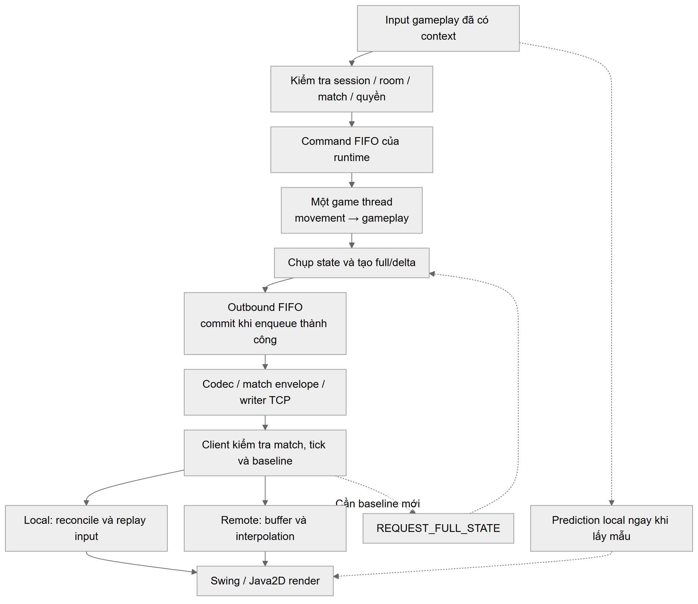

## 5.2. Server authoritative, GameLoop và concurrency

### 5.2.1. Quyền quyết định trạng thái

Trong kiến trúc server authoritative, client gửi ý định thao tác, còn server kiểm tra và quyết định trạng thái hợp lệ.
Client có thể dự đoán chuyển động để phản hồi input sớm, nhưng kết quả cuối cùng vẫn do server xác định.
[[2]](https://www.gabrielgambetta.com/client-server-game-architecture.html)
Bomb It áp dụng nguyên tắc này cho movement, collision, bom/item và kết quả trận.

### 5.2.2. Vòng cập nhật và bước thời gian

Game loop lặp lại việc nhận input, cập nhật trạng thái và tạo đầu ra; trong mô hình client–server,
server xuất state còn client đảm nhiệm hiển thị. [[8]](https://raw.githubusercontent.com/munificent/game-programming-patterns/master/book/game-loop.markdown)
Bước thời gian cố định giữ nguyên khoảng mô phỏng `Δt` giữa các lần cập nhật, nhưng không bảo đảm loop luôn chạy kịp thời gian thực.
[[9]](https://gafferongames.com/post/fix_your_timestep/)
Bomb It dùng nhịp mục tiêu 50 ms/tick (20 tick/giây), theo thứ tự command → movement → gameplay → snapshot.

### 5.2.3. Queue hữu hạn và quyền sở hữu state

Queue an toàn luồng hỗ trợ nhận command từ nhiều kết nối; `offer` trả về thất bại khi queue đầy thay vì chờ có chỗ trống.
[[10]](https://docs.oracle.com/en/java/javase/25/docs/api/java.base/java/util/concurrent/BlockingQueue.html)
Mỗi runtime Bomb It dùng một game thread cập nhật world, còn tầng mạng nhận snapshot bất biến.
Queue hữu hạn giúp kiểm soát tải nhưng vẫn có thể tồn đọng command.
Ở client Swing, thao tác giao diện được chuyển về Event Dispatch Thread (EDT) theo chính sách luồng của Swing.
[[11]](https://docs.oracle.com/en/java/javase/25/docs/api/java.desktop/javax/swing/package-summary.html)
Chi tiết queue và thread ownership trình bày ở mục 8 và 10.

### 5.2.4. Hitbox và va chạm trên tile map

Hitbox là vùng hình học đại diện phần không gian nhân vật chiếm chỗ. Va chạm phải xét toàn vùng này với vật cản và biên bản đồ, không chỉ ô chứa một điểm đại diện. Mô hình của Bomb It dùng hitbox chữ nhật trên lưới tile; chi tiết xử lý biên và bước di chuyển trình bày tại 10.4.3.

## 5.3. Full/delta, prediction, reconciliation và interpolation

### 5.3.1. Full snapshot và delta snapshot

Snapshot ghi nhận trạng thái tại một thời điểm để client tái dựng world.
[[12]](https://gafferongames.com/post/snapshot_interpolation/)
Full snapshot chứa đầy đủ phần state thuộc phạm vi đồng bộ; delta chỉ chứa thay đổi so với baseline.
Client phải có đúng baseline để áp dụng delta. [[3]](https://gafferongames.com/post/snapshot_compression/)
Nguyên lý được mô tả bằng:

`D_(b→t) = diff(S_b, S_t)`; `apply(S_b, D_(b→t)) = S_t`.

Phép `diff` cần biểu diễn cập nhật, thêm và xóa.
Trong Bomb It, delta gồm tile/player/entity; client kiểm tra `baseTick` và yêu cầu full khi baseline không khớp.
Full được dùng lúc khởi tạo, định kỳ và resync. Chi tiết format nằm ở mục 7.5 và 9.4.
Khi so sánh dung lượng phải tính cả lớp đóng gói: Base64 là phép biểu diễn dữ liệu, không phải thuật toán nén.
[[13]](https://www.rfc-editor.org/rfc/rfc4648.html)

### 5.3.2. Client-side prediction và server reconciliation

Prediction mô phỏng input local trước khi có phản hồi server.
Reconciliation dùng sequence và input cuối server đã xử lý để hiệu chỉnh: khôi phục state authoritative,
bỏ input đã ACK rồi replay input còn chờ. [[4]](https://www.gabrielgambetta.com/client-side-prediction-server-reconciliation.html)
Bomb It áp dụng cơ chế này cho nhân vật local. Do world phía client có thể chưa cập nhật kịp,
dự đoán vẫn có thể sai và cần hiệu chỉnh; mức cải thiện trải nghiệm phải được đánh giá riêng.

### 5.3.3. Interpolation cho thực thể từ xa

Interpolation hiển thị vị trí giữa các mẫu state đã nhận, phù hợp với nhân vật remote mà client không biết input tương lai.
[[5]](https://www.gabrielgambetta.com/entity-interpolation.html)
Client giữ một buffer snapshot và render lùi thời gian để có mẫu nội suy;
đánh đổi là chuyển động liên tục hơn khi đủ mẫu nhưng có thêm độ trễ hiển thị.
[[12]](https://gafferongames.com/post/snapshot_interpolation/)
Bomb It nội suy tuyến tính vị trí remote, chỉ thay đổi biểu diễn phía client, không thay state authoritative.

### 5.3.4. Phân biệt mục tiêu các kỹ thuật

**Bảng 5.1. So sánh các kỹ thuật đồng bộ theo mục tiêu sử dụng.**

| Kỹ thuật | Mục tiêu | Điều kiện/chi phí | Vai trò trong Bomb It |
|---|---|---|---|
| Full snapshot | Tái dựng nền đầy đủ | Dữ liệu lặp lại; không phụ thuộc baseline delta | Khởi tạo và phục hồi |
| Delta snapshot | Tránh gửi lại phần không đổi | Cần baseline khớp và metadata thay đổi [[3]](https://gafferongames.com/post/snapshot_compression/) | Đồng bộ tăng dần |
| Prediction + reconciliation | Phản hồi input local [[4]](https://www.gabrielgambetta.com/client-side-prediction-server-reconciliation.html) | Lịch sử input, replay và khả năng hiệu chỉnh | Nhân vật local |
| Interpolation | Làm mượt dữ liệu từ xa [[5]](https://www.gabrielgambetta.com/entity-interpolation.html) | Buffer và độ trễ hiển thị | Nhân vật remote |

Các kỹ thuật được phối hợp vì phục vụ những mục tiêu khác nhau.
Giảm byte snapshot không tự chứng minh giảm latency hoặc cải thiện độ mượt hiển thị.

### 6.1.2. Dữ liệu đầu vào cho movement và đồng bộ

Dữ liệu đầu vào gồm hướng, trạng thái đi/dừng và sequence của input, cùng yêu cầu đồng bộ lại khi client thiếu nền trạng thái hợp lệ.

### 6.1.3. Dữ liệu đầu ra cho movement và đồng bộ

Server công bố vị trí/trạng thái authoritative, sequence input cuối đã xử lý và full snapshot hoặc delta có mốc nền. Client sử dụng dữ liệu này để tái dựng world, hiệu chỉnh nhân vật local và hiển thị remote.

### 6.2.3. Movement và tính nhất quán trạng thái

Người chơi còn sống và được phép điều khiển có thể di chuyển hoặc dừng trong phạm vi bản đồ. Nhân vật không được vượt biên, đi xuyên tường cứng hoặc block chưa phá. Bom chặn việc đi vào; nhân vật đang chồng bom được bước ra nhưng không quay vào sau khi ra hết. Bản hiện tại không dùng va chạm giữa các player để cản đường nhau. Server quyết định vị trí cuối cùng; vị trí dự đoán trên client chỉ phục vụ phản hồi điều khiển.

## 6.3. Yêu cầu chức năng về movement và đồng bộ

| Mã | Yêu cầu chức năng | Điều kiện kiểm chứng |
|---|---|---|
| FR04 | Mỗi trận có world và runtime riêng | Thay đổi/dừng một trận không trực tiếp sửa state trận khác |
| FR05 | Di chuyển và dừng đúng quyền, trạng thái sống và vật cản | Không xuyên biên/tường/block/bom theo luật; player chết hoặc frozen không tiếp tục movement |
| FR10 | Client tái dựng đúng state từ full/delta hợp lệ và phục hồi khi thiếu baseline | Không áp delta sai nền hoặc update cũ; full hợp lệ thiết lập nền để tiếp tục đồng bộ |
| FR11 | Client hỗ trợ prediction/reconciliation cho local và interpolation cho remote | ACK loại input đã xử lý; respawn loại lịch sử cũ; dữ liệu hiển thị không thay quyền quyết định server |
| FR15 | Recovery giữ các bộ đếm trong cùng trận và chỉ cho điều khiển sau khi tái đồng bộ | ACK riêng lẻ chưa đủ; full phải áp dụng đúng context; không replay phím cũ hoặc áp lại effect gameplay |

Tính nhất quán ở đây là các client tái dựng cùng phần state được đồng bộ tại cùng mốc snapshot hợp lệ. Không yêu cầu mọi màn hình có cùng tọa độ hiển thị tại cùng thời điểm thực, vì local prediction và remote interpolation có timeline khác nhau.

## 7.1. Ý tưởng server authoritative và luồng input → state → client

Giải pháp dùng server làm nguồn quyết định gameplay; client gửi intent và dựng biểu diễn từ state được công bố, kết hợp prediction cho local và interpolation cho remote. Đây là ứng dụng mô hình server authoritative đã có trong tài liệu [2]. Dữ liệu được cập nhật theo chuỗi: kiểm tra quyền → command queue → movement/gameplay → snapshot → truyền → áp dụng replica → hiển thị. Full thiết lập nền; delta giảm phần dữ liệu không đổi khi nền đã hợp lệ.



*Hình 7.1. Luồng input → state → client trong giải pháp đề xuất.*

Yêu cầu resync được tiếp nhận qua tầng xử lý yêu cầu để đặt cờ tạo full; client không gọi trực tiếp builder.

## 7.3. Single-writer state, command queue và runtime theo phòng

Mỗi runtime giữ world riêng và một game thread cập nhật state. Network đưa command vào queue hữu hạn; tầng gửi nhận snapshot bất biến, không đọc trực tiếp world mutable. Command được xử lý theo FIFO và giới hạn công việc mỗi tick; chính sách giữ thứ tự có thể tạo backlog. Loop dùng bước mô phỏng cố định theo lựa chọn timestep [9]; nhịp cấu hình không phải cam kết thời gian thực.

**Thuật toán 7.1. Vòng cập nhật theo runtime.**

```text
while runtime đang chạy:
    chuẩn bị tick; đọc command theo FIFO và giới hạn lấy mẫu
    áp lifecycle/movement; chuyển command cho gameplay extension
    giữ player frozen ở trạng thái dừng; cập nhật movement
    cập nhật gameplay; tăng tick
    tạo update và công bố nếu outbound nhận được
    chờ lịch tick kế tiếp
finally: cleanup extension và command còn chờ
```

Không gọi sửa world từ callback mạng. Freeze/unfreeze cũng đi qua command queue; việc submit không thành công phải được tầng điều phối xử lý, không coi là đã áp dụng.

## 7.4. Movement/collision và đồng bộ phía client

### 7.4.1. Movement và collision

Server tính dịch chuyển từ hướng, tốc độ và bước mô phỏng, sau đó kiểm tra toàn bộ hitbox với biên map, tile và entity cản đường. Mẫu input đã xử lý không được dùng lại để tiến thêm bước. Kiểm tra theo bước nhỏ hạn chế việc bỏ qua vật cản; thông số bước và quy tắc kiểm tra mép hitbox được trình bày tại mục 10.4.3.

### 7.4.2. Prediction và reconciliation

Client mô phỏng input local, giữ lịch sử theo sequence và nhận ACK trong state server. Sau khi áp dụng snapshot hợp lệ, client cập nhật world dùng collision, khôi phục state authoritative, bỏ input đã ACK và replay phần còn chờ [4]. Respawn loại pending của đời sống trước nhưng không làm sequence quay lại. World client có thể chưa biết vật cản mới, nên hiệu chỉnh vẫn cần thiết.

### 7.4.3. Interpolation

Vị trí remote được nội suy giữa các mẫu đã nhận theo timeline hiển thị lùi [5]. Thiếu mẫu thì giữ endpoint theo chính sách hiện tại; respawn xóa lịch sử để tránh kéo hình nhân vật xuyên bản đồ. Phần này chỉ tác động đến render, không sửa replica authoritative hoặc kết quả gameplay. Dung lượng buffer và độ lùi hiển thị được trình bày tại mục 10.5.

## 7.5. State Delta Compression và phục hồi baseline

### 7.5.1. Ý tưởng và dữ liệu được đồng bộ

Nhóm kế thừa delta theo baseline [3], áp dụng cho tile, PlayerData, entity, trạng thái/frame gameplay và các khóa bị xóa. Baseline là ảnh đã công bố, không mặc định là tick ngay trước. Mục tiêu là `apply(B_b, Diff(B_b, C_t)) = C_t` trên phần state thuộc contract. PlayerData gồm ACK, nên đứng yên không đồng nghĩa không có thay đổi cần gửi.

### 7.5.2. Tạo update

**Thuật toán 7.2. Tạo full/delta.**

```text
C = chụp state cần đồng bộ tại tick t
if bắt buộc full hoặc chưa có baseline tương thích:
    U = full của C
else:
    tính upsert, tile thay đổi, khóa xóa và thay đổi frame/notice
    if không có thay đổi có ý nghĩa: không tạo update
    else: U = delta với baseTick của baseline đã commit
lưu U là pending; chưa chuyển baseline
```

### 7.5.3. Enqueue và commit

**Thuật toán 7.3. Công bố update.**

```text
if outbound.offer(U) thành công:
    commit đúng pending U; chuyển notices sang tầng gửi; cập nhật latest
else:
    giữ baseline/notices cũ; yêu cầu lại full nếu cần
```

Commit sau enqueue giữ baseline không tiến trước chuỗi update đã được nhận vào queue. Nó chưa xác nhận từng client đã nhận hoặc áp dụng. Tầng gửi phải giữ chuỗi FIFO; `latest/createUpdate()` không thay thế việc đọc các delta trung gian. Nếu một lần enqueue thất bại, tick sau so state hiện tại với baseline cũ.

### 7.5.4. Apply và resync

**Thuật toán 7.4. Áp dụng replica.**

```text
kiểm tra match và dữ liệu; loại update có tick cũ
if delta thiếu nền hoặc baseTick khác tick replica:
    giữ world cũ; đánh dấu cần full; yêu cầu resync
else:
    full thay nền; delta áp upsert/xóa rồi cập nhật tick
    cập nhật prediction/reconciliation và interpolation
```

Full hợp lệ khôi phục nền; delta sau đó phải tham chiếu nền tương ứng. Callback recovery còn yêu cầu gate riêng ở 7.8. Payload không decode được đi theo đường lỗi, không mặc nhiên sửa được bằng resync. Do baseline dùng chung runtime, full phục hồi có thể được gửi tới cả roster.

### 7.5.5. Đánh đổi

Diff vẫn quét/chụp state và giữ baseline/pending; giảm byte không đồng nghĩa giảm CPU hoặc bộ nhớ. Nhiều record đổi có thể làm delta kém lợi; implementation chưa encode cả full và delta để chọn gói nhỏ nhất. Chi tiết layout và Base64 thuộc chương 9; Base64 là lớp biểu diễn [13]. Phương pháp đo thuộc chương 11, kết quả thuộc chương 12, đóng góp thuộc chương 14.

### 7.8.2. Freeze/unfreeze và nền đồng bộ

Khi lobby chấp nhận giữ player offline, nó submit command disconnect để game thread đóng băng điều khiển, giữ player trong world. Khi nhận lại phiên hợp lệ, command reconnect gỡ frozen và yêu cầu full; không tạo runtime mới. Tầng snapshot giữ barrier để bỏ các update cũ đối với người đang phục hồi, chỉ khởi tạo lại đường nhận sau khi enqueue full mới vượt barrier. Đây là gate công bố phía server, chưa phải xác nhận client đã áp dụng full. Gameplay vẫn được extension cập nhật trong khoảng mất mạng; bom, sát thương và timer không dừng theo trạng thái kết nối của player.

### 7.8.3. Input và dữ liệu client sau recovery

Client khóa input, xóa phím giữ/tác vụ gửi cũ và pending prediction/interpolation, đồng thời giữ controller, context, sequence MOVE và request counter bom. Replica được đánh dấu cần full nhưng có thể giữ world cũ để hiển thị trạng thái đang phục hồi. Sau ACK và metadata đúng phiên/trận, chỉ full hợp lệ đã áp dụng, đúng `lastAppliedFullTick` và không còn thiếu nền mới cho phép resume khi match còn RUNNING. ACK, delta hoặc full stale không mở input. Client lấy mẫu thao tác mới, không replay mọi phím trong thời gian offline; trạng thái sống vẫn được kiểm tra khi movement/đặt bom. Full cung cấp state hiện tại, không áp lại damage/pickup đã xảy ra.

## 8.3. Model, state, runtime và movement

| Thành phần | Trách nhiệm | Ranh giới dữ liệu |
|---|---|---|
| Direction, TilePosition, TileType | Thống nhất hướng, tọa độ ô và loại nền | Enum/giá trị bất biến dùng chung |
| GameState/GameMap/Player | Giữ world đang mô phỏng | Mutable, thuộc game thread sau khởi tạo |
| GameCommand | Chuyển intent/lifecycle từ bên ngoài vào runtime | Dữ liệu lệnh; không mang socket/UI |
| GameRuntime/GameRuntimeManager | Tạo, tìm, submit và dừng runtime theo room | State/map/loop riêng; resume dùng lại runtime còn giữ |
| MovementSystem/CollisionSystem | Tính dịch chuyển và kiểm tra vùng chiếm chỗ | Chỉ cập nhật world trong bước mô phỏng |
| StateDeltaBuilder/GameStateUpdate | Chụp state, tạo và công bố full/delta | Snapshot không đưa tham chiếu Player/map mutable cho network |

Tầng mạng giao tiếp với runtime bằng submit/poll update/request full; không đọc GameState trực tiếp. Chi tiết pipeline đã có ở chương 7, API/cấu hình ở chương 10.

## 8.6. Thread và quyền sửa state

Reader/handler xác thực yêu cầu rồi enqueue command; game thread của runtime là nơi áp dụng command và cập nhật world. Snapshot được chuyển giao qua outbound FIFO cho consumer gửi, còn client đưa cập nhật UI về EDT. Queue thread-safe không biến các phần tử mutable thành an toàn chia sẻ: dữ liệu qua ranh giới phải là command hoặc snapshot phù hợp. Một snapshot mới nhất không thay thế được chuỗi delta. Callback disconnect/reconnect đi qua command queue và snapshot barrier như 7.8.

## 9.4. MOVE, sequence/ACK và đồng bộ snapshot

### 9.4.1. MOVE và sequence/ACK

MOVE gửi hướng, moving và sequence dương, không gửi tọa độ authoritative. Server bỏ sequence đã xử lý; ACK nằm trong PlayerData sau xử lý mô phỏng, không có MOVE_ACK riêng và không dùng ACK TCP thay nó. Mỗi tick tối đa một mẫu movement mới thành công/player theo FIFO; không có mẫu sequenced mới thì không tự mô phỏng thêm một bước. Reconnect cùng trận giữ sequence; lượt mới có context mới.
### 9.4.2. Tick và baseTick

Tick đánh dấu ảnh state; full có `baseTick=-1`. Delta có `0≤baseTick<tick` và chỉ được áp khi baseTick khớp tick replica. Baseline có thể cách nhiều tick vì update rỗng không được công bố.
### 9.4.3. Snapshot và biểu diễn xóa

Record không xuất hiện trong delta được giữ; xóa phải qua danh sách ID/khóa xóa. Full hợp lệ thay nền, delta upsert/xóa. Kiểm tra stale, match, kích thước và payload diễn ra trước khi chấp nhận state mới.
### 9.4.4. Phục hồi baseline

Thiếu nền giữ replica cũ và yêu cầu full theo gate hiện hành; không rewind server theo tick client. `createUpdate()` có thể là delta và không được dùng như full resync.
### 9.4.5. Điều kiện áp dụng full khi recovery

Sau khi xác nhận đúng epoch, ACK và metadata, client vẫn cần full đã áp thành công; gate server “enqueue full” và gate client “apply full” khác nhau. Full hợp lệ trong GAME_SNAPSHOT cũng phải qua kiểm tra kind/tick/context như FULL_STATE_SYNC; không mở input chỉ từ tên packet.

## 10.3. State, command queue và runtime

`Direction`/`TileType` là enum và `TilePosition` là record. `GameMap` lưu tile theo `[y][x]`; `Player.x/y` là góc trên trái hitbox, thao tác theo ô dùng tâm hitbox. World mutable thuộc game thread. Model lồng cũ còn bridge deprecated, không nhận đã xóa toàn bộ API tương thích.

`GameCommand` hiện là sealed class với các subclass final cho move, stop, plant, disconnect và reconnect. Core khai báo contract đặt bom, còn gameplay extension thực thi luật đặt bom. Runtime giữ mapping session→numeric player ID và matchId riêng; manager tạo map/state/extension riêng theo room. Recovery cùng trận dùng lại runtime đang được giữ.

| Tham số/API hiện hành | Giá trị hoặc ý nghĩa |
|---|---|
| Bước mô phỏng | 50 ms, nhịp mục tiêu 20 Hz |
| Queue command / outbound | 4096 / 1024 phần tử mặc định |
| Giới hạn xử lý tick | Tối đa 256 command; một mẫu sequenced thành công/player, dừng đọc nếu head FIFO là mẫu tiếp của player đã lấy mẫu |
| submit | Offer không đợi chỗ; trả false khi không nhận; counter queue-full khác trường hợp runtime đã dừng |
| createUpdate / pollUpdate | Ảnh công bố gần nhất / đọc chuỗi outbound; không trả GameState |
| requestFullState | Đặt cờ, không gửi socket trực tiếp |
| stop | Interrupt và join tối đa 2 giây khi gọi từ thread khác; báo lỗi nếu thread chưa dừng |

Loop không chạy bù đầy đủ mọi tick bị trễ; nhịp 20 Hz là cấu hình. Lifecycle extension chạy trên game thread. Freeze/unfreeze do command xử lý trước movement, không biến attach socket thành quyền sửa Player.

## 10.4. Movement/collision và xuất bản snapshot

`MovementSystem` chỉ áp input khi match RUNNING và player còn sống, loại sequence cũ và cập nhật ACK cho input mới. Stop tắt movement intent. Bước update kiểm tra `dt` hữu hạn/không âm và chặn tối đa 0,1 giây. Input mạng cần mẫu mới của tick, không dùng mãi hướng cũ khi thiếu input.

`CollisionSystem` xét toàn bộ hitbox, chặn ngoài map, hard wall, breakable block và overlap mới với bom. Dịch chuyển theo từng trục được chia thành bước tối đa 1 pixel; mép phải/dưới dùng `Math.nextDown` để không chiếm nhầm ô sát cạnh. Người đang overlap bom được đi ra; chưa có collision cản player với player. 

`StateDeltaBuilder` chụp tile/PlayerData/entity và so với baseline đã commit. Player so cả ACK và tọa độ chính xác; entity dùng key kind+ID và danh sách xóa. `GameStateUpdate` cung cấp snapshot bất biến theo API, không trả Player hoặc map gốc. Commit chỉ xảy ra sau `outbound.offer` thành công và phải đúng pending instance; queue đầy giữ baseline/notices để tick sau build lại từ world hiện tại.

Full được ép ở tick đầu, mỗi 100 tick, theo yêu cầu và khi FINISHED; 100 tick chỉ tương đương khoảng 5 giây khi loop chạy kịp. Update không đổi có thể bị bỏ. Builder chưa dùng dirty tracking, quantization hoặc tự chọn full/delta theo size nhỏ nhất.

`SnapshotPacketCodec` tạo binary big-endian rồi Base64/JSON; encoder phát v2, v3 hoặc v5 tùy frame và decoder nhận v2–v5. Framing và match envelope do tầng protocol xử lý như trình bày tại chương 9 và mục 10.8. Recovery dùng lại snapshot full, không tạo layout world mutable riêng.

## 10.5. Replica, prediction, reconciliation và interpolation

| Class | Trách nhiệm và lựa chọn triển khai |
|---|---|
| InputController | Timer lấy mẫu 50 ms; phím nhấn sau ưu tiên; mất focus/generation đổi thì xóa phím giữ |
| ClientWorldState | Loại stale, kiểm tra baseline/kích thước rồi apply; NEED_FULL giữ world cũ để vẽ |
| PredictionController | Mô phỏng local bước 0,05 s; pending theo sequence, tối đa 256; không dự đoán damage/bom |
| ReconciliationController | Cập nhật world collision, restore state server và replay pending chưa ACK; chưa có correction smoothing riêng |
| InterpolationController | Tối đa 32 frame; nội suy tuyến tính, giữ endpoint khi thiếu mẫu; xóa lịch sử khi respawn/recovery |
| MovementClientController | Sender một thread/queue 256, replica/controller và gate recovery; không sở hữu vòng đời ClientNetwork dùng chung |

Render timeline lùi hai tick với mức tiến bị chặn khi thiếu update; đây không phải bảo đảm hiển thị trễ đúng 100 ms. Respawn loại pending/lịch sử của vị trí cũ nhưng sequence không lùi. Local player chết không tiếp tục predict movement.

Trên đường lobby, application owner dispatch packet cho controller có `subscribe=false` để tránh hai listener cùng apply. Đóng controller dừng sender/listener do nó sở hữu, không đóng ClientNetwork dùng chung.

Trong recovery, `suspendForRecovery()` tăng input generation và bỏ task chờ; task đã lấy ra còn kiểm tra generation trước send. `prepareRecoveryOnUi()` đặt requireFullState, xóa pending/interpolation nhưng giữ controller/counter. Full áp thành công cập nhật `lastAppliedFullTick`; `resumeAfterRecovery()` kiểm tra điều kiện trước khi mở lại. `isInputReady()` xét trạng thái controller/replica/match; kiểm tra còn sống nằm ở movement/prediction/plantBomb. Cơ chế này không thu hồi được lệnh đã tới server trước disconnect.

### 10.7.1. Player và HUD

`TileGridRenderer` lấy map từ replica; ô local được đánh dấu theo vị trí server xác nhận. `MovementGameWindow` vẽ local theo prediction và remote theo interpolation; HUD lấy timer/lives/shield/quota/range/speed authoritative. Timer repaint 16 ms là lịch yêu cầu vẽ, không phải số đo 60 FPS. Input và Space đều đi qua readiness; lớp hiển thị recovery giữ cửa sổ/world cũ nhưng không tự cấp quyền gửi lệnh.

## 11.5. Thiết kế đối chứng full–delta

B0 tạo full mỗi tick; B1 dùng full đầu/định kỳ, delta khi state đổi và bỏ update rỗng. Hai nhánh đọc cùng state tại cùng tick, cùng codec và envelope trong từng cấu hình. Tổng byte tính cả full của B1; kịch bản nào có resync phải tính full resync. Tỷ lệ giảm là `100 × (1 − B1/B0)`, với B0 dương; không lấy trung bình phần trăm từng gói hoặc trộn D0 và D1 thành một đối chứng.

Phạm vi byte là frame ứng dụng sau binary/Base64/JSON/envelope/framing, chưa gồm TCP/IP/retransmission/notice riêng. D0 dùng v2, một player, 200 tick; D1 dùng v5, 2/4 player, 600 tick với ba trace idle/movement/sự kiện. Mỗi cấu hình có năm lần lặp size. Trace sự kiện D1 dựng state theo script, không chạy gameplay tự nhiên. Bản full/delta được decode/apply rồi so sánh state chuẩn hóa mỗi tick; bỏ metadata tick và clock BombFrame trong equality, vẫn kiểm tra state/gameplay được đồng bộ. Năm lần fixture xác định không thay cho phép đo biến thiên mạng.

## 12.2. Movement, runtime và replica

Lượt kiểm thử sau sửa recovery ngày 27/10/2026 đạt 171/171 JUnit trong 44 class ngoài sandbox. Các lớp trong bảng dưới là tập con của lượt chạy này. Chúng xác nhận cách ly runtime, FIFO theo thứ tự enqueue, queue nhiều producer, snapshot cũ không đổi, collision và lifecycle; phía client có kiểm tra ACK/replay, respawn và baseline/resync. Kết quả assertion không thay cho nghiệm thu GUI/LAN hoặc phép đo UX.

| Lớp kiểm thử | Số test đạt | Phạm vi kiểm chứng |
|---|---:|---|
| RuntimeContractTest | 1/1 | Gọi check runtime/queue/thread/snapshot và hai runtime |
| MovementFeatureTest | 1/1 | Gọi check movement/collision/prediction/interpolation |
| MovementBalanceTest | 4/4 | Cấu hình hitbox/tốc độ và movement trong fixture |
| MovementDemoTest | 8/8 | Movement/STOP/collision/TCP và resync theo fixture |
| RespawnPredictionTest | 2/2 | Loại pending/lịch sử cũ và giữ sequence |
| DeltaCompressionTest | 1/1 | Baseline, build/commit, xóa và full phục hồi |
| RecoveryInputTest | 2/2 | Xóa phím theo generation, khóa input qua recovery |
| RecoveryGameplayIntegrationTest | 8/8 | Giữ runtime/controller/counter, đối chiếu full và tiếp tục delta sau full trong fixture recovery |

Một số lớp JUnit gọi lại check main tương ứng, nên chạy check riêng không tạo thêm coverage độc lập. Số đếm từng lớp và XML được lưu trong [class-results.csv](../evidence/recovery-report-task03-20261027-200413/class-results.csv) và [surefire](../evidence/recovery-report-task03-20261027-200413/surefire/). Suite baseline 133/133 trước recovery thuộc revision khác, được lưu riêng trong [hồ sơ baseline](../evidence/task12-2026-10-26/junit-summary.json).

## 12.5. Kết quả full–delta

Mỗi cấu hình được chạy năm lần: D0 giảm 85,09%; sáu cấu hình D1 giảm 35,98–97,54% tổng byte frame snapshot. D1 hoàn tất 18.000/18.000 đối chiếu state chuẩn hóa trong 30 scenario-run. Các phép đối chiếu này thuộc harness, không phải JUnit mới hoặc phép đo latency. Tổng byte và kết quả từng lần được lưu trong [summary.csv](../evidence/task13-2026-10-26/summary.csv) và [all-runs.csv](../evidence/task13-2026-10-26/all-runs.csv).

Phép đo gộp lợi ích diff và bỏ tick rỗng. Idle không phát MOVE khác GUI lấy mẫu đứng yên; movement làm PlayerData/ACK đổi thường xuyên; trace sự kiện có đoạn dài ít thay đổi. Harness D1 không đi qua queue/socket, không tính traffic notice hay nhân số receiver. Chưa đo CPU/GC/bộ nhớ, workload resync dày hoặc A/B latency có recovery. Phạm vi kết luận vì vậy giới hạn ở tính đúng replica và dung lượng snapshot trên các trace đã đo.

### 12.8.3. Tính đúng của state và input sau recovery

Kết quả `multi_input_bomb` trong [case-results.csv](../evidence/recovery-report-task03-20261027-200413/case-results.csv) ghi ba chu kỳ reconnect, ba full bằng replica peer tại cùng tick và ba lần delta tiếp tục sau full; các bộ đếm input/request được giữ để thao tác mới còn hợp lệ. Equality full tại fixture này so cả map/player/entity/frame và ACK theo assertion, khác phép chuẩn hóa metadata của harness D1. Kết quả xác nhận các invariant state/input/baseline trong fixture cục bộ; ba chu kỳ không đại diện cho tỷ lệ phục hồi thành công trên mạng thật.

## 13.2. Lợi ích và chi phí delta

Delta có lợi khi phần state thay đổi ít so với full hoặc có nhiều tick không cần phát update. Lợi ích giảm khi PlayerData/ACK và frame gameplay đổi thường xuyên; tăng số player không làm phần dữ liệu cần gửi giữ nguyên. Idle của harness cũng khác client GUI vẫn lấy mẫu input, nên không dùng một workload ít thay đổi làm đại diện cho toàn bộ trận chơi.

Đổi lại, server phải chụp/so sánh state và giữ baseline/pending; hệ thống còn trả chi phí encode/đóng gói và full phục hồi. Một delta với nhiều record đổi có thể lớn hơn full, trong khi code chưa tự chọn gói nhỏ nhất. Các phép đo hiện tại xác nhận byte snapshot trên trace đã chọn; chưa xác nhận CPU, RAM hoặc latency giảm tương ứng. Full phát thêm khi recovery có thể ảnh hưởng cả roster, nên số đo delta cũ không tự áp cho workload reconnect.

## 13.3. Tick, backlog và correction

Input phải đi qua queue và lịch tick trước khi trở thành state authoritative; RTT thấp không loại bỏ thời gian chờ này. Giới hạn một mẫu sequenced/player/tick và giữ head FIFO bảo toàn thứ tự nhưng có thể làm command phía sau cùng chờ. Queue hữu hạn làm quá tải quan sát được bằng từ chối/backlog, không chứng minh mọi lệnh xử lý ngay tick kế hoặc các room scale tuyến tính.

Prediction giúp phản hồi local trước ACK nhưng world replica có thể thiếu vật cản mới; correction vì vậy vẫn xuất hiện. Interpolation cần buffer và đánh đổi độ trễ hiển thị, có thể giữ endpoint khi thiếu mẫu. Test state/ACK/respawn xác nhận logic fixture, chưa đo độ giật, correction người dùng thấy hoặc độ mượt GUI. Vì vậy cần phân biệt tính đúng dữ liệu với chất lượng trải nghiệm.

## 14.2. State Delta Compression

Đóng góp của nhóm là hiện thực delta trên state Bomb It và tích hợp với ranh giới xuất bản: diff tile/player/entity, biểu diễn xóa, baseline chỉ commit khi outbound nhận update, replica kiểm tra nền và full/resync để phục hồi. Delta theo baseline là phương pháp kế thừa [3]; phần nhóm làm nằm ở contract, code và kiểm chứng trong project.

Baseline là mốc công bố chung runtime, không phải snapshot mới nhất đã được từng client ACK receipt. Thiết kế cần giữ chuỗi update và full phục hồi; enqueue không chứng minh remote apply. Kết quả thực nghiệm ở mục 12.5 cho thấy giảm tổng byte trên các trace đã đo, kèm đối chiếu replica; chưa chứng minh mọi packet 50–100 byte, giảm latency tương ứng hay tối ưu CPU/bộ nhớ. Đóng góp được đánh giá qua hành vi đồng bộ và kết quả kiểm chứng, thay vì số lượng lớp hoặc dòng code.

## 14.5. Phục hồi runtime và trạng thái client

Phần runtime/client hỗ trợ recovery gồm đưa freeze/unfreeze qua game thread, tạo full mới để thiết lập lại nền, giữ controller/sequence/request counter và khóa input tới khi full đúng context áp dụng thành công. Các assertion full→delta và input/counter trong RecoveryGameplayIntegrationTest hỗ trợ đóng góp tích hợp này. Cơ chế runtime/client kết hợp với session và transport để tái lập khả năng điều khiển trên nền state hợp lệ; nó không phát lại toàn bộ thao tác trong thời gian offline.

### 15.1.3. Hạn chế đồng bộ, tài nguyên và hiển thị

| Hạn chế | Ảnh hưởng và giới hạn kết luận |
|---|---|
| Delta so theo tile/record, chưa tự chọn full theo size (L03) | Nhiều record đổi có thể kém lợi; không bảo đảm gói nhỏ nhất |
| Chưa đo CPU/GC và thời gian capture/diff/encode | Giảm byte chưa chứng minh giảm chi phí tính toán |
| Baseline/pending và queue giữ dữ liệu trong bộ nhớ | Queue hữu hạn vẫn có thể chiếm nhiều byte; chưa có số đo RAM theo tải |
| Commit theo queue chung, chưa ACK snapshot từng receiver (L04) | Thiếu chuỗi delta cần full; recovery có thể phát full cho cả roster |
| FIFO và lấy mẫu có thể gây backlog (L05) | Input chờ thêm tick; chưa chứng minh fairness hoặc tải tối đa |
| Chưa correction smoothing riêng (L06) | Hiệu chỉnh state đúng vẫn có thể giật hình |
| Buffer nội suy hữu hạn, giữ endpoint khi thiếu mẫu (L06) | Remote có thể đứng hình hoặc thêm độ trễ |

Các kết quả hiện tại chưa định lượng chi phí CPU/GC, bộ nhớ baseline/queue hoặc chất lượng hiển thị. Kiểm thử runtime và replica đạt không thay thế cho các phép đo này.

## 16.2. Tối ưu đồng bộ, tài nguyên và hiển thị

| Hướng phát triển | Tiêu chí kiểm chứng |
|---|---|
| Tối ưu lựa chọn dữ liệu/full–delta | Đo nhiều mật độ thay đổi; thử chọn full/delta theo size hoặc dirty tracking, giữ equality replica và tính cả chi phí encode |
| Đánh giá chi phí CPU/GC | Profile theo map/player/entity, báo thời gian từng pha và tick overrun cùng môi trường/workload |
| Kiểm soát chi phí bộ nhớ | Đo retained/peak heap, queue depth và allocation; chỉ tối ưu copy/buffer sau khi giữ được tính bất biến |
| Mở rộng chính sách baseline khi cần | Đo full/resync theo receiver; nếu đổi sang baseline riêng cần version/ACK/bộ nhớ có giới hạn và test client chậm/reconnect |
| Đánh giá lịch xử lý command | Đo queue age/depth, rejected và input→ACK/tick overrun; thử chính sách mới nhưng giữ thứ tự/ACK/lifecycle |
| Làm mượt correction local | Đo correction trước/sau replay và vị trí render; thử smoothing, giữ state authoritative tách khỏi vị trí trình bày |
| Nội suy thích ứng | Đo sample gap/buffer underflow và render delay; thử buffer thích ứng, xóa lịch sử khi respawn/recovery |

Các hướng phát triển cần được đánh giá trên cùng workload và môi trường xác định, đồng thời giữ invariant sequence/ACK, baseline và vòng đời respawn/recovery.
