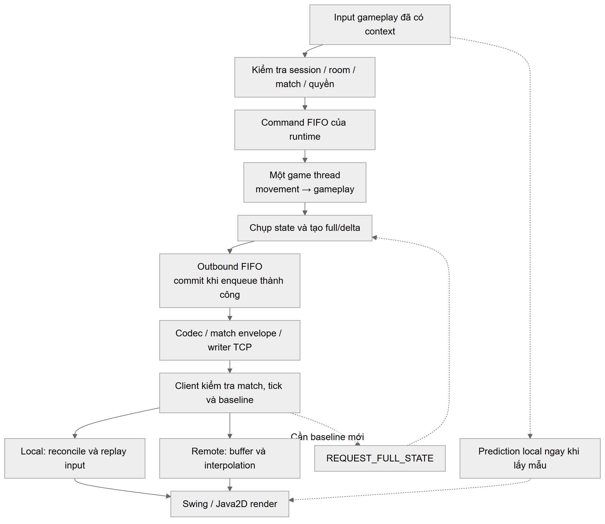
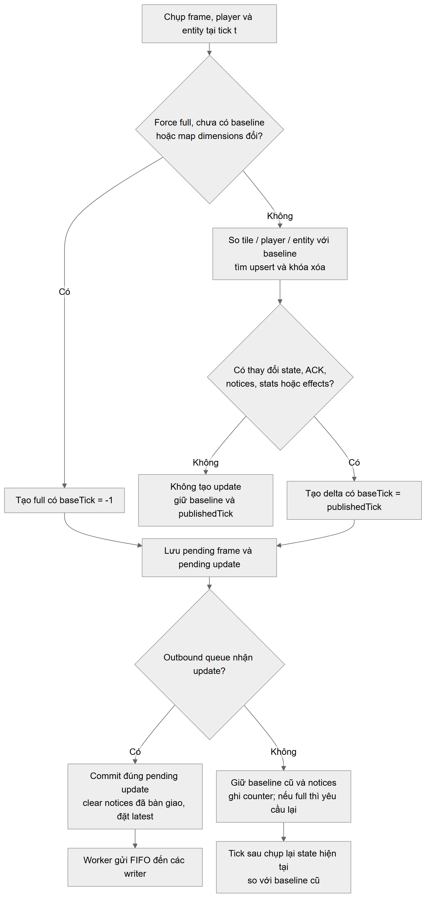

# VỊ TRÍ VÀ NỘI DUNG THAY THẾ — PHẦN CHINH

Mỗi khối ghi rõ ranh giới thao tác. Chỉ copy phần nằm giữa **BẮT ĐẦU NỘI DUNG BÁO CÁO** và **KẾT THÚC NỘI DUNG BÁO CÁO**. Phần vị trí/phạm vi/giữ nguyên là chỉ dẫn riêng, không dán vào báo cáo. Khối “giữ nguyên” không có nội dung thay thế.

Các vị trí được kiểm tra theo hệ thống mục trong bản chương nguồn của báo cáo. Không hiểu tiêu đề một mục lớn là yêu cầu xóa tất cả mục con: loại thao tác và ranh giới ghi tại từng khối mới là phạm vi áp dụng.

| Khối | Vị trí | Thao tác |
|---|---|---|
| S01 | 5.2 | THAY TOÀN BỘ MỤC |
| S02 | 5.4.1 | CHỈ XÓA ĐOẠN |
| S03 | 5.3 | THAY TOÀN BỘ MỤC |
| S04 | 6.1.2 / Bảng 6.1 | CHỈ THAY DÒNG BẢNG |
| S05 | 6.1.2 | CHỈ THAY ĐOẠN/CÂU |
| S06 | 6.1.3 / Bảng 6.2 | CHỈ THAY DÒNG BẢNG |
| S07 | 6.1.3 | CHỈ THAY ĐOẠN/CÂU |
| S08 | 6.2.3 | THAY TOÀN BỘ MỤC |
| S09 | 6.3 / Bảng 6.5 | CHỈ THAY DÒNG BẢNG |
| S10 | 6.3 / FR15 | CHÈN ĐOẠN/CÂU |
| S11 | 7.1 | THAY TOÀN BỘ MỤC |
| S12 | 7.3 | THAY TOÀN BỘ MỤC |
| S13 | 7.4 | THAY TOÀN BỘ MỤC |
| S14 | 7.5 | THAY TOÀN BỘ MỤC |
| S15 | 7.8.2 | CHỈ THAY ĐOẠN/CÂU |
| S16 | 7.8.3 | CHÈN ĐOẠN/CÂU |
| S17 | 8.3 | THAY TOÀN BỘ MỤC |
| S18 | 8.6.1 | CHÈN ĐOẠN/CÂU |
| S19 | 9.4 | GIỮ NGUYÊN — KHÔNG DÁN |
| S20 | 10.3 | THAY TOÀN BỘ MỤC |
| S21 | 10.4 | THAY TOÀN BỘ MỤC |
| S22 | 10.5 | THAY TOÀN BỘ MỤC |
| S23 | 10.7.1 | GIỮ NGUYÊN — KHÔNG DÁN |
| S24 | 11.5.1 | THAY TOÀN BỘ MỤC |
| S25 | 11.5.2 | CHỈ THAY ĐOẠN/CÂU |
| S26 | 11.5.3 | THÊM MỤC CON |
| S27 | 12.2 | CHÈN ĐOẠN/CÂU |
| S28 | Bảng 12.3 / cột 4 | CHỈ THAY Ô HEADER |
| S29 | Bảng 12.4 / cột 3 | CHỈ THAY Ô HEADER |
| S30 | 12.2.3 | THÊM MỤC CON |
| S31 | 12.5.1 | THAY TOÀN BỘ MỤC |
| S32 | 12.5.2–12.5.5 | GIỮ NGUYÊN — KHÔNG DÁN |
| S33 | 12.8.3 | CHÈN ĐOẠN/CÂU |
| S34 | 13.2 | THAY TOÀN BỘ MỤC |
| S35 | 13.3 | THAY TOÀN BỘ MỤC |
| S36 | 14.2 | GIỮ NGUYÊN — KHÔNG DÁN |
| S37 | 14.5 | CHÈN ĐOẠN/CÂU |
| S38 | 15.1.3 / Bảng 15.1 | CHỈ THAY DÒNG BẢNG |
| S39 | 16.2.1–16.2.3 | GIỮ NGUYÊN — KHÔNG DÁN |
| S40 | 16.2.4 | THÊM MỤC CON |

# S01 — 5.2

> **Vị trí:** Chương 5 → mục 5.2.

> **Thao tác:** THAY TOÀN BỘ mục 5.2: từ tiêu đề “5.2. Server authoritative, GameLoop và concurrency” đến ngay trước “5.3. Full/delta, prediction, reconciliation và interpolation”. Bao gồm các mục con, bảng/hình và đoạn văn nằm trong phạm vi đó; không xóa tiêu đề kế tiếp hoặc ghi chú phân công của mục kế tiếp. Bản mới có 5.2.1–5.2.4; không tạo thêm một mục 5.2 thứ hai.

> **Phần phải giữ:** Giữ 5.1, 5.3 và các mục khác ngoài phạm vi. Mục mới 5.2.4 nằm bên trong phần thay thế này.

> **Đối chiếu mục gốc:** [05_CO_SO_LY_THUYET_VA_CONG_TRINH_LIEN_QUAN.md](../chapters/05_CO_SO_LY_THUYET_VA_CONG_TRINH_LIEN_QUAN.md).

> **BẮT ĐẦU NỘI DUNG BÁO CÁO**

## 5.2. Server authoritative, GameLoop và concurrency

### 5.2.1. Quyền quyết định trạng thái

Trong kiến trúc server authoritative, client gửi ý định thao tác, còn server kiểm tra và quyết định trạng thái hợp lệ.
Client có thể dự đoán chuyển động để phản hồi input sớm, nhưng kết quả cuối cùng vẫn do server xác định.
[[2]](https://www.gabrielgambetta.com/client-server-game-architecture.html)
Bomb It áp dụng nguyên tắc này cho movement, collision, bom/item và kết quả trận.

### 5.2.2. Vòng cập nhật và bước thời gian

Game loop lặp lại việc nhận input, cập nhật trạng thái và tạo đầu ra; trong mô hình client–server,
server xuất state còn client đảm nhiệm hiển thị. [[8]](https://raw.githubusercontent.com/munificent/game-programming-patterns/master/book/game-loop.markdown)
Bước thời gian cố định giữ nguyên khoảng mô phỏng `Δt` giữa các lần cập nhật, nhưng không bảo đảm loop luôn chạy kịp thời gian thực.
[[9]](https://gafferongames.com/post/fix_your_timestep/)
Bomb It dùng nhịp mục tiêu 50 ms/tick (20 tick/giây), theo thứ tự command → movement → gameplay → snapshot.

### 5.2.3. Queue hữu hạn và quyền sở hữu state

Queue an toàn luồng hỗ trợ nhận command từ nhiều kết nối; `offer` trả về thất bại khi queue đầy thay vì chờ có chỗ trống.
[[10]](https://docs.oracle.com/en/java/javase/25/docs/api/java.base/java/util/concurrent/BlockingQueue.html)
Mỗi runtime Bomb It dùng một game thread cập nhật world, còn tầng mạng nhận snapshot bất biến.
Queue hữu hạn giúp kiểm soát tải nhưng vẫn có thể tồn đọng command.
Ở client Swing, thao tác giao diện được chuyển về Event Dispatch Thread (EDT) theo chính sách luồng của Swing.
[[11]](https://docs.oracle.com/en/java/javase/25/docs/api/java.desktop/javax/swing/package-summary.html)
Chi tiết queue và thread ownership trình bày ở mục 8 và 10.

### 5.2.4. Hitbox và va chạm trên tile map

Hitbox là vùng hình học đại diện phần không gian nhân vật chiếm chỗ. Va chạm phải xét toàn vùng này với vật cản và biên bản đồ, không chỉ ô chứa một điểm đại diện. Mô hình của Bomb It dùng hitbox chữ nhật trên lưới tile; chi tiết xử lý biên và bước di chuyển trình bày tại 10.4.3.

> **KẾT THÚC NỘI DUNG BÁO CÁO**


# S02 — 5.4.1

> **Vị trí:** Chương 5 → 5.4.1 → đoạn hitbox/collision.

> **Thao tác:** XÓA CHỈ đoạn cũ được định vị bên dưới sau khi đã đưa nguyên lý vào 5.2.4 và chi tiết vào 10.4.3. Không xóa toàn bộ 5.4.1.

> **Phần phải giữ:** Giữ đoạn mô hình tile/entity trước nó; giữ 5.4.2 về timer/bom và 5.4.3 về state/event để các chủ phần xử lý theo phân công.

> **Đối chiếu mục gốc:** [05_CO_SO_LY_THUYET_VA_CONG_TRINH_LIEN_QUAN.md](../chapters/05_CO_SO_LY_THUYET_VA_CONG_TRINH_LIEN_QUAN.md).

> **Tìm đúng phần cũ:** bắt đầu “Nhân vật có hitbox hình chữ nhật. Kiểm tra va chạm cần xét các ô hitbox phủ lên,”; kết thúc “thể từ [CollisionSystem](../../src/main/java/com/bombit/server/game/movement/CollisionSystem.java), không phải tuyên bố rằng mọi game bản đồ ô đều dùng cùng thuật toán.”.

> **Chỉ xóa đúng phần đã định vị; không có đoạn thay thế ở vị trí cũ.**


# S03 — 5.3

> **Vị trí:** Chương 5 → mục 5.3.

> **Thao tác:** THAY TOÀN BỘ mục 5.3: từ tiêu đề “5.3. Full/delta, prediction, reconciliation và interpolation” đến ngay trước “5.4. Tile map, bom, timer và event gameplay”. Bao gồm các mục con, bảng/hình và đoạn văn nằm trong phạm vi đó; không xóa tiêu đề kế tiếp hoặc ghi chú phân công của mục kế tiếp. Bản mới gồm 5.3.1–5.3.4; chỉ phần lý thuyết được rút theo yêu cầu.

> **Phần phải giữ:** Giữ 5.4 trở đi. Bảng 5.1 đã nằm đầy đủ trong nội dung thay thế; không giữ thêm bản Bảng 5.1 cũ bên dưới.

> **Đối chiếu mục gốc:** [05_CO_SO_LY_THUYET_VA_CONG_TRINH_LIEN_QUAN.md](../chapters/05_CO_SO_LY_THUYET_VA_CONG_TRINH_LIEN_QUAN.md).

> **BẮT ĐẦU NỘI DUNG BÁO CÁO**

## 5.3. Full/delta, prediction, reconciliation và interpolation

### 5.3.1. Full snapshot và delta snapshot

Snapshot ghi nhận trạng thái tại một thời điểm để client tái dựng world.
[[12]](https://gafferongames.com/post/snapshot_interpolation/)
Full snapshot chứa đầy đủ phần state thuộc phạm vi đồng bộ; delta chỉ chứa thay đổi so với baseline.
Client phải có đúng baseline để áp dụng delta. [[3]](https://gafferongames.com/post/snapshot_compression/)
Nguyên lý được mô tả bằng:

`D_(b→t) = diff(S_b, S_t)`; `apply(S_b, D_(b→t)) = S_t`.

Phép `diff` cần biểu diễn cập nhật, thêm và xóa.
Trong Bomb It, delta gồm tile/player/entity; client kiểm tra `baseTick` và yêu cầu full khi baseline không khớp.
Full được dùng lúc khởi tạo, định kỳ và resync. Chi tiết format nằm ở mục 7.5 và 9.4.
Khi so sánh dung lượng phải tính cả lớp đóng gói: Base64 là phép biểu diễn dữ liệu, không phải thuật toán nén.
[[13]](https://www.rfc-editor.org/rfc/rfc4648.html)

### 5.3.2. Client-side prediction và server reconciliation

Prediction mô phỏng input local trước khi có phản hồi server.
Reconciliation dùng sequence và input cuối server đã xử lý để hiệu chỉnh: khôi phục state authoritative,
bỏ input đã ACK rồi replay input còn chờ. [[4]](https://www.gabrielgambetta.com/client-side-prediction-server-reconciliation.html)
Bomb It áp dụng cơ chế này cho nhân vật local. Do world phía client có thể chưa cập nhật kịp,
dự đoán vẫn có thể sai và cần hiệu chỉnh; mức cải thiện trải nghiệm phải được đánh giá riêng.

### 5.3.3. Interpolation cho thực thể từ xa

Interpolation hiển thị vị trí giữa các mẫu state đã nhận, phù hợp với nhân vật remote mà client không biết input tương lai.
[[5]](https://www.gabrielgambetta.com/entity-interpolation.html)
Client giữ một buffer snapshot và render lùi thời gian để có mẫu nội suy;
đánh đổi là chuyển động liên tục hơn khi đủ mẫu nhưng có thêm độ trễ hiển thị.
[[12]](https://gafferongames.com/post/snapshot_interpolation/)
Bomb It nội suy tuyến tính vị trí remote, chỉ thay đổi biểu diễn phía client, không thay state authoritative.

### 5.3.4. Phân biệt mục tiêu các kỹ thuật

**Bảng 5.1. So sánh các kỹ thuật đồng bộ theo mục tiêu sử dụng.**

| Kỹ thuật | Mục tiêu | Điều kiện/chi phí | Vai trò trong Bomb It |
|---|---|---|---|
| Full snapshot | Tái dựng nền đầy đủ | Dữ liệu lặp lại; không phụ thuộc baseline delta | Khởi tạo và phục hồi |
| Delta snapshot | Tránh gửi lại phần không đổi | Cần baseline khớp và metadata thay đổi [[3]](https://gafferongames.com/post/snapshot_compression/) | Đồng bộ tăng dần |
| Prediction + reconciliation | Phản hồi input local [[4]](https://www.gabrielgambetta.com/client-side-prediction-server-reconciliation.html) | Lịch sử input, replay và khả năng hiệu chỉnh | Nhân vật local |
| Interpolation | Làm mượt dữ liệu từ xa [[5]](https://www.gabrielgambetta.com/entity-interpolation.html) | Buffer và độ trễ hiển thị | Nhân vật remote |

Các kỹ thuật được phối hợp vì phục vụ những mục tiêu khác nhau.
Giảm byte snapshot không tự chứng minh giảm latency hoặc cải thiện độ mượt hiển thị.

> **KẾT THÚC NỘI DUNG BÁO CÁO**


# S04 — 6.1.2 / Bảng 6.1

> **Vị trí:** Chương 6 → 6.1.2 → Bảng 6.1 → hai dòng “Di chuyển”, “Phục hồi đồng bộ”.

> **Thao tác:** CHỈ THAY hai dòng dữ liệu tương ứng, đủ bốn cột theo thứ tự bảng gốc. Hai dòng không liền nhau: dán từng dòng vào đúng dòng có cùng tên; không chọn gộp phần nằm giữa.

> **Phần phải giữ:** Giữ tiêu đề 6.1.2, header Bảng 6.1 và tất cả dòng khác, gồm dòng đặt bom, phục hồi phiên, kết nối/lobby và cấu hình.

> **Đối chiếu mục gốc:** [06_DINH_NGHIA_BAI_TOAN.md](../chapters/06_DINH_NGHIA_BAI_TOAN.md).

> **Cách copy bảng:** DOCX bên dưới chỉ có các hàng dữ liệu, không có header mới. Thứ tự cột giữ giống bảng gốc; dán từng hàng vào đúng mã/tên được chỉ định.

> **BẮT ĐẦU NỘI DUNG BÁO CÁO**

<!-- ROWS_ONLY -->

| Nhóm input | Nội dung | Nơi phát sinh | Điều kiện xử lý |
|---|---|---|---|
| Di chuyển | Hướng UP/DOWN/LEFT/RIGHT, trạng thái đi/dừng và sequence | Client lấy mẫu điều khiển | Đúng match, player còn sống và không frozen; server kiểm tra vật cản và quyết định vị trí |
| Phục hồi đồng bộ | Yêu cầu full khi replica chưa có nền hoặc delta không khớp baseline | Client | Đúng match; tuân theo gate/tần suất; full hợp lệ thiết lập lại nền, không rewind server theo tick client |

> **KẾT THÚC NỘI DUNG BÁO CÁO**


# S05 — 6.1.2

> **Vị trí:** Chương 6 → 6.1.2 → đoạn ngay sau Bảng 6.1.

> **Thao tác:** CHỈ THAY đoạn văn cũ được định vị bên dưới, không thay bảng và không thay toàn bộ mục 6.1.2.

> **Phần phải giữ:** Giữ mọi dữ liệu đầu vào của các chức năng khác.

> **Đối chiếu mục gốc:** [06_DINH_NGHIA_BAI_TOAN.md](../chapters/06_DINH_NGHIA_BAI_TOAN.md).

> **Tìm đúng phần cũ:** bắt đầu “Trong giao diện hiện tại, input di chuyển được lấy mẫu theo bốn hướng; nhả phím tạo ý”; kết thúc “trường và mã message chi tiết thuộc mục 9; điều kiện nghiệp vụ thuộc phạm vi chương này.”.

> **BẮT ĐẦU NỘI DUNG BÁO CÁO**

Dữ liệu đầu vào gồm hướng, trạng thái đi/dừng và sequence của input, cùng yêu cầu đồng bộ lại khi client thiếu nền trạng thái hợp lệ.

Input là ý định thao tác, không phải tọa độ đích hoặc tốc độ do client tự quyết định. Schema message được trình bày ở chương 9.

> **KẾT THÚC NỘI DUNG BÁO CÁO**


# S06 — 6.1.3 / Bảng 6.2

> **Vị trí:** Chương 6 → 6.1.3 → Bảng 6.2 → dòng “Đồng bộ gameplay”.

> **Thao tác:** CHỈ THAY một dòng dữ liệu, đủ ba cột. Không thay toàn bộ mục 6.1.3 hoặc Bảng 6.2.

> **Phần phải giữ:** Giữ output lobby, session/recovery, diễn biến gameplay và kết quả cuối lượt.

> **Đối chiếu mục gốc:** [06_DINH_NGHIA_BAI_TOAN.md](../chapters/06_DINH_NGHIA_BAI_TOAN.md).

> **Cách copy bảng:** DOCX bên dưới chỉ có các hàng dữ liệu, không có header mới. Thứ tự cột giữ giống bảng gốc; dán từng hàng vào đúng mã/tên được chỉ định.

> **BẮT ĐẦU NỘI DUNG BÁO CÁO**

<!-- ROWS_ONLY -->

| Nhóm output | Nội dung cần cung cấp | Người nhận/mục đích |
|---|---|---|
| Đồng bộ gameplay | Full/delta của map, player, entity, tick/baseTick và sequence input cuối server đã xử lý | Client tái dựng replica, reconcile local và nội suy remote; dữ liệu hiển thị không thay quyền quyết định server |

> **KẾT THÚC NỘI DUNG BÁO CÁO**


# S07 — 6.1.3

> **Vị trí:** Chương 6 → 6.1.3 → đoạn kết ngay sau Bảng 6.2.

> **Thao tác:** CHỈ THAY đoạn kết cũ được định vị bên dưới.

> **Phần phải giữ:** Giữ tiêu đề, Bảng 6.2 và các nhóm output khác.

> **Đối chiếu mục gốc:** [06_DINH_NGHIA_BAI_TOAN.md](../chapters/06_DINH_NGHIA_BAI_TOAN.md).

> **Tìm đúng phần cũ:** bắt đầu “Tính đúng của output không chỉ là dữ liệu hợp lệ về cú pháp: nó phải thuộc đúng”; kết thúc “sẽ phân biệt tính đúng replica với độ mượt hình ảnh và thời gian phản hồi điều khiển.”.

> **BẮT ĐẦU NỘI DUNG BÁO CÁO**

Server công bố vị trí/trạng thái authoritative, sequence input cuối đã xử lý và full snapshot hoặc delta có mốc nền. Client sử dụng dữ liệu này để tái dựng world, hiệu chỉnh nhân vật local và hiển thị remote.

Output phải thuộc đúng room/match, phản ánh input đã xử lý và không áp lặp effect gameplay. Tính nhất quán ở đây là các client tái dựng cùng phần state được đồng bộ tại cùng mốc snapshot hợp lệ. Không yêu cầu mọi màn hình có cùng tọa độ hiển thị tại cùng thời điểm thực, vì local prediction và remote interpolation có timeline khác nhau.

> **KẾT THÚC NỘI DUNG BÁO CÁO**


# S08 — 6.2.3

> **Vị trí:** Chương 6 → mục 6.2.3.

> **Thao tác:** THAY TOÀN BỘ mục 6.2.3: từ tiêu đề “6.2.3. Movement và va chạm” đến ngay trước “6.2.4. Đặt bom, nổ và sát thương”. Bao gồm các mục con, bảng/hình và đoạn văn nằm trong phạm vi đó; không xóa tiêu đề kế tiếp hoặc ghi chú phân công của mục kế tiếp. 

> **Phần phải giữ:** Giữ toàn bộ các mục khác của 6.2, nhất là 6.2.4–6.2.7 về bom/item/kết thúc/recovery.

> **Đối chiếu mục gốc:** [06_DINH_NGHIA_BAI_TOAN.md](../chapters/06_DINH_NGHIA_BAI_TOAN.md).

> **BẮT ĐẦU NỘI DUNG BÁO CÁO**

### 6.2.3. Movement và tính nhất quán trạng thái

Người chơi còn sống và được phép điều khiển có thể di chuyển hoặc dừng trong phạm vi bản đồ. Nhân vật không được vượt biên, đi xuyên tường cứng hoặc block chưa phá. Bom chặn việc đi vào; nhân vật đang chồng bom được bước ra nhưng không quay vào sau khi ra hết. Bản hiện tại không dùng va chạm giữa các player để cản đường nhau. Server quyết định vị trí cuối cùng; vị trí dự đoán trên client chỉ phục vụ phản hồi điều khiển.

> **KẾT THÚC NỘI DUNG BÁO CÁO**


# S09 — 6.3 / Bảng 6.5

> **Vị trí:** Chương 6 → 6.3 → Bảng 6.5 → các dòng FR04, FR05, FR10, FR11.

> **Thao tác:** CHỈ THAY bốn dòng có mã trên, đủ bốn cột. Các dòng không liền nhau: dán riêng vào từng mã; không xóa các dòng xen giữa.

> **Phần phải giữ:** Giữ header, cột phụ trách như đã có và toàn bộ FR01–FR03, FR06–FR09, FR12–FR15. Không thay cả bảng hoặc cả mục 6.3.

> **Đối chiếu mục gốc:** [06_DINH_NGHIA_BAI_TOAN.md](../chapters/06_DINH_NGHIA_BAI_TOAN.md).

> **Cách copy bảng:** DOCX bên dưới chỉ có các hàng dữ liệu, không có header mới. Thứ tự cột giữ giống bảng gốc; dán từng hàng vào đúng mã/tên được chỉ định.

> **BẮT ĐẦU NỘI DUNG BÁO CÁO**

<!-- ROWS_ONLY -->

| Mã | Yêu cầu | Tiêu chí kiểm chứng chính | Phụ trách |
|---|---|---|---|
| FR04 | Khởi tạo và cách ly trận | Roster/spawn và match identity đúng; mỗi trận có runtime/state riêng; thay đổi hoặc dừng một trận không sửa trực tiếp state trận khác; không nhận thêm người giữa trận | TV2, TV1, TV4 |
| FR05 | Di chuyển và dừng | Server xử lý hướng/đi-dừng, vật cản và biên; player chết hoặc frozen không tiếp tục movement; vị trí dự đoán không thay kết quả authoritative | TV2 |
| FR10 | Đồng bộ full/delta và phục hồi baseline | Full khởi tạo đúng; delta chỉ áp khi baseline hợp lệ; loại stale/sai match/epoch; thiếu nền yêu cầu full; full sau recovery thiết lập nền để tiếp tục delta mà không lặp effect | TV2, TV4 |
| FR11 | Điều khiển và biểu diễn client | Prediction/reconciliation dùng sequence/ACK; nội suy remote; respawn loại lịch sử cũ nhưng không lùi sequence; HUD/gameplay lấy state server; render không quyết định damage/kết quả | TV2, TV3 |

> **KẾT THÚC NỘI DUNG BÁO CÁO**


# S10 — 6.3 / FR15

> **Vị trí:** Chương 6 → Bảng 6.5 → dòng FR15 → ô “Tiêu chí kiểm chứng chính”.

> **Thao tác:** BỔ SUNG câu dưới đây ở cuối ô tiêu chí của FR15. Không tạo dòng FR15 thứ hai và không thay phần tiêu chí session/token/deadline đã có.

> **Phần phải giữ:** Giữ nguyên cột mã, yêu cầu, phụ trách và toàn bộ nội dung token/grace/ownership ở đầu ô.

> **Đối chiếu mục gốc:** [06_DINH_NGHIA_BAI_TOAN.md](../chapters/06_DINH_NGHIA_BAI_TOAN.md).

> **BẮT ĐẦU NỘI DUNG BÁO CÁO**

Giữ sequence MOVE/request counter trong cùng match; client chỉ mở input sau full đúng context đã áp; không phát lại phím cũ hoặc áp lại effect gameplay.

> **KẾT THÚC NỘI DUNG BÁO CÁO**


# S11 — 7.1

> **Vị trí:** Chương 7 → mục 7.1.

> **Thao tác:** THAY TOÀN BỘ mục 7.1: từ tiêu đề “7.1. Ý tưởng server authoritative và luồng input → state → client” đến ngay trước “7.2. Quản lý connection, session và room”. Bao gồm các mục con, bảng/hình và đoạn văn nằm trong phạm vi đó; không xóa tiêu đề kế tiếp hoặc ghi chú phân công của mục kế tiếp. 

> **Phần phải giữ:** Giữ 7.2. Hình 7.1 được giữ trong bản mới; Bảng 7.1 cũ không còn trong phần 7.1 thay thế để tránh lặp các cơ chế ở các mục sau.

> **Đối chiếu mục gốc:** [07_GIAI_PHAP_DE_XUAT.md](../chapters/07_GIAI_PHAP_DE_XUAT.md).

> **BẮT ĐẦU NỘI DUNG BÁO CÁO**

## 7.1. Ý tưởng server authoritative và luồng input → state → client

Giải pháp dùng server làm nguồn quyết định gameplay; client gửi intent và dựng biểu diễn từ state được công bố, kết hợp prediction cho local và interpolation cho remote. Đây là ứng dụng mô hình server authoritative đã có trong tài liệu [2]. Dữ liệu được cập nhật theo chuỗi: kiểm tra quyền → command queue → movement/gameplay → snapshot → truyền → áp dụng replica → hiển thị. Full thiết lập nền; delta giảm phần dữ liệu không đổi khi nền đã hợp lệ.



*Hình 7.1. Luồng input → state → client trong giải pháp đề xuất.*

Yêu cầu resync được tiếp nhận qua tầng xử lý yêu cầu để đặt cờ tạo full; client không gọi trực tiếp builder.

> **KẾT THÚC NỘI DUNG BÁO CÁO**


# S12 — 7.3

> **Vị trí:** Chương 7 → mục 7.3.

> **Thao tác:** THAY TOÀN BỘ mục 7.3: từ tiêu đề “7.3. Single-writer state, command queue và runtime theo phòng” đến ngay trước “7.4. Movement/collision và đồng bộ chuyển động phía client”. Bao gồm các mục con, bảng/hình và đoạn văn nằm trong phạm vi đó; không xóa tiêu đề kế tiếp hoặc ghi chú phân công của mục kế tiếp. 

> **Phần phải giữ:** Giữ 7.2 và 7.4 trở đi. Bản mới rút mã giả tick, vẫn giữ giải thích single-writer/FIFO/lifecycle; cấu hình cụ thể nằm ở 10.3.

> **Đối chiếu mục gốc:** [07_GIAI_PHAP_DE_XUAT.md](../chapters/07_GIAI_PHAP_DE_XUAT.md).

> **BẮT ĐẦU NỘI DUNG BÁO CÁO**

## 7.3. Single-writer state, command queue và runtime theo phòng

Mỗi runtime có map, state, extension và một game thread riêng. Network chuyển intent vào command queue thay vì sửa Player hoặc GameMap trên luồng socket. Game thread áp dụng command rồi xuất snapshot bất biến qua outbound FIFO; consumer gửi không cần đọc world mutable.

Bước mô phỏng cố định được lựa chọn theo phân tích timestep [9]. Một tick xử lý command theo FIFO và giới hạn lấy mẫu, cập nhật movement, gọi extension rồi công bố snapshot. Khi trễ lịch, loop điều chỉnh mốc tick tiếp theo thay vì chạy bù toàn bộ. Nhịp tick là mục tiêu cấu hình, không phải bảo đảm thời gian thực.

**Thuật toán 7.1. Vòng cập nhật theo runtime.**

```text
onStart của extension
while runtime chạy:
    chuẩn bị tick; sampled = tập rỗng
    trong giới hạn command mỗi tick:
        xem head queue; dừng nếu hết command
        nếu head là mẫu movement mới thứ hai của player đã sampled: dừng đọc
        lấy command; áp lifecycle hoặc movement khi đủ điều kiện
        ghi player vào sampled nếu áp mẫu sequenced thành công
        chuyển command tới extension
    buộc player frozen dừng; cập nhật movement rồi gameplay
    tăng tick; tạo và công bố update theo chính sách full/delta
    chờ tới lịch tick tiếp theo
finally: onStop và cleanup
```

Peek và dừng tại head giữ FIFO toàn cục, nhưng có thể làm command của player khác phía sau đợi thêm tick. Rate limit và queue hữu hạn hỗ trợ kiểm soát tải, chưa bảo đảm không backlog hoặc công bằng tuyệt đối. Sequence, ACK và vị trí chỉ tiến theo command được mô phỏng, không theo số packet đã nhận.

Command disconnect/reconnect cũng đi qua game thread: giữ hoặc gỡ frozen theo vòng đời phiên, không để attach socket trực tiếp sửa world. Submit thất bại không đồng nghĩa lifecycle đã áp dụng; tầng điều phối phải xử lý nhánh lỗi. Các capacity, giới hạn tick và API lifecycle được trình bày tại mục 10.3.

> **KẾT THÚC NỘI DUNG BÁO CÁO**


# S13 — 7.4

> **Vị trí:** Chương 7 → mục 7.4.

> **Thao tác:** THAY TOÀN BỘ mục 7.4: từ tiêu đề “7.4. Movement/collision và đồng bộ chuyển động phía client” đến ngay trước “7.5. State Delta Compression và phục hồi baseline”. Bao gồm các mục con, bảng/hình và đoạn văn nằm trong phạm vi đó; không xóa tiêu đề kế tiếp hoặc ghi chú phân công của mục kế tiếp. Mục 7.4.4 cũ bị bỏ khỏi vị trí này vì nội dung được chèn vào 7.8.3 trong bước riêng bên dưới; chỉ hoàn tất chuyển sau khi đã chèn phần đó. Thông số triển khai được giữ ở 10.4/10.5.

> **Phần phải giữ:** Giữ 7.3 và 7.5. Bản mới gồm 7.4.1–7.4.3.

> **Đối chiếu mục gốc:** [07_GIAI_PHAP_DE_XUAT.md](../chapters/07_GIAI_PHAP_DE_XUAT.md).

> **BẮT ĐẦU NỘI DUNG BÁO CÁO**

## 7.4. Movement/collision và đồng bộ chuyển động phía client

### 7.4.1. Tính vị trí và va chạm phía server

MOVE cập nhật hướng/đi-dừng; bước movement tính quãng đường `d = speed × Δt`.
Nhân vật phải còn sống và input có sequence phải được áp dụng ở tick đó mới tiến thêm bước tương ứng.
Mẫu sequence không lớn hơn ACK được bỏ; không tăng tốc chỉ vì gửi lại input cũ.

Collision dùng hitbox hình chữ nhật, kiểm tra map/boundary và entity bom.
Quãng đường được kiểm tra theo từng bước nhỏ trên mỗi trục; cấu hình và thứ tự xử lý chi tiết nằm tại mục 10.4.3. Cạnh phải/dưới của hitbox không được tính như phần bên trong,
tránh nhận nhầm tile kề khi đứng sát mép. Người đang chồng bom được đi ra nhưng không đi trở vào sau khi đã ra hết.
Đây là phương pháp đang dùng cho quy mô map và tốc độ hiện tại, chưa phải broad-phase/spatial index cho nhiều thực thể.
Nguồn: [MovementSystem](../../src/main/java/com/bombit/server/game/movement/MovementSystem.java)
và [CollisionSystem](../../src/main/java/com/bombit/server/game/movement/CollisionSystem.java).

### 7.4.2. Prediction, ACK và reconciliation

Nhóm kế thừa cách prediction/reconciliation của Gambetta: dự đoán input local,
nhận state server kèm input ACK, bỏ input đã xử lý và phát lại phần chưa được xác nhận.
[[4]](https://www.gabrielgambetta.com/client-side-prediction-server-reconciliation.html)

Client dùng movement/collision chung trên state local riêng, giữ pending theo sequence tăng dần.
Sau khi snapshot áp dụng hợp lệ, controller cập nhật map/entity dùng dự đoán trước khi restore player và replay.
Nếu respawn counter đổi, pending trước hồi sinh được xóa nhưng sequence không quay lại số đã dùng.
Nếu player bị loại, prediction không tiếp tục replay hành động cho player đó.

ACK nằm trong PlayerData sau movement, không phải ACK TCP hay xác nhận mới enqueue command.
Do client chỉ có world đã nhận gần nhất, bom/block mới đổi có thể gây khác biệt prediction;
reconciliation là bước cần thiết. Pending có giới hạn để lịch sử không tăng mãi; khi không thể tiếp nhận input, client báo lỗi theo chính sách. Giới hạn cụ thể nằm ở mục 10.5.

### 7.4.3. Nội suy nhân vật từ xa

Nhân vật remote được hiển thị giữa các mẫu đã biết, thay vì giả định đã biết input tương lai của họ.
Cách tiếp cận tham khảo phần entity interpolation của Gambetta.
[[5]](https://www.gabrielgambetta.com/entity-interpolation.html)

Client giữ buffer vị trí có giới hạn, render lùi thời gian và chặn mức tiến timeline khi thiếu update; các tham số nằm ở mục 10.5.
Giữa hai tick khác nhau, dùng `p(r) = p_a + (p_b − p_a) × α`, với `α` được chặn trong [0,1].
Ngoài vùng mẫu thì giữ vị trí biên, không ngoại suy vô hạn; respawn làm xóa buffer để không vẽ đường dịch chuyển qua map.
Render không sửa replica hoặc quyết định damage. Độ mượt, correction và độ trễ hiển thị còn cần nghiệm thu/đo riêng.
Nguồn: [PredictionController](../../src/main/java/com/bombit/client/game/movement/PredictionController.java),
[MovementClientController](../../src/main/java/com/bombit/client/game/movement/MovementClientController.java)
và [InterpolationController](../../src/main/java/com/bombit/client/game/movement/InterpolationController.java).

> **KẾT THÚC NỘI DUNG BÁO CÁO**


# S14 — 7.5

> **Vị trí:** Chương 7 → mục 7.5.

> **Thao tác:** THAY TOÀN BỘ mục 7.5: từ tiêu đề “7.5. State Delta Compression và phục hồi baseline” đến ngay trước “7.6. Bom/item/event, damage batch, respawn và kết quả”. Bao gồm các mục con, bảng/hình và đoạn văn nằm trong phạm vi đó; không xóa tiêu đề kế tiếp hoặc ghi chú phân công của mục kế tiếp. Bản mới giữ 7.5.1–7.5.6, Bảng 7.2–7.3 và Hình 7.2. 7.5.7 cũ chuyển vào 11.5.1; ví dụ byte Bảng 7.4 được chuyển thành diễn giải phạm vi đo ở 11.5.3. Không để lại hai bản của các phần đã chuyển.

> **Phần phải giữ:** Giữ 7.6, 7.7, 7.8 và các ghi chú của chúng.

> **Đối chiếu mục gốc:** [07_GIAI_PHAP_DE_XUAT.md](../chapters/07_GIAI_PHAP_DE_XUAT.md).

> **BẮT ĐẦU NỘI DUNG BÁO CÁO**

## 7.5. State Delta Compression và phục hồi baseline

### 7.5.1. Phần kế thừa và phần áp dụng của nhóm

Delta compression biểu diễn thay đổi so với baseline; phía nhận phải có baseline phù hợp để giải mã.
Nguyên tắc này đã được Fiedler trình bày.
[[3]](https://gafferongames.com/post/snapshot_compression/)
Nhóm áp dụng vào trạng thái Bomb It, với map/player/entity, ACK, frame gameplay và danh sách xóa.
Không giới hạn giải pháp ở việc so hai mảng tile, và không nhận đây là phát minh delta compression nói chung.

Gọi `C_t` là ảnh state cần đồng bộ chụp tại tick `t`, `B_b` là ảnh baseline đã commit tại tick `b`.
Update tăng dần có dạng `U_(b→t) = Diff(B_b, C_t)` và mang `baseTick=b`.
Mục tiêu khôi phục là: nếu replica đang đúng ảnh ở `b`, áp dụng update hợp lệ sẽ tạo đúng phần state được contract đồng bộ tại `t`.
Ký hiệu không bao gồm các đối tượng nội bộ như socket, queue hay toàn bộ lịch sử domain event.

### 7.5.2. Những dữ liệu được so sánh

**Bảng 7.2. Quy tắc phát hiện và biểu diễn thay đổi.**

| Thành phần | Cách xác định thay đổi | Dữ liệu gửi/giữ |
|---|---|---|
| Map nền | So từng tile ở cùng `(x,y)` | Record `x,y,newType`; full thì gửi toàn map theo hàng |
| Player | So toàn bộ trường PlayerData, kể cả ACK và double chính xác | Upsert cả PlayerData, chưa chỉ gửi field đổi |
| Player bị xóa | ID baseline không còn trong ảnh hiện tại | Danh sách removedPlayerIds |
| Bom/item | So EntityData theo key kind + ID và record equality | Upsert record mới/đổi; removedEntityKeys cho entity biến mất |
| Match state | So WAITING/RUNNING/FINISHED | State và cờ changed theo contract |
| MatchFrame | So timer, Stats và result | Khi phát snapshot có frame thì gửi trọn MatchFrame |
| BombFrame | So danh sách explosion; không chỉ vì serverTimeMillis tiến lên | Khi phát snapshot có frame thì gửi trọn effect list hiện tại |
| Notices | Có event chưa bàn giao | Gắn với update nội bộ để worker encode thành message riêng |

Vì PlayerData có `lastProcessedInput`, nhân vật đứng yên nhưng nhận mẫu input mới vẫn có thể tạo player upsert.
Match timer đổi giây, Stats, effect hoặc notice cũng có thể làm phát update dù không tile nào đổi.
Do đó, không dự đoán dung lượng từ số tile thay đổi đơn thuần.

Builder giữ bản sao tile/PlayerData và EntityData bất biến làm baseline;
nó không giữ Player mutable để rồi baseline vô tình đổi theo world.
Không lượng tử hóa tọa độ trước so sánh và chưa chọn full/delta theo kích thước encode nhỏ hơn.
Nguồn: [StateDeltaBuilder](../../src/main/java/com/bombit/server/game/movement/StateDeltaBuilder.java)
và [SnapshotPacketCodec](../../src/main/java/com/bombit/server/game/movement/SnapshotPacketCodec.java).

### 7.5.3. Mã giả tạo full/delta

**Thuật toán 7.2. Tạo update dựa trên baseline đã công bố.**

```text
BUILD_UPDATE(state, t, forceFull):
    C := chụp map, PlayerData và entity hiện tại trên game thread
    B := baseline đã commit, có tick b và các frame gameplay đã công bố
    Nếu forceFull hoặc B chưa tồn tại hoặc dimensions/tileSize đổi:
        U := FULL(t, baseTick=-1, toàn bộ map/player/entity)
    Ngược lại:
        tileChanges := các ô mà C.tile khác B.tile
        playerUpserts := player mới hoặc khác bất kỳ trường PlayerData nào
        removedPlayers := ID trong B nhưng không còn trong C
        entityUpserts := entity mới hoặc record khác theo key
        removedEntities := key trong B nhưng không còn trong C
        stateChanged := C.matchState khác B.matchState
        frameChanged := MatchFrame đổi hoặc danh sách explosion đổi
        Nếu mọi danh sách đổi/xóa rỗng,
           stateChanged=false, frameChanged=false và không có notices chờ:
            trả NONE, không tiến baseline
        U := DELTA(t, baseTick=b, các upsert/xóa và metadata)
    Gắn BombFrame/MatchFrame hiện tại và bản sao notices vào U
    Lưu pending frame/entity và đúng đối tượng pendingUpdate=U
    Trả U; bước này chưa commit baseline
```

Ở đây `B` gộp các trường published của implementation để viết gọn; code thực lưu frame, entity,
BombFrame và MatchFrame ở các trường riêng. So effect chỉ xét danh sách explosion khi quyết định bỏ tick rỗng,
nhưng snapshot đã phát vẫn mang serverTimeMillis mới để client biểu diễn effect theo thời lượng.
Danh sách notices là handoff nội bộ, không được encode thành một phần lịch sử event trong Base64 snapshot.

**Hình 7.2. Tạo delta, pending và commit. Nhóm tự vẽ từ StateDeltaBuilder/GameLoop.**



Mũi tên đến worker chỉ đường handoff, không có nghĩa commit chờ socket gửi xong.
Bản nguồn: [07_02_delta_va_commit.mmd](../figures/approach/07_02_delta_va_commit.mmd).

### 7.5.4. Commit sau enqueue và chính sách full

**Thuật toán 7.3. Công bố update mà không làm baseline tiến trước queue.**

```text
PUBLISH(state, t):
    requested := đọc và xóa cờ fullRequested một cách nguyên tử
    wantFull := requested hoặc tick đầu hoặc đến chu kỳ full hoặc state=FINISHED
    U := BUILD_UPDATE(state, t, wantFull)
    Nếu U là NONE: kết thúc bước publish
    Nếu outboundQueue.offer(U) thành công:
        builder.commit(U)              // chỉ chấp nhận đúng pendingUpdate
        state.clearGameNotices()
        latest := U
    Ngược lại:
        tăng outboundFull counter
        giữ baseline đã commit và notices chưa bàn giao
        Nếu wantFull: đặt lại cờ fullRequested
```

Nhóm dùng một consumer đọc outbound FIFO theo runtime để không bỏ delta trung gian.
`latest/createUpdate()` chỉ là ảnh công bố gần nhất, không thay chuỗi queue và không bảo đảm là full.
Nếu offer thất bại, lần build sau chụp state hiện tại rồi so với baseline cũ; không chỉ retry mù update cũ.
Phần state trung gian có thể được gộp về ảnh cuối, còn notices chưa bàn giao được giữ trong giới hạn backlog.

**Bảng 7.3. Ví dụ logic về baseline, không phải log thực nghiệm.**

| Tick | Điều kiện giả định | Kết quả publish | Baseline sau bước |
|---:|---|---|---:|
| 100 | Force full, queue nhận | Full có baseTick=-1 | 100 |
| 101 | Không trường đồng bộ/ACK/frame/notice nào đổi | Không update | 100 |
| 102 | Có thay đổi, queue nhận | Delta baseTick=100 | 102 |
| 103 | Có thay đổi, queue đầy | Có pending nhưng chưa công bố | 102 |
| 104 | Chụp state mới, queue nhận | Delta baseTick=102, gồm chênh lệch còn tồn tại | 104 |

Ví dụ cho thấy baseTick không phải mặc định `t−1`. Điều kiện tick 101 là giả định minh họa:
trong trận thật ACK/timer/notice vẫn có thể đổi dù nhân vật đứng yên.
Commit chỉ xác nhận queue nhận update, chưa phải từng client xác nhận receipt hoặc apply.
Nếu writer một client thất bại, transport/lobby xử lý disconnect theo chính sách;
không âm thầm bỏ delta rồi tiếp tục với giả định baseline client đã tiến.

### 7.5.5. Ghép replica và phục hồi baseline

**Thuật toán 7.4. Tiếp nhận update và đồng bộ movement phía client.**

```text
RECEIVE_UPDATE(packet):
    Kiểm tra match envelope; packet sai match thì bỏ
    Decode và kiểm tra cấu trúc U; lỗi decode đi theo đường fail controller
    Nếu U.tick <= replica.tick: bỏ stale, không lùi replica
    Kiểm tra dimensions, tọa độ và dữ liệu theo contract
    Nếu U là delta và (replica cần full hoặc U.baseTick != replica.tick
                      hoặc dimensions/tileSize không khớp):
        đánh dấu cần full, giữ world cũ
        yêu cầu full qua owner có giới hạn tần suất; kết thúc
    Nếu các kiểm tra apply khác thất bại:
        đánh dấu cần full theo ClientWorldState, yêu cầu full qua owner; kết thúc
    Nếu full: thay map/player/entity
    Nếu delta: áp tile changes, upsert và các danh sách xóa
    Thay các frame gameplay bằng frame đi kèm; đặt replica.tick=U.tick
    Đồng bộ scene và lấy player local
    Nếu respawn counter đổi: xóa pending trước hồi sinh
    Nếu recovery: áp dụng quy tắc reset và mở input ở mục 7.8
    Cập nhật world dùng prediction, restore player server và replay input > ACK
    Ghi frame vị trí cho interpolation
```

Đây là chuỗi logic tổng hợp từ controller/replica, không khẳng định tất cả validation nằm trong một hàm.
Khi replica từ chối update ở một kiểm tra khác, controller cũng gửi yêu cầu full như khi sai baseline.
Payload không decode được có thể làm controller fail; không coi mọi dữ liệu hỏng đều tự sửa được bằng resync.
Session Recovery bổ sung gate đúng epoch/context và full đã áp dụng trước khi mở input như mục 7.8.

Resync dùng handler hiện có để lưu barrier tick và đặt cờ full cho runtime.
Worker duy nhất chờ full mới sau barrier rồi phát FULL_STATE_SYNC cho cả roster,
vì baseline đang dùng chung room. Client owner gộp request đang chờ và hạn chế tần suất;
tick client báo không được dùng để rewind world server.
Trong Session Recovery, callback resume chủ động yêu cầu full và đặt barrier cho player trở lại;
không cần client liên tục gửi REQUEST_FULL_STATE trong khoảng chờ recovery.
Update cũ trong queue và delta chưa có nền bị chặn đối với player đó cho tới full vượt barrier.

Lập luận khôi phục theo contract như sau: full thiết lập ảnh nền; với delta có đúng baseline,
những phần không được nêu giữ nguyên, phần upsert được thay và khóa xóa được loại bỏ.
Nếu các danh sách Diff đầy đủ và thứ tự update được giữ, replica thu được ảnh cần đồng bộ của tick đích.
Đây là lập luận thiết kế dưới điều kiện dữ liệu hợp lệ, không thay cho test correctness hoặc chứng minh hình thức toàn bộ hệ thống.
Nguồn: [ClientWorldState](../../src/main/java/com/bombit/client/game/movement/ClientWorldState.java),
[MovementClientController](../../src/main/java/com/bombit/client/game/movement/MovementClientController.java)
và `LobbyGameServer`.

### 7.5.6. Chi phí và trường hợp delta kém lợi

Với `N=W×H`, `P` là tổng số player cần xét ở ảnh cũ/mới, `E` là tổng entity cũ/mới,
`F` đại diện kích thước effect/frame/notice cần sao chép hoặc so sánh,
chi phí builder thông thường có cỡ `O(N+P+E+F)` khi lookup hash có chi phí kỳ vọng hằng số.
Builder vẫn quét/chụp toàn map mỗi lần, chưa dùng dirty-tile tracking để chỉ đọc ô thay đổi.
Giảm số byte truyền không đồng nghĩa chi phí CPU tạo delta chỉ phụ thuộc số ô đổi.

Baseline và pending cần bộ nhớ cùng cỡ dữ liệu được giữ; queue update còn tốn bộ nhớ riêng tùy số phần tử và kích thước update.
Ước lượng trên chỉ nói builder, không bao gồm encode/serialize, sắp xếp cell effect, khóa, I/O hoặc render.
Đây là phân tích từ các vòng lặp code, chưa phải phép đo thời gian hay RAM.

Chi phí biểu diễn binary/Base64 và phạm vi byte được xác định tại chương 9 và mục 11.5. Kết quả đo được trình bày riêng ở mục 12.5.

> **KẾT THÚC NỘI DUNG BÁO CÁO**


# S15 — 7.8.2

> **Vị trí:** Chương 7 → 7.8.2 “Chuyển ownership và tạo full mới” → đoạn bắt đầu “Lobby xác minh match còn active…”.

> **Thao tác:** CHỈ THAY đúng đoạn được định vị bên dưới bằng các đoạn runtime/baseline mới. Không thay tiêu đề hoặc toàn bộ 7.8.2.

> **Phần phải giữ:** Giữ nguyên đoạn trước về claim/socket/writer/CONNECT_ACK của Mai; giữ đoạn sau bắt đầu “Do baseline chung theo match…” và phần từ chối khi match kết thúc.

> **Đối chiếu mục gốc:** [07_GIAI_PHAP_DE_XUAT.md](../chapters/07_GIAI_PHAP_DE_XUAT.md).

> **Tìm đúng phần cũ:** bắt đầu “Lobby xác minh match còn active, submit PlayerReconnectedCommand, gửi GAME_STARTED cùng context, đặt recovery barrier theo tick công”; kết thúc “rollback/cleanup hoặc ABORT theo nhánh lỗi; không mở tiếp luồng trên giả định state đã được cập nhật.”.

> **BẮT ĐẦU NỘI DUNG BÁO CÁO**

Callback disconnect của lobby submit PlayerDisconnectedCommand để game thread giữ player nhưng đưa vào tập frozen. Player bị buộc dừng trước movement update; gameplay extension vẫn xử lý bom, item, sát thương và timer. Command reconnect gỡ frozen và yêu cầu full trên cùng runtime, không tạo một lượt hoặc matchId mới.

Trong lúc phục hồi, đường nhận của player bị suspend; các delta/full cũ trong queue không được dùng làm nền mới. Tầng điều phối đặt barrier dựa trên tick đã công bố, yêu cầu runtime tạo full mới và chỉ đánh dấu initialized sau khi full vượt barrier được enqueue thành công. Đây là gate phía server; nó chưa chứng minh client đã nhận hoặc apply. Baseline dùng chung runtime nên full có thể được gửi tới cả roster.

Nếu queue không nhận command lifecycle, tầng điều phối xử lý theo nhánh kết thúc, không bỏ qua freeze/unfreeze rồi tiếp tục giả định phiên đã an toàn. Dữ liệu trong full phản ánh world hiện tại, bao gồm thay đổi gameplay xảy ra khi player offline; full không phải lịch sử để áp lại damage hoặc pickup.

> **KẾT THÚC NỘI DUNG BÁO CÁO**


# S16 — 7.8.3

> **Vị trí:** Chương 7 → 7.8.3 “State machine client và deadline” → ngay trước Thuật toán 7.5.

> **Thao tác:** CHÈN các đoạn dưới đây sau phần giải thích budget/deadline và trước tiêu đề Thuật toán 7.5. Không dán lại tiêu đề 7.8.3.

> **Phần phải giữ:** Giữ state machine, Bảng 7.7, các deadline, Thuật toán 7.5 và phần xử lý lỗi đang có. Đây là nơi nhận nội dung 7.4.4 cũ; không giữ bản 7.4.4 trùng ở phía trên.

> **Đối chiếu mục gốc:** [07_GIAI_PHAP_DE_XUAT.md](../chapters/07_GIAI_PHAP_DE_XUAT.md).

> **Chèn ngay trước:** “**Thuật toán 7.5. Phục hồi client với gate full state.**”.

> **BẮT ĐẦU NỘI DUNG BÁO CÁO**

Ngay khi bắt đầu recovery, client khóa input, tăng input generation và clear tác vụ gửi chờ. Task đã được lấy khỏi queue còn kiểm tra generation/trạng thái trước send. InputController xóa phím giữ khi generation đổi, kể cả recovery hoàn tất giữa hai lần lấy mẫu; vì vậy intent từ kết nối cũ không tự xuất hiện như thao tác mới.

Client giữ controller/context, next sequence MOVE và counter request đặt bom. Pending prediction và interpolation cũ được xóa; replica đánh dấu cần full nhưng vẫn có thể giữ world cũ để vẽ trạng thái đang phục hồi. Cơ chế này không thu hồi lệnh đã tới server hoặc đảo ngược tác động đã được xử lý trước disconnect.

Sau ACK và metadata đúng phiên/trận/epoch, client cần áp dụng một full hợp lệ và xác nhận lastAppliedFullTick đúng update vừa xử lý, replica không còn needsFullState. Khi đó prediction được thiết lập lại từ PlayerData authoritative, sequence/request counter không lùi và input chỉ được mở nếu controller/match còn đủ điều kiện. Trạng thái còn sống tiếp tục được kiểm tra khi movement/đặt bom.

ACK phiên riêng lẻ, delta, full stale hoặc sai context không đủ hoàn tất recovery. Sau resume, client lấy mẫu thao tác mới thay vì replay mọi phím trong thời gian offline. Điều này khác reconciliation trên kết nối liên tục, vốn replay input pending chưa ACK; nó cũng không phát lại lịch sử gameplay hoặc kết quả trận bị bỏ lỡ.

> **KẾT THÚC NỘI DUNG BÁO CÁO**


# S17 — 8.3

> **Vị trí:** Chương 8 → toàn bộ mục 8.3.

> **Thao tác:** THAY TOÀN BỘ 8.3, gồm 8.3.1–8.3.3 và Bảng 8.2 cũ, đến trước 8.4. Bản mới chỉ còn trách nhiệm thành phần ngắn gọn, bảng vẫn mang nhãn 8.2.

> **Phần phải giữ:** Giữ 8.1, 8.2, 8.4–8.7. Không xóa hoặc thay sơ đồ/bảng ở 8.6.

> **Đối chiếu mục gốc:** [08_KIEN_TRUC_HE_THONG.md](../chapters/08_KIEN_TRUC_HE_THONG.md).

> **BẮT ĐẦU NỘI DUNG BÁO CÁO**

## 8.3. Model, state, runtime và movement

**Bảng 8.2. Trách nhiệm model, state, runtime và movement.**

| Thành phần | Trách nhiệm | Ranh giới dữ liệu |
|---|---|---|
| Direction, TilePosition, TileType | Thống nhất hướng, tọa độ ô và loại nền | Enum/giá trị bất biến dùng chung |
| GameState/GameMap/Player | Giữ world đang mô phỏng | Mutable, thuộc game thread sau khởi tạo |
| GameCommand | Chuyển intent/lifecycle từ bên ngoài vào runtime | Dữ liệu lệnh; không mang socket/UI |
| GameRuntime/GameRuntimeManager | Tạo, tìm, submit và dừng runtime theo room | State/map/loop riêng; resume dùng lại runtime còn giữ |
| MovementSystem/CollisionSystem | Tính dịch chuyển và kiểm tra vùng chiếm chỗ | Chỉ cập nhật world trong bước mô phỏng |
| StateDeltaBuilder/GameStateUpdate | Chụp state, tạo và công bố full/delta | Snapshot không đưa tham chiếu Player/map mutable cho network |

Tầng mạng giao tiếp với runtime bằng submit/poll update/request full; không đọc GameState trực tiếp. Chi tiết pipeline đã có ở chương 7, API/cấu hình ở chương 10.

> **KẾT THÚC NỘI DUNG BÁO CÁO**


# S18 — 8.6.1

> **Vị trí:** Chương 8 → 8.6.1 “Các ranh giới bàn giao dữ liệu” → sau Bảng 8.5.

> **Thao tác:** CHÈN MỘT ĐOẠN ngay sau dòng dữ liệu cuối của Bảng 8.5 và trước đoạn “Giới hạn pending dispatch của owner client…”. Không dán tiêu đề 8.6 từ file trước.

> **Phần phải giữ:** KHÔNG thay toàn bộ 8.6 hoặc 8.6.1. Giữ nguyên Hình 8.2, Bảng 8.5, các đoạn khác của 8.6.1 và toàn bộ 8.6.2–8.6.5.

> **Đối chiếu mục gốc:** [08_KIEN_TRUC_HE_THONG.md](../chapters/08_KIEN_TRUC_HE_THONG.md).

> **Chèn ngay trước:** “Giới hạn pending dispatch của owner client không biến hàng đợi EDT toàn cục của Swing thành một”.

> **BẮT ĐẦU NỘI DUNG BÁO CÁO**

Reader/handler xác thực yêu cầu rồi enqueue command; game thread của runtime là nơi áp dụng command và cập nhật world. Snapshot được chuyển giao qua outbound FIFO cho consumer gửi, còn client đưa cập nhật UI về EDT. Queue thread-safe không biến các phần tử mutable thành an toàn chia sẻ: dữ liệu qua ranh giới phải là command hoặc snapshot phù hợp. Một snapshot mới nhất không thay thế được chuỗi delta. Callback disconnect/reconnect đi qua command queue và snapshot barrier như 7.8.

> **KẾT THÚC NỘI DUNG BÁO CÁO**


# S19 — 9.4

> **Vị trí:** Chương 9 → 9.4.1, 9.4.3, 9.4.4, 9.4.5.

> **Thao tác:** GIỮ NGUYÊN. Nội dung trong file trước ở các mục này là bản đối chiếu lại ngữ nghĩa, không phải yêu cầu xóa hoặc thay cả 9.4. Không có khối nội dung mới cần dán.

> **Phần phải giữ:** Giữ MOVE/ACK, tick/baseTick, full/delta/resync và gate recovery hiện tại; 9.4.2 về layout/version vẫn do Giang tổng hợp. Giữ các bảng/schema của chương 9.

> **Đối chiếu mục gốc:** [09_THIET_KE_GIAO_TIEP_MANG.md](../chapters/09_THIET_KE_GIAO_TIEP_MANG.md).

> **Không có nội dung mới cần copy/paste cho khối này.**


# S20 — 10.3

> **Vị trí:** Chương 10 → mục 10.3.

> **Thao tác:** THAY TOÀN BỘ mục 10.3: từ tiêu đề “10.3. Model/map/state, command queue, GameLoop và runtime” đến ngay trước “10.4. Movement, collision, snapshot builder và delta codec”. Bao gồm các mục con, bảng/hình và đoạn văn nằm trong phạm vi đó; không xóa tiêu đề kế tiếp hoặc ghi chú phân công của mục kế tiếp. Thay cả 10.3.1–10.3.5, kể cả Bảng 10.5, bằng bản module đã biên tập đầy đủ bên dưới.

> **Phần phải giữ:** Giữ 10.1–10.2 và 10.4 trở đi.

> **Đối chiếu mục gốc:** [10_TRIEN_KHAI_HE_THONG.md](../chapters/10_TRIEN_KHAI_HE_THONG.md).

> **BẮT ĐẦU NỘI DUNG BÁO CÁO**

## 10.3. Model, state, command queue và runtime

### 10.3.1. Model dùng chung và quy ước tọa độ

Package `server/game/model` cung cấp `Direction`, `TileType` và `TilePosition`. `Direction` là enum bốn hướng, với trục x tăng sang phải và trục y tăng xuống dưới. `TileType` phân biệt `EMPTY`, `HARD_WALL`, `BREAKABLE_BLOCK` và `OUT_OF_BOUNDS`; chỉ ô trống cho phép đi qua. `TilePosition` là record bất biến, thực hiện đổi tọa độ pixel sang ô bằng phép floor, kiểm tra giá trị hữu hạn và kích thước ô dương.

`Player.x/y` biểu diễn góc trên trái hitbox, còn ô đại diện của player được xác định từ tâm hitbox. Collision sử dụng toàn hình chữ nhật thay vì chỉ ô đại diện. Các enum lồng cũ còn được giữ dưới dạng deprecated để tương thích; triển khai hiện hành sử dụng model chung.

### 10.3.2. Map, Player và quyền sở hữu GameState

`GameMap` lưu dữ liệu theo `tiles[y][x]`. Truy vấn `tileAt` ngoài biên trả `OUT_OF_BOUNDS`; giá trị này không được lưu thành một ô thật. Phá block chỉ chuyển `BREAKABLE_BLOCK` thành `EMPTY`. Đường lobby sử dụng arena 17 × 15 ô, mỗi ô 32 pixel; mặc định hitbox 24 pixel, tốc độ ban đầu 80 pixel/giây và vị trí spawn đặt hitbox giữa ô.

`GameState` sở hữu map, tập player, entity, trạng thái trận, frame gameplay và các notice chờ xuất bản. Player được thêm khi WAITING; `startMatch` chuyển sang RUNNING. `finishMatch` đặt FINISHED và dừng ý định di chuyển, còn tầng điều phối chịu trách nhiệm dừng runtime sau khi xử lý kết quả. API core có thể chạy một player cho fixture, khác điều kiện bắt đầu trận của lobby.

`Player` giữ vị trí, hitbox, hướng, tốc độ, trạng thái sống, movement intent, ACK input và dữ liệu gameplay. Các phần tử này mutable. Danh sách trả từ `getPlayers()` không cho sửa cấu trúc nhưng vẫn chứa Player mutable, nên không được dùng thay snapshot trên network thread. Sau khởi tạo, game thread của runtime là nơi cập nhật world.

### 10.3.3. Command có kiểu và queue hữu hạn

`GameCommand` là sealed class với các subclass final: `MoveCommand`, `StopMovingCommand`, `PlantBombCommand`, `PlayerDisconnectedCommand` và `PlayerReconnectedCommand`. Command mang dữ liệu bất biến; sequence dương dùng cho input mạng, sequence 0 còn phục vụ đường tương thích. Core khai báo contract đặt bom, gameplay extension xử lý luật placement thực tế.

GameLoop dùng `LinkedBlockingQueue` có capacity, mặc định 4096 command. `submit` kiểm tra trạng thái loop rồi gọi `offer`, không chờ có chỗ trống. Queue đầy làm tăng counter rejected và trả false; submit khi loop đã dừng cũng trả false nhưng không tăng counter queue đầy. FIFO được xác định theo thứ tự enqueue thành công, không giả định thứ tự nghiệp vụ tuyệt đối giữa hai producer đồng thời.

Mỗi tick đọc tối đa 256 command và áp dụng tối đa một mẫu movement có sequence dương thành công cho mỗi player. Khi head queue là mẫu tiếp theo của player đã được lấy mẫu, loop dừng đọc tick đó để bảo toàn FIFO; command khác phía sau có thể phải chờ.

Disconnect/reconnect cập nhật tập frozen qua game thread. Đường lobby recovery giữ player với `removePlayer=false`; player frozen bị buộc dừng trước movement update. Reconnect gỡ frozen và yêu cầu full. Gameplay extension vẫn nhận command lifecycle, chặn yêu cầu đặt bom mới của player mất kết nối nhưng tiếp tục cập nhật bom đã tồn tại.

### 10.3.4. Tạo và quản lý runtime theo room

`PlayerSpawn` chứa session ID, gameplay player ID, vị trí, hitbox và tốc độ đã kiểm tra hợp lệ; không chứa socket. `GameRuntimeManager` quản lý room ID → runtime, tạo map/state/player/extension cho từng trận và kiểm tra spawn bằng collision. Map factory không được tái sử dụng cùng một instance map cho hai runtime.

**Bảng 10.5. API runtime và ranh giới dữ liệu.**

| API | Vai trò | Ràng buộc |
|---|---|---|
| `startGame(roomId, players)` | Tạo và khởi động trận | Kiểm tra room, ID, spawn; API core nhận 1–4 spawn |
| `findGame(roomId)` | Tìm runtime của room | Trả Optional |
| `submit(roomId, command)` | Chuyển intent vào queue | Trả kết quả tiếp nhận, không trả GameState |
| `stopGame(roomId)` | Đóng runtime trước khi bỏ khỏi bảng | Kiểm tra thread dừng theo thời hạn |
| `pollUpdate(timeout, unit)` | Đọc chuỗi snapshot đầu ra | Chờ có giới hạn, giữ thứ tự update |
| `createUpdate()` | Đọc ảnh đã công bố gần nhất | Có thể là delta; không chụp world từ network thread |
| `requestFullState()` | Đặt cờ tạo full | Full được tạo ở bước publish của loop |

Mỗi runtime có matchId mới, mapping session → player bất biến và một loop riêng. Lobby cung cấp arena và gameplay extension đầy đủ; constructor mặc định còn phục vụ cấu hình tối giản. Recovery cùng trận tìm runtime đang được giữ thay vì gọi `startGame` và cấp matchId mới. Tick từ `createUpdate` chỉ phục vụ mốc công bố/barrier; ảnh full mới vẫn phải được yêu cầu qua loop.

### 10.3.5. Tick, extension và dừng thread

Chu kỳ mặc định là 50.000.000 ns. Thứ tự xử lý gồm chuẩn bị cờ input, đọc command, giữ player frozen ở trạng thái dừng, cập nhật movement, gọi gameplay extension, tăng tick và publish snapshot. `processCommand` nhận command đã lấy khỏi queue; `update(nowMillis)` chạy sau movement. Hook `onStart/onStop` hỗ trợ lifecycle mà không đưa luật bom/item trực tiếp vào GameLoop.

Loop dùng thời gian đơn điệu để tính lịch ngủ. Nếu trễ, nó đặt lại mốc lịch thay vì chạy bù đầy đủ bằng accumulator; 20 Hz là nhịp mục tiêu. `start` chỉ chạy một lần trên instance và yêu cầu state RUNNING. `stop` đổi cờ, interrupt và join tối đa hai giây khi được gọi từ thread khác, không giữ monitor trong lúc join. Nếu thread chưa dừng, phương thức báo lỗi. Khối finally cleanup extension, lưu failure và bỏ command còn chờ; `isRunning`, `isThreadAlive` và `failure` giúp kiểm tra kết quả lifecycle.

> **KẾT THÚC NỘI DUNG BÁO CÁO**


# S21 — 10.4

> **Vị trí:** Chương 10 → mục 10.4.

> **Thao tác:** THAY TOÀN BỘ mục 10.4: từ tiêu đề “10.4. Movement, collision, snapshot builder và delta codec” đến ngay trước “10.5. Input, prediction, replay, interpolation và respawn reset”. Bao gồm các mục con, bảng/hình và đoạn văn nằm trong phạm vi đó; không xóa tiêu đề kế tiếp hoặc ghi chú phân công của mục kế tiếp. Thay cả 10.4.1–10.4.6; các thông số collision được đặt tại 10.4.3 trong bản này.

> **Phần phải giữ:** Giữ 10.3 và 10.5 trở đi. Không sửa module bom/item ở 10.6.

> **Đối chiếu mục gốc:** [10_TRIEN_KHAI_HE_THONG.md](../chapters/10_TRIEN_KHAI_HE_THONG.md).

> **BẮT ĐẦU NỘI DUNG BÁO CÁO**

## 10.4. Movement, collision và snapshot

### 10.4.1. Từ MOVE đến command

`MovePacketCodec` encode/decode sequence, direction và moving, kiểm tra schema/giới hạn và yêu cầu sequence mạng dương. Payload không cho client tự khai vị trí hoặc tốc độ authoritative. `MovementHandler` kiểm tra session PLAYING, tìm runtime theo room, suy ra numeric player ID rồi tạo Move/Stop command. Đường lobby kiểm tra match envelope trước xử lý payload. Handler chỉ submit, không dịch chuyển Player trên luồng đọc socket.

### 10.4.2. Áp dụng input và bước mô phỏng

`MovementSystem` chỉ áp dụng input khi match RUNNING và player còn sống. Sequence không lớn hơn ACK bị bỏ; input mới cập nhật ACK và hướng/ý định di chuyển. `StopMovingCommand` tắt movement intent. Các command sequence 0 vẫn có đường xử lý tương thích riêng.

`update(dt)` yêu cầu dt hữu hạn, không âm và chặn tối đa 0,1 giây. Dịch chuyển được tính từ speed × dt rồi giao cho collision. Với input mạng, cờ lấy mẫu ngăn một mẫu cũ tiếp tục được dùng qua nhiều tick không nhận input mới. Client vì vậy gửi mẫu định kỳ cả khi giữ phím hoặc đứng yên. Player chết hoặc không đủ điều kiện tiến bước trong tick không được movement cập nhật vị trí.

### 10.4.3. Collision trên hitbox và entity

`CollisionSystem` kiểm tra toàn bộ hitbox nằm trong map và các tile nó phủ lên đều walkable. Mép phải/dưới dùng `Math.nextDown` khi đổi sang ô để hitbox chỉ vừa chạm biên không chiếm nhầm tile kế bên. Hard wall, breakable block và ngoài map chặn movement.

Quãng đường được chia thành bước tối đa một pixel, xét X trước Y và dừng trước vị trí không thể chiếm. Cách này hạn chế bỏ qua vật cản giữa hai lần kiểm tra. Entity bom chặn vùng overlap mới; player đang overlap bom được bước ra nhưng không đi vào lại sau khi ra hết. Hiện chưa có collision giữa các player để cản đường nhau. Client dùng cùng quy tắc trên world replica để prediction; server vẫn quyết định vị trí cuối cùng.

### 10.4.4. Snapshot ở ranh giới thread

`GameStateUpdate` mang kind FULL_STATE/DELTA, tick/baseTick, kích thước map, dữ liệu tile/player/entity, danh sách xóa và frame gameplay. Collection được sao chép hoặc không cho sửa qua API; bổ sung frame tạo update mới. Tính bất biến được bảo vệ ở API xuất bản, không có nghĩa mọi field nội bộ đều khai báo final.

`EntityData` là record cho bom/item, định danh theo kind+ID, gồm vị trí ô, owner, variant và mốc hết hạn. Mốc thời gian không bị biểu diễn như bộ đếm giảm mỗi tick khiến entity luôn đổi. Snapshot không mang Player mutable hoặc mảng map gốc. Notice đi kèm update để chuyển tiếp thành message sự kiện, không phải toàn bộ lịch sử event trong payload snapshot.

### 10.4.5. Capture, diff và commit

`StateDeltaBuilder` chụp map, PlayerData và bảng entity rồi so với baseline đã commit. PlayerData được so cả ACK và tọa độ chính xác; entity mới/đổi được upsert, đối tượng biến mất được biểu diễn bằng ID/khóa xóa. Full được tạo khi bắt buộc hoặc baseline không còn tương thích. Chưa có field-level delta hay quantization cho PlayerData.

GameLoop chỉ gọi commit sau khi outbound queue nhận update. Queue capacity 1024; queue đầy giữ baseline cũ, notices chưa chuyển giao và yêu cầu lại full nếu cần. `commit` kiểm tra đúng pending instance để tránh chốt một lần build cũ. `baseTick` là tick đã công bố, không mặc định current tick trừ một; enqueue thành công chưa chứng minh client đã nhận hoặc apply.

Update không có thay đổi có ý nghĩa có thể trả null; BombFrame chỉ đổi serverTimeMillis không tự bắt buộc phát delta. MatchFrame, danh sách explosion, notice và state được xét theo contract. Loop ép full ở tick đầu, mỗi 100 tick, khi yêu cầu và khi FINISHED. Chỉ enqueue thành công mới commit, xóa notices đã chuyển giao và cập nhật latest. Builder hiện quét/chụp state, chưa dùng dirty tracking hoặc chọn gói nhỏ nhất sau encode.

### 10.4.6. Codec và tích hợp

`SnapshotPacketCodec` dùng binary big-endian rồi Base64 trong JSON. Encoder chọn v2 khi không có BombFrame, v3 khi có BombFrame nhưng chưa có MatchFrame, và v5 khi có MatchFrame; decoder nhận v2/v3/v4/v5. Layout binary, match envelope và framing được phân biệt ở mục 9.4.

Recovery dùng lại codec snapshot. Pump gửi full vượt barrier và client kiểm tra kind/tick/context cùng kết quả apply; full hợp lệ dưới GAME_SNAPSHOT cũng đi qua gate như FULL_STATE_SYNC. Không mở input chỉ dựa vào tên message. Kết quả giảm dung lượng phải đo tại cùng lớp đóng gói, không suy trực tiếp từ số tile thay đổi.

> **KẾT THÚC NỘI DUNG BÁO CÁO**


# S22 — 10.5

> **Vị trí:** Chương 10 → mục 10.5.

> **Thao tác:** THAY TOÀN BỘ mục 10.5: từ tiêu đề “10.5. Input, prediction, replay, interpolation và respawn reset” đến ngay trước “10.6. Bom, chain reaction, block, item, lives/shield/damage/result”. Bao gồm các mục con, bảng/hình và đoạn văn nằm trong phạm vi đó; không xóa tiêu đề kế tiếp hoặc ghi chú phân công của mục kế tiếp. Thay cả 10.5.1–10.5.7 và Bảng 10.6. Không thay phần ClientNetwork/application owner do Giang quản lý ở 10.8.

> **Phần phải giữ:** Giữ 10.4 và 10.6–10.8.

> **Đối chiếu mục gốc:** [10_TRIEN_KHAI_HE_THONG.md](../chapters/10_TRIEN_KHAI_HE_THONG.md).

> **BẮT ĐẦU NỘI DUNG BÁO CÁO**

## 10.5. Input, replica và đồng bộ client

### 10.5.1. Phân lớp controller

**Bảng 10.6. Các thành phần đồng bộ client.**

| Class | Trách nhiệm | Ranh giới |
|---|---|---|
| InputController | Key binding, lấy mẫu và clear phím theo generation | Chỉ lấy mẫu khi readiness cho phép |
| ClientWorldState | Apply full/delta, giữ replica và trạng thái cần full | Kiểm tra tick, baseline, kích thước và dữ liệu |
| PredictionController | Mô phỏng local, pending và reset | Không dự đoán damage/placement; giữ sequence |
| ReconciliationController | Cập nhật world, restore và replay | Chưa có visual smoothing riêng |
| InterpolationController | Buffer vị trí, nội suy và reset lịch sử | Không ngoại suy vô hạn qua dữ liệu thiếu |
| MovementClientController | Điều phối replica/sender và gate recovery | Không sở hữu ClientNetwork dùng chung |

### 10.5.2. Lấy mẫu và gửi ngoài EDT

InputController dùng Swing key bindings và Timer 50 ms. Phím nhấn sau cùng được ưu tiên; thả phím đó trở về hướng còn giữ trước. Không giữ phím thì tạo moving=false. Mất focus hoặc input generation đổi làm clear tập phím, tránh giữ intent cũ sau recovery, kể cả khi recovery bắt đầu và kết thúc giữa hai lần lấy mẫu. Đóng input dừng Timer, bỏ listener và khôi phục binding đã thay.

Mẫu được prediction xử lý trước rồi giao cho executor gửi một thread với queue 256 task; EDT không chờ socket write. Space tạo request đặt bom theo cạnh nhấn, không tạo bom dự đoán. Queue và pending đều có giới hạn. Lỗi transport được chuyển về owner để recovery theo điều kiện; dữ liệu/world hoặc quá tải được xử lý theo nhánh lỗi tương ứng, không tiếp tục prediction trên nền thiếu dữ liệu mà không báo lỗi.

### 10.5.3. Apply full/delta và resync

ClientWorldState giữ map/player/entity và frame gameplay. Tick không lớn hơn tick đã áp dụng trả STALE. Full hợp lệ thay nền; delta cần baseTick bằng tick replica và kích thước tương thích. Kiểm tra tọa độ, số lượng, thống kê và entity diễn ra trước khi chấp nhận dữ liệu. NEED_FULL giữ state cũ và đánh dấu cần nền mới.

MovementClientController lọc match, decode và đưa công việc UI về EDT. Yêu cầu full đang chờ được gộp bằng `resyncPending`, gửi qua sender. Sau APPLIED, controller cập nhật scene và world collision, reconcile local rồi ghi frame nội suy từ replica hoàn chỉnh. Delta không chứa đủ mọi player vẫn tạo được frame remote đầy đủ sau merge.

Đường lobby tạo controller với `subscribe=false`; application owner giữ listener thường trực và dispatch theo thứ tự, tránh hai listener apply một packet. `requireFullState()` giữ world cũ để hiển thị lúc chờ. Recovery chặn delta/notices trước khi có ACK/metadata phù hợp và full hợp lệ, không xóa cờ cần full bằng một delta bất kỳ.

### 10.5.4. Prediction, ACK và replay

PredictionController dùng movement/collision trên state local riêng với bước 0,05 giây. Pending được giữ theo sequence trong TreeMap, tối đa 256 mẫu chưa ACK; đầy pending làm từ chối mẫu mới và báo lỗi, không âm thầm xóa lịch sử. Trước reconcile, map/entity được cập nhật từ replica để replay dùng world mới nhất đã biết.

Khi nhận PlayerData authoritative, controller loại ACK cũ, bỏ pending có sequence ≤ ACK mới, restore vị trí/hướng/tốc độ/trạng thái sống rồi replay phần còn lại theo sequence. ACK phản ánh input server đã xử lý, không phải mọi input client đã gửi. Dữ liệu replay nằm ở bộ đệm client, không phải server gửi lại đường đi.

Sai lệch trả về trước reconcile là khoảng cách giữa predicted trước hiệu chỉnh và authoritative nhận được; hai vị trí có thể thuộc hai thời điểm mô phỏng. Nó không phải residual sau replay hoặc số đo độ giật hiển thị. Client hiện lấy predicted sau reconcile để vẽ, chưa có smoothing correction local riêng. `resetAfterRecovery` bỏ pending nhưng giữ nextSequence không lùi so với ACK/số đã dùng.

### 10.5.5. Nội suy và respawn

InterpolationController giữ tối đa 32 frame theo tick và nội suy tuyến tính giữa hai mẫu bao quanh render tick. Thiếu mẫu thì giữ endpoint; sống/chết là trạng thái gián đoạn, không trộn thành một trạng thái trung gian. Render tick dựa trên tick replica và thời gian đã trôi, chặn phần tiến tối đa hai tick rồi lùi hai tick; snapshot thưa/jitter khiến độ trễ thực không luôn đúng 100 ms.

Khi respawn counter đổi, controller bỏ pending của vị trí trước nhưng giữ sequence tăng; interpolation xóa lịch sử để không kéo nhân vật qua cả bản đồ. Player chết không tiếp tục predict movement, còn replica và render các player khác vẫn hoạt động.

### 10.5.6. Đóng controller

Đóng MovementClientController đánh dấu closed, bỏ listener do nó sở hữu và shutdown sender. Cửa sổ dừng Timer/input/controller khi dispose; application owner quyết định rời phòng hay đóng kết nối. Controller không đóng ClientNetwork dùng chung với lobby, tránh tác vụ cũ tiếp tục gửi hoặc đóng nhầm kết nối khi chuyển màn hình.

### 10.5.7. Suspend, prepare và resume khi recovery

`suspendForRecovery()` đặt trạng thái khóa, tăng AtomicLong inputGeneration và clear sender queue. Task MOVE/PLANT capture generation rồi kiểm tra lại trước send; lỗi của task cũ không được đẩy vào recovery mới. Clear queue không thu hồi được lệnh đã ghi hoặc tới server.

`prepareRecoveryOnUi()` chạy trên UI, đặt resetAfterRecovery, gọi requireFullState, clear interpolation và pending prediction, giữ controller/prediction và counter plantRequest. Full APPLIED cập nhật scene/world/state authoritative, reset dữ liệu chuyển động phù hợp, ghi lastAppliedFullTick và kết thúc pha reset; không gọi lại damage/item effect.

`resumeAfterRecovery()` chỉ mở khi controller chưa closed, reset đã xong và replica không còn cần full; owner còn đối chiếu lastAppliedFullTick với full vừa áp. `isInputReady()` xét controller, prediction, trạng thái recovery, baseline và match RUNNING; trạng thái còn sống được movement/prediction/plantBomb kiểm tra riêng. ACK phiên hoặc socket mới không tự cấp quyền đi/đặt bom; sequence input, input ACK và requestId placement có vai trò khác nhau.

> **KẾT THÚC NỘI DUNG BÁO CÁO**


# S23 — 10.7.1

> **Vị trí:** Chương 10 → 10.7.1 “Grid, nhân vật và HUD”.

> **Thao tác:** GIỮ NGUYÊN sau kiểm tra. Nội dung player/HUD trong file trước không yêu cầu thay cả 10.7. Không có khối mới cần dán.

> **Phần phải giữ:** Giữ 10.7.1 và toàn bộ 10.7.2 về bom/item/effect, 10.7.3 về results/lobby UI.

> **Đối chiếu mục gốc:** [10_TRIEN_KHAI_HE_THONG.md](../chapters/10_TRIEN_KHAI_HE_THONG.md).

> **Không có nội dung mới cần copy/paste cho khối này.**


# S24 — 11.5.1

> **Vị trí:** Chương 11 → mục 11.5.1.

> **Thao tác:** THAY TOÀN BỘ mục 11.5.1: từ tiêu đề “11.5.1. Hai nhánh so sánh và phạm vi byte” đến ngay trước “11.5.2. Fixture hiện có và mở rộng được thiết kế”. Bao gồm các mục con, bảng/hình và đoạn văn nằm trong phạm vi đó; không xóa tiêu đề kế tiếp hoặc ghi chú phân công của mục kế tiếp. Đây là nơi gộp phương pháp đối chứng từ 7.5.7 cũ. Không tạo một mục đánh giá thứ hai ở chương 7.

> **Phần phải giữ:** Giữ tiêu đề 11.5, Bảng 11.5 và 11.5.2; phần môi trường/metric/số lần chạy khác vẫn giữ.

> **Đối chiếu mục gốc:** [11_THIET_LAP_THUC_NGHIEM.md](../chapters/11_THIET_LAP_THUC_NGHIEM.md).

> **BẮT ĐẦU NỘI DUNG BÁO CÁO**

### 11.5.1. Hai nhánh so sánh và phạm vi byte

Nhánh B0 gửi FULL_STATE ở mọi tick. Nhánh B1 dùng StateDeltaBuilder, full tại tick 1 và mỗi 100 tick,
delta khi có thay đổi, không phát packet khi builder trả null; full do resync được tính nếu kịch bản có resync.
Hai nhánh nhận cùng state ở cùng tick, cùng phiên bản codec và cùng nội dung gameplay.
Commit baseline B1 theo đúng điều kiện xuất bản của harness; không bỏ các full định kỳ khỏi tổng byte.
Kết quả này đo cả lợi ích chọn dữ liệu thay đổi và việc bỏ update rỗng, không gán toàn bộ mức giảm riêng cho tile diff.

Thước đo chính là tổng độ dài frame ứng dụng sau encode: 4 byte length + 2 byte type + payload UTF-8,
bao gồm binary snapshot đã Base64/JSON và match envelope nếu harness có dùng.
Không gọi số này là tổng byte trên dây TCP/IP: chưa gồm header mạng, ACK TCP, retransmission hoặc mã hóa tầng khác.
Nếu cần so sánh riêng binary payload, ghi thành cột bổ sung và giữ phạm vi đo hai nhánh giống nhau.

Tỷ lệ giảm được tính bằng `100 × (1 − B_delta/B_full)` với B_full dương và hai tổng có cùng phạm vi byte. Giá trị âm thể hiện delta dùng nhiều dữ liệu hơn, không bị loại khỏi báo cáo. Kịch bản cần xét correctness replica trước khi nhận mức giảm byte; kết quả byte không tự chứng minh lợi ích latency.

> **KẾT THÚC NỘI DUNG BÁO CÁO**


# S25 — 11.5.2

> **Vị trí:** Chương 11 → 11.5.2 → đúng một câu về trạng thái công cụ D1.

> **Thao tác:** CHỈ THAY câu được định vị bên dưới, không thay đoạn còn lại hoặc toàn bộ 11.5.2.

> **Phần phải giữ:** Giữ Bảng 11.5, cấu hình D0/D1, trace, RNG, CSV và các điều kiện correctness khác.

> **Đối chiếu mục gốc:** [11_THIET_LAP_THUC_NGHIEM.md](../chapters/11_THIET_LAP_THUC_NGHIEM.md).

> **Tìm đúng phần cũ:** bắt đầu “D1 chỉ được công bố khi đã có harness lưu trace và kiểm tra equality replica sau mỗi”; kết thúc “chỉ được công bố khi đã có harness lưu trace và kiểm tra equality replica sau mỗi tick.”.

> **BẮT ĐẦU NỘI DUNG BÁO CÁO**

Harness D1 lưu trace và kiểm tra equality replica sau mỗi tick như điều kiện chấp nhận kết quả.

> **KẾT THÚC NỘI DUNG BÁO CÁO**


# S26 — 11.5.3

> **Vị trí:** Chương 11 → cuối 11.5.2, sau đoạn kết về equality replica và trước 11.6.

> **Thao tác:** CHÈN mục mới 11.5.3 với tiêu đề và nội dung bên dưới. Không thay 11.5.2 hoặc 11.6.

> **Phần phải giữ:** Giữ toàn bộ phương pháp đang có; đây là nơi nhận diễn giải byte/layout từ 7.5.6 và ví dụ Bảng 7.4 cũ.

> **Đối chiếu mục gốc:** [11_THIET_LAP_THUC_NGHIEM.md](../chapters/11_THIET_LAP_THUC_NGHIEM.md).

> **Chèn ngay sau đoạn kết thúc:** “nhận phép đo: giảm byte mà world cuối/từng tick sai thì không được nhận là cải tiến đạt.”.

> **BẮT ĐẦU NỘI DUNG BÁO CÁO**

### 11.5.3. Phạm vi byte và chi phí biểu diễn tile

Binary snapshot được bọc Base64 trong JSON. Với n byte binary, Base64 có padding dùng `4×ceil(n/3)` ký tự [13]; do đó hai chế độ phải được đo sau cùng lớp encode, tính cả count/header, match envelope và frame ứng dụng. Khi đánh giá toàn luồng cần tính notice/control theo cùng quy tắc ở cả hai nhánh; phép đo snapshot riêng không bao gồm các thành phần đó.

Theo layout tile hiện tại, full dùng một byte mỗi ô, còn một tile delta cần bốn byte x, bốn byte y và một byte loại nền. Với map 17×15, riêng giá trị full map là 255 byte; một ô đổi cần chín byte, 29 ô đổi cần 261 byte ở delta. Đây là tính toán layout, chưa gồm metadata/player/entity/frame và không phải số đo toàn packet. Nó cho thấy lý do không thể bảo đảm delta luôn nhỏ hơn full; implementation hiện chưa chọn loại packet nhỏ nhất bằng cách encode thử cả hai.

> **KẾT THÚC NỘI DUNG BÁO CÁO**


# S27 — 12.2

> **Vị trí:** Chương 12 → sau tiêu đề 12.2 và trước 12.2.1.

> **Thao tác:** CHÈN đoạn xác định mốc baseline bên dưới. Không thay tiêu đề, 12.2.1, 12.2.2 hoặc các bảng test.

> **Phần phải giữ:** Giữ Bảng 12.3–12.4 và toàn bộ kết quả assertion/chứng cứ cũ.

> **Đối chiếu mục gốc:** [12_KET_QUA.md](../chapters/12_KET_QUA.md).

> **Chèn ngay trước:** “### 12.2.1. Movement, collision và ranh giới runtime”.

> **BẮT ĐẦU NỘI DUNG BÁO CÁO**

Các kết quả trong Bảng 12.3–12.4 thuộc suite baseline 133/133 JUnit ngày 26/10/2026. Lượt hồi quy sau tích hợp recovery ngày 27/10/2026 được nêu riêng ở cuối mục; hai mốc không được gộp thành một lượt kiểm thử.

> **KẾT THÚC NỘI DUNG BÁO CÁO**


# S28 — Bảng 12.3 / cột 4

> **Vị trí:** Chương 12 → Bảng 12.3 → ô header cột 4.

> **Thao tác:** CHỈ THAY chữ “Kết quả lượt mới” trong ô header cột 4 bằng chuỗi dưới đây. Không thay các dòng dữ liệu.

> **Phần phải giữ:** Giữ ba cột khác và tất cả giá trị test/fixture.

> **Đối chiếu mục gốc:** [12_KET_QUA.md](../chapters/12_KET_QUA.md).

> **BẮT ĐẦU NỘI DUNG BÁO CÁO**

Kết quả baseline 26/10/2026

> **KẾT THÚC NỘI DUNG BÁO CÁO**


# S29 — Bảng 12.4 / cột 3

> **Vị trí:** Chương 12 → Bảng 12.4 → ô header cột 3.

> **Thao tác:** CHỈ THAY chữ “Kết quả lượt mới và phạm vi” trong ô header cột 3 bằng chuỗi dưới đây.

> **Phần phải giữ:** Giữ hai cột khác và tất cả dòng dữ liệu.

> **Đối chiếu mục gốc:** [12_KET_QUA.md](../chapters/12_KET_QUA.md).

> **BẮT ĐẦU NỘI DUNG BÁO CÁO**

Kết quả baseline 26/10/2026 và phạm vi

> **KẾT THÚC NỘI DUNG BÁO CÁO**


# S30 — 12.2.3

> **Vị trí:** Chương 12 → sau đoạn kết của 12.2.2, trước ghi chú phân công và tiêu đề 12.3.

> **Thao tác:** CHÈN mục mới 12.2.3 với tiêu đề và nội dung đầy đủ. Không thay bảng baseline bằng số 171/171.

> **Phần phải giữ:** Giữ 12.2.1–12.2.2 và toàn bộ 12.3 về gameplay.

> **Đối chiếu mục gốc:** [12_KET_QUA.md](../chapters/12_KET_QUA.md).

> **Chèn ngay sau đoạn kết thúc:** “sẽ được phân tích riêng ở 12.5, tránh trộn kiểm chứng tính đúng với kết luận hiệu năng.”.

> **BẮT ĐẦU NỘI DUNG BÁO CÁO**

### 12.2.3. Hồi quy sau tích hợp recovery

Lượt sau sửa recovery đạt 171/171 JUnit trong 44 class ngoài sandbox. RuntimeContractTest và MovementFeatureTest đạt 1/1 mỗi lớp; MovementBalanceTest đạt 4/4, MovementDemoTest 8/8, RespawnPredictionTest 2/2 và DeltaCompressionTest 1/1. RecoveryInputTest đạt 2/2; RecoveryGameplayIntegrationTest có 8/8 test tích hợp, gồm kiểm tra state/counter/full→delta cùng các tình huống session/gameplay. Các lớp này là tập con trong 171 execution, không được cộng lại thành test chạy thêm.

Số đếm và XML được lưu tại [class-results.csv](../evidence/recovery-report-task03-20261027-200413/class-results.csv), [test-executions.csv](../evidence/recovery-report-task03-20261027-200413/test-executions.csv) và [surefire](../evidence/recovery-report-task03-20261027-200413/surefire/). Kết quả baseline được giữ tại [hồ sơ ngày 26/10](../evidence/task12-2026-10-26/README.md). Check main do wrapper JUnit gọi lại không tạo thêm một nhóm coverage độc lập.

> **KẾT THÚC NỘI DUNG BÁO CÁO**


# S31 — 12.5.1

> **Vị trí:** Chương 12 → mục 12.5.1.

> **Thao tác:** THAY TOÀN BỘ mục 12.5.1: từ tiêu đề “12.5.1. Phép đo thực hiện và đối chứng” đến ngay trước “12.5.2. Trace D1 và kiểm tra tính đúng”. Bao gồm các mục con, bảng/hình và đoạn văn nằm trong phạm vi đó; không xóa tiêu đề kế tiếp hoặc ghi chú phân công của mục kế tiếp. Chỉ thay mục con 12.5.1 để dẫn phương pháp về 11.5; KHÔNG thay toàn bộ 12.5 bằng hai đoạn này.

> **Phần phải giữ:** Giữ 12.5.2–12.5.5 nguyên trạng, gồm Bảng 12.8/12.9, Hình 12.1/12.2, đủ bảy cấu hình, số packet/skip và giới hạn phép đo.

> **Đối chiếu mục gốc:** [12_KET_QUA.md](../chapters/12_KET_QUA.md).

> **BẮT ĐẦU NỘI DUNG BÁO CÁO**

### 12.5.1. Lượt đo và bộ dữ liệu

Ngày 26/10/2026, D0 chạy năm process Java mới; D1 chạy năm process, mỗi process gồm sáu cấu hình, tổng cộng 35 scenario-run. D0 dùng snapshot v2 không match envelope, D1 dùng v5 có envelope. Hai nhánh full/delta nhận cùng state theo phương pháp ở mục 11.5. D0 có ba full trong B1, D1 có bảy full; phép đo này không phát sinh full do disconnect, queue đầy hoặc mất baseline.

Dữ liệu, manifest, log và trace nằm trong [hồ sơ thực nghiệm delta](../evidence/task13-2026-10-26/README.md). Kết quả là byte frame snapshot ứng dụng, không phải toàn traffic TCP/IP. Mỗi tỷ lệ giảm so hai nhánh trong cùng cấu hình; D0 và D1 khác phiên bản/số tick/player nên không so tổng byte trực tiếp như hai cách encode cùng workload.

> **KẾT THÚC NỘI DUNG BÁO CÁO**


# S32 — 12.5.2–12.5.5

> **Vị trí:** Chương 12 → các mục 12.5.2, 12.5.3, 12.5.4, 12.5.5.

> **Thao tác:** GIỮ NGUYÊN. Các phần này trong file trước được giữ lại để bảo toàn chi tiết, không phải nội dung thay thế mới cần dán thêm.

> **Phần phải giữ:** Giữ trace/equality, hai bảng byte/packet, hai biểu đồ, mọi con số và hạn chế đo. Không xóa chúng khi thay 12.5.1.

> **Đối chiếu mục gốc:** [12_KET_QUA.md](../chapters/12_KET_QUA.md).

> **Không có nội dung mới cần copy/paste cho khối này.**


# S33 — 12.8.3

> **Vị trí:** Chương 12 → 12.8.3 → sau đoạn nêu case-results và trước “Các test client/server khác còn xác nhận…”.

> **Thao tác:** CHÈN phần giải thích state/input phía client bên dưới. Không dán lại tiêu đề 12.8.3 và không thay toàn bộ mục.

> **Phần phải giữ:** Giữ Bảng 12.16 với toàn bộ R01–R14; giữ token/grace/gameplay offline của Mai/Duy và các đoạn writer/cleanup/lỗi khác.

> **Đối chiếu mục gốc:** [12_KET_QUA.md](../chapters/12_KET_QUA.md).

> **Chèn ngay trước:** “Các test client/server khác còn xác nhận ACK/delta/full cũ chưa mở input, thiếu ACK/full không chờ vô hạn,”.

> **BẮT ĐẦU NỘI DUNG BÁO CÁO**

Kết quả `multi_input_bomb` trong [case-results.csv](../evidence/recovery-report-task03-20261027-200413/case-results.csv) xác nhận ba chu kỳ reconnect, ba full bằng replica peer ở cùng tick và ba lần delta tiếp tục sau full. Fixture tạo nhiều input/yêu cầu đặt bom trước ngắt; controller và bộ đếm được giữ để thao tác mới vẫn hợp lệ, yêu cầu cũ không bị dùng lại như một placement mới.

Equality full kiểm tra kích thước map, tile size, match state, toàn bộ tile/PlayerData và ACK, entity, MatchFrame và BombFrame tại cùng tick. Nó khác phép chuẩn hóa trong harness D1, nơi replica có thể giữ metadata tick/clock cũ ở tick không gửi. Full không gọi lại damage hoặc item effect; state gameplay phản ánh diễn biến thật của runtime trong khoảng mất kết nối.

RecoveryInputTest kiểm tra khóa input và clear phím theo generation; các assertion integration còn kiểm tra giữ cùng runtime/controller, counter và chuỗi full→delta. Bằng chứng này xác nhận các invariant trong fixture TCP cục bộ, không đại diện cho tỷ lệ phục hồi trên Wi-Fi/LAN thực tế hoặc một phân phối latency recovery. Các attempt sandbox có smoke failure và lượt ngoài sandbox PASS vẫn được lưu riêng ở [hồ sơ kiểm thử recovery](../session-recovery/03_KET_QUA_KIEM_THU_THUC_TE.md).

> **KẾT THÚC NỘI DUNG BÁO CÁO**


# S34 — 13.2

> **Vị trí:** Chương 13 → mục 13.2.

> **Thao tác:** THAY TOÀN BỘ mục 13.2: từ tiêu đề “13.2. Hiệu quả/chi phí và trường hợp delta kém lợi” đến ngay trước “13.3. Tick, FIFO, backlog, prediction correction và độ trễ”. Bao gồm các mục con, bảng/hình và đoạn văn nằm trong phạm vi đó; không xóa tiêu đề kế tiếp hoặc ghi chú phân công của mục kế tiếp. Thay 13.2.1–13.2.3 bằng phần giải thích workload/chi phí; Bảng 13.2 cũ không được lặp lại trong bản mới. Bảng kết quả chi tiết ở chương 12 vẫn giữ.

> **Phần phải giữ:** Giữ 13.1 và 13.3–13.6.

> **Đối chiếu mục gốc:** [13_THAO_LUAN.md](../chapters/13_THAO_LUAN.md).

> **BẮT ĐẦU NỘI DUNG BÁO CÁO**

## 13.2. Lợi ích, chi phí và phạm vi hiệu quả delta

### 13.2.1. Vì sao hiệu quả phụ thuộc workload

Workload ít thay đổi hưởng lợi theo hai hướng: tránh truyền lại record không đổi và không phát packet ở tick không có thay đổi có ý nghĩa. Timer hoặc frame gameplay vẫn có thể làm phát update dù tile không đổi. Vì vậy, kết quả idle không chỉ đo mức tiết kiệm của tile diff.

Với movement liên tục, vị trí và ACK của nhiều player đổi ở mỗi bước lấy mẫu. Builder gửi lại cả PlayerData thay vì từng field riêng, nên phần player/metadata tiếp tục chiếm byte, trong khi map cố định được loại khỏi delta. Tăng roster làm phần player lớn hơn mà không tăng tương ứng phần map có thể bỏ; đây là lý do tỷ lệ giảm khác nhau giữa các cấu hình của mục 12.5. Nó không xác lập quy luật scale tuyến tính cho mọi map hoặc số người chơi.

Trace sự kiện có các mốc bom/block/item xác định và đoạn dài ít thay đổi sau sự kiện cuối. Mức giảm cao trong trace này vì vậy không đại diện cho đặt bom liên tục hoặc map/entity thay đổi dày. Việc so sánh phải giữ cùng đầu vào và xem cả số packet phát, không chỉ size của một delta được chọn.

### 13.2.2. Idle của harness khác người chơi không giữ phím

[InputController](../../src/main/java/com/bombit/client/game/movement/InputController.java)
vẫn lấy mẫu và gửi moving=false khi không giữ phím, nếu controller còn sẵn sàng.
[PredictionController](../../src/main/java/com/bombit/client/game/movement/PredictionController.java)
cấp sequence mới, còn StateDeltaBuilder so sánh cả lastProcessedInput.
Do đó một player có vị trí đứng yên vẫn có thể tạo PlayerData thay đổi vì ACK.
Ngược lại, D1 idle và mode idle của benchmark không gửi MOVE.

Đây là giới hạn đối chiếu workload quan trọng: mức tiết kiệm idle cao đã đo không phải lời hứa cho mọi client GUI đứng yên.
Suy luận từ code cho thấy mẫu đứng yên liên tục có thể làm giảm số tick skip; mức ảnh hưởng chính xác cần trace/benchmark riêng.
Chưa có phép đo đó nên không gán phần trăm cụ thể hoặc tự bỏ mẫu input trong production.
Mẫu đứng yên hiện còn phục vụ contract input/ACK, vì vậy tối ưu nó phải xét cả tính đúng, không chỉ số byte.

### 13.2.3. Chi phí còn lại và trường hợp có thể kém lợi

Builder quét/chụp state và giữ baseline; snapshot còn có metadata, MatchFrame và Base64/JSON envelope.
Đây là đổi chác giữa lượng dữ liệu gửi, công việc so sánh và bộ nhớ; phép đo byte chưa xác định chi phí CPU/GC.
Không thể từ “giảm 35,98% byte” kết luận “giảm 35,98% thời gian xử lý” hoặc “tăng FPS tương ứng”.

Nếu phần lớn tile/entity đổi, danh sách tọa độ/chỉ mục, record mới và khóa xóa có thể làm delta kém lợi.
Code chưa encode thử cả full/delta để chọn bản nhỏ hơn, nên không có bảo đảm delta luôn nhỏ nhất.
Full định kỳ còn cần cho chính sách đồng bộ và phải được tính trong tổng, như các bảng kết quả đã làm.
Việc chọn chu kỳ full khác có thể thay đổi byte/phục hồi, nhưng chưa có sweep tham số để gọi 100 tick là tối ưu.

> **KẾT THÚC NỘI DUNG BÁO CÁO**


# S35 — 13.3

> **Vị trí:** Chương 13 → mục 13.3.

> **Thao tác:** THAY TOÀN BỘ mục 13.3: từ tiêu đề “13.3. Tick, FIFO, backlog, prediction correction và độ trễ” đến ngay trước “13.4. Tính nhất quán gameplay, event và respawn”. Bao gồm các mục con, bảng/hình và đoạn văn nằm trong phạm vi đó; không xóa tiêu đề kế tiếp hoặc ghi chú phân công của mục kế tiếp. Thay cả 13.3.1–13.3.3, không thay toàn bộ chương 13.

> **Phần phải giữ:** Giữ 13.2 và các mục 13.4–13.6 về gameplay/recovery/giới hạn chung.

> **Đối chiếu mục gốc:** [13_THAO_LUAN.md](../chapters/13_THAO_LUAN.md).

> **BẮT ĐẦU NỘI DUNG BÁO CÁO**

## 13.3. Tick, FIFO, backlog và prediction correction

### 13.3.1. Thời gian chờ mô phỏng

PING/PONG và ACK input đi qua các đường xử lý khác nhau: phản hồi mạng không chứng minh input đã được mô phỏng, còn ACK trong snapshot chỉ phản ánh sequence server đã xử lý. Input có thể chờ queue, lịch tick và công bố snapshot trước khi được client quan sát. Kết quả mạng ở mục 12.6 chưa có trace từng pha để tách riêng các thời gian đó.

GameLoop giới hạn command/tick và chỉ áp một mẫu movement sequenced thành công/player. Nếu head queue là mẫu tiếp của player vừa được lấy mẫu, loop dừng đọc để giữ FIFO; command của người khác phía sau cũng chờ. Đây là khả năng gây backlog và giới hạn fairness, chưa phải bottleneck đã được chứng minh ở tải đã thử. Giới hạn tổng command/tick không có nghĩa cùng một player được mô phỏng từng ấy input trong một tick.

### 13.3.2. Backpressure bảo vệ state nhưng có chi phí trải nghiệm

Command queue dùng offer có giới hạn; outbound chỉ commit baseline sau enqueue thành công.
Writer/client queue đầy hoặc write deadline có thể đóng connection để tránh tiếp tục với chuỗi snapshot thiếu dữ liệu.
Cách xử lý này bảo vệ một số invariant về tài nguyên và thứ tự, nhưng có thể kết thúc lượt theo ABORTED.
Không nên gọi đây là phục hồi trong suốt cho người chơi hoặc exactly-once toàn hệ thống.
Ở bản tích hợp, lỗi transport còn có nhánh giữ session/runtime trong grace; queue lifecycle không nhận freeze/unfreeze
hoặc hết grace vẫn có thể ABORT. Recovery bổ sung khả năng trở lại, không loại bỏ mọi hậu quả của backpressure.

TCP cung cấp byte stream có thứ tự và tin cậy [1]; contract ứng dụng vẫn phải kiểm tra match/baseline.
([RFC 9293, §2.2](https://www.rfc-editor.org/rfc/rfc9293.html#section-2.2)).
Việc update vào outbound queue không xác nhận client đã nhận, và ACK TCP không xác nhận replica đã áp dụng.
Input còn pending ở cuối cửa sổ đo là một giới hạn quan sát completion, chưa đủ để kết luận message loss hoặc mất tính nhất quán.

### 13.3.3. Prediction và interpolation chưa có bằng chứng UX định lượng

Prediction/reconciliation dùng input chưa ACK để mô phỏng lại theo hướng tiếp cận đã có [4].
([Gambetta, Part II](https://www.gabrielgambetta.com/client-side-prediction-server-reconciliation.html)).
Test hiện có kiểm tra replay/reset đúng giá trị, không đo thời gian từ nhấn phím tới pixel thay đổi.
Giá trị sai lệch trả về trước reconciliation cũng không phải residual sau replay,
vì vị trí predicted và authoritative có thể thuộc hai thời điểm mô phỏng khác nhau.

Nội suy remote cần dữ liệu các mẫu trước để dựng chuyển động giữa update [5].
([Gambetta, Part III](https://www.gabrielgambetta.com/entity-interpolation.html)).
Client hiện lùi render timeline khoảng hai tick với phần tiến thời gian có giới hạn;
đó là lựa chọn presentation, không phải lời bảo đảm lag hiển thị luôn 100 ms.
Reset khi respawn giúp tránh nội suy qua một bước nhảy vị trí không liên tục,
nhưng độ mượt trên GUI và mạng có jitter vẫn cần phép đo/quan sát riêng.

> **KẾT THÚC NỘI DUNG BÁO CÁO**


# S36 — 14.2

> **Vị trí:** Chương 14 → 14.2.1–14.2.2.

> **Thao tác:** GIỮ NGUYÊN sau đối chiếu. Phần 14.2 trong file trước giữ lại contract, phạm vi kế thừa và bằng chứng, không phải yêu cầu rút còn một đoạn.

> **Phần phải giữ:** Giữ đầy đủ 14.2.1–14.2.2, số byte/tỷ lệ/equality/citation; không thay 14.1 hoặc 14.3–14.5.

> **Đối chiếu mục gốc:** [14_DIEM_MOI_VA_DONG_GOP.md](../chapters/14_DIEM_MOI_VA_DONG_GOP.md).

> **Không có nội dung mới cần copy/paste cho khối này.**


# S37 — 14.5

> **Vị trí:** Chương 14 → 14.5 → sau đoạn mở đầu “C5 bổ sung đường phục hồi…” và trước “Mục 12.8 cung cấp test…”.

> **Thao tác:** CHÈN các đoạn riêng về runtime/client. Không dán lại tiêu đề 14.5 và KHÔNG thay toàn bộ phần Session Recovery bằng nội dung này.

> **Phần phải giữ:** Giữ đoạn mở đầu session/token/claim, các đoạn bằng chứng, baseline không recovery, giới hạn bảo mật và phần đóng góp của Mai/Giang.

> **Đối chiếu mục gốc:** [14_DIEM_MOI_VA_DONG_GOP.md](../chapters/14_DIEM_MOI_VA_DONG_GOP.md).

> **Chèn ngay sau đoạn kết thúc:** “liên tầng và kiểm chứng các ranh giới này trong game, không phải chỉ khai báo message mới.”.

> **BẮT ĐẦU NỘI DUNG BÁO CÁO**

Phần runtime/client nối cơ chế giữ phiên với trạng thái game đang chạy: freeze/unfreeze được thực hiện qua game thread; snapshot barrier yêu cầu một full mới sau khi nhận lại phiên; controller, sequence và request counter được giữ xuyên handoff. Input generation loại tác vụ/phím cũ, trong khi pending prediction/interpolation được thiết lập lại từ full authoritative.

Điều kiện hoàn tất nằm ở full đúng context đã apply, không chỉ socket nối được hoặc ACK phiên đã tới. Cách tổ chức này giữ cùng runtime/world và tránh dùng một delta không có nền để mở lại điều khiển. Các ca ở mục 12.8 kiểm tra nhiều input trước ngắt, cùng controller/counter, full bằng peer ở cùng tick rồi delta; RecoveryInputTest còn kiểm tra reset phím qua generation.

Đây là đóng góp tích hợp với session/transport, không phải một cơ chế replay toàn bộ input/event. Full bổ sung có chi phí và có thể gửi tới cả roster. Bộ test correctness không thay cho A/B về latency, byte hoặc tỷ lệ hoàn tất trận; các kết quả byte D1 trước recovery không tự chứng minh cơ chế phục hồi nhanh hoặc nhẹ hơn.

> **KẾT THÚC NỘI DUNG BÁO CÁO**


# S38 — 15.1.3 / Bảng 15.1

> **Vị trí:** Chương 15 → 15.1.3 → Bảng 15.1 → các dòng L03–L06.

> **Thao tác:** CHỈ THAY bốn dòng L03, L04, L05, L06, đủ bốn cột của bảng gốc. Không thay cả Bảng 15.1 hoặc cả mục 15.1.3.

> **Phần phải giữ:** Giữ L01 về session/recovery của Mai, L02 về placement của Duy, các đoạn kết của 15.1.3 và toàn bộ 15.2–15.4.

> **Đối chiếu mục gốc:** [15_HAN_CHE.md](../chapters/15_HAN_CHE.md).

> **Cách copy bảng:** DOCX bên dưới chỉ có các hàng dữ liệu, không có header mới. Thứ tự cột giữ giống bảng gốc; dán từng hàng vào đúng mã/tên được chỉ định.

> **BẮT ĐẦU NỘI DUNG BÁO CÁO**

<!-- ROWS_ONLY -->

| Mã | Cơ chế/giới hạn | Hệ quả trong phạm vi project | Bằng chứng/căn cứ |
|---|---|---|---|
| L03 | Diff quét/chụp state, gửi cả record; chưa tự chọn full/delta nhỏ nhất và chưa đo chi phí CPU/bộ nhớ | Byte giảm chưa chứng minh CPU/GC/RAM giảm; nhiều record đổi có thể kém lợi; baseline/pending/queue vẫn giữ dữ liệu | StateDeltaBuilder, full–delta mục 12.5; chưa có profiling CPU/GC/retained heap |
| L04 | Baseline commit sau enqueue chung runtime, chưa có receipt ACK snapshot từng receiver | Phải giữ chuỗi delta và fallback full; enqueue chưa chứng minh remote apply; recovery có thể phát full tới cả roster | GameLoop, ClientWorldState, snapshot barrier và mục 9.4/12.8 |
| L05 | FIFO có thể dừng ở mẫu sequenced thứ hai của cùng player; queue và deadline hữu hạn | Input có thể chờ thêm tick; chưa chứng minh fairness/tải tối đa; lifecycle queue đầy hoặc hết grace có thể ABORT | GameLoop/runtime tests và recovery fault tests; chưa có trace queue age/tick overrun theo tải |
| L06 | Chưa có correction smoothing riêng; buffer nội suy hữu hạn và giữ endpoint khi thiếu mẫu | State đúng vẫn có thể giật/đứng hình hoặc thêm độ trễ; chưa có số đo UX/frame time/correction cùng mốc mô phỏng | Prediction/Reconciliation/InterpolationController; respawn/input tests; chưa nghiệm thu UX định lượng |

> **KẾT THÚC NỘI DUNG BÁO CÁO**


# S39 — 16.2.1–16.2.3

> **Vị trí:** Chương 16 → 16.2.1, 16.2.2, 16.2.3.

> **Thao tác:** GIỮ NGUYÊN sau rà soát: các đề xuất profiling/delta/input/baseline/correction đã có đủ nội dung. Không thay cả 16.2 bằng bảng tóm tắt.

> **Phần phải giữ:** Giữ các mục 16.1, 16.3 và 16.4 của nhóm; chỉ thêm phần bộ nhớ ở bước kế tiếp.

> **Đối chiếu mục gốc:** [16_HUONG_PHAT_TRIEN.md](../chapters/16_HUONG_PHAT_TRIEN.md).

> **Không có nội dung mới cần copy/paste cho khối này.**


# S40 — 16.2.4

> **Vị trí:** Chương 16 → sau đoạn cuối 16.2.3, trước tiêu đề 16.3.

> **Thao tác:** CHÈN mục mới 16.2.4 về bộ nhớ và chính sách giới hạn. Không thay 16.2.1–16.2.3 hoặc 16.3.

> **Phần phải giữ:** Giữ mọi hướng phát triển session/token/protocol/gameplay và nghiệm thu LAN/WAN/soak của các phần khác.

> **Đối chiếu mục gốc:** [16_HUONG_PHAT_TRIEN.md](../chapters/16_HUONG_PHAT_TRIEN.md).

> **Chèn ngay sau đoạn kết thúc:** “ngoại suy/thời gian giữ endpoint. So sánh bật/tắt cơ chế trên cùng trace delay/jitter, giữ nguyên authority server.”.

> **BẮT ĐẦU NỘI DUNG BÁO CÁO**

### 16.2.4. Chi phí bộ nhớ và chính sách giới hạn

Đánh giá cần tách retained/peak heap của baseline, pending update, outbound queue và lịch sử client. Capacity tính theo số phần tử chưa cho biết số byte giữ lại, vì update full/delta có kích thước khác nhau. Cần ghi queue depth/age, allocation và GC theo cùng workload/map/roster để xác định nguyên nhân trước khi giảm copy hoặc dùng lại buffer.

Bất kỳ tối ưu bộ nhớ nào cũng phải giữ snapshot đã xuất bản không thay đổi, consumer đọc đúng thứ tự và baseline không tiến trước enqueue. Thử nghiệm queue nhỏ hoặc client chậm cần kiểm tra cả fallback full và lifecycle recovery, không chỉ số byte hoặc số object giảm.

> **KẾT THÚC NỘI DUNG BÁO CÁO**

